# Applied AI on a Multi-Domain Data Layer — Presentation Structure

**Event:** Architects Retreat
**Format:** Perspective + open decisions (not a funding proposal)
**Duration:** Modular, 20–45 minutes
**Status:** Structure draft v1 — September 2026

---

## Thesis

> Our data platform becomes the provider of a minimal, shared AI platform. Agents from any domain get governed access to trusted data (Gold only, catalogued in OpenMetadata, stored as Iceberg), local-first model access through a single gateway, versioned prompts and configurations outside the code, reusable tools through MCP, isolated execution in sandboxes, and full tracing. Agents follow exactly the same policies as users and APIs, and no critical write happens without multi-step human approval. Everything is built hexagonally on open standards, so today's on-prem constraint is a starting point, not a lock-in.

## How to use this deck

The deck has a **core path** that tells the complete story in about 20 minutes, **extended modules (E1–E6)** that plug in for longer slots, and an **appendix (A1–A8)** for Q&A and follow-up.

| Slot | Running order | Slides |
|---|---|---|
| 20 min | 1 → 2 → 3 → 4 → 5 → 6 → 7 → 8 → 9 → 10 | 10 |
| 30 min | 1 → 2 → 3 → 4 → 5 → 6 → 7 → **E6** → 8 → **E4** → **E3** → 9 → 10 | 13 |
| 45 min | 1 → 2 → 3 → 4 → 5 → 6 → **E1** → **E2** → **E3** → 7 → **E6** → 8 → **E4** → **E5** → 9 → 10 | 16 |

Note for the 30-min order: E3 (MCP) moves after E4 because it is chosen for its governance angle. Its transitions still work in that position.

**Conventions**

- Every deep-dive slide ends with an **Open decision** callout. Slide 10 collects them all.
- Where a slide has two transitions, *Core* is used when the next slide is on the core path, and *Extended* when a module follows.
- All visuals are Mermaid code, to be redrawn in the corporate template. Charts marked *illustrative* use placeholder or derived values and must be labeled as such on the slide.
- Logos: use the official logo kits from each project and follow their trademark guidelines.

---

# Core path

---

## Slide 1: Title and thesis

*Path: Core · Time: 1 min*

**Action title:** Our data platform becomes the AI platform: shared, governed, local-first, portable

**Contents:**
- Title: *Applied AI on a Multi-Domain Data Layer*
- Subtitle: *A reference architecture and the decisions we need to make together*
- The thesis in one sentence: "One shared platform, many domains, agents that are safe by construction."
- Four keyword chips: **Shared** · **Governed** · **Local-first** · **Portable**
- Presenter, role, date, event

**Visual:** A minimal "from → to" transformation graphic, with no logos on the title slide.

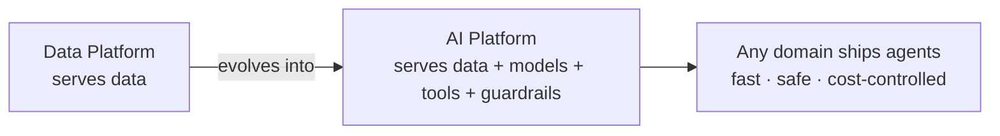

**Transition:** "Why does this need to happen now? Because without it, every team is quietly building its own AI stack."

---

## Slide 2: Why now

*Path: Core · Time: 2 min*

**Action title:** Without a shared platform, every team rebuilds the AI stack and multiplies cost and risk

**Contents:**
- **Duplication:** each team picks its own models, frameworks, prompt handling, and tracing, or none at all.
- **Unbounded spend:** agents loop, and every tool call and retry is billed per token by external APIs.
- **Data leakage risk:** sensitive data flows to external endpoints without classification or control.
- **Governance gaps:** prompts hard-coded in code, no traces, no audit trail of what an agent did and why.
- **Client reality:** on-prem is mandated, and *the minimum infrastructure does not exist yet*. We have to supply the blueprint, including hardware.
- Bottom line on the slide: *"The cost of doing nothing is paid in duplication, incidents, and invoices."*

**Visual:** A side-by-side comparison of "today" (fragmented) and "target" (shared platform).

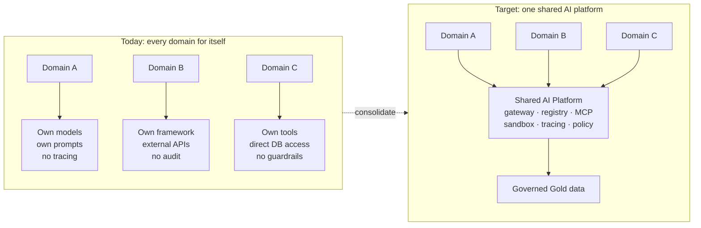

**Transition:** "If we build it once, it has to follow a small set of non-negotiable principles."

---

## Slide 3: Design principles

*Path: Core · Time: 2 min*

**Action title:** Seven principles decide every architectural choice that follows

**Contents:**
1. **Local-first models:** local by default, cloud by exception.
2. **Gold-only by default:** agents read curated data. Silver comes later, and Bronze never.
3. **Policy parity:** users, APIs, and agents are governed by the same policies.
4. **Prompts are data, not code:** they are versioned, approved, and stored outside agent code.
5. **Human-in-the-loop for critical writes:** multi-step approval, with no exceptions.
6. **Open standards and hexagonal design:** every component sits behind a port, so we can swap adapters instead of rewriting.
7. **Observe everything:** every model call, tool call, and decision is traced.
- Footer: *"Each following slide references the principle it implements."*

**Visual:** A mindmap of the seven principles. On the slide, give each one an icon and a number that later slides reuse as a badge.

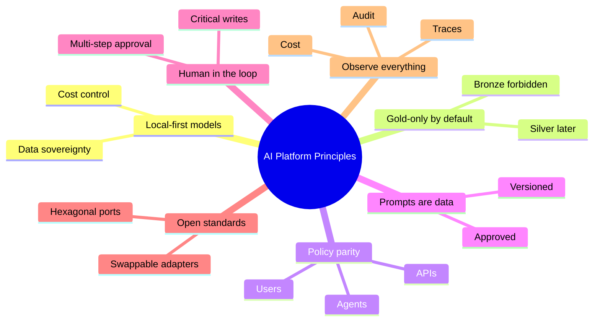

**Transition:** "Here is what those principles look like when you turn them into an architecture."

---

## Slide 4: Reference architecture

*Path: Core · Time: 3 min · **Anchor slide** (return to it, highlighting the relevant layer, before each deep dive)*

**Action title:** One layered platform: governed data at the bottom, agents at the top, policy across everything

**Contents:**
- **Infrastructure:** Kubernetes on-prem, the same cluster estate as the data layer, including GPU nodes.
- **Data layer:** an Iceberg lakehouse with Bronze, Silver, and Gold layers, and OpenMetadata as the catalog, lineage, and classification service.
- **AI platform services:** LiteLLM model gateway, local inference (vLLM), the prompt, configuration, and skills registry, the MCP layer, agent sandboxes, and Langfuse.
- **Agent layer:** ADK agents that collaborate through A2A.
- **Cross-cutting:** identity (OIDC), a policy decision point, HITL approvals, and audit.
- Callout: *"Every box is replaceable. The arrows are standards."*

**Visual:** A layered architecture diagram. On the slide, put the tool logos inside the boxes (Kubernetes, Apache Iceberg, OpenMetadata, LiteLLM, vLLM, Langfuse, Google ADK, MCP, A2A).

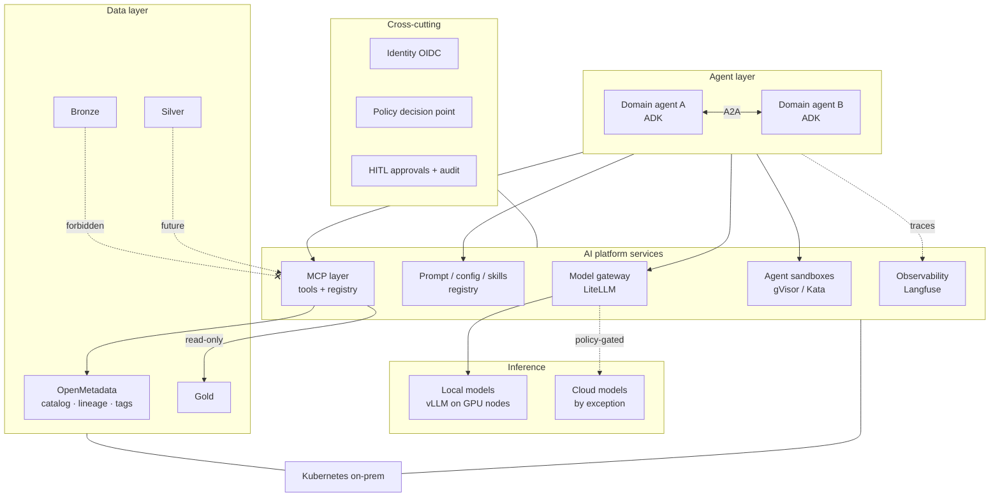

**Transition:** "Let's start at the foundation: which data agents can touch, and how we enforce it."

---

## Slide 5: The data contract for AI

*Path: Core · Time: 2 min · Principles: #2, #3*

**Action title:** Agents read Gold only, enforced by the data plane, not by a prompt

**Contents:**
- **Storage:** an on-prem Iceberg lakehouse with a medallion design, with each layer in its own catalog namespace.
- **Access rule:** agents are granted read-only on Gold. Silver is planned for later, and Bronze is forbidden.
- **Three enforcement points** (defense in depth):
  1. **Catalog:** RBAC on namespaces, with agent principals granted read-only on Gold.
  2. **Query engine:** row and column policies and masking, driven by OpenMetadata classifications.
  3. **Network:** Bronze storage is unreachable from the AI namespace.
- **OpenMetadata as the agents' map:** search, lineage, glossary, and PII tags, exposed through its embedded MCP server with a **read-only role** for agents.
- **Classification feeds routing:** data tagged as sensitive can never be sent to a cloud model (see slide 6).
- Key line: *"Opening Silver later is a policy change, not a code change."*
- **Open decision:** the criteria for opening Silver to agents (quality SLAs, classification coverage, domain owner sign-off).

**Visual:** An access-path diagram showing the three enforcement points, with Bronze visibly blocked.

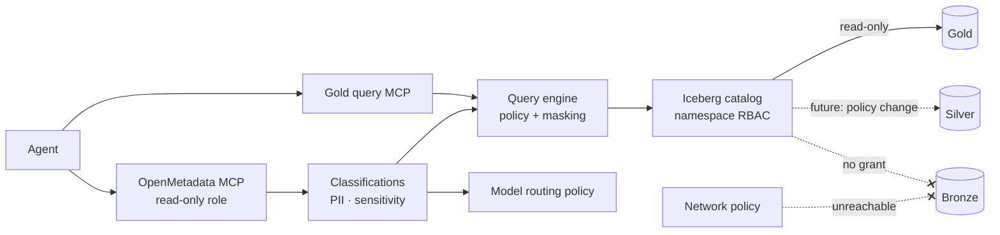

**Transition:**
- *Core:* "With governed data in place, the next question is which models reason over it, and where they run."

---

## Slide 6: Model access and local-first routing

*Path: Core · Time: 2 min · Principles: #1, #6*

**Action title:** One gateway, local by default: cloud models are an exception the policy must allow

**Contents:**
- **LiteLLM as the single endpoint:** OpenAI-compatible, so any framework or agent talks to one API.
- **Local inference:** vLLM serving open-weight models on GPU nodes in Kubernetes.
- **Model catalog by role:** a small router or classifier model, a workhorse reasoning model, and specialist models (embeddings, coding).
- **Routing policy:**
  - Default: local model.
  - Escalate to cloud *only if* the data classification allows it **and** the task class requires it.
  - Sensitive data: never to the cloud, enforced at the gateway, not in the agent.
  - Fallbacks: another local replica first, then cloud if policy allows.
- **Virtual keys per domain and agent:** budgets, rate limits, and cost attribution (the basis for chargeback).
- **Open decision:** the cloud escalation policy, meaning which data classes and task classes may ever leave on-prem.

**Visual:** A routing decision flow inside the gateway.

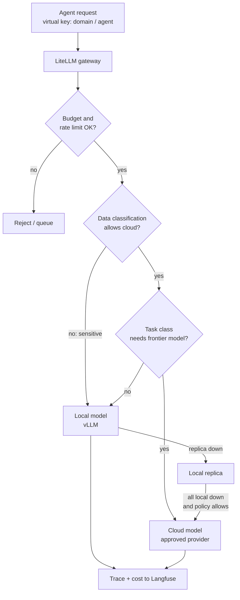

**Transition:**
- *Core:* "Local-first only works if the hardware exists, and at our clients it doesn't yet."
- *Extended (to E1):* "Models are one building block. How do we build the agents that use them?"

---

## Slide 7: Hardware reality, with 2026 tiers and costs

*Path: Core · Time: 3 min · Principle: #1 · Support document: `hardware-tiers-support.md`*

**Action title:** Local-first needs real hardware: start with a USD 50–60K pilot, and size by context length, not model size

**Contents:**
- **Key sizing insight:** agents carry long contexts, and the KV cache eats GPU memory, so **context length drives concurrency**. GitLab's reference deployment of gpt-oss-120b gets about 10 concurrent requests at 32K context on 1× H100 80 GB, and about 51 at 128K on 4× H100.
- **Three tiers** (September 2026, USD, excluding duties and taxes; server costs are estimates):

  | Tier | Configuration | Approx. capex | Enables |
  |---|---|---|---|
  | A. Pilot | 2× RTX PRO 6000 Server Edition (192 GB) | ~$50–60K | One workhorse model and a small model; ~10–20 long-context sessions; no HA |
  | B. Production start | 4× RTX PRO 6000 (384 GB) **or** 2–4× H200 NVL | ~$90–110K / ~$95–175K | Replicas, specialists, a ~300B MoE at 4-bit |
  | C. Scale | 8× H200 HGX | ~$320–420K | Frontier-class open-weight models, high concurrency |

- **Market warning:** the RTX PRO 6000 went from a $8,565 launch price (March 2025) to $16,000 (August 2026) because of memory shortages, so quotes have short validity windows.
- **Three caveats:** production needs N+1 for high availability (double the node count); non-production needs at least one GPU node; each GPU draws up to about 600 W (power and cooling).

**Visual 1:** A line chart of RTX PRO 6000 list price history (NVIDIA Marketplace, USD).

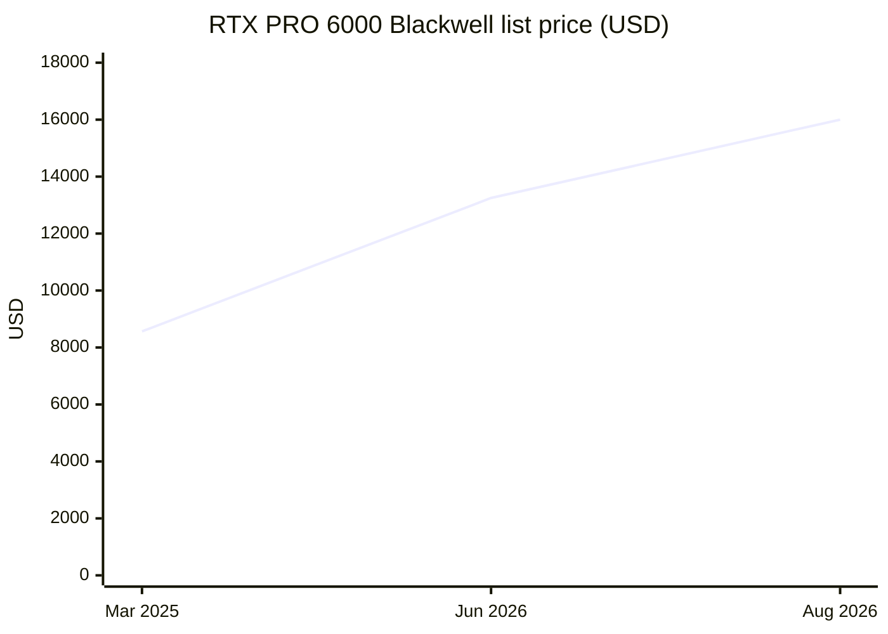

**Visual 2:** A tier ladder showing what each step unlocks.

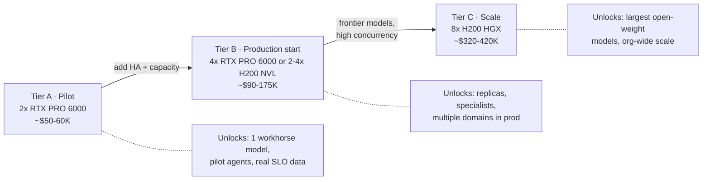

**Transition:**
- *Core:* "Hardware is the decision that is expensive to reverse. Everything else must be safe to experiment with, starting with how we keep agents in check."
- *Extended (to E6):* "Is buying actually cheaper than renting? That depends on one number: utilization."

---

## Slide 8: Safety model

*Path: Core · Time: 2 min · Principles: #3, #5*

**Action title:** Agents get no special powers: same policies as users, human approval for critical writes, isolated execution

**Contents:**
- **Agents as first-class identities:** each agent has its own principal and acts **on behalf of** a user through OAuth 2.0 token exchange.
- **One policy decision point** evaluates users, APIs, and agents identically.
- **Action risk tiers:**

  | Tier | Example | Control |
  |---|---|---|
  | Read | Query Gold, search metadata | Automatic, logged |
  | Non-critical write | Draft a report, create a ticket | Single approval |
  | Critical write | Update or delete business data | Dry run and diff, then multiple approvers, then a short-lived scoped credential |

- **Isolated execution:** code and tools run in sandboxes, ephemeral with no egress by default (see E4).
- **Immutable audit trail** for every proposed, approved, rejected, and executed action.
- **Open decision:** the HITL approval tiers, meaning who approves which action classes and with how many approvers.

**Visual:** A sequence diagram of the multi-step HITL flow for a critical write.

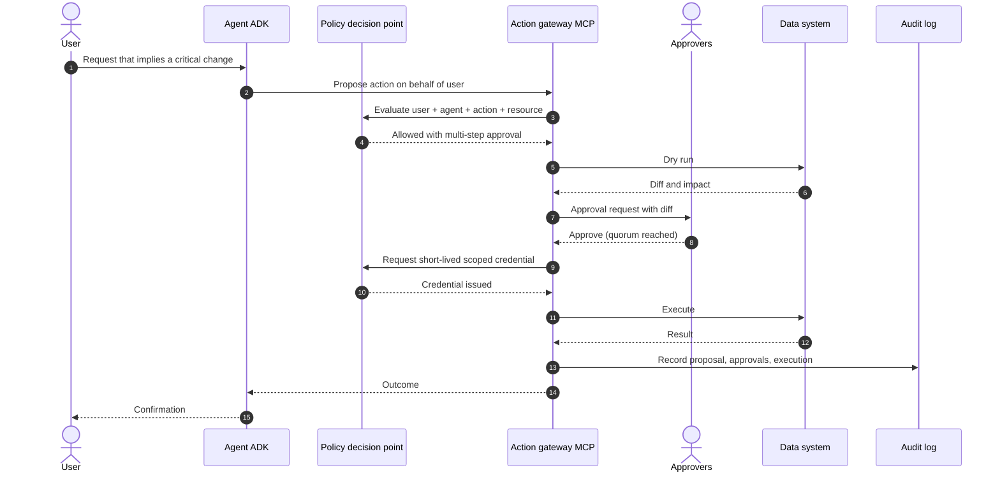

**Transition:**
- *Core:* "One question remains: does any of this survive the move to hybrid and cloud?"
- *Extended (to E4):* "Isolation deserves a closer look, because on-prem constraints decide the technology."

---

## Slide 9: Portability roadmap

*Path: Core · Time: 1.5 min · Principle: #6*

**Action title:** Hexagonal by design: on-prem today, hybrid next, cloud-agnostic later, with adapters swapped rather than rewritten

**Contents:**
- **Ports (open standards) and today's adapters:**

  | Port | Standard | Adapter today (on-prem) | Future adapters |
  |---|---|---|---|
  | Inference | OpenAI-compatible API | LiteLLM + vLLM | Cloud providers through the same gateway |
  | Table format | Apache Iceberg + REST catalog | On-prem object storage | Any S3-compatible or cloud storage |
  | Metadata | OpenMetadata API / MCP | Self-hosted | Same, anywhere |
  | Tools | MCP | Internal MCP servers | Same |
  | Agent-to-agent | A2A | ADK agents | Any A2A-compliant agent |
  | Telemetry | OpenTelemetry | Langfuse self-hosted | Any OTel backend |
  | Identity | OIDC / OAuth 2.0 | Corporate IdP | Federated IdPs |
  | Isolation | Kubernetes RuntimeClass | gVisor / Kata | Managed sandbox offerings |
  | Workloads | Kubernetes | On-prem clusters | Any conformant Kubernetes |

- **Phases:** 1. On-prem. 2. Hybrid (cloud burst inference, DR). 3. Cloud-agnostic (any Kubernetes, any object store).

**Visual 1:** A hexagonal view with the core in the middle, ports around it, and on-prem and cloud adapters outside.

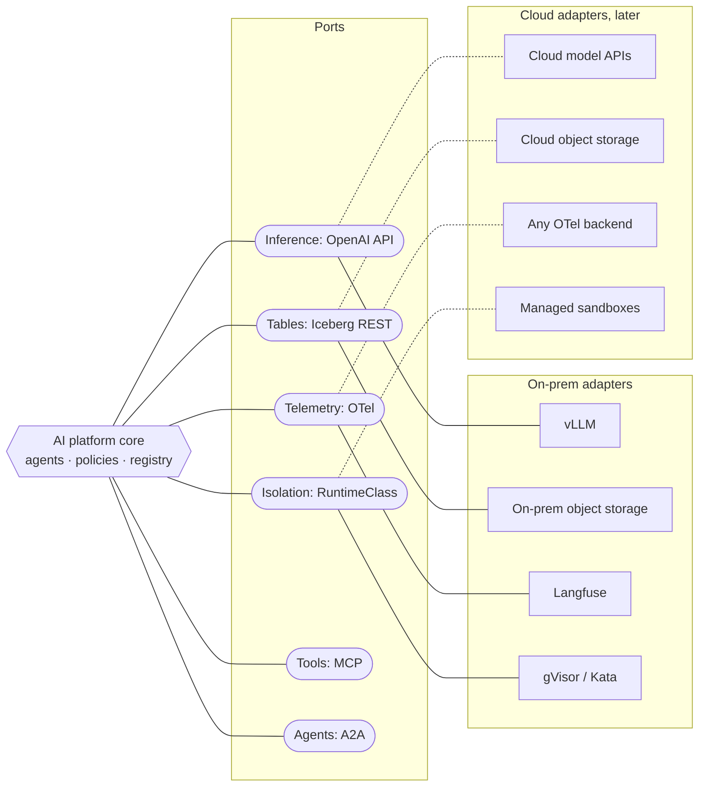

**Visual 2:** A phase timeline.

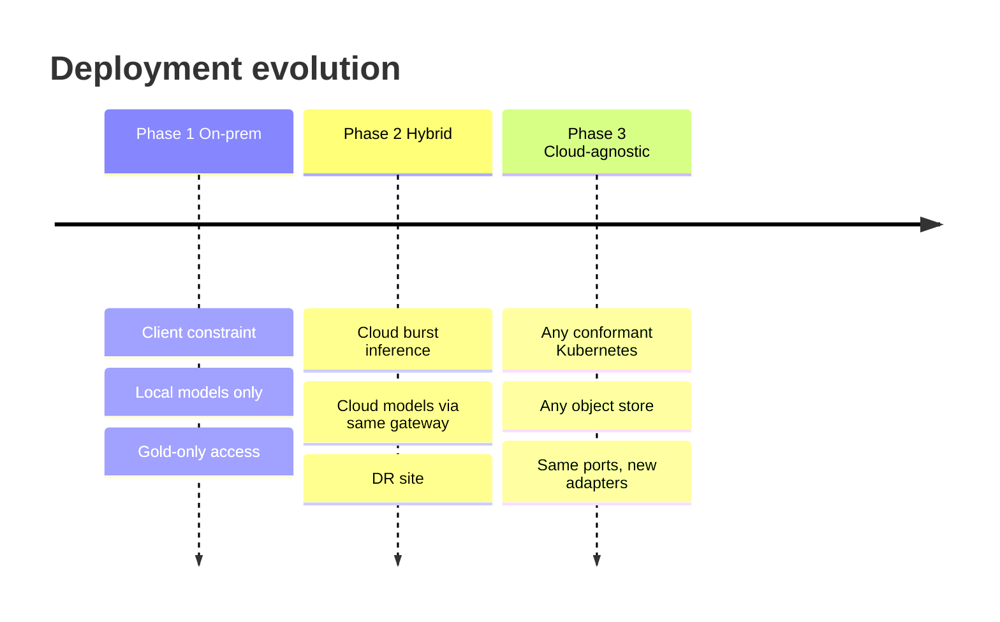

**Transition:** "That leaves a short list of decisions we should make together, starting today."

---

## Slide 10: Open decisions for discussion

*Path: Core · Time: 1.5 min plus discussion*

**Action title:** Eight decisions to make together: two are one-way doors, the rest are safe to iterate

**Contents:**

| # | Decision | Options | Door type | Proposed owner |
|---|---|---|---|---|
| 1 | Starting tier and GPU family | RTX PRO 6000 vs H200 | One-way (capex) | Infra + Finance |
| 2 | Default local models and license policy | Apache/MIT only vs bespoke licenses allowed | Two-way | Architecture + Legal |
| 3 | Cloud escalation policy | Which data and task classes may leave on-prem | One-way (compliance) | Security + Data governance |
| 4 | Default sandbox runtime | gVisor vs Kata (depends on node virtualization) | Two-way | Platform |
| 5 | Registry implementation | Git-backed vs DB service | Two-way | Platform |
| 6 | HITL approval tiers | Action classes, approvers, quorum | Two-way | Security + Domains |
| 7 | Criteria for opening Silver | Quality SLAs, classification coverage | Two-way | Data governance |
| 8 | Chargeback model | Per token, per GPU-hour, flat per domain | Two-way | Finance + Platform |

- Call to action: *"Agree on owners and dates for #1 and #3 before we leave the retreat."*

**Visual:** A quadrant chart of impact vs. reversibility. The placements are a starting proposal for the group to move during discussion.

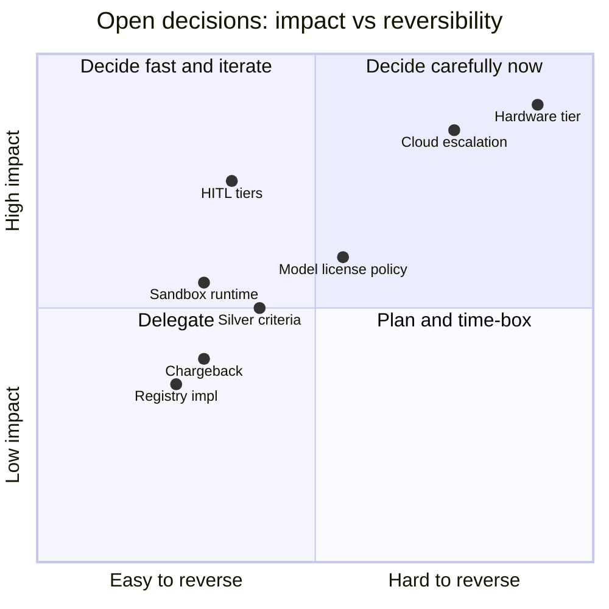

**Transition:** "Questions and discussion. The appendix has the hardware bill of materials, model fit, sandbox matrix, and risk register if we need them."

---

# Extended modules

---

## E1: Agent standard, ADK and A2A

*Path: Extended · Time: 2 min · Insert after slide 6 · Principles: #4, #6*

**Action title:** We standardize on ADK because A2A is native, and the contracts keep the choice reversible

**Contents:**
- **Why ADK:** native A2A for agent-to-agent collaboration across domains, MCP tool support, and callback hooks where the platform intercepts tool calls (HITL, policy).
- **Anatomy of a platform agent:**
  - thin code (orchestration logic only);
  - prompts and configuration **resolved from the registry** at runtime, never stored in code;
  - tools **only through MCP**;
  - models **only through LiteLLM**;
  - execution **inside sandboxes** when it runs code;
  - traces **always emitted** to Langfuse.
- **Reversibility:** because the contracts (OpenAI API, MCP, A2A, OTel) are framework-agnostic, LangChain/LangGraph could be reintroduced later without platform changes.
- **Open decision:** whether non-ADK frameworks are allowed as an exception, and under what conditions.

**Visual:** Agent anatomy, with A2A between two domain agents. Show the ADK, MCP, and A2A logos on the slide.

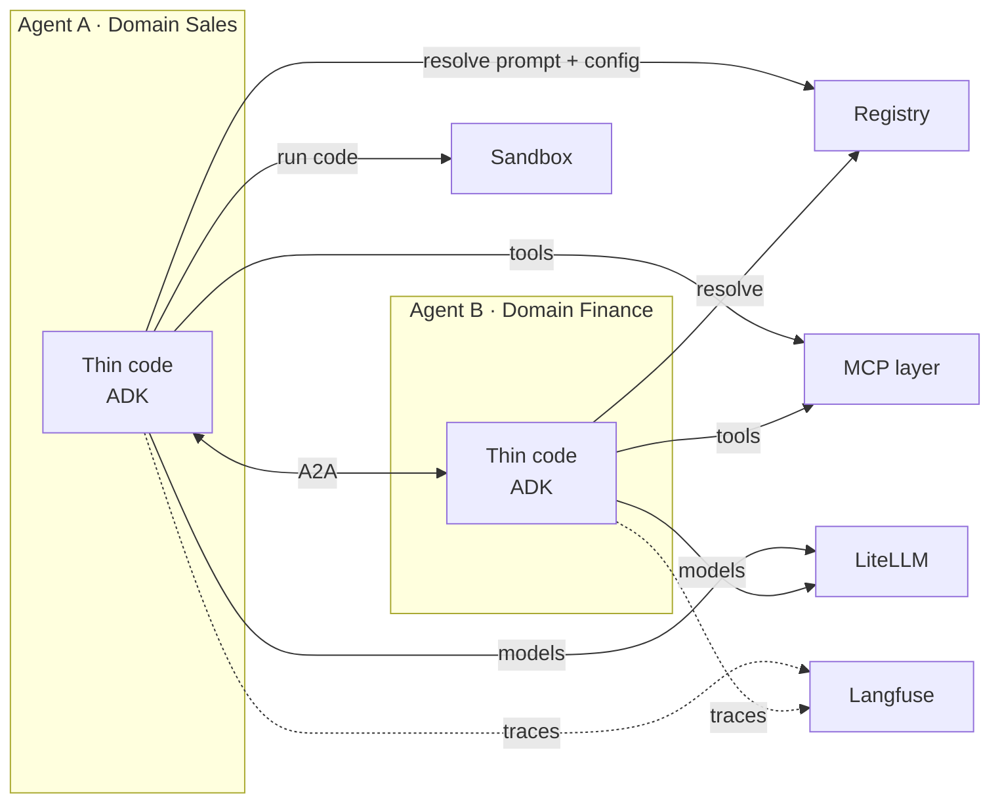

**Transition:** "Agents don't carry their prompts. So where do the prompts live?"

---

## E2: Prompt, configuration, and skills registry

*Path: Extended · Time: 2 min · Principle: #4*

**Action title:** Prompts, agent configs, and skills are governed artifacts, and the registry is their single source of truth

**Contents:**
- **Artifact types:** system prompt templates, user prompt templates, agent YAML definitions, skills.
- **Properties:** immutable versions, environment labels (dev, staging, prod), an approval workflow with four-eyes review for prod, audit, and one-step rollback.
- **Runtime behavior:** agents resolve artifacts by name and label, cache them, and **record the version ID in every trace**.
- **Separation of concerns:** Langfuse *observes* (traces), while the registry *governs* (source of truth). This avoids two competing prompt stores.
- **Open decision:** a Git-backed implementation (PR-based approvals) or a database-backed service (UI and API-based approvals).

**Visual 1:** The artifact lifecycle.

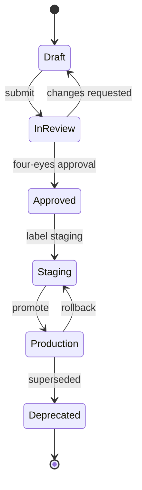

**Visual 2:** Runtime resolution and the link from trace to version.

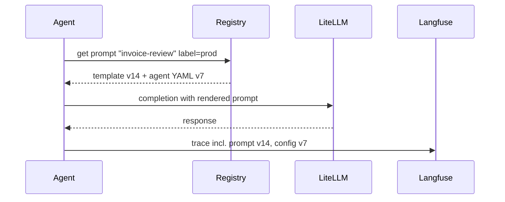

**Transition:** "Prompts tell agents how to think. Tools let them act, and those tools must be reusable too."

---

## E3: Tools layer, internal MCP

*Path: Extended · Time: 2 min · Principles: #2, #3, #5*

**Action title:** Capabilities are built once as MCP servers and reused by every agent, behind one gateway

**Contents:**
- **Three kinds of MCP servers:**
  1. **Adopted:** OpenMetadata's embedded MCP server (metadata search, lineage, glossary), with an agent role restricted to read-only.
  2. **Platform-built:** a Gold query MCP (read-only SQL through the policy-enforcing query engine, with row limits and query cost guards).
  3. **Domain-owned:** domain actions and data products, published by each domain team.
- **MCP gateway and registry:** discovery, OIDC authentication, a policy decision per tool call, rate limits, and audit.
- **Write-capable tools** are tagged as critical and routed through the HITL flow (slide 8).
- **Open decision:** whether to build or adopt the MCP gateway and registry.

**Visual:** The MCP layer topology.

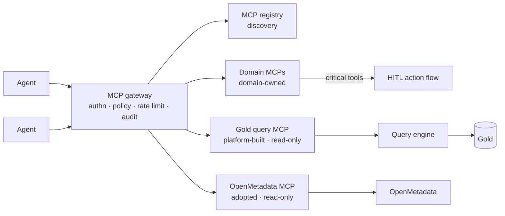

**Transition:** "All of this runs on hardware. Here is what that takes, and what it costs, in 2026."

---

## E4: Sandbox evaluation

*Path: Extended · Time: 2 min · Insert after slide 8 · Principles: #3, #6*

**Action title:** Choose the sandbox port, not the technology: gVisor runs anywhere, and Kata adds VM isolation where KVM exists

**Contents:**
- **The decisive on-prem question:** are the Kubernetes nodes bare metal with KVM, or VMs with nested virtualization enabled?
- **Summary comparison** (full matrix in A3):
  - **gVisor:** user-space kernel, no KVM needed, runs anywhere; overhead on syscall- and I/O-heavy work.
  - **Kata Containers:** VM per pod with its own guest kernel; needs KVM; stronger boundary and better on I/O-heavy work.
  - **Firecracker:** microVM with fast boot, but not a Kubernetes runtime by itself; use it through Kata rather than directly.
- **Recommendation:** Kubernetes **Agent Sandbox** (SIG Apps) as the orchestrator, with isolation selected through **RuntimeClass**:
  - default tier: gVisor;
  - high-risk tier: Kata, optionally with the Firecracker VMM;
  - pre-warmed pools for fast allocation.
- **Maturity risk:** Agent Sandbox is pre-1.0 (v0.5.x as of September 2026).
- Sandbox defaults: ephemeral, **no network egress by default**, resource quotas, no host mounts.
- **Open decision:** the default runtime per client environment.

**Visual:** A decision tree for choosing the runtime.

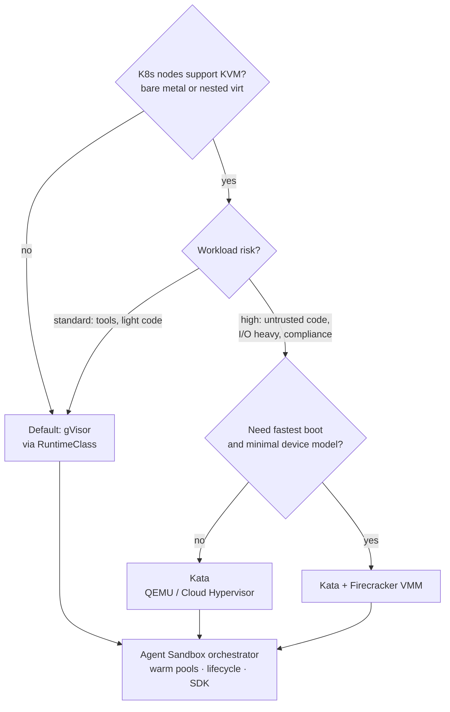

**Transition:** "Once agents run, we need to see what they do, and what it costs."

---

## E5: Observability with Langfuse

*Path: Extended · Time: 1.5 min · Principle: #7*

**Action title:** Every model call, tool call, and decision is traced, so cost and quality are visible per domain and per agent

**Contents:**
- **Langfuse, self-hosted:** traces, spans per tool call, token usage and cost (fed by LiteLLM), and the prompt and config version per trace.
- **Evaluations:** datasets, LLM-as-judge scoring, and user feedback, feeding a regression check before prompt promotion (links to E2).
- **OpenTelemetry as the port:** agents emit OTel, so the backend is swappable.
- **Why not LangSmith at scale:** its pricing grows with trace volume, while self-hosting keeps data on-prem and cost predictable.
- **Trace hygiene:** PII masking before storage, and retention by data classification.
- **Open decision:** the trace retention and PII masking policy.

**Visual:** The telemetry flow and what it produces.

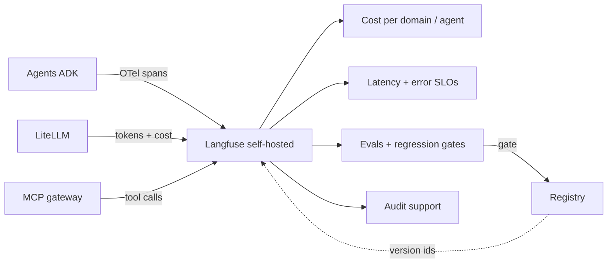

**Transition:** "Everything so far runs on-prem. Now let's show it isn't locked there."

---

## E6: Economics, buy vs. rent

*Path: Extended · Time: 2 min · Insert after slide 7 · Principle: #1*

**Action title:** Owning GPUs pays off only at high utilization, and a shared multi-domain platform is what keeps them busy

**Contents:**
- **Hardware-only break-even:** *months = purchase price ÷ (rental $/h × 730 h × utilization)*.
  - H200: about $35K purchase vs. $3.49/h rental gives about 14 months at 100% utilization.
  - RTX PRO 6000: about $16K vs. about $2/h gives about 11 months at 100% utilization.
- **Utilization is the lever:** at 30% utilization, break-even takes about 3.3× longer.
- **TCO beyond hardware:** power and cooling, rack space, support contracts, operations staff, and a refresh cycle.
- **Multi-domain effect:** pooling many domains' agent workloads flattens demand peaks and raises average utilization.
- **Open decision:** the chargeback model per domain.

**Visual:** A break-even line chart, *illustrative and hardware-only*, derived from the formula above. On the slide, label the upper line H200 and the lower line RTX PRO 6000.

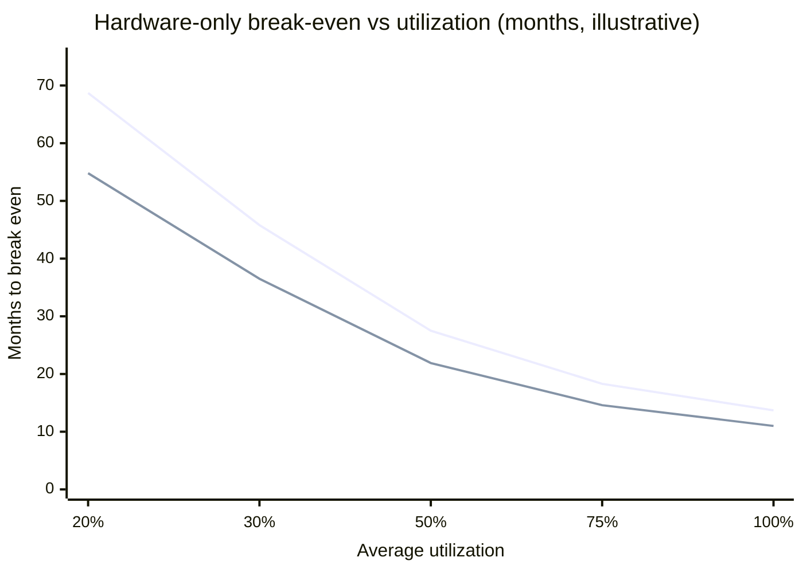

**Transition:** "Economics decides whether we can afford it. Safety decides whether we're allowed to run it."

---

# Appendix

---

## A1: Hardware bill of materials per tier

*Path: Appendix · Details in `hardware-tiers-support.md`*

**Action title:** Three tiers with an explicit bill of materials, plus HA and non-production on top

**Contents:**
- For each tier: GPUs, server platform (CPUs, RAM, NVMe), networking, estimated capex, what it enables, and its limits.
- **Minimum viable production:** 2 inference nodes (N+1) plus 1 non-production GPU node.
- Facilities per node: power (GPU count × ~600 W + ~1 kW platform), cooling, rack units.
- Every line marked **"quote with OEM"** where it is an estimate.

**Visual:** A rack and topology sketch for minimum viable production.

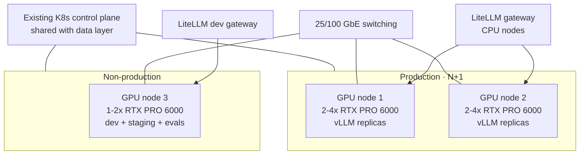

**Transition:** "Which models fit on which tier?"

---

## A2: Model-to-hardware fit matrix

*Path: Appendix*

**Action title:** Model choice follows the hardware tier, and licenses matter as much as benchmarks

**Contents:**

| Model class | Example (2026) | Size / active | License | Fits on | Role |
|---|---|---|---|---|---|
| Small reasoning | gpt-oss-20b | 21B / 3.6B active | Apache 2.0 | Any tier (≤16 GB) | Router, classifier, summarizer |
| Workhorse | gpt-oss-120b | 117B / 5.1B active, MXFP4 | Apache 2.0 | Tier A (1 GPU ≥80 GB) | Default agent reasoning |
| Mid MoE | DeepSeek-V4-Flash class | ~300B total | Check per model | Tier B (4-bit) | Harder agentic and coding tasks |
| Frontier open-weight | GLM-5.x, Kimi, DeepSeek V4 Pro | 1T+ total | Some bespoke or revenue-gated | Tier C or beyond | Only if justified |

- Note: benchmarks move monthly, so re-validate the shortlist with our own evals before deciding.

**Visual:** A model selection flow.

```mermaid
flowchart TD
    S["New agent use case"] --> L{"License policy<br/>allows model?"}
    L -->|no| X["Exclude"]
    L -->|yes| T{"Task complexity"}
    T -->|routing / extraction| M1["Small model<br/>gpt-oss-20b class"]
    T -->|standard agent reasoning| M2["Workhorse<br/>gpt-oss-120b class"]
    T -->|hard multi-step / coding| M3["Mid MoE<br/>~300B class, Tier B"]
    T -->|frontier-only| M4{"Tier C available?"}
    M4 -->|yes| M5["Frontier open-weight"]
    M4 -->|no| M6["Cloud escalation<br/>if policy allows"]
    M1 & M2 & M3 & M5 --> E["Validate with own eval set in Langfuse"]
```

**Transition:** "And for isolation, here is the full comparison behind E4."

---

## A3: Sandbox full comparison matrix

*Path: Appendix*

**Action title:** gVisor, Kata, and Firecracker compared on the criteria that matter on-prem

**Contents:**

| Criterion | gVisor | Kata Containers | Firecracker (direct) |
|---|---|---|---|
| Isolation model | User-space kernel intercepting syscalls | Lightweight VM per pod, guest kernel | MicroVM, minimal device model |
| Needs KVM / nested virtualization | No | Yes | Yes |
| Kubernetes integration | OCI runtime via RuntimeClass | OCI runtime via RuntimeClass | Needs Kata or custom orchestration |
| Syscall compatibility | Partial (some gaps) | Full (real kernel) | Full (real kernel) |
| I/O-heavy performance | Weaker | Stronger | Strong |
| Memory overhead per sandbox | Low | Medium | Low–medium |
| Boot time | Fast | Medium | Very fast |
| Operational effort | Low | Medium (guest kernel and images) | High |
| Portability on-prem → cloud | Highest | High where KVM exists | Lowest standalone |
| Agent Sandbox support | Yes | Yes (incl. Firecracker VMM example) | Via Kata |

**Visual:** The comparison table with logos in the header row. No chart is needed; color the cells (green / amber / red) on the slide.

**Transition:** "Here is every component we have named, with its license."

---

## A4: Component and license inventory

*Path: Appendix*

**Action title:** Every component is open source with a permissive core license; verify enterprise features at procurement

**Contents:**

| Layer | Component | Role | License (core; verify) |
|---|---|---|---|
| Infra | Kubernetes | Orchestration | Apache 2.0 |
| Data | Apache Iceberg | Table format | Apache 2.0 |
| Data | OpenMetadata | Catalog, lineage, MCP | Apache 2.0 |
| AI | LiteLLM | Model gateway | MIT core; enterprise features separately licensed |
| AI | vLLM | Inference server | Apache 2.0 |
| AI | Langfuse | Tracing and evals | MIT core; enterprise features separately licensed |
| AI | Google ADK | Agent framework | Apache 2.0 |
| AI | A2A | Agent-to-agent protocol | Apache 2.0 |
| AI | MCP | Tool protocol | Open specification |
| Isolation | Agent Sandbox | Sandbox orchestrator | Apache 2.0 |
| Isolation | gVisor / Kata / Firecracker | Runtimes | Apache 2.0 |
| Policy | e.g. OPA | Policy decision point | Apache 2.0 |
| Models | gpt-oss family | Local models | Apache 2.0 |

**Visual:** The table with logos. Optionally, a mindmap grouping by layer.

```mermaid
mindmap
  root((Stack))
    Infrastructure
      Kubernetes
    Data
      Iceberg
      OpenMetadata
    AI services
      LiteLLM
      vLLM
      Langfuse
      Registry
    Agents
      ADK
      A2A
      MCP
    Isolation
      Agent Sandbox
      gVisor
      Kata
    Policy
      OPA or equivalent
      OIDC IdP
```

**Transition:** "For newcomers, a one-slide glossary of the standards we rely on."

---

## A5: Standards glossary

*Path: Appendix*

**Action title:** Six open standards are the ports that make the platform portable

**Contents:**

| Standard | What it is | Why it matters here |
|---|---|---|
| OpenAI-compatible API | De facto chat and completions interface | One inference contract for local and cloud models |
| Apache Iceberg + REST catalog | Open table format and catalog API | Engine- and cloud-independent data |
| MCP (Model Context Protocol) | Protocol for exposing tools and data to agents | Build once, reuse by every agent |
| A2A (Agent2Agent) | Protocol for agent-to-agent collaboration | Cross-domain agent workflows |
| OpenTelemetry | Vendor-neutral telemetry standard | Swappable observability backend |
| OIDC / OAuth 2.0 token exchange | Identity and delegation | Agents acting on behalf of users |
| Kubernetes RuntimeClass | Pluggable container runtime selection | Swappable sandbox isolation |

**Visual:** The table only, with standard logos where they exist.

**Transition:** "What could go wrong? Here is the risk register."

---

## A6: Risk register

*Path: Appendix*

**Action title:** The top risks are hardware cost volatility and local-model quality, and both have mitigations

**Contents:**

| Risk | Likelihood | Impact | Mitigation |
|---|---|---|---|
| GPU price volatility / lead times | High | High | Short-validity quotes, phased tiers, rental bridge |
| Local model quality insufficient for some agents | Medium | High | Own eval sets, policy-gated cloud escalation, Tier B upgrade path |
| Agent Sandbox pre-1.0 maturity | Medium | Medium | Hide behind the RuntimeClass port; fallback to plain RuntimeClass pods |
| Prompt injection through data or tools | Medium | High | Read-only Gold, HITL writes, sandbox no-egress, tool allow-lists |
| Low GPU utilization | Medium | Medium | Multi-domain onboarding plan, chargeback incentives |
| Skills gap (GPU ops, vLLM tuning) | High | Medium | Enablement plan, vendor support contracts |
| Nested virtualization unavailable | High | Low | gVisor default works without KVM |

**Visual:** A likelihood-vs-impact quadrant chart.

```mermaid
quadrantChart
    title Risk map
    x-axis Low likelihood --> High likelihood
    y-axis Low impact --> High impact
    quadrant-1 Act now
    quadrant-2 Monitor closely
    quadrant-3 Accept
    quadrant-4 Mitigate cheaply
    GPU price volatility: [0.85, 0.85]
    Local model quality: [0.55, 0.8]
    Prompt injection: [0.5, 0.75]
    Sandbox maturity: [0.5, 0.5]
    Low utilization: [0.55, 0.55]
    Skills gap: [0.8, 0.55]
    No nested virt: [0.8, 0.2]
```

**Transition:** "And if we move forward, this is what the first months could look like."

---

## A7: Illustrative implementation plan

*Path: Appendix*

**Action title:** From pilot to first production domain in about two quarters (illustrative)

**Contents:**
- **Phase 0:** decisions and procurement (hardware tier, policies).
- **Phase 1:** platform foundation (gateway, Langfuse, registry, Gold query MCP).
- **Phase 2:** pilot agents in one domain with HITL and sandboxes.
- **Phase 3:** hardening and a second domain, with HA and chargeback.
- All durations are placeholders to be adjusted by each client.

**Visual:** A Gantt chart, *illustrative*, where the durations are assumptions.

```mermaid
gantt
    title Illustrative rollout
    dateFormat YYYY-MM-DD
    axisFormat %b
    section Phase 0 Decide
    Open decisions + policies      :d1, 2026-11-02, 4w
    Hardware RFQ + procurement     :d2, 2026-11-02, 8w
    section Phase 1 Foundation
    LiteLLM + vLLM + Langfuse      :f1, after d2, 4w
    Registry + Gold query MCP      :f2, after d1, 6w
    Sandbox runtime                :f3, after d2, 3w
    section Phase 2 Pilot
    Pilot agents domain 1          :p1, after f1, 6w
    HITL write flow                :p2, after f2, 4w
    section Phase 3 Harden
    HA + second domain             :h1, after p1, 6w
    Chargeback reporting           :h2, after p1, 4w
```

**Transition:** "The sources behind every number are on the last slide."

---

## A8: References

*Path: Appendix*

**Action title:** Sources for figures and claims (as of September 2026)

**Contents:**
- RTX PRO 6000 pricing: <https://www.thundercompute.com/blog/nvidia-rtx-pro-6000-pricing>, <https://videocardz.com/newz/nvidia-raises-rtx-pro-6000-blackwell-price-to-16000-now-87-above-original-msrp>
- RTX PRO 6000 Server Edition pricing: <https://gpupoet.com/gpu/learn/price/june-2026/nvidia-rtx-pro-6000-blackwell-server>
- H200 pricing and break-even: <https://www.hyperbolic.ai/blog/h200-price>, <https://www.mercatus-ai.com/blog/h200-server-price>
- gpt-oss-120b on vLLM, concurrency vs. context: <https://docs.gitlab.com/administration/gitlab_duo_self_hosted/vllm_gpt_oss_120b/>
- gpt-oss model card: <https://huggingface.co/openai/gpt-oss-20b>
- Open-weight model landscape: <https://pinggy.io/blog/best_open_source_self_hosted_llms_for_coding/>
- Kubernetes Agent Sandbox: <https://github.com/kubernetes-sigs/agent-sandbox>, <https://agent-sandbox.sigs.k8s.io/docs/>
- OpenMetadata MCP: <https://blog.open-metadata.org/introducing-the-model-context-protocol-mcp-in-openmetadata-e757385f4fb2>

**Visual:** None (text only).

**Transition:** End of deck.
