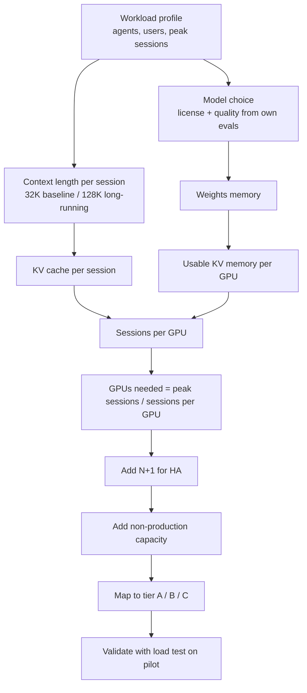
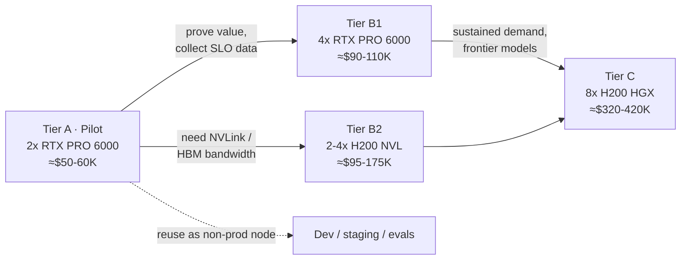
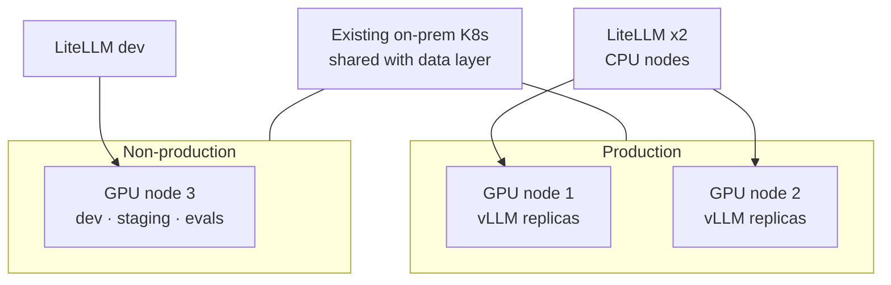

# Hardware Tiers for a Local-First AI Platform — Support Document

**Companion to:** *Applied AI on a Multi-Domain Data Layer* (slides 7, E6, A1, A2)
**Prices as of:** September 2026, in USD, excluding import duties, local taxes, and shipping
**Status:** Planning estimates. Every figure marked *estimate* must be replaced with OEM quotes before any budget request.

---

## 1. Purpose and scope

Clients need a local-first AI platform on-prem but lack the minimum GPU infrastructure. This document gives architects:

1. a repeatable **sizing method** for agent workloads;
2. three **reference hardware tiers** with bills of materials and cost ranges;
3. the **deployment topology** for a minimum viable production setup;
4. **facilities, software, and procurement** considerations;
5. an **RFQ checklist** for OEM conversations.

**Out of scope:** the Kubernetes control plane, storage for the lakehouse, and the data layer. These already exist, because the data layer runs on the same on-prem Kubernetes estate.

---

## 2. Assumptions

- Kubernetes is available on-prem and GPU nodes join the existing cluster estate.
- Inference is served with vLLM (or an equivalent OpenAI-compatible server) behind LiteLLM.
- The default workhorse model is in the **gpt-oss-120b class**: 117B total parameters, 5.1B active, MXFP4 weights, fitting on a single 80 GB GPU.
- Agent sessions use **32K tokens of context** as the planning baseline, with up to 128K for long-running agents.
- Prices are volatile (see section 10). Treat every number as having a validity window of weeks, not months.

---

## 3. Sizing method

### 3.1 The key insight

For agents, **context length drives concurrency more than model size does.** Every active session holds its context in the GPU's KV cache. Long agent contexts (history, tool results, retrieved data) consume memory that would otherwise serve more sessions.

Reference data point: GitLab's vLLM deployment guide for gpt-oss-120b estimates about **36 KB of KV cache per token**. It shows about **10 concurrent requests at 32K context on 1× H100 80 GB**, and about **51 concurrent requests at 128K context on 4× H100 80 GB**.

### 3.2 Formulas

```text
Weights memory (GB)      ≈ total_params × bytes_per_param
                           (MXFP4 ≈ 0.5 byte/param; FP8 = 1; BF16 = 2)

KV cache per token       = 2 × layers × kv_heads × head_dim × bytes_per_element
                           (or take the model's published figure, e.g. ~36 KB/token for gpt-oss-120b)

KV cache per session     = KV_per_token × context_tokens

Usable KV memory per GPU ≈ GPU_memory × gpu_memory_utilization (≈0.90) − weights − runtime overhead

Concurrent sessions      ≈ usable KV memory ÷ KV cache per session
```

### 3.3 Worked example (rough estimate)

gpt-oss-120b on **1× RTX PRO 6000 (96 GB)**:

| Item | Value |
|---|---|
| Usable GPU memory (0.90 × 96 GB) | ~86 GB |
| Model weights (MXFP4) | ~60–65 GB |
| Remaining for KV cache (after overhead) | ~18–22 GB |
| KV per 32K-token session (36 KB × 32,768) | ~1.2 GB |
| **Concurrent 32K sessions** | **~15–18** |
| KV per 128K-token session | ~4.7 GB |
| **Concurrent 128K sessions** | **~4** |

This is consistent with the GitLab H100 figure (~10 sessions at 32K on 80 GB). Validate it with a load test on the pilot (tier A) before sizing production.

### 3.4 Sizing flow



---

## 4. Model candidates and fit

| Model class | Example | Size | License | Memory need | Tier |
|---|---|---|---|---|---|
| Small reasoning | gpt-oss-20b | 21B / 3.6B active | Apache 2.0 | ≤16 GB | Any |
| Workhorse | gpt-oss-120b | 117B / 5.1B active | Apache 2.0 | 1× GPU ≥80 GB | A+ |
| Mid MoE | DeepSeek-V4-Flash class | ~300B total | Verify per model | ~150 GB+ at 4-bit, plus KV | B |
| Frontier open-weight | GLM-5.x, Kimi, DeepSeek V4 Pro | 1T+ total | Some bespoke or revenue-gated | Multi-GPU node(s) | C+ |

**Rules:**

- Start with permissively licensed models (Apache 2.0 or MIT). Bespoke or revenue-gated licenses need Legal review, which is open decision #2.
- Benchmarks change monthly. The final choice must come from **our own eval set** run in Langfuse, not from public leaderboards.

---

## 5. Reference tiers

### Tier A — Pilot

**Goal:** prove the platform end to end, run pilot agents, and collect real latency and SLO data.

| Line item | Specification | Est. cost (USD) |
|---|---|---|
| GPUs | 2× RTX PRO 6000 Blackwell **Server Edition**, 96 GB each (192 GB total) | $26–32K (Server Edition lowest average about $13.1K in June 2026, up ~8% since; NVIDIA list for the Workstation Edition is $16K) |
| Server platform | 2U/4U GPU-ready chassis, 2× server CPUs, 512 GB–1 TB RAM, 2–4× NVMe | $20–30K *estimate* (RAM prices are elevated in 2026) |
| Networking | 2× 25 GbE (or 100 GbE if the cluster fabric requires it) | Included / existing |
| **Total** | | **≈ $50–60K** |

- **Runs:** gpt-oss-120b on GPU 1; a small model, embeddings, and a reranker on GPU 2.
- **Capacity:** about 15–18 concurrent 32K sessions on the workhorse model (section 3.3).
- **Limits:** no high availability, one workhorse model, no room for a ~300B model.

### Tier B — Production start

**Goal:** first production domains, with model replicas and specialists.

| Option | Specification | Est. cost (USD) |
|---|---|---|
| **B1: RTX PRO** | 4× RTX PRO 6000 Server Edition (384 GB) + server platform | GPUs $52–64K + platform $30–40K *estimate* ≈ **$90–110K** |
| **B2: H200 NVL** | 2–4× H200 NVL 141 GB (282–564 GB) + server platform | GPUs $64–134K (retail $32–33.5K each) + platform $30–40K *estimate* ≈ **$95–175K** |

- **B1 vs B2:** B1 is cheaper per GB of VRAM, but the RTX PRO 6000 has no NVLink. B2 offers HBM3e bandwidth and NVLink bridging for better multi-GPU (tensor-parallel) performance.
- **Runs:** 2–3 workhorse replicas plus specialists, **or** a ~300B MoE at 4-bit with room for KV cache.

### Tier C — Scale

**Goal:** frontier-class open-weight models and organization-wide concurrency.

| Line item | Specification | Est. cost (USD) |
|---|---|---|
| System | 8× H200 SXM on an HGX board, OEM integrated (1.1 TB HBM3e) | **$320–420K** (typical ~$370K) |
| Of which, non-GPU | Chassis, CPUs, NVLink fabric, networking, storage, integration | ~$75–90K |

- Only justified once utilization data from tiers A and B shows sustained demand, or when a use case genuinely requires frontier-class models on-prem.

### Upgrade path



---

## 6. Deployment topology

### 6.1 Minimum viable production

A single inference node is a single point of failure, so production requires **N+1**:

- **Production:** 2 GPU nodes (each tier A-sized or larger), with vLLM replicas spread across both.
- **Non-production:** 1 GPU node (1–2 GPUs) for dev, staging, and evals. The tier A pilot node is usually recycled into this role.
- **LiteLLM** runs on CPU nodes with at least 2 replicas.

**Budget rule of thumb:** minimum viable production ≈ 2× the production tier node + 1 small non-production node.



### 6.2 GPU partitioning

The RTX PRO 6000 Server Edition supports MIG, with up to 4 isolated instances per GPU. This is useful for non-production, where several teams share one GPU for small models and evals.

---

## 7. Facilities

| Item | Planning figure | Notes |
|---|---|---|
| Power per GPU | Up to ~600 W | Plan for the maximum; Server Edition power is configurable |
| Power per node | GPUs × 600 W + ~1 kW platform | e.g. 4-GPU node ≈ 3.4 kW |
| Cooling | Passive GPUs rely on chassis airflow | Requires validated server platforms and a rack airflow plan |
| Rack space | 2U–4U per 2–4 GPU node; more for 8-GPU HGX | Confirm the per-rack power budget with the data center |
| Networking | 25/100 GbE to the cluster fabric | Model weights load from storage; fast links shorten cold starts |
| Local storage | NVMe for model weights cache | Hundreds of GB for several models |

**Example annual energy cost** (illustrative, one 4-GPU node at full load):
3.4 kW × 8,760 h ≈ 29.8 MWh/year. At an assumed $0.15/kWh that is ≈ $4.5K/year, or ≈ $6.7K/year at a PUE of 1.5. Replace these with the client's tariff and PUE.

---

## 8. Software stack on GPU nodes

| Layer | Component | Notes |
|---|---|---|
| Drivers and device plugin | NVIDIA GPU Operator | Manages drivers, container toolkit, and device plugin in Kubernetes |
| Inference | vLLM | OpenAI-compatible; tune `max-model-len`, `max-num-seqs`, and `gpu-memory-utilization` |
| Gateway | LiteLLM | Routing, fallbacks, virtual keys, budgets |
| Scheduling | Node labels and taints for GPU nodes | Keep sandboxes and data workloads off inference GPUs |
| Monitoring | GPU metrics exporter + Prometheus | GPU utilization feeds the chargeback and break-even analysis |

---

## 9. Cost model

### 9.1 Capex summary

| Scenario | Composition | Est. capex (USD) |
|---|---|---|
| Pilot only | 1× tier A | $50–60K |
| Minimum viable production, RTX | 2× tier B1 nodes + 1 small non-production node | ~$200–250K *estimate* |
| Minimum viable production, lean | 2× tier A nodes + 1 small non-production node | ~$120–150K *estimate* |
| Scale | Tier C + existing nodes reused for HA / non-production | $320–420K+ |

### 9.2 Opex components

- Power and cooling (section 7)
- Rack space and data center services
- Hardware support contracts (quote with OEM)
- Operations staff for GPU and inference operations (vLLM tuning, upgrades)
- Refresh cycle (plan 3–5 years)

### 9.3 Buy vs. rent

```text
Break-even months (hardware only) = purchase price ÷ (rental $/h × 730 h × utilization)
```

| GPU | Purchase | Rental reference | Break-even at 100% | at 50% | at 30% |
|---|---|---|---|---|---|
| H200 | ~$35K | ~$3.49/h | ~14 months | ~27 months | ~46 months |
| RTX PRO 6000 | ~$16K | ~$2/h (cloud range about $1.48–$4.50/h) | ~11 months | ~22 months | ~37 months |

**Takeaway:** ownership pays when utilization is high. A shared, multi-domain platform raises average utilization, so the multi-domain design is what makes local-first economical. For on-prem clients, renting is a *bridge* (e.g., for evals or burst) rather than the main model.

---

## 10. Procurement risks and mitigations

| Risk | Evidence | Mitigation |
|---|---|---|
| Price volatility | RTX PRO 6000 list price went from $8,565 (Mar 2025) to $13,250 (Jun 2026) to $16,000 (Aug 2026) | Short-validity quotes, phased purchasing by tier, price clauses in the RFQ |
| Wide retail spread | Street prices ranged from about $14K to $20K in September 2026 | Buy through OEM channels with support, not marketplaces |
| Memory shortage affects servers too | Elevated DRAM prices in 2026 | Get platform quotes early; right-size RAM |
| Lead times | Supply-constrained parts | Order the pilot early; use cloud rental as a temporary bridge for evals |
| Workstation vs. Server Edition mix-up | Different cooling designs | Specify **Server Edition** (passive, rack-validated) explicitly |

---

## 11. RFQ checklist for OEMs

- [ ] GPU model **and edition** (RTX PRO 6000 Blackwell *Server Edition*; H200 *NVL* or *SXM/HGX*)
- [ ] GPU count per node and maximum supported per chassis (upgrade headroom)
- [ ] Validated platform for the GPU (airflow, power supplies, PCIe Gen5 lanes)
- [ ] CPU model, RAM size and type, NVMe capacity
- [ ] Network interfaces (25/100 GbE), compatibility with the existing fabric
- [ ] Power draw at maximum load, PSU redundancy, rack units
- [ ] Support level (next-business-day vs. 4-hour), warranty years
- [ ] Quote validity period and price-protection terms
- [ ] Delivery lead time
- [ ] Kubernetes / GPU Operator compatibility statement
- [ ] Import, duties, and local taxes quoted separately

---

## 12. Open decisions (from slide 10)

1. **Starting tier and GPU family:** tier A pilot first; then B1 (RTX PRO) vs. B2 (H200 NVL).
2. **Model license policy:** permissive only, or bespoke licenses allowed.
3. **HA posture for the first production:** lean (2× tier A) vs. standard (2× tier B1).
4. **Rental bridge:** allowed for evals and burst, or strictly on-prem.

---

## 13. Sources

- RTX PRO 6000 price history and cloud rates: <https://www.thundercompute.com/blog/nvidia-rtx-pro-6000-pricing>
- RTX PRO 6000 price increase to $16,000: <https://videocardz.com/newz/nvidia-raises-rtx-pro-6000-blackwell-price-to-16000-now-87-above-original-msrp>
- RTX PRO 6000 retail tracker: <https://videocardprices.com/card/nvidia-rtx-pro-6000-blackwell/>
- RTX PRO 6000 Server Edition pricing: <https://gpupoet.com/gpu/learn/price/june-2026/nvidia-rtx-pro-6000-blackwell-server>
- RTX PRO 6000 Server Edition MIG and rack notes: <https://millionminer.com/product/ai-hardware/nvidia-rtx-pro-6000-server>
- H200 pricing and buy-vs-rent break-even: <https://www.hyperbolic.ai/blog/h200-price>
- HGX H200 system pricing and breakdown: <https://www.mercatus-ai.com/blog/h200-server-price>
- gpt-oss-120b on vLLM (KV per token, concurrency vs. context): <https://docs.gitlab.com/administration/gitlab_duo_self_hosted/vllm_gpt_oss_120b/>
- gpt-oss model card: <https://huggingface.co/openai/gpt-oss-20b>
- Open-weight model landscape 2026: <https://pinggy.io/blog/best_open_source_self_hosted_llms_for_coding/>
