# Spec-Driven Development with GitHub Spec Kit — Diagram Source, Appendix (Mermaid)

Companion to `sdd-presentation-structure.md`. Each diagram ID (`D13a`, `D14b`, …) matches the "Visual" references in the structure document. This file holds slides 13–20 (D13–D20); slides 1–12 (D1–D12) are in `sdd-presentation-diagrams-core.md`. Conventions below are identical to the core file.

**Conventions**
- Color classes used consistently across flowcharts:
  - `human` — human decisions / review gates (warm orange)
  - `ai` — AI generation steps (blue)
  - `artifact` — files and outputs (neutral gray)
  - `optional` — optional quality gates (dashed border)
  - `risk` — threats / warnings (red)
- Charts marked `%% ILLUSTRATIVE` use placeholder values — replace with real project data or label the slide "Illustrative".
- `xychart-beta` does not render series legends; add the legend in the slide itself.
- Renders in GitHub, GitLab, VS Code (Markdown Preview Mermaid Support), mermaid.live, and draw.io (*Arrange → Insert → Advanced → Mermaid*).

---

# APPENDIX

## Slide 13 — Repository anatomy and team workflow

### D13a — Directory tree (color-coded by owner)

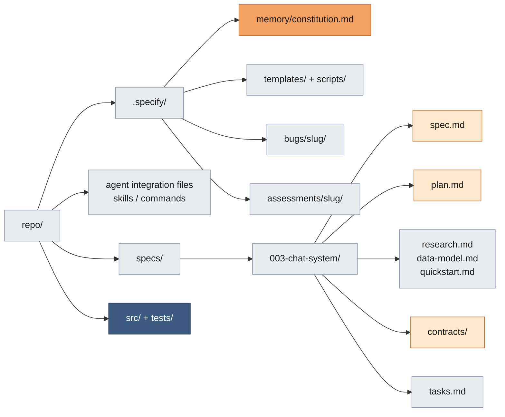

### D13b — Branch flow

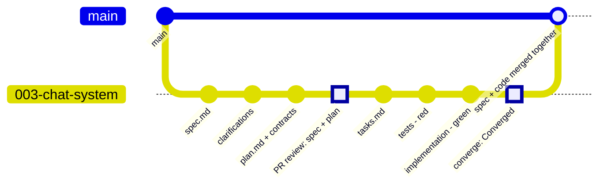

### D13c — Review ownership

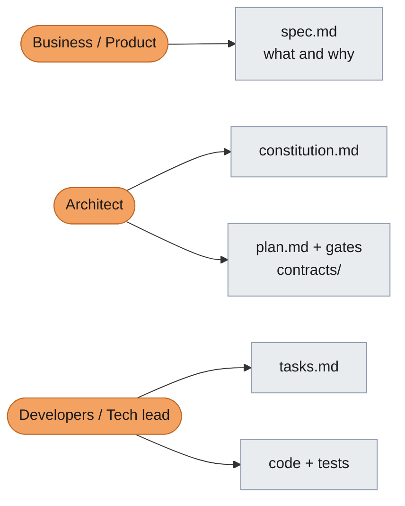

---

## Slide 14 — Worked example / demo

### D14a — Feature walkthrough

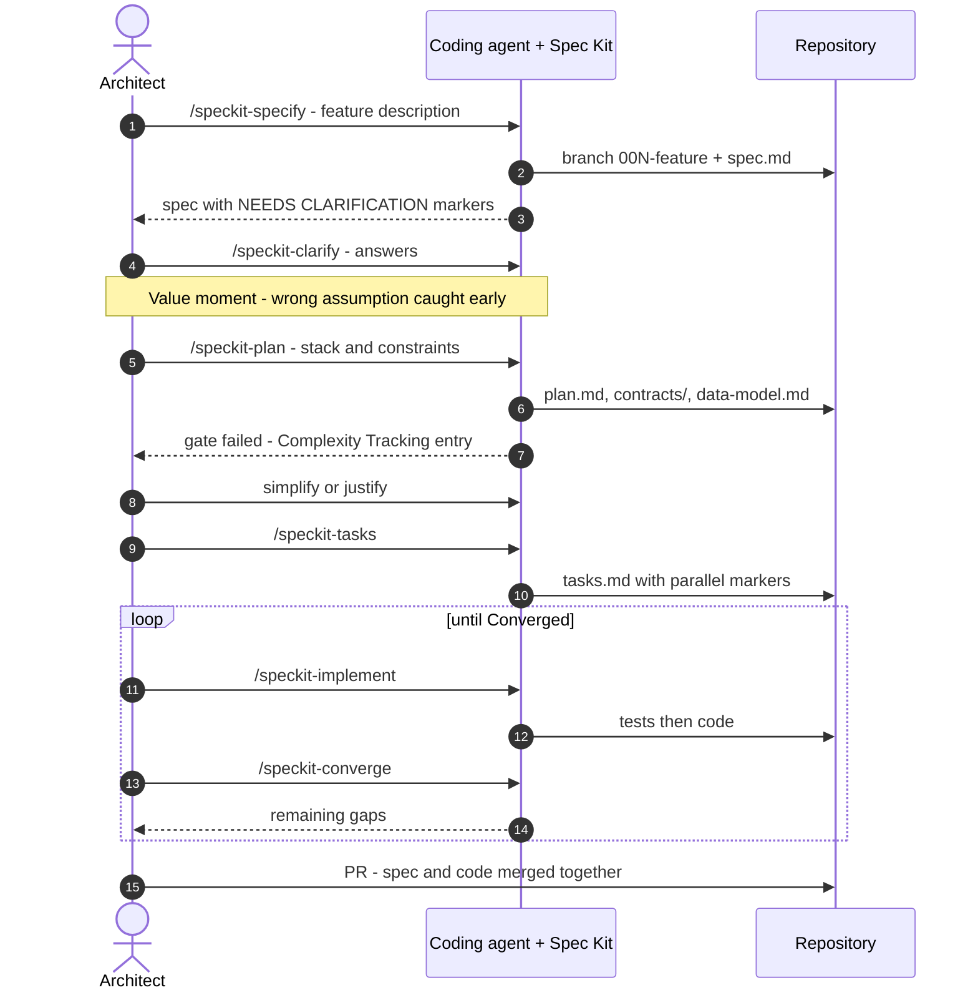

### D14b — Time split (REAL DATA ONLY)

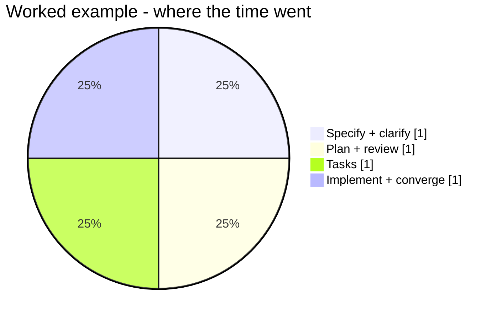

---

## Slide 15 — Artifact map

### D15a — Swimlane view: who produces, who reviews

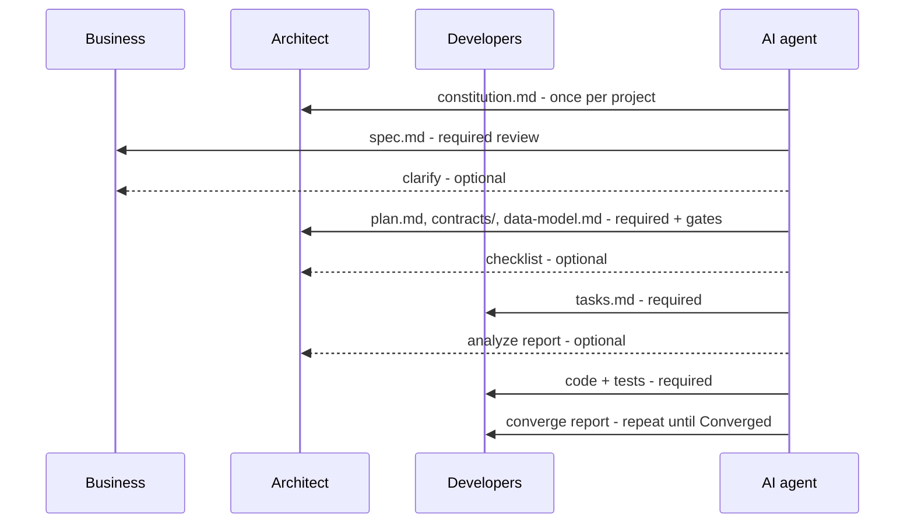

### D15b — Rigor dial

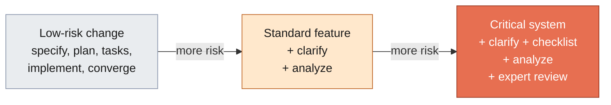

---

## Slide 16 — Context brief template

### D16a — Template sections

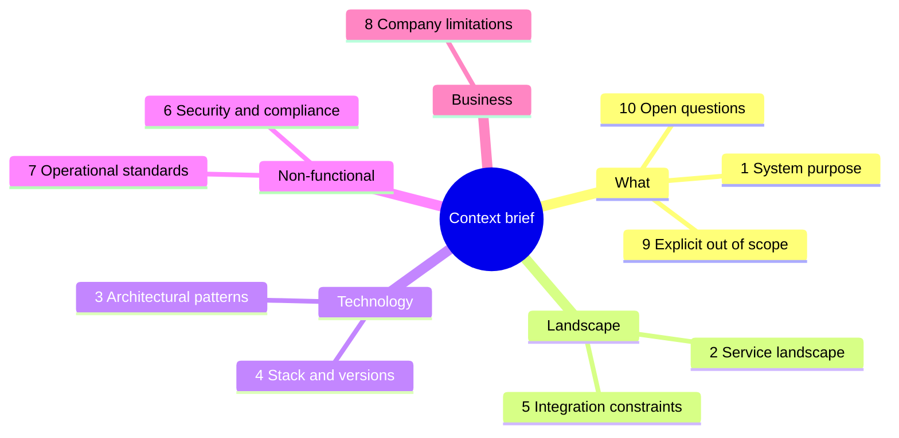

### D16b — One input, two uses

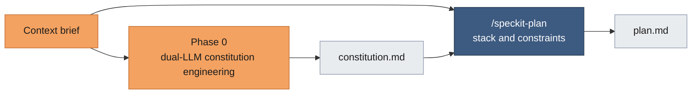

### D16c — Traceability: brief → constitution articles

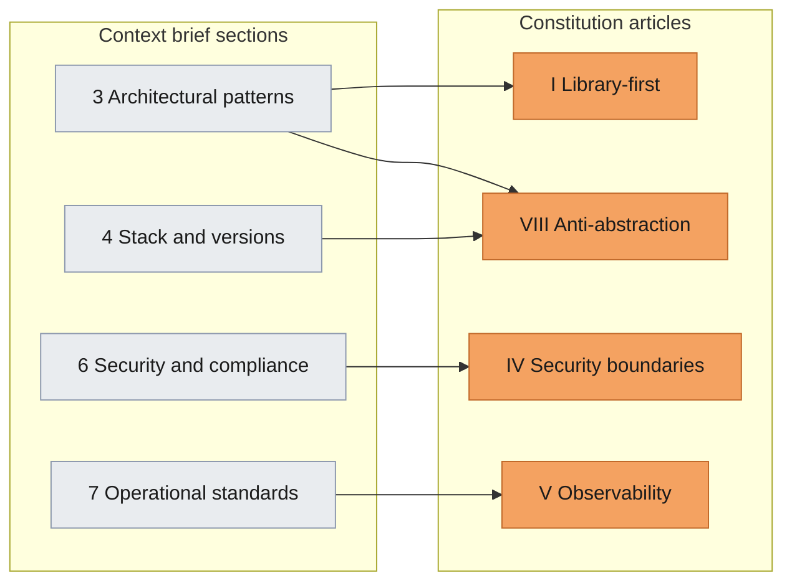

---

## Slide 17 — Sample constitution

### D17a — Annotated article

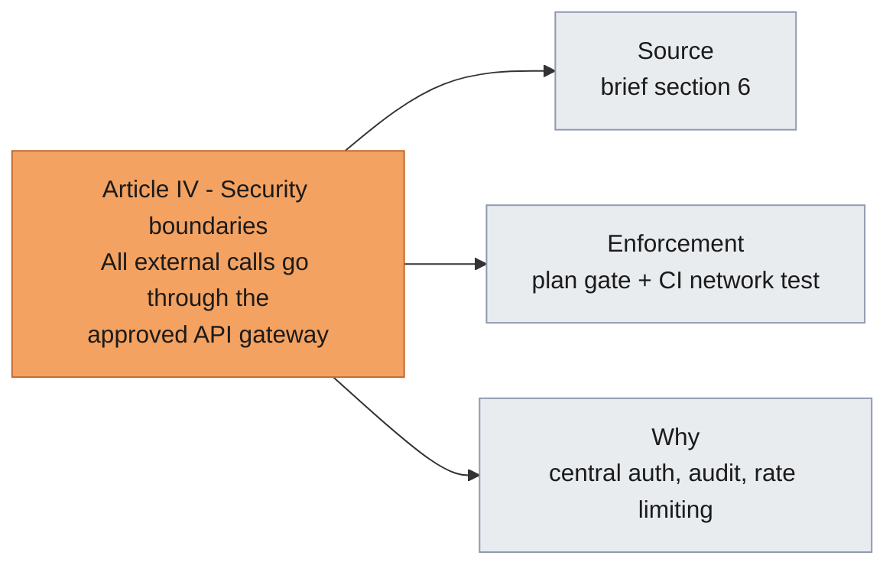

### D17b — Testability scale

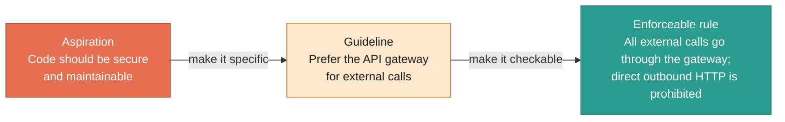

### D17c — Amendment history

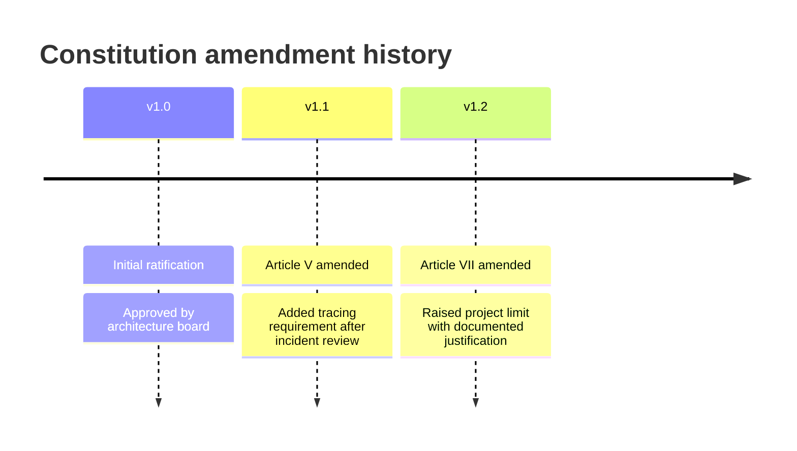

---

## Slide 18 — ASTs and code graphs in depth

### D18a — From syntax tree to knowledge graph

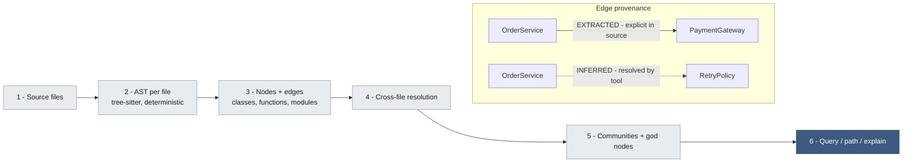

### D18b — Impact analysis with a `path` query

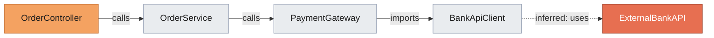

### D18c — Token comparison (MEASURE ON A REAL REPO)

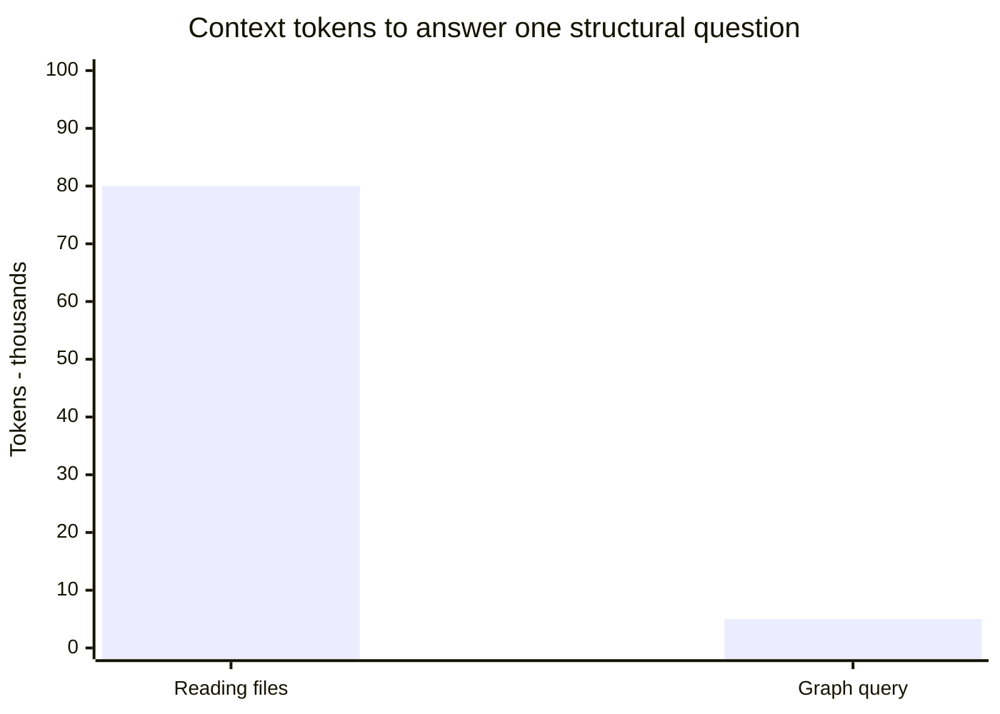

---

## Slide 19 — Full vetting checklist

### D19a — Tool trust lifecycle

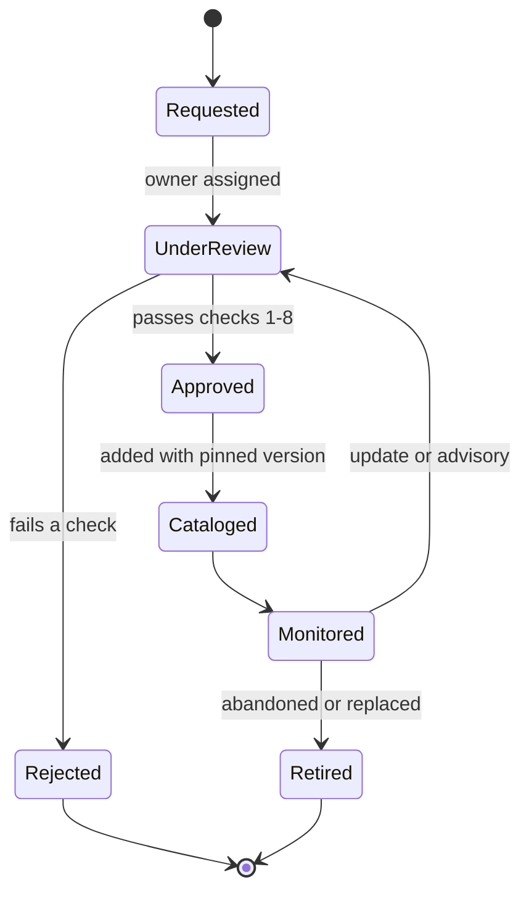

### D19b — Trust tiers

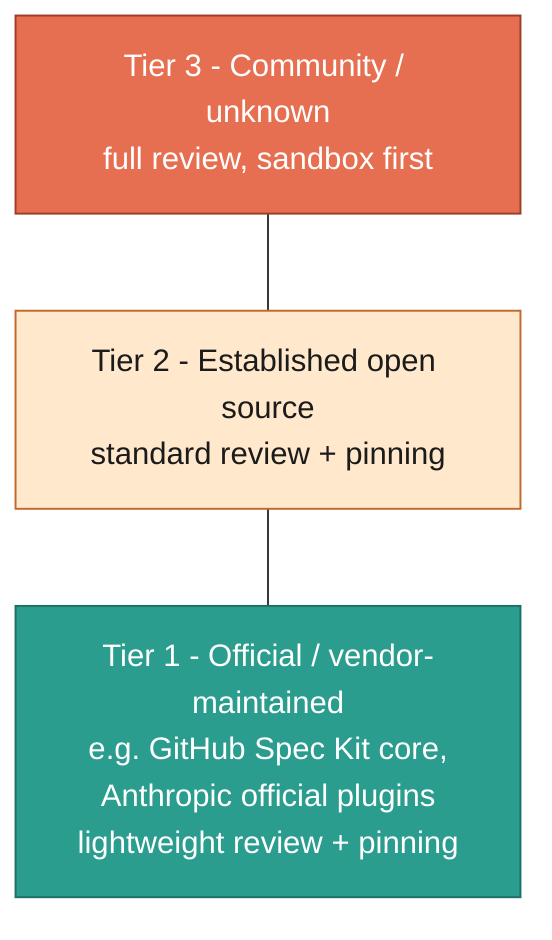

---

## Slide 20 — References

### D20 — Reference map

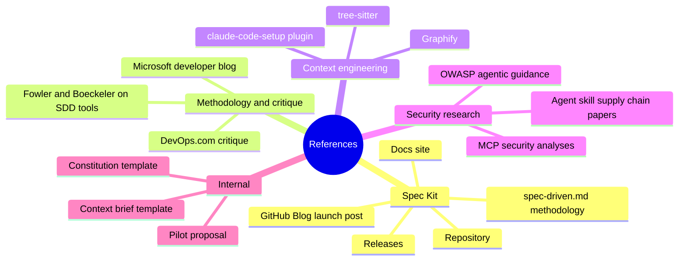
