# Spec-Driven Development with GitHub Spec Kit — Diagram Source, Core Deck (Mermaid)

Companion to `sdd-presentation-structure.md`. Each diagram ID (`D1`, `D4`, …) matches the "Visual" references in the structure document. This file holds slides 1–12 (D1–D12); slides 13–20 (D13–D20) are in `sdd-presentation-diagrams-appendix.md`. The document is split in two because the editor preview times out on pages with more than ~33 Mermaid diagrams.

**Conventions**
- Color classes used consistently across flowcharts:
  - `human` — human decisions / review gates (warm orange)
  - `ai` — AI generation steps (blue)
  - `artifact` — files and outputs (neutral gray)
  - `optional` — optional quality gates (dashed border)
  - `risk` — threats / warnings (red)
- Charts marked `%% ILLUSTRATIVE` use placeholder values — replace with real project data or label the slide "Illustrative".
- `xychart-beta` does not render series legends; add the legend in the slide itself.
- Renders in GitHub, GitLab, VS Code (Markdown Preview Mermaid Support), mermaid.live, and draw.io (*Arrange → Insert → Advanced → Mermaid*).

---

# CORE DECK

## Slide 1 — Title

### D1 — The inversion

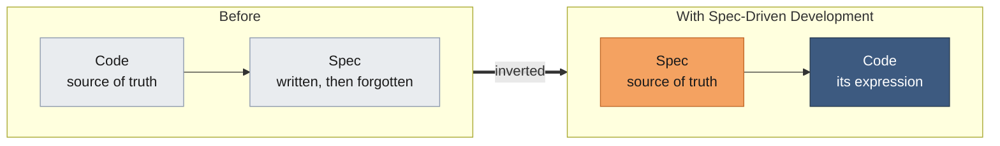

---

## Slide 2 — The problem

### D2 — The widening gap (ILLUSTRATIVE)

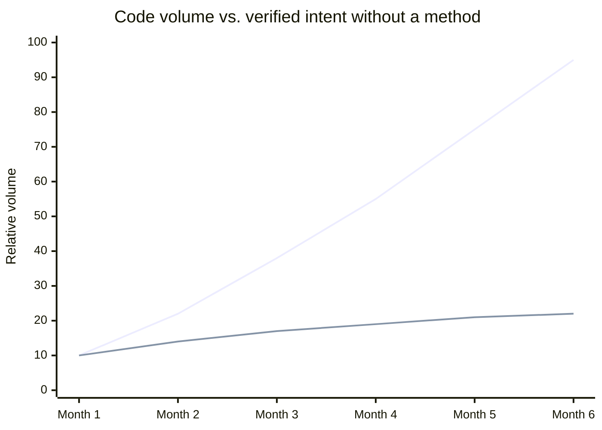

---

## Slide 3 — Spec Kit: origin, credibility and the core idea

### D3a — Before / after: who is the source of truth?

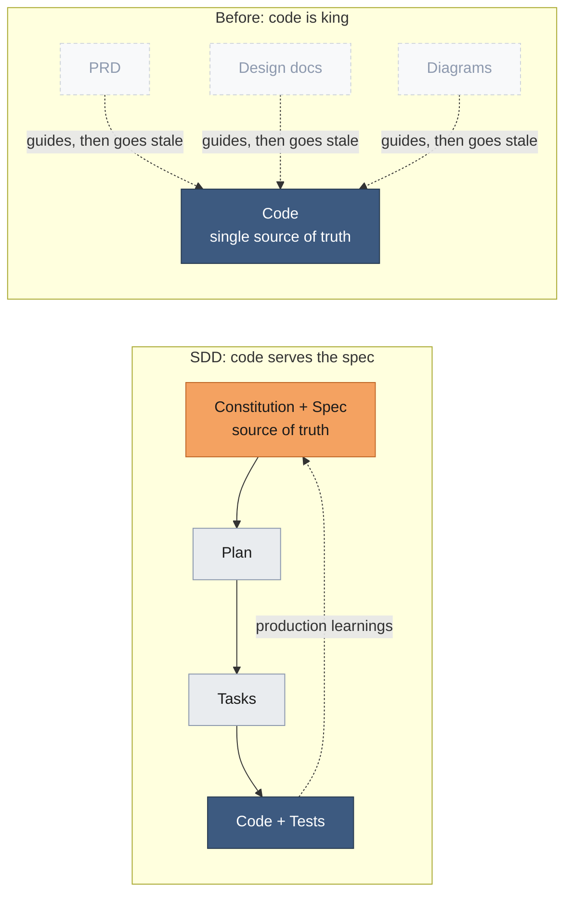

### D3b — Spec Kit timeline

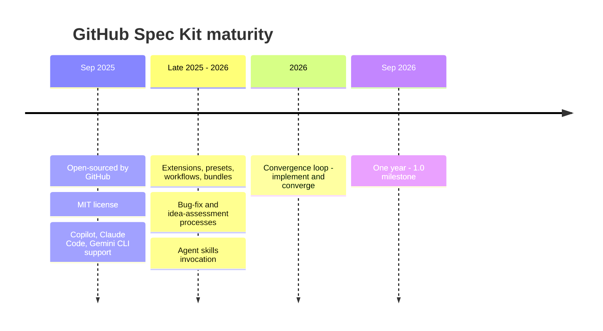

---

## Slide 4 — The Spec Kit cycle (anchor)

### D4 — The full cycle

```mermaid
flowchart LR
    subgraph P0["Phase 0 - once per project"]
        direction TB
        BRIEF["Context brief"] --> ENG["Constitution engineering<br/>dual-LLM + architect"]
        ENG --> CONST["/speckit-constitution"]
    end

    subgraph FEAT["Per feature"]
        direction LR
        SPEC["/speckit-specify"] --> G1{{"Review"}} --> CLAR["/speckit-clarify"]
        CLAR --> PLAN["/speckit-plan"] --> G2{{"Review + gates"}} --> CHK["/speckit-checklist"]
        CHK --> TASK["/speckit-tasks"] --> ANA["/speckit-analyze"] --> G3{{"Review"}}
        G3 --> IMP["/speckit-implement"]
        IMP <-->|"until Converged"| CONV["/speckit-converge"]
    end

    CONST --> SPEC
    CONV -.->|"production learnings update the spec"| SPEC

    A1[/"constitution.md"/] -.- CONST
    A2[/"spec.md"/] -.- SPEC
    A3[/"plan.md, research.md<br/>data-model.md, contracts/"/] -.- PLAN
    A4[/"tasks.md"/] -.- TASK
    A5[/"code + tests"/] -.- IMP

    classDef human fill:#F4A261,stroke:#C1692A,color:#1b1b1b
    classDef ai fill:#3D5A80,stroke:#26394F,color:#ffffff
    classDef artifact fill:#E9ECEF,stroke:#8D99AE,color:#1b1b1b
    classDef optional fill:#DCE6F2,stroke:#3D5A80,color:#1b1b1b,stroke-dasharray: 5 4
    class BRIEF,ENG,G1,G2,G3 human
    class CONST,SPEC,PLAN,TASK,IMP,CONV ai
    class CLAR,CHK,ANA optional
    class A1,A2,A3,A4,A5 artifact
```

### D4-mini — "You are here" marker (reuse on slides 5–10)

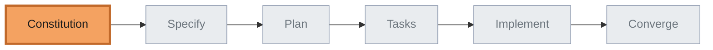

---

## Slide 5 — The constitution

### D5a — The constitution as a filter

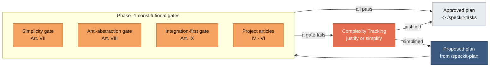

### D5b — The nine articles, grouped

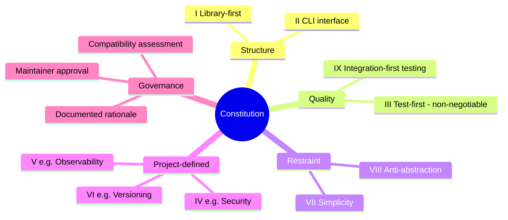

---

## Slide 6 — How I build the constitution

### D6a — Structured debate flow

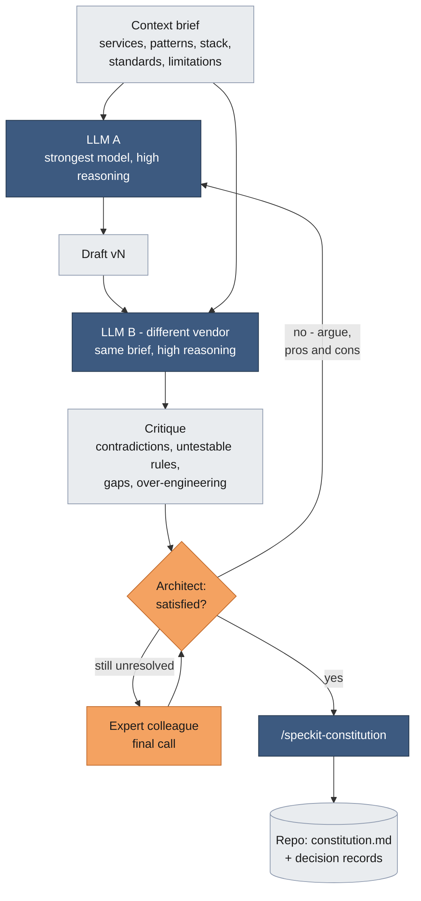

### D6b — Escalation ladder

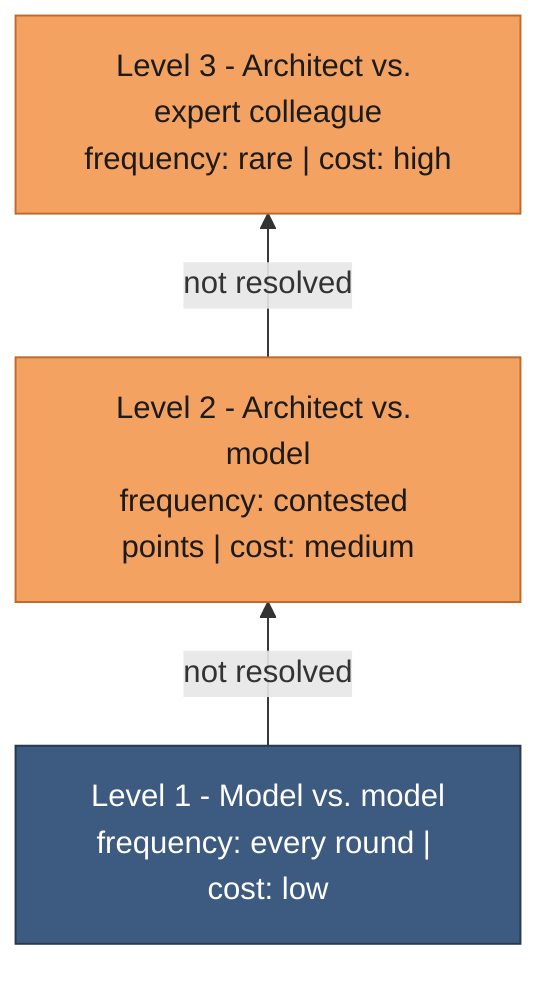

---

## Slide 7 — Specify and plan

### D7a — What/why vs. how

```mermaid
flowchart LR
    subgraph SPEC["spec.md - WHAT and WHY"]
        direction TB
        US["User stories"]
        AC["Acceptance criteria"]
        NC["NEEDS CLARIFICATION markers"]
        CK["Spec checklists"]
    end
    subgraph PLAN["plan.md + artifacts - HOW"]
        direction TB
        AR["Architecture and stack"]
        RS["research.md"]
        DM["data-model.md"]
        CO["contracts/"]
        CT["Complexity Tracking<br/>lightweight ADR log"]
    end
    SPEC ==>|"stable business intent"| GATES{{"Constitutional gates"}}
    GATES ==>|"architect owns this boundary"| PLAN

    classDef human fill:#F4A261,stroke:#C1692A,color:#1b1b1b
    classDef artifact fill:#E9ECEF,stroke:#8D99AE,color:#1b1b1b
    class GATES human
    class US,AC,NC,CK,AR,RS,DM,CO,CT artifact
```

### D7b — Stable vs. volatile (ILLUSTRATIVE)

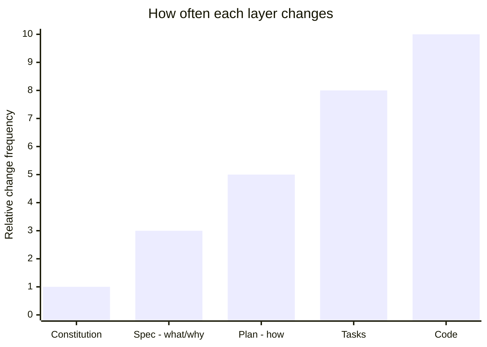

---

## Slide 8 — Tasks → implement → converge

### D8a — Task dependency graph with parallel lanes

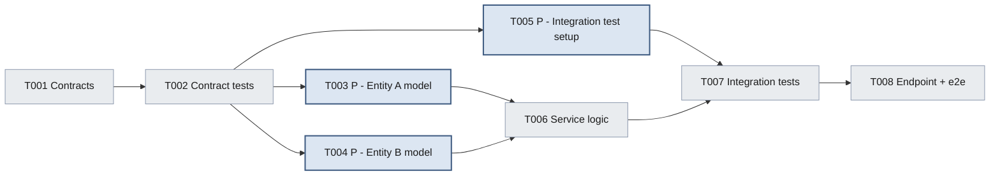

### D8b — Convergence (ILLUSTRATIVE)

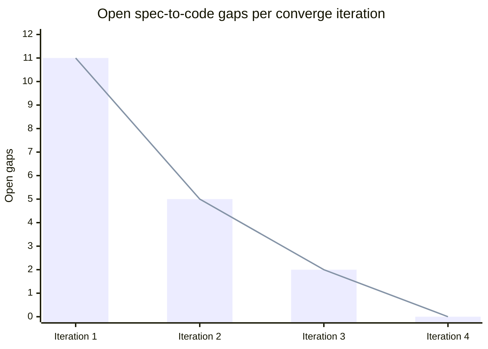

### D8c — Enforced test-first order

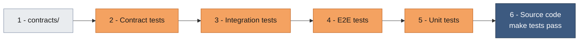

---

## Slide 9 — Context engineering: ASTs and Graphify

### D9a — AST for `total = price * qty`

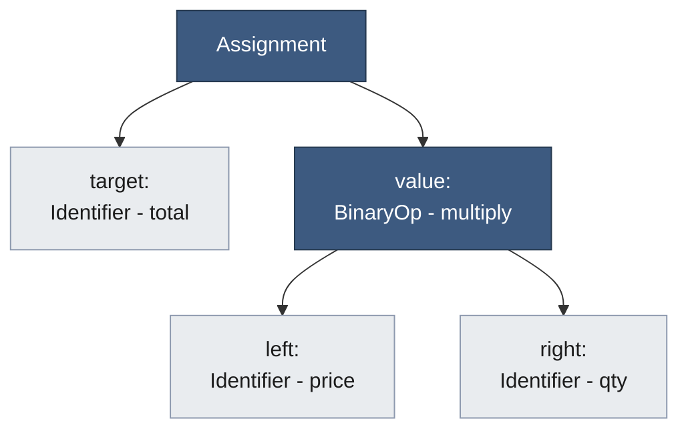

### D9b — Three ways an agent understands code

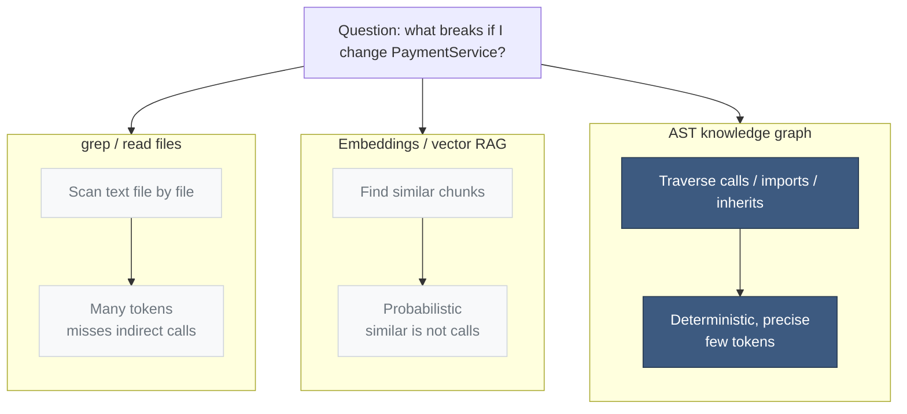

### D9c — From repository to Spec Kit

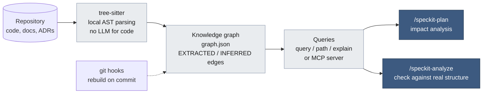

---

## Slide 10 — Trust your toolchain

### D10a — Attack surface around the agent

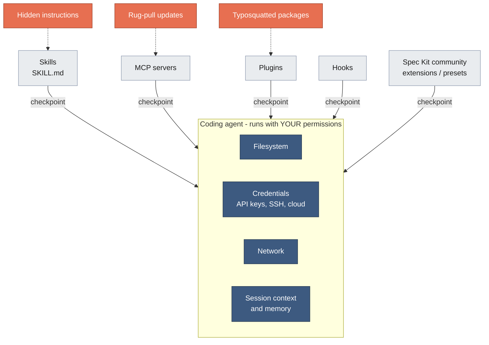

### D10b — Trust funnel

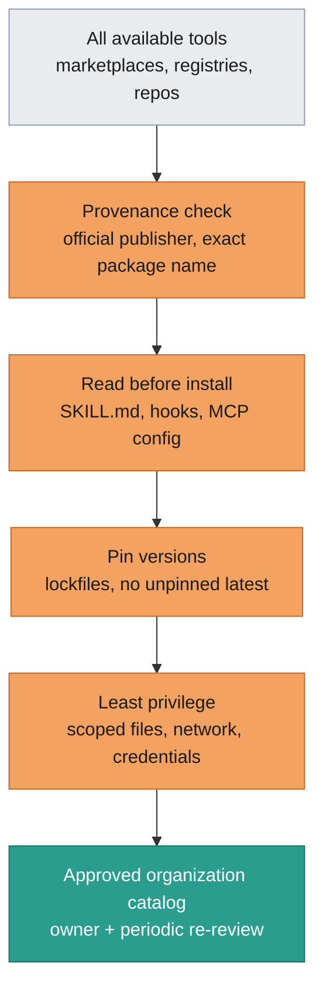

### D10c — (Optional) 2026 incident figures

```mermaid
%% Figures from cited 2026 research - keep the source on the slide
%% Left: malicious skills in the ClawHavoc campaign; Right: percent of 42,447 scanned skills with a vulnerability
xychart-beta
    title "Agent skill supply chain, 2026"
    x-axis ["ClawHavoc malicious skills", "Scanned skills with a vulnerability - percent x10"]
    y-axis "Count" 0 --> 1400
    bar [1184, 261]
```

---

## Slide 11 — The business case

### D11a — Cost of change (ILLUSTRATIVE)

```mermaid
%% ILLUSTRATIVE - classic cost-of-change curve. Annotate on the slide:
%% "SDD catches misunderstandings here" at Spec/Plan, "Vibe coding finds them here" at Test/Production
xychart-beta
    title "Relative cost to fix a misunderstanding"
    x-axis ["Spec", "Plan", "Code", "Test", "Production"]
    y-axis "Relative cost" 0 --> 100
    line [1, 3, 10, 30, 100]
```

### D11b — Effort distribution (ILLUSTRATIVE)

```mermaid
%% ILLUSTRATIVE - replace with your own project data
pie showData
    title Vibe coding - effort distribution
    "Spec and planning" : 5
    "Implementation" : 45
    "Review" : 15
    "Rework" : 35
```

```mermaid
%% ILLUSTRATIVE - replace with your own project data
pie showData
    title SDD - effort distribution
    "Spec and planning" : 25
    "Implementation" : 45
    "Review" : 20
    "Rework" : 10
```

### D11c — KPI dashboard mock-up

```mermaid
flowchart LR
    subgraph DORA["Delivery - DORA"]
        direction TB
        K1["Lead time for changes"]
        K2["Change failure rate"]
    end
    subgraph SDD["SDD-specific"]
        direction TB
        K3["% of changes starting from a spec"]
        K4["Iterations to Converged"]
        K5["Defects traced to spec gaps"]
        K6["Spec-to-merge time"]
    end
    DORA ~~~ SDD

    classDef kpi fill:#FFFFFF,stroke:#3D5A80,color:#1b1b1b,stroke-width:2px
    class K1,K2,K3,K4,K5,K6 kpi
```

---

## Slide 12 — Risks, adoption roadmap and discussion

### D12a — Risk matrix

```mermaid
%% Positions are a starting point for discussion - adjust to your context
quadrantChart
    title Risk matrix before mitigation
    x-axis Low likelihood --> High likelihood
    y-axis Low impact --> High impact
    quadrant-1 Mitigate first
    quadrant-2 Plan contingency
    quadrant-3 Accept
    quadrant-4 Reduce frequency
    Ceremony on small changes: [0.75, 0.35]
    Review fatigue: [0.65, 0.5]
    Unmaintained constitution: [0.45, 0.7]
    Fast-changing tool: [0.7, 0.45]
    Toolchain supply chain: [0.35, 0.9]
    False LLM consensus: [0.4, 0.65]
```

### D12b — Adoption staircase

```mermaid
flowchart LR
    S1["Step 1 - Pilot<br/>one bounded context<br/><br/>Exit: one feature Converged<br/>+ lessons learned"]
    S2["Step 2 - Organization base<br/>base constitution + templates<br/><br/>Exit: approved by architects"]
    S3["Step 3 - Industrialize<br/>presets, extensions, CI checks,<br/>approved tool catalog<br/><br/>Exit: used by 3+ teams"]
    S4["Step 4 - Scale<br/>all new features spec-first<br/><br/>Exit: SDD KPIs tracked"]
    S1 --> S2 --> S3 --> S4

    classDef s1 fill:#E9ECEF,stroke:#8D99AE,color:#1b1b1b
    classDef s2 fill:#DCE6F2,stroke:#3D5A80,color:#1b1b1b
    classDef s3 fill:#8FA9C8,stroke:#3D5A80,color:#1b1b1b
    classDef s4 fill:#3D5A80,stroke:#26394F,color:#ffffff
    class S1 s1
    class S2 s2
    class S3 s3
    class S4 s4
```
