# Engines as the Core Abstraction — Presentation Structure

**Audience:** Architects retreat · **Type:** Proposal · **Slot:** 20–45 min · **Length:** 20 slides (max) + appendix
**Goal:** Adopt the engine blueprint as the way to build the 27-engine catalog, ratify principles, and approve a first engine pilot.

> Visual notes: every diagram below is a *basic idea* in Mermaid, meant to be redrawn by the designer.
> Numbers in charts are illustrative unless stated otherwise. Example manifests use invented laws, rates and account codes.

---

## Agenda and timing

| # | Slide | Act | Min | 12-slide cut |
|---|---|---|---|---|
| 1 | Title and thesis | 1 · Why | 1 | ✅ |
| 2 | The problem we keep paying for | 1 · Why | 2 | ✅ |
| 3 | What we mean by "Engine" | 1 · Why | 2 | ✅ |
| 4 | Three tools, one idea | 2 · Pattern | 2 | — (fold into 5) |
| 5 | The shared anatomy | 2 · Pattern | 2 | ✅ |
| 6 | Rules as code in government | 2 · Pattern | 1 | — (one line in 5) |
| 7 | The engine blueprint | 3 · Method | 3 | ✅ |
| 8 | Anatomy at runtime | 3 · Method | 2 | — (fold into 7) |
| 9 | Worked example 1: Calculation engine | 3 · Method | 3 | ✅ |
| 10 | Worked example 2: Treatment ladder | 3 · Method | 2 | ✅ |
| 11 | Engines that configure engines | 3 · Method | 2 | ✅ |
| 12 | The catalog through this lens | 3 · Method | 2 | — (appendix A1) |
| 13 | Configuration language options | 3 · Method | 2 | ✅ |
| 14 | Design questions the method makes explicit | 3 · Method | 2 | — |
| 15 | Business case | 4 · Value | 3 | ✅ |
| 16 | Risks and mitigations | 4 · Value | 2 | — |
| 17 | Engines are AI tools by construction | 4 · Value | 2 | — (merge into 18) |
| 18 | Agent orchestration: navigate, don't decide | 4 · Value | 2 | ✅ |
| 19 | Proposed principles | 5 · Decide | 1 | — (merge into 20) |
| 20 | The pilot and the ask | 5 · Decide | 2 | ✅ |
| | **Total** | | **~38** | **~22** |

### Narrative arc

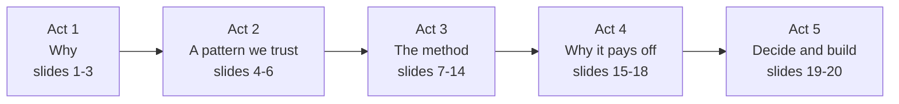

---

# Act 1 — Why

## Slide 1: Title and thesis

**Action title:** Build 27 engines once. Configure every domain.

**Contents:**
- Title: *Engines as the Core Abstraction*
- Subtitle: A method for building a multi-domain government suite
- Presenter, date, retreat name
- Nothing else. The thesis line is the whole slide.

**Visual:** Minimal. Optional background motif: many domain boxes feeding one row of engines.

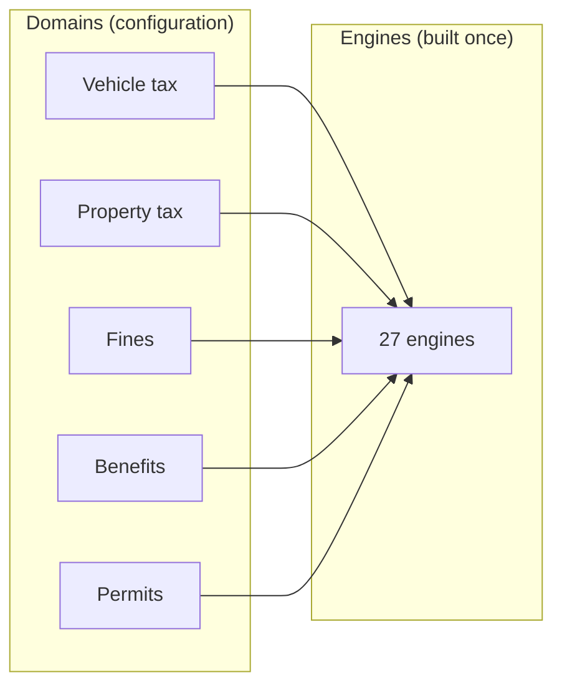

**Transition:** "Before the idea, let's look at what we do today, and what it costs us."

---

## Slide 2: The problem we keep paying for

**Action title:** Every domain rebuilds the same capabilities, and each rebuild computes things slightly differently.

**Contents:**
- Today: each domain (tax, fees, fines, benefits, permits) is delivered as its own system or project.
- Each one reimplements the same capabilities: calculation, accounting, billing, notices, workflow, follow-up.
- Consequences:
  - **Cost:** the same capability paid for N times.
  - **Inconsistency:** the same interest rule computed three different ways.
  - **Audit exposure:** findings arise from the differences, not the rules.
  - **Slow change:** a regulatory change becomes N projects.
- One real anecdote from your context is worth more than any bullet here.

**Visual:** A domains × capabilities grid. Each cell is a separate implementation; highlight duplicated cells in red.

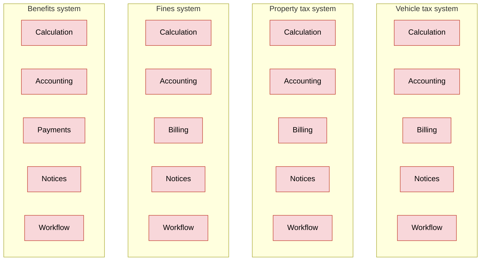

**Transition:** "What if each capability existed once, and domains were just configuration? That's what we call an engine."

---

## Slide 3: What we mean by "Engine"

**Action title:** An engine understands one kind of domain task end to end, and executes every step of it from configuration.

**Contents:**
- **Definition:** a piece of configurable software that understands one type of domain task end to end and executes each step involved in the process.
- **Two examples:**
  - **Calculation engine:** does the money arithmetic (bases, proration, rounding, interest, penalty, indexation, currency) identically everywhere.
  - **Ledger and accounting engine:** turns every operational event with financial effect into double-entry postings under the applicable accounting basis, and closes the period.
- **What an engine is not:**
  - Not a library: it owns the whole process, not a function.
  - Not a microservice per domain: it's domain-agnostic.
  - Not a low-code platform: it's bounded to one capability.

**Visual:** The engine formula: **Runtime + Contract + Configuration + Connectors**, with "is / is not" on the side.

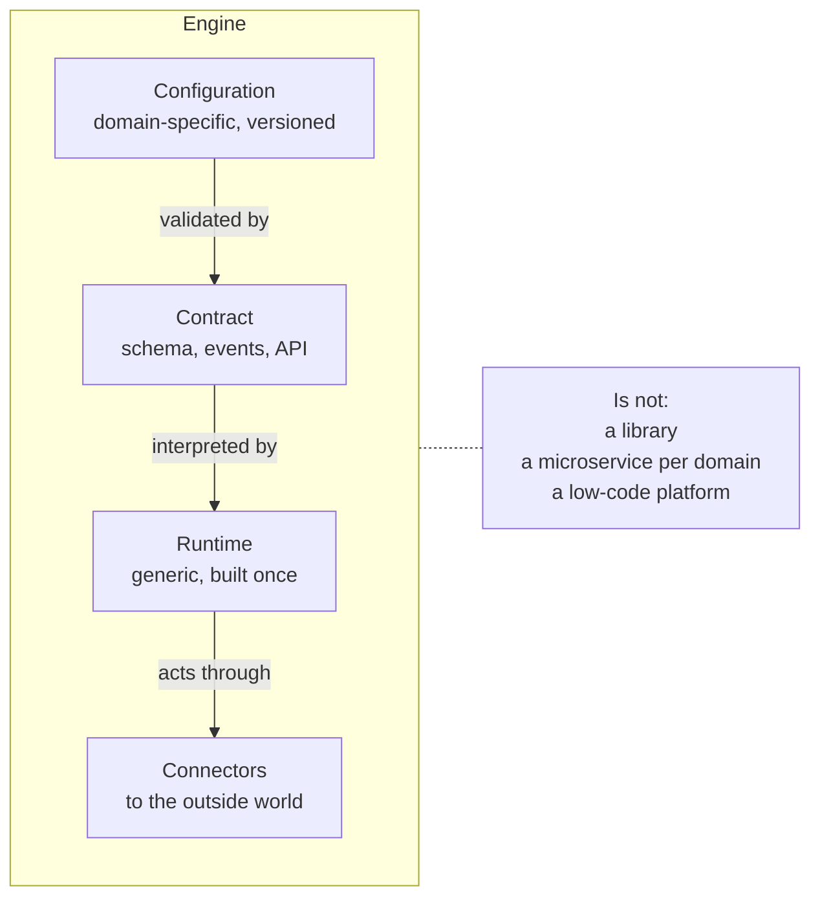

**Transition:** "This isn't a new idea. We already use tools built exactly this way every day."

---

# Act 2 — A pattern we already trust

## Slide 4: Three tools, one idea

**Action title:** Docker Compose, dbt and Terraform all separate *what you want* from *how it gets done*.

**Contents:** One column per tool, each with a 5–8 line snippet and its signature trick.
- **Docker Compose (YAML):** declare the desired state (services, networks, `depends_on` with healthcheck conditions). The runtime makes it real.
- **dbt (YAML + SQL + Jinja):** one YAML declares sources, tests, freshness rules and docs. Jinja macros add abstraction. `ref()` builds the dependency graph.
- **Terraform (HCL):** a strict language, providers as connectors, `plan` before `apply`, and state with drift detection.
- Footnote: Compose is YAML, but Terraform is HCL, and dbt mixes YAML with templated SQL. The *language* differs; the *pattern* is the same.

**Visual:** Three columns with the official logos (Docker, dbt, Terraform) on top, a code snippet in the middle, and the flow at the bottom:

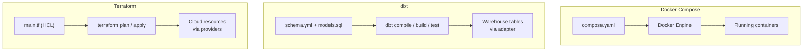

**Transition:** "Take away the logos, and all three have the same anatomy."

---

## Slide 5: The shared anatomy

**Action title:** The value isn't YAML. It's a declarative spec interpreted by a trusted runtime.

**Contents:** The comparison table.

| Element | Docker Compose | dbt | Terraform | Our engines |
|---|---|---|---|---|
| Declarative spec | services, networks | sources, models, tests | resources, modules | domain manifests |
| Schema / contract | Compose spec | property schemas | provider schemas | engine manifest schema |
| Dependency graph | `depends_on` | `ref()` / `source()` | references | prerequisites, events |
| Abstraction | interpolation, profiles | Jinja macros | modules, variables | reusable rule fragments |
| Runtime | Docker Engine | dbt compiler | Terraform core | the engine |
| Adapters | drivers | warehouse adapters | providers | connectors |
| Verify before act | config validation | `test`, `compile` | `plan` | dry run / simulation |
| State | running vs desired | snapshots, incremental | state file | ledger / event store |

**Visual:** The generic pipeline that all four columns share, with the state feedback loop.

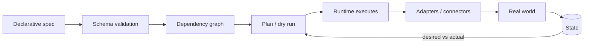

**Transition:** "And in government specifically, people have already applied this idea to law."

---

## Slide 6: Rules as code in government

**Action title:** Governments already run law as code. We generalize it from rules to 27 capabilities.

**Contents:**
- **OpenFisca:** open-source engine for tax and benefit rules, used by several governments.
- **Catala:** a programming language designed to translate legislative text, especially tax law, into code faithfully.
- **DMN / FEEL:** the OMG standard for decision tables and expressions.
- **Our step:** these tools cover *rules and calculation*. We apply the same principle to registries, obligations, ledgers, payments, cases, notices and the rest of the catalog.

**Visual:** Logos of OpenFisca, Catala and OMG DMN in a row, then a "scope" arrow widening from "rules" to "27 capabilities".

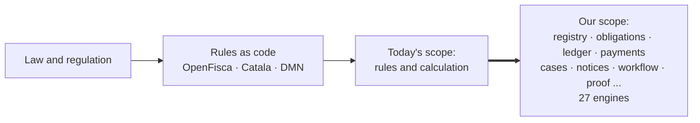

**Transition:** "So how would we actually build 27 engines this way? With one blueprint."

---

# Act 3 — The method

## Slide 7: The engine blueprint

**Action title:** Every engine is built from the same eight parts; only four of them are specific to the engine.

**Contents:**

| # | Part | What it defines | Shared or specific | Inspiration |
|---|---|---|---|---|
| 1 | Manifest kind | The engine's config schema | Specific | K8s `kind`, Compose spec |
| 2 | Common envelope | Version, effective dating, legal basis, owner, tests | **Shared** | K8s `apiVersion/metadata` |
| 3 | Primitive library | Built-in functions (`interest.daily_compound`, `ladder.step`) | Specific | Terraform resources, dbt macros |
| 4 | Contracts | Events consumed/emitted, engines called | Specific | `ref()`, references |
| 5 | Plan / dry run | What would happen, before it happens | **Shared** | `terraform plan` |
| 6 | Trace | Why every output is what it is | **Shared** | lineage, plan diff |
| 7 | Tests in the spec | Golden cases next to the config | **Shared** | `dbt test` |
| 8 | Connectors | Adapters to the outside world | Specific | providers, adapters |

- **Key point:** parts 2, 5, 6 and 7 form an **engine SDK**, built once. Each new engine only defines parts 1, 3, 4 and 8. That is what makes 27 engines feasible.

**Visual:** The engine at the center with eight parts around it, colored shared (SDK) vs specific.

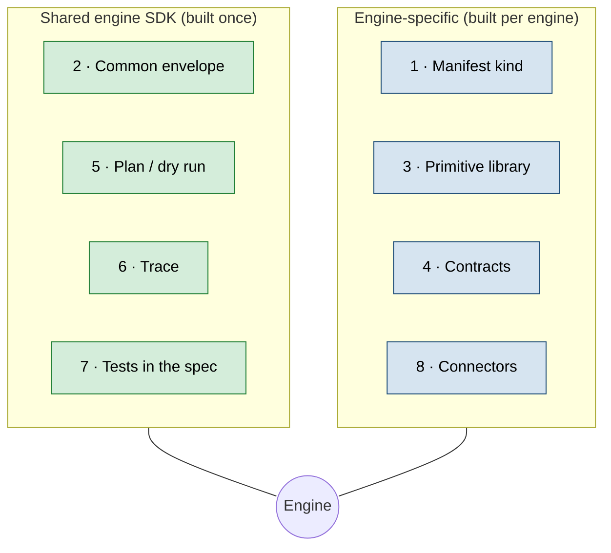

**Transition:** "Here's what happens inside any engine when it runs."

---

## Slide 8: Anatomy at runtime

**Action title:** Every engine runs the same pipeline: validate, compile, plan, execute, emit, trace.

**Contents:**
1. **Manifest:** versioned and effective-dated domain configuration.
2. **Validate:** against the engine's manifest schema, with the common envelope checks.
3. **Compile:** resolve references and build an execution graph.
4. **Plan:** dry run that shows what would happen.
5. **Execute:** run the steps, calling other engines and connectors.
6. **Emit:** publish results as events on the shared spine.
7. **Trace:** record why each output is what it is (rule, version, inputs, legal basis).
- The pipeline is the engine SDK; the engine only adds its primitives.

**Visual:** A horizontal pipeline, with the state/event store and audit underneath.

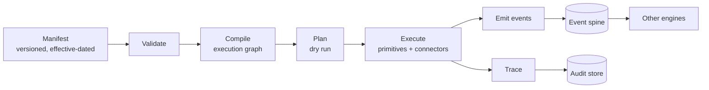

**Transition:** "Let's make it concrete with the engine every domain needs: calculation."

---

## Slide 9: Worked example 1 — Calculation engine

**Action title:** A late-payment penalty becomes 25 lines of tested, effective-dated configuration, and every figure explains itself.

**Contents:** Manifest on the left, trace output on the right.

```yaml
apiVersion: engines.gov/v1
kind: Calculation
metadata:
  name: vehicle-tax-late-payment
  owner: revenue-policy
  version: 2.1.0
effective:
  from: 2026-01-01
  legal_basis: "Law 123/2025, art. 14"
spec:
  inputs:
    principal: { type: money, currency: COP }
    due_date:  { type: date }
    paid_date: { type: date }
  steps:
    - id: days_late
      expr: max(0, days_between(due_date, paid_date))
    - id: interest
      function: interest.daily_compound
      rate_ref: rates/usury-monthly      # indexed table, resolved by date
      base: principal
      period: days_late
    - id: penalty
      function: penalty.percentage
      rate: 0.05
      cap: { max: principal * 1.0 }
  rounding: { mode: HALF_EVEN, scale: 0, apply: per_step }
tests:
  - name: 30 days late
    given: { principal: 1000000, due_date: 2026-03-01, paid_date: 2026-03-31 }
    expect: { penalty: 50000 }
```

- **Callouts:**
  - Declarative steps, reusable primitives (`interest.*`, `penalty.*`).
  - Effective dating and legal basis in the envelope.
  - Tests live in the spec (the dbt idea).
  - Every result carries a trace (the Terraform `plan` idea).

**Visual:** The calculation graph with trace annotations. Callout arrows point to envelope, primitives, rounding and tests on the code.

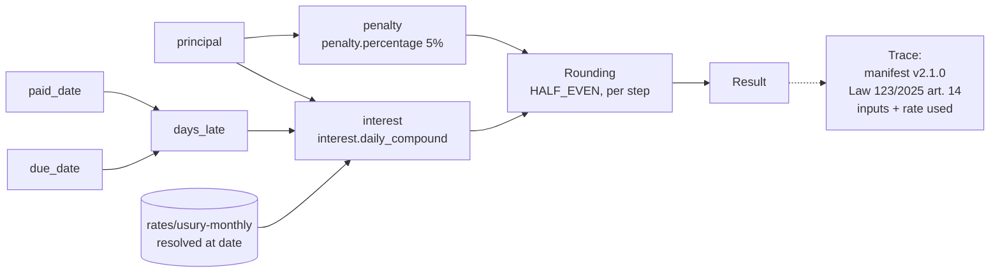

**Transition:** "Arithmetic is an easy case. Does the same blueprint work for a process that runs over weeks?"

---

## Slide 10: Worked example 2 — Treatment ladder

**Action title:** A completely different engine, the same envelope, plan, trace and tests.

**Contents:**

```yaml
apiVersion: engines.gov/v1
kind: TreatmentLadder
metadata:
  name: vehicle-tax-overdue-ladder
  owner: revenue-collections
  version: 1.2.0
effective:
  from: 2026-01-01
  legal_basis: "Collections Regulation 45/2025, arts. 8-12"
spec:
  entry:
    when: account.overdue_amount > 0
  pauses:
    - when: case.open(kind: "dispute")
    - when: party.flag("vulnerability")
  proportionality:
    min_amount_for_step: { escalate: 500000 }
  steps:
    - id: remind
      after_days: 5
      action: notice.issue(template: "reminder-v3", channel: preferred)
    - id: demand
      after_days: 30
      action: notice.issue(template: "formal-demand-v2", channel: certified)
    - id: escalate
      after_days: 60
      action: case.open(kind: "enforcement")
      approval: role("collections-supervisor")
tests:
  - name: dispute pauses the ladder
    given: { overdue: 800000, days_overdue: 45, open_cases: [dispute] }
    expect: { current_step: paused }
```

- **Callouts:**
  - Same envelope as slide 9 (highlight the identical top half in the same color).
  - Different body: states, pauses, proportionality, approvals.
  - Calls other engines through contracts (`notice.issue`, `case.open`).
  - Plan answers "which parties would be escalated if this ran today?"

**Visual:** The ladder as a state machine, next to the YAML. Put slides 9 and 10 envelopes side by side in a small inset.

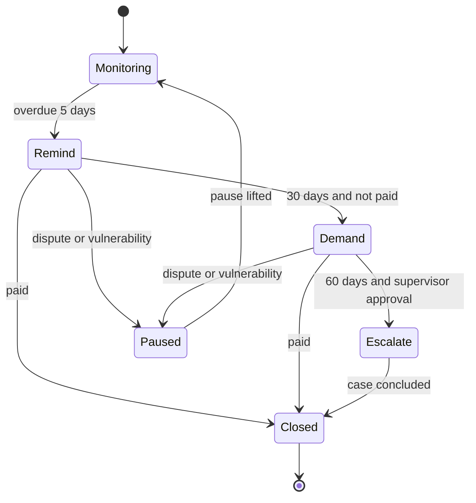

**Transition:** "Now, who writes these manifests, and how do they reach production? Some engines exist to configure the others."

---

## Slide 11: Engines that configure engines

**Action title:** Three engines in the catalog are our Terraform layer: they define, release and compose everything else.

**Contents:**

| Catalog engine | Analogue | Role |
|---|---|---|
| Levy and scheme design studio | Terraform modules, dbt packages | One scheme definition compiles into manifests for many engines |
| Configuration and release | `plan` / `apply`, environments | Validate, diff, test, promote and roll back configuration |
| Composition | Compose profiles, workspaces, feature flags | Which modules are active per client, and what a change does to a running instance |

- **The layered spec:** scheme (business) → engine manifests (technical) → released and composed (control plane).

**Visual:** Fan-out from one scheme into engine manifests, then promotion across environments, then composition per client.

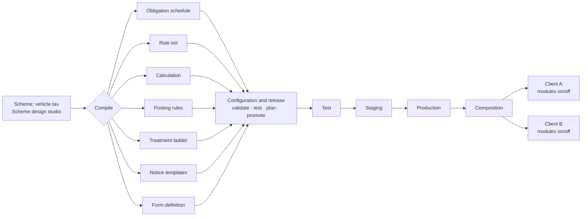

**Transition:** "With that lens, here's the whole catalog."

---

## Slide 12: The catalog through this lens

**Action title:** 27 engines in seven layers; one life event crosses almost all of them.

**Contents:**
- Seven layers: Control plane, Foundation, Decision, Financial, Process and response, Interaction and output, Cross-cutting platform. Full list in appendix A1.
- Highlighted flow: life event → record amended → obligation re-dated → rules + calculation → determination → account allocation → ledger postings → notice → audit and insight.
- Message: engines don't call each other ad hoc; they react to events through contracts.

**Visual:** Layer map with the flow numbered across layers. On the real slide, show all 27 engines in their layers (use A1) and highlight only the ones on the path.

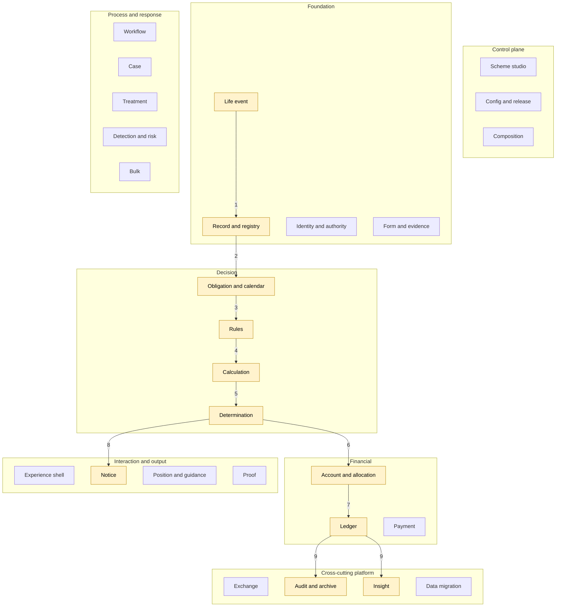

**Transition:** "Every one of these engines needs a configuration language. We have options, and I want to show them, not decide them today."

---

## Slide 13: Configuration language options

**Action title:** One common envelope for all 27 engines; the body language is a decision we make with criteria, not taste.

**Contents:**

| Option | Examples | Strength | Weakness |
|---|---|---|---|
| YAML + JSON Schema | Compose, Kubernetes | Familiar, huge tooling | Weak typing; logic leaks into strings |
| YAML + expression language | CEL, FEEL, JSONata | Safe, sandboxed, not Turing-complete | Two syntaxes |
| Typed config languages | CUE, Pkl, Dhall | Types, validation, composition | Smaller ecosystem, learning curve |
| HCL-style | Terraform | Readable, strict, graph-friendly | Tooling tied to one ecosystem |
| Templated YAML | dbt + Jinja | Very flexible | Becomes unreadable code |
| Domain DSL | Catala, DMN tables | Closest to law and analysts | Cost to build and maintain |

- **Evaluation criteria:** who authors (analyst vs engineer), type safety, expressiveness ceiling, testability, diff/review friendliness, tooling and IDE support.
- **Not every engine is equally declarative:**
  - Strongly declarative: Rules, Calculation, Obligation, Ledger posting rules, Treatment, Forms, Notices, Retention, Exchange schemas, Composition.
  - Process models: Workflow, Case (BPMN/CMMN or state machines).
  - Partly: Detection (rules yes, models no), Data migration (mappings yes).
  - Weakly: Experience shell.
- **Proposal:** common envelope everywhere, engine-specific body, and a sandboxed expression language for logic.

**Visual:** Quadrant chart (positions are a starting point for discussion, not measurements) and the envelope/body split.

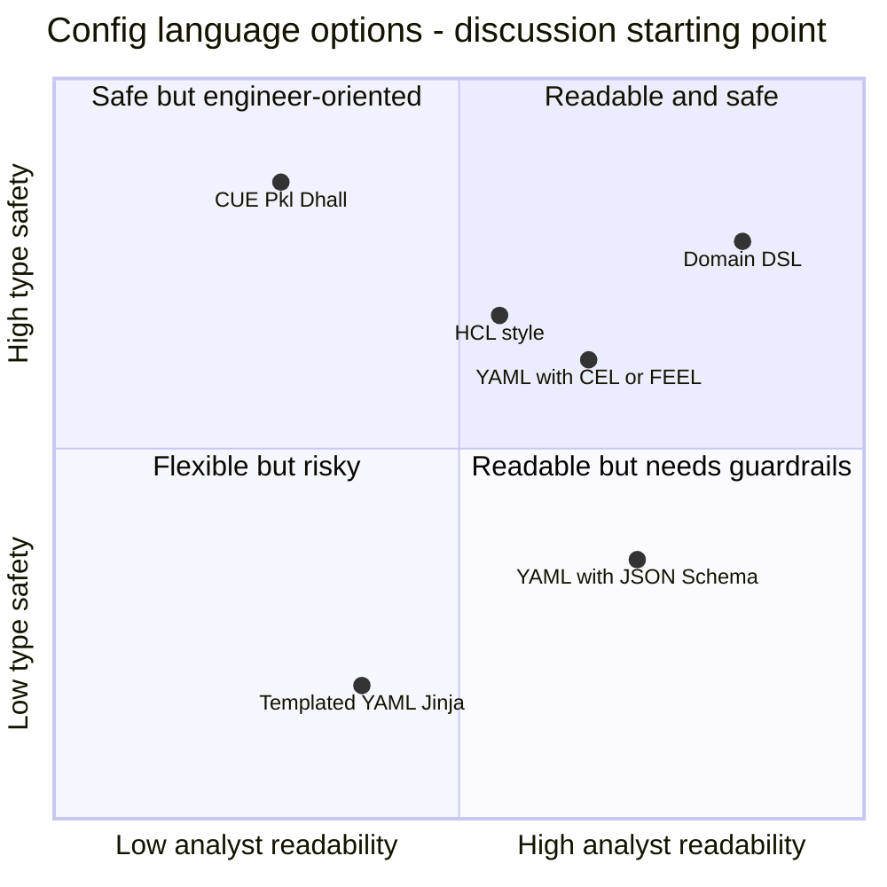

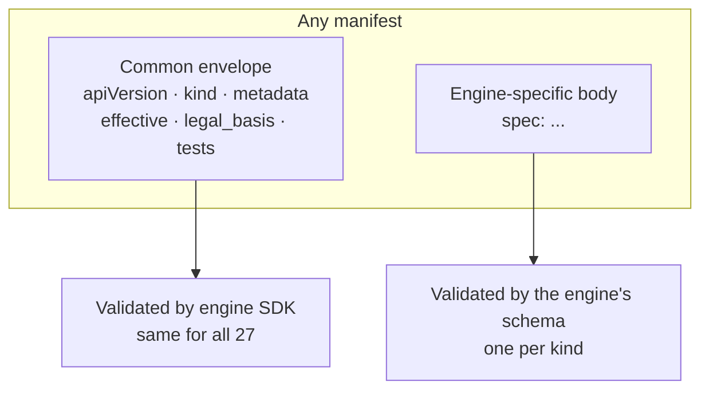

**Transition:** "Whatever language we choose, a few hard questions have to be answered. The method makes us answer them once."

---

## Slide 14: Design questions the method makes explicit

**Action title:** We answer the hard questions once, in the blueprint, instead of 27 times in production.

**Contents:**
- **Time:** effective dating, retroactive recalculation, bitemporality ("the rule valid on date X, as known on date Y").
- **Determinism:** decimal arithmetic, explicit rounding policy, no ambient state.
- **Explainability:** every figure traceable to rule, version, inputs and legal basis.
- **Expressiveness boundary:** when config can't express a need, add a governed extension point, not ad-hoc code (avoid the inner-platform effect).
- **Responsibility splits:** e.g. Rules *selects*, Calculation *computes*, Determination *freezes the result with its facts*.
- **Config lifecycle:** versioning, review, promotion, rollback, and migration of in-flight cases.

**Visual:** Questions flowing into the blueprint, then inherited by every engine.

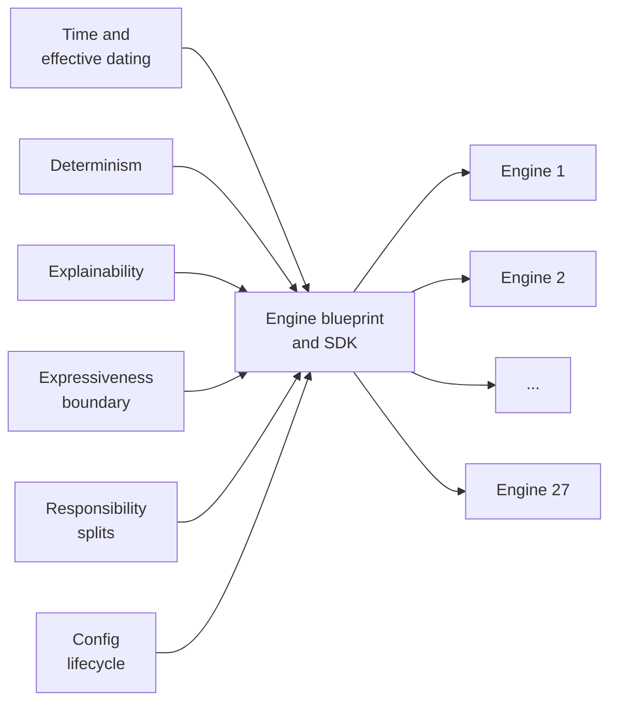

**Transition:** "So far this is architecture. Now, why is it worth the investment?"

---

# Act 4 — Why it pays off

## Slide 15: Business case

**Action title:** Higher upfront cost, much lower cost per domain, and regulatory change becomes a release, not a project.

**Contents:**
- **Time to market:** a new scheme or a law change becomes a configuration release through the control plane.
- **Cost curve:** engine investment upfront; marginal cost per domain drops. Crossover after a few domains.
- **Risk and compliance:** one audited implementation of money logic.
- **Engine as contract — build, buy or wrap:** the contract is ours; the implementation behind it can vary.
  - Likely build (differentiators): Rules, Calculation, Obligation, Determination, Account and allocation, Scheme studio.
  - Likely buy or wrap: Identity, payment rails, parts of Exchange, archive storage, the BI side of Insight.
- **Operating model:** policy analysts author or review manifests; engineers own engines.
- Replace the illustrative numbers with real ones, even rough ones from past projects.

**Visual 1:** Cumulative cost vs domains onboarded. Line 1 = bespoke per domain; line 2 = engines. Illustrative.

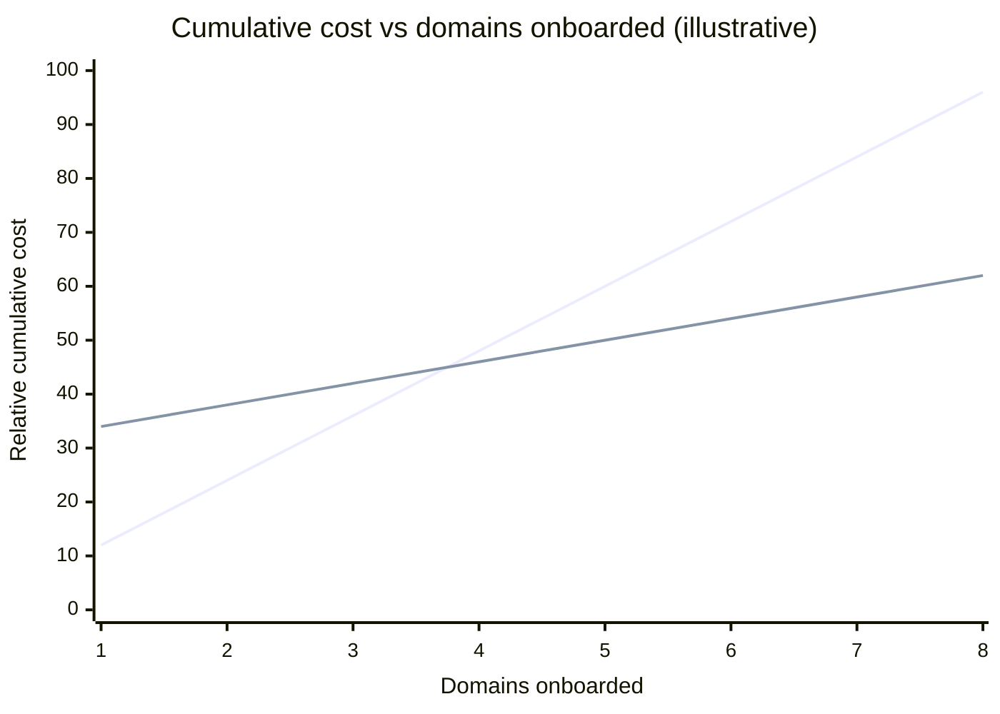

**Visual 2:** Build, buy or wrap behind a stable contract.

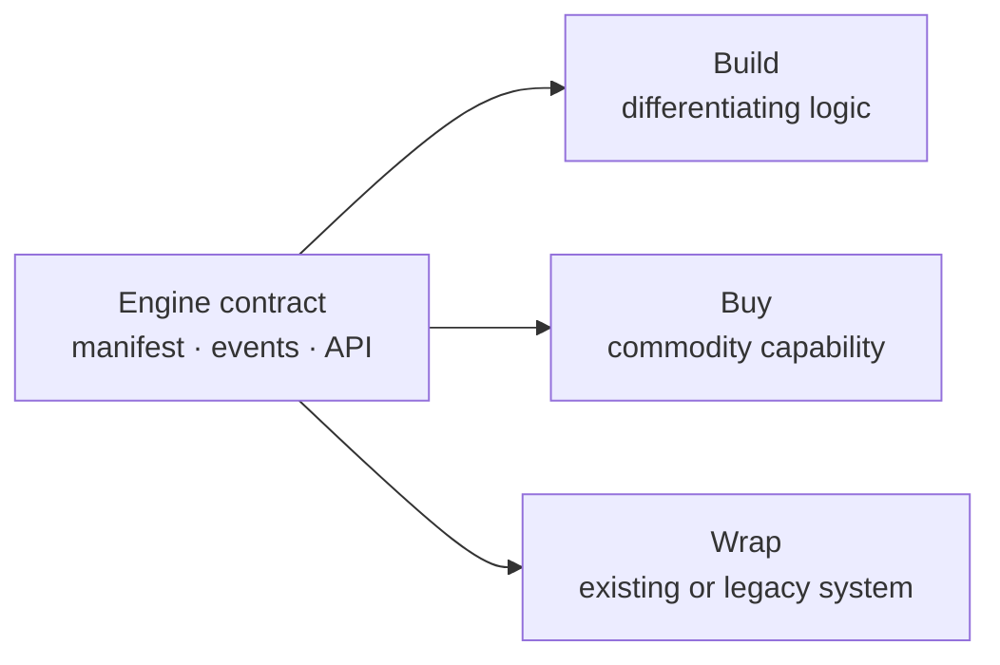

**Transition:** "This isn't free of risk. Here's what can go wrong, and how we prevent it."

---

## Slide 16: Risks and mitigations

**Action title:** The failure modes are known; each has a design answer in the blueprint.

**Contents:**

| Risk | Mitigation |
|---|---|
| **God engine:** one engine absorbs everything | A one-sentence scope per engine (the catalog), reviewed by the architecture board |
| **Premature abstraction:** building for domains that never come | Build from two real domains, generalize on the third |
| **Config sprawl:** thousands of unreviewed manifests | Config is code: owners, review, tests, release engine |
| **Turing-complete configuration** | Sandboxed expression language; logic beyond it goes to governed extension points |
| **Engine team bottleneck** | SDK + documentation + domain teams authoring manifests |
| **Performance surprises** | Plan/dry run and load tests on real volumes before cutover |

**Visual:** Risk-to-mitigation pairs (red to green).

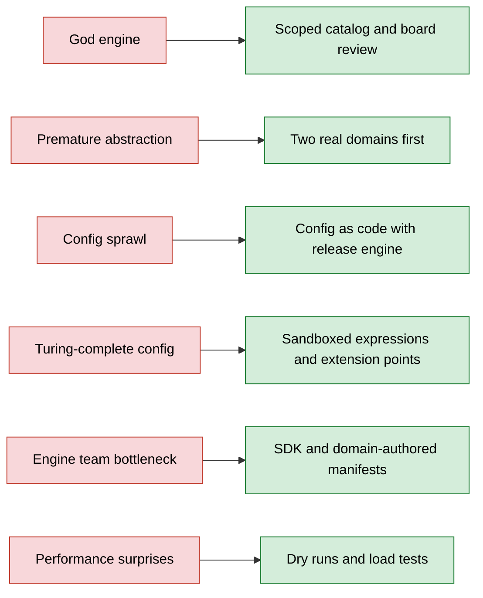

**Transition:** "There's one more payoff we get almost for free if we build engines this way."

---

## Slide 17: Engines are AI tools by construction

**Action title:** The same contract serves humans, systems and AI agents; the blueprint makes every engine an AI tool.

**Contents:**

| Blueprint part | What an agent gets |
|---|---|
| Manifest schema / contracts | Tool definitions (input/output schemas), exposable via MCP |
| Plan / dry run | Safe exploration before acting |
| Trace | Grounded explanations of every figure |
| Identity, access and authority | Permissions: the agent acts on behalf of someone, within their authority |
| Audit, retention and archive | Every agent action logged and reconstructable |
| Workflow and orchestration | Human approval gates and compensation |
| Tests in the spec | Evaluation sets for agents |

- Principle: **one contract, three consumers.**

**Visual:** One engine contract exposed three ways. Add the MCP logo next to the agent path.

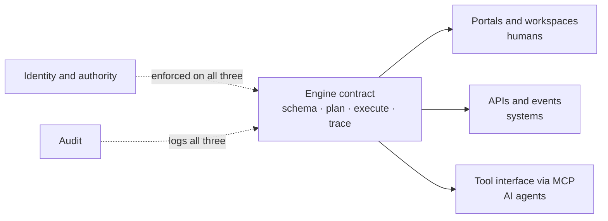

**Transition:** "So can an agent orchestrate the engines? Yes, with one rule."

---

## Slide 18: Agent orchestration — navigate, don't decide

**Action title:** The agent navigates. The engines decide. The manifests remember.

**Contents:**
- **Split of responsibilities:**
  - Processes are versioned manifests (Workflow, Treatment, Case), effective-dated and tested.
  - Agent instructions *reference* the manifests (like skills); they don't *contain* the process.
  - The agent chooses which tool and when; engines produce results. No money is calculated, posted or moved by the model.
- **Why not processes in prompts:** no determinism, no effective dating, no legal reasoning trail, bypasses release control.
- **Maturity ladder:**
  1. **Author:** copilot drafts manifests and golden tests (e.g. in the Scheme studio).
  2. **Explain:** answers "where do I stand and why" from Position and trace.
  3. **Assist:** triages cases, pre-fills forms, proposes steps; a human approves.
  4. **Orchestrate:** runs bounded processes; Workflow enforces approval gates.
- **Always behind approval:** final determinations, ledger postings, payments, anything with legal effect on a party. Check local rules on automated administrative decisions before promising level 4.

**Visual 1:** Sequence of an agent explaining and then acting through an approval gate.

```mermaid
sequenceDiagram
    actor U as Citizen or officer
    participant A as Agent orchestrator
    participant POS as Position engine
    participant CAL as Calculation engine
    participant WF as Workflow engine
    participant H as Human approver
    participant AUD as Audit engine
    U->>A: Why do I owe this, and can I get a payment plan?
    A->>POS: position(party, as_at: today)
    POS-->>A: balance with sources
    A->>CAL: trace(penalty_id)
    CAL-->>A: steps, rule version, legal basis
    A-->>U: Grounded explanation
    A->>WF: start(process: payment-plan-v2, dry_run: true)
    WF-->>A: plan of the arrangement
    A->>WF: start(process: payment-plan-v2)
    WF->>H: Approval task
    H-->>WF: Approved
    WF-->>A: Arrangement created
    WF->>AUD: Log all actions
```

**Visual 2:** Maturity ladder (staircase).

```mermaid
flowchart LR
    L1["1 · Author<br/>drafts manifests"] --> L2["2 · Explain<br/>read only"]
    L2 --> L3["3 · Assist<br/>human approves"]
    L3 --> L4["4 · Orchestrate<br/>bounded, gated"]
    classDef low fill:#d4edda,stroke:#1e7e34,color:#000
    classDef mid fill:#fff3cd,stroke:#b8860b,color:#000
    classDef high fill:#f8d7da,stroke:#c0392b,color:#000
    class L1,L2 low
    class L3 mid
    class L4 high
```

**Transition:** "Let's turn all of this into principles we can agree on today."

---

# Act 5 — Decide and build

## Slide 19: Proposed principles

**Action title:** Eight principles to ratify or amend today.

**Contents:**
1. Engines are domain-agnostic; domains are configuration.
2. Every engine is built on one blueprint: validate, plan, execute, trace.
3. Configuration is versioned, effective-dated, tested code.
4. Every output is explainable back to rule, version, inputs and legal basis.
5. Engines communicate only through events and published contracts.
6. When configuration can't express a need, we add a governed extension point, not ad-hoc code.
7. Money arithmetic is deterministic and centralized.
8. Every engine is usable by humans, systems and agents through the same contract.

**Visual:** A numbered list is enough. Optionally, principles grouped by what they protect.

```mermaid
flowchart TB
    subgraph REUSE["Reuse"]
        P1["1 · Domain-agnostic engines"]
        P2["2 · One blueprint"]
    end
    subgraph TRUST["Trust"]
        P3["3 · Config is tested code"]
        P4["4 · Explainable outputs"]
        P7["7 · Deterministic money"]
    end
    subgraph EVOLVE["Evolvability"]
        P5["5 · Events and contracts"]
        P6["6 · Governed extensions"]
        P8["8 · One contract, three consumers"]
    end
```

**Transition:** "Principles are cheap. The way to prove them is to build one engine."

---

## Slide 20: The pilot and the ask

**Action title:** Prove the blueprint on the Calculation engine in shadow mode, then decide on scale with evidence.

**Contents:**
- **Why Calculation first:** pure and side-effect free, reused by almost every domain, exercises dates, rounding, indexation and explainability, and can be compared objectively with legacy.
- **Thin vertical slice:**
  - Calculation: fully built (manifest kind, primitives, tests, plan, trace, effective dating).
  - Rules: contract only, with a minimal expression language; try two config-language options for real.
  - Obligation/period: fixtures as inputs.
  - Determination: stretch goal, freezing results with facts.
  - AI: expose Calculation as a tool; a small "explain this penalty" demo.
- **Success criteria:** match rate vs legacy in shadow mode, time to add a new rule, trace for every figure.
- **The ask today:**
  1. Adopt Engines as the Core Abstraction as the architectural direction.
  2. Ratify or amend the principles.
  3. Approve the Calculation engine pilot and its team.
  4. Schedule a design session for the catalog boundaries.

**Visual 1:** The thin slice.

```mermaid
flowchart LR
    FIX["Obligation fixtures"] --> CAL["Calculation engine<br/>fully built"]
    RUL["Rules contract<br/>minimal expressions"] --> CAL
    CAL --> DET["Determination<br/>stretch goal"]
    CAL --> CMP{"Compare"}
    LEG["Legacy system output"] --> CMP
    CMP --> KPI["Match rate · time per rule · trace coverage"]
    CAL --> AGT["Agent demo<br/>explain a penalty"]
    classDef built fill:#d4edda,stroke:#1e7e34,color:#000
    classDef thin fill:#fff3cd,stroke:#b8860b,color:#000
    class CAL built
    class RUL,FIX,DET,AGT thin
```

**Visual 2:** Indicative pilot plan. Dates and durations are placeholders to adjust.

```mermaid
gantt
    title Calculation engine pilot - indicative
    dateFormat YYYY-MM-DD
    axisFormat %d %b
    section Foundations
    Envelope and SDK skeleton          :a1, 2026-11-02, 21d
    Manifest kind and primitives       :a2, after a1, 21d
    section Content
    Two real obligations as manifests  :b1, 2026-11-23, 21d
    Golden tests from legacy cases     :b2, after b1, 14d
    section Evidence
    Shadow run against legacy          :c1, after b2, 21d
    Agent explain demo                 :c2, after b2, 14d
    Results and scale decision         :milestone, c3, after c1, 0d
```

**Transition (closing):** "The engines are the product. Domains are configuration. Let's prove it with one."

---

# Appendix (backup slides)

## Slide A1: The full catalog by layer

**Action title:** 27 engines, seven layers, one question per layer.

**Contents:**

| Layer | Question | Engines |
|---|---|---|
| Control plane | How is the suite defined, released and composed? | Levy and scheme design studio · Configuration and release · Composition |
| Foundation | Who and what exists, and what changed? | Record, registry and relationship · Identity, access and authority · Life event · Form and evidence |
| Decision | What is owed, by what rule, for how much, and what was decided? | Rules · Calculation · Obligation, period and calendar · Determination |
| Financial | Where is the money, and how is it accounted for? | Account, balance and allocation · Ledger and accounting · Payment and settlement |
| Process and response | What work happens, and how do we react? | Workflow and orchestration · Case · Treatment and follow-up · Detection and risk · Bulk processing |
| Interaction and output | What does the party see, receive or hold? | Experience shell and journey · Notice and correspondence · Position, guidance and forewarning · Proof and certification |
| Cross-cutting platform | How do data, evidence and history flow? | Exchange and interoperability · Audit, retention and archive · Insight and measurement · Data migration |

**Visual:** Layered "stack" diagram, control plane on the side.

```mermaid
flowchart TB
    CP["Control plane<br/>Scheme studio · Config and release · Composition"]
    subgraph STACK["Runtime stack"]
        L6["Interaction and output<br/>Experience · Notice · Position · Proof"]
        L5["Process and response<br/>Workflow · Case · Treatment · Detection · Bulk"]
        L4["Financial<br/>Account · Ledger · Payment"]
        L3["Decision<br/>Rules · Calculation · Obligation · Determination"]
        L2["Foundation<br/>Record · Identity · Life event · Form"]
        L6 --- L5 --- L4 --- L3 --- L2
    end
    X["Cross-cutting platform<br/>Exchange · Audit · Insight · Migration"]
    CP -->|"configures"| STACK
    STACK -->|"events"| X
```

**Transition:** Back to slide 12, or to A2 if asked about manifest format.

---

## Slide A2: The common manifest envelope

**Action title:** Every manifest of every engine starts with the same envelope, so the SDK can validate, date, test and trace any of them.

**Contents:**
- `apiVersion`: engine API version (enables schema evolution).
- `kind`: manifest type (Calculation, TreatmentLadder, PostingRules, Scheme …).
- `metadata`: name, owner, semantic version, labels.
- `effective`: from/to dates, legal basis, supersedes.
- `spec`: engine-specific body.
- `tests`: golden cases (given / expect).
- Rules: immutable once released; changes create a new version; effective periods can't overlap for the same name.

**Visual:** Class diagram of the envelope.

```mermaid
classDiagram
    class Manifest {
        +string apiVersion
        +string kind
        +Metadata metadata
        +Effective effective
        +Spec spec
        +Test[] tests
    }
    class Metadata {
        +string name
        +string owner
        +string version
        +map labels
    }
    class Effective {
        +date from
        +date to
        +string legal_basis
        +string supersedes
    }
    class Spec {
        <<engine specific>>
    }
    class Test {
        +string name
        +map given
        +map expect
    }
    Manifest *-- Metadata
    Manifest *-- Effective
    Manifest *-- Spec
    Manifest *-- Test
```

**Transition:** Back to slide 13, or to A3 for a financial example.

---

## Slide A3: Ledger manifest example

**Action title:** Posting rules are configuration too: events in, balanced double entries out, under each accounting basis.

**Contents:**

```yaml
apiVersion: engines.gov/v1
kind: PostingRules
metadata: { name: vehicle-tax-postings, owner: public-accounting, version: 1.0.0 }
effective: { from: 2026-01-01, legal_basis: "Public accounting framework, chart of accounts 2026" }
spec:
  bases: [accrual, budgetary]
  on:
    - event: AssessmentDetermined
      accrual:
        - { debit: "1305-VEH", credit: "4105-VEH", amount: event.amount }
    - event: PaymentSettled
      accrual:
        - { debit: "1110-BANK", credit: "1305-VEH", amount: event.amount }
      budgetary:
        - { debit: "BUD-COLLECTED", credit: "BUD-RECOGNIZED", amount: event.amount }
    - event: PaymentDishonoured
      reverse_of: PaymentSettled
  period_close:
    calendar: fiscal-monthly
    checks: [trial_balance_zero, suspense_empty, all_events_posted]
tests:
  - name: payment clears receivable
    given: { events: [AssessmentDetermined(100), PaymentSettled(100)] }
    expect: { balance: { "1305-VEH": 0 } }
```

- Account codes are illustrative.

**Visual:** Events to postings, per basis.

```mermaid
flowchart LR
    E1["AssessmentDetermined"] --> PR["Posting rules<br/>vehicle-tax-postings v1.0.0"]
    E2["PaymentSettled"] --> PR
    E3["PaymentDishonoured"] --> PR
    PR --> ACR["Accrual basis<br/>balanced entries"]
    PR --> BUD["Budgetary basis<br/>balanced entries"]
    ACR --> CL["Period close<br/>checks"]
    BUD --> CL
```

**Transition:** Back to slide 9/10, or A4 for how schemes generate these.

---

## Slide A4: From scheme to engine manifests

**Action title:** A tax type is a module: one scheme definition generates the manifests for every engine it touches.

**Contents:**

```yaml
apiVersion: engines.gov/v1
kind: Scheme
metadata: { name: vehicle-tax, owner: revenue-policy, version: 3.0.0 }
effective: { from: 2026-01-01, legal_basis: "Law 123/2025" }
spec:
  subject: registry.vehicle
  liable_party: relationship.owner
  period: annual
  due: { month: 5, day: 31 }
  base: vehicle.commercial_value
  rate_table: rates/vehicle-tax-2026
  late_payment: calculation/vehicle-tax-late-payment
  accounting: { receivable: "1305-VEH", revenue: "4105-VEH" }
  collections: treatment/vehicle-tax-overdue-ladder
  notices: [assessment-v2, reminder-v3, formal-demand-v2]
  intake: form/vehicle-tax-return-v1
```

- The studio compiles this into engine manifests and shows a *plan* of everything it would create or change, before release.

**Visual:** Scheme fields mapped to generated manifests.

```mermaid
flowchart LR
    S["Scheme vehicle-tax v3.0.0"]
    S -->|"subject, liable_party"| M1["Record: relationship rules"]
    S -->|"period, due"| M2["Obligation schedule"]
    S -->|"base, rate_table"| M3["Rule set + Calculation"]
    S -->|"late_payment"| M4["Calculation: late payment"]
    S -->|"accounting"| M5["Posting rules"]
    S -->|"collections"| M6["Treatment ladder"]
    S -->|"notices"| M7["Notice templates"]
    S -->|"intake"| M8["Form definition"]
    M1 & M2 & M3 & M4 & M5 & M6 & M7 & M8 --> PLAN["Plan: 8 manifests to create or change"]
```

**Transition:** Back to slide 11.

---

## Slide A5: Engine SDK internals

**Action title:** The SDK is the shared skeleton: what we build once so each engine only adds its domain primitives.

**Contents:**
- **Manifest loader and envelope validator.**
- **Effective-date resolver:** picks the manifest version valid at a date.
- **Expression evaluator:** sandboxed (e.g. CEL or FEEL), with a decimal money type.
- **Graph compiler:** turns steps into an execution DAG.
- **Planner:** runs the DAG with side effects disabled.
- **Executor:** runs the DAG, with retries and idempotency.
- **Trace recorder:** writes step-level provenance.
- **Test runner:** executes the `tests` block in CI.
- **Event publisher and contract registry.**
- **Tool adapter:** exposes the engine as an MCP tool.

**Visual:** SDK component diagram with the engine plugging its primitives in.

```mermaid
flowchart TB
    subgraph SDK["Engine SDK"]
        LD["Loader and envelope validator"] --> ED["Effective-date resolver"]
        ED --> GC["Graph compiler"]
        GC --> PL["Planner"]
        GC --> EX["Executor"]
        EV["Expression evaluator<br/>sandboxed, decimal"] --> EX
        EX --> TRC["Trace recorder"]
        EX --> PUB["Event publisher"]
        TR["Test runner"] --> PL
        TA["Tool adapter<br/>MCP"] --> PL
        TA --> EX
    end
    PRIM["Engine-specific primitives<br/>e.g. interest.*, penalty.*"] --> EX
    SCHEMA["Engine manifest schema"] --> LD
    CONN["Connectors"] --> EX
```

**Transition:** Back to slide 7.

---

## Slide A6: Event contracts between engines

**Action title:** Engines talk through versioned events with idempotency keys, so retries and replays are safe.

**Contents:**
- **Event envelope:** event id, type, schema version, source engine, subject, effective date, recorded time, correlation id, idempotency key, payload.
- **Guarantees:** at-least-once delivery, idempotent consumers, ordering per subject (partition by party or account).
- **Schema evolution:** additive changes only within a version; breaking changes mean a new event version.
- **Replay:** events can be replayed to rebuild projections (Position, Insight).

**Visual:** Sequence with a duplicate delivery safely ignored.

```mermaid
sequenceDiagram
    participant CAL as Calculation engine
    participant BUS as Event spine
    participant ACC as Account engine
    participant LED as Ledger engine
    CAL->>BUS: AmountDetermined (key K1)
    BUS->>ACC: AmountDetermined (key K1)
    ACC->>ACC: Allocate and store K1
    ACC->>BUS: AccountCharged (key K2)
    BUS->>LED: AccountCharged (key K2)
    LED->>LED: Post double entry
    BUS->>ACC: AmountDetermined (key K1) redelivered
    ACC->>ACC: K1 already processed, ignore
```

**Transition:** Back to slide 12.

---

## Slide A7: Effective dating and bitemporality

**Action title:** Two timelines: when a rule is valid in the world, and when we knew about it.

**Contents:**
- **Valid time:** the period the rule or fact applies to (e.g. rate valid from 2026-01-01).
- **Recorded time:** when the system learned it (e.g. law published in March, retroactive to January).
- **Why it matters:** retroactive changes, reproducing a past decision "as it was made", and audit.
- **Engine behaviour:** every query takes an `as_at` (valid) and optionally `as_known_at` (recorded).

**Visual:** Rate versions on both axes (valid time as bars; the retroactive correction recorded later).

```mermaid
gantt
    title Rate versions - valid time vs recorded time
    dateFormat YYYY-MM-DD
    axisFormat %b %Y
    section Valid time
    Rate v1 valid                       :v1, 2025-07-01, 2026-01-01
    Rate v2 valid, retroactive          :v2, 2026-01-01, 2026-07-01
    section Recorded time
    v1 recorded                         :milestone, r1, 2025-06-15, 0d
    v2 recorded after law publication   :milestone, r2, 2026-03-10, 0d
    Recalculation of Jan-Mar cases      :rc, 2026-03-10, 14d
```

**Transition:** Back to slide 14.

---

## Slide A8: Configuration lifecycle and release

**Action title:** Configuration follows the same path as code: branch, validate, test, plan, approve, promote, roll back.

**Contents:**
- Authors edit manifests (studio or repository).
- Automatic: envelope and schema validation, tests, plan against production data (dry run).
- Human review: domain owner + technical reviewer; legal basis checked.
- Promotion across environments by the Configuration and release engine.
- Rollback = reactivate the previous version; in-flight cases keep the version they started with, unless a migration is declared.

**Visual:** Release pipeline.

```mermaid
flowchart LR
    A["Author<br/>studio or repo"] --> V["Validate<br/>envelope + schema"]
    V --> T["Run tests"]
    T --> P["Plan<br/>dry run on real data"]
    P --> R{"Review<br/>domain + technical"}
    R -->|"approved"| E1["Test env"]
    E1 --> E2["Staging"]
    E2 --> E3["Production"]
    R -->|"changes requested"| A
    E3 -->|"issue"| RB["Rollback to previous version"]
```

**Transition:** Back to slide 11 or 16.

---

## Slide A9: AI agent reference architecture

**Action title:** Agents reach engines only through the tool gateway, with authority and audit enforced on every call.

**Contents:**
- **Agent orchestrator:** model + instructions that reference process manifests (skills).
- **Tool gateway (MCP):** exposes engine tools; enforces allow-lists per agent role.
- **Identity and authority:** agent acts on behalf of a user or a service identity.
- **Workflow:** approval gates for any action with legal or financial effect.
- **Audit:** logs prompts, tool calls, plans and results.
- **Evaluation:** manifest tests reused as agent evaluation sets.

**Visual:** Reference architecture.

```mermaid
flowchart LR
    U["User or officer"] --> AG["Agent orchestrator"]
    SK[("Process manifests<br/>and skills")] --> AG
    AG --> GW["Tool gateway MCP"]
    GW --> IAM["Identity and authority check"]
    IAM --> ENG["Engines<br/>plan · execute · trace"]
    ENG --> WF["Workflow approval gates"]
    WF --> HU["Human approver"]
    GW --> AUD[("Audit")]
    ENG --> AUD
    EVAL["Evaluation sets<br/>from manifest tests"] -.-> AG
```

**Transition:** Back to slide 18.

---

## Slide A10: Glossary

**Action title:** Shared vocabulary for the discussion.

**Contents:**
- **Engine:** configurable software that understands one kind of domain task end to end.
- **Manifest:** a versioned, effective-dated configuration document for one engine.
- **Envelope:** the common header of every manifest.
- **Kind:** the manifest type an engine accepts.
- **Primitive:** a built-in function an engine exposes to manifests.
- **Plan / dry run:** executing without side effects to show what would happen.
- **Trace:** step-level record of why an output is what it is.
- **Effective dating:** the period a rule or fact applies to.
- **Bitemporal:** tracking both valid time and recorded time.
- **Control plane:** engines that define, release and compose other engines' configuration.
- **Contract:** the published schema, events and API of an engine.
- **MCP:** Model Context Protocol, a standard way to expose tools to AI agents.

**Visual:** None (text slide).

**Transition:** —

---

## Slide A11: Prior art and references

**Action title:** Where to look further.

**Contents:**
- Docker Compose specification — https://docs.docker.com/compose/
- dbt documentation — https://docs.getdbt.com/
- Terraform documentation — https://developer.hashicorp.com/terraform
- OpenFisca — https://openfisca.org/
- Catala — https://catala-lang.org/
- DMN (OMG) — https://www.omg.org/dmn/
- CEL (Common Expression Language) — https://cel.dev/
- CUE — https://cuelang.org/
- Pkl — https://pkl-lang.org/
- Model Context Protocol — https://modelcontextprotocol.io/

**Visual:** Logo wall of the tools above.

**Transition:** —
