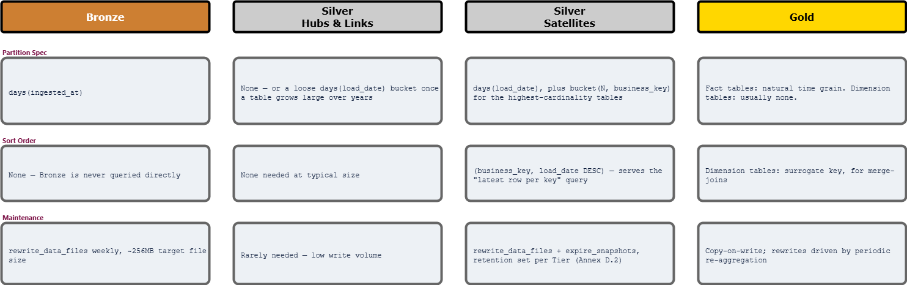

# Apache Iceberg at Nexus

*Companion document to* `Lakehouse_Architecture.md` *and* `Data_Principles.md` *L2 (Open formats; no vendor dependency). `Lakehouse_Architecture.md` already makes the case for a Lakehouse over a bare Data Lake, argues ACID transactions are non-negotiable, and explains why time-travel is the mechanism behind Data Principles T1's traceability promise — none of that is repeated here. This document picks up two things that document deliberately left open: why Apache Iceberg specifically, not "Iceberg or Delta Lake" as an interchangeable pair (as* `Lakehouse_Architecture.md` *phrases it), and how Nexus's actual tables — Bronze, Silver's Hubs/Links/Satellites, and Gold — should be laid out inside it.*

**Part:** 3 — How it is built · **Document:** 16 of 22 · **Version:** 0.1 · **Status:** Draft · **Last Updated:** 2026-09-22

## **Executive Summary**

`Lakehouse_Architecture.md` settled *why a Lakehouse at all* — ACID, time-travel, and a catalog-managed table format instead of a bare pile of files. It never settled *which* Lakehouse table format, treating Iceberg and Delta Lake as one bundled option throughout. That's a real, currently-unmade decision, and it matters concretely for Nexus: Iceberg's governance, its Flink integration, and its partition-evolution model all line up with commitments this documentation set has already made elsewhere. The second half of this document is the part `Lakehouse_Architecture.md` never attempted — concrete partition specs, sort orders, and maintenance cadences for Bronze, Silver's Data Vault tables, and Gold, not just the argument that a Lakehouse should exist.

## **Why Iceberg, Specifically**

| | Apache Iceberg | Delta Lake |
| --- | --- | --- |
| Governance | Apache Software Foundation — vendor-neutral by the ASF's own rules; no single company can steer the project regardless of who employs the most committers | Linux Foundation-hosted, but engineering direction still centers heavily on Databricks |
| License | Apache 2.0 | Apache 2.0 — both are genuinely open here; license isn't the differentiator it was for Vault/OpenBao |
| Flink support | First-class and mature | Historically Spark-native; multi-engine support (Delta Kernel) is newer and less mature |
| Hidden partitioning | A query filtering on `event_timestamp` gets partition pruning automatically, without referencing the derived partition column | More Hive-style — the query must explicitly reference the partition column or pruning silently fails |
| Partition evolution | A table's partition spec can change without rewriting existing data — old files keep their old spec, new files use the new one | Historically required a rewrite; "liquid clustering" is a newer, different answer to similar pain, not equivalent |
| Schema evolution | Column-ID-based tracking — a rename is a metadata-only operation, not a name-matching heuristic | Name-based; generally solid, but less robust specifically for renames |
| Catalog ecosystem | An open REST Catalog spec — Nessie, Polaris, and even Databricks' own Unity Catalog now speak it | Catalog options exist, but the neutral-protocol story is newer and thinner |

Two of these rows do more work than the rest. **Flink support isn't an abstract ecosystem-breadth point — Nexus already commits to Apache Flink** for real-time streaming analytics on Kafka streams (`ELT-ETL_Orchestration_Tooling.md`). Choosing a table format whose Flink integration is first-class rather than a newer, thinner one is a decision Nexus's own stack already leans toward. **Partition evolution without rewriting data is the same principle this entire documentation set keeps returning to** — Data Principles P5's "safe to evolve, safe to remove," Data Vault's non-breaking Satellite/Link additions, DLC's graph extension by new edge types. A table format that requires rewriting history every time a Dominion's query patterns change would be the one piece of the stack quietly violating a principle everything else honors.

**Verdict on Part 1:** Iceberg, specifically — not because Delta Lake is a bad format, but because two of Iceberg's real technical differentiators happen to match commitments Nexus has already made independently of this choice.

## **How Storage Should Be Modeled**

`Lakehouse_Architecture.md`'s Honest Trade-Offs table already names the risk: *"time travel isn't free storage-wise... snapshot expiration is an operational job Nexus must actually schedule, not a one-time setting."* It doesn't say what that job is, or how a table should actually be laid out. This section does.

### **Bronze**

Partition by `days(ingested_at)` — a direct match for append-only, time-ordered writes; a partition, once written, is never touched again. Streaming ingestion via Kafka/Flink tends to produce many small files, so Bronze needs a scheduled compaction job (`rewrite_data_files`) targeting roughly 256MB files — left unscheduled, the small-file problem quietly degrades every downstream Silver read. Sort order is not worth investing in here: per `Medallion_Architecture.md`, nobody runs an ad-hoc analytical query against raw Bronze, so there's nothing to optimize for.

### **Silver — Hubs and Links**

Small, slow-growing tables — a Hub gains a row only when a genuinely new business key appears; a Link only when a new relationship does. Most Hub and Link tables are small enough that partitioning adds overhead without buying anything; a loose `days(load_date)` bucket is enough once a Hub grows large enough over years of operation to matter.

### **Silver — Satellites**

This is where the real volume lives — every changed attribute value, ever, per Hub or Link. Partition by `days(load_date)`, sort by `(business_key, load_date DESC)`. That sort order directly serves the single most common Data Vault access pattern — "give me the current row per key" (a `ROW_NUMBER() OVER (PARTITION BY business_key ORDER BY load_date DESC)` window query) — by letting Iceberg's file-level min/max stats skip files that can't contain the latest row for a given key, instead of scanning every version ever written.

For the highest-cardinality Satellites — a citizen-level table at national scale — add a secondary `bucket(N, business_key)` transform alongside the date partition. This is hidden partitioning doing real work, not a feature listed for its own sake: a query for one citizen's full history only has to touch the relevant bucket within each day's partition, not every file written that day.

Worth stating explicitly, since it connects two documents that haven't been connected yet: **Data Vault's insert-only discipline (`Data_Vault_2.0.md`) means Satellites never face Iceberg's costlier merge-on-read maintenance mode at all.** There's no in-place `UPDATE` to merge on read, because Data Vault never updates a Satellite row — a changed value is a new row, always. The modeling discipline `Data_Vault_2.0.md` argued for on data-integrity grounds also happens to be the cheapest possible shape for Iceberg to maintain.

### **Gold**

Partition fact tables by their natural time grain — most Gold consumption queries filter by a date range for reporting, so this is rarely a judgment call. Dimension tables are usually small enough to skip partitioning entirely; the more useful lever there is sort order on the surrogate key, to help merge-joins against fact tables. Gold is read-heavy and rarely updated in place except for periodic re-aggregation, so copy-on-write — rewriting affected files fully on update rather than tracking row-level deletes — is the right default; the read performance it buys is worth more here than the write-amplification it costs, which is the opposite trade-off from a table with frequent small updates.

### **Maintenance, Made Concrete**

Three Iceberg procedures, run on a schedule (an Airflow job, matching the orchestration choice in `ELT-ETL_Orchestration_Tooling.md`), not left to accumulate:

* **`rewrite_data_files`** — compacts small files into target-sized ones. Runs most often against Bronze and Satellite tables, where high-frequency small writes are the norm.
* **`expire_snapshots`** — the operational job `Lakehouse_Architecture.md` already flagged as necessary but didn't name. Retention length is a per-Dominion-owner decision, the same way Annex D.2 already lets an owner commit to a stricter SLO than their Tier's floor — a Tier 1 dataset subject to Annex E.3's mandatory quarterly restore drill needs a retention window long enough to support that drill; a Tier 3 analytical table doesn't need the same discipline.
* **`remove_orphan_files`** — cleans up files left behind by failed or interrupted writes that no snapshot ever ended up referencing. Cheap to run, easy to forget, and the one job most likely to be skipped because nothing breaks visibly when it isn't run — until storage costs quietly climb for files no query can even see.

## **Worked Example: Modeling the Citizen Satellite Table**

The Civil Registry Dominion's `Citizen Satellite` (`Data_Vault_2.0.md`) carries every historical name, address, and date-of-birth correction for every citizen, nationally — exactly the highest-cardinality case above.

* **Partition spec:** `days(load_date)`, `bucket(64, citizen_business_key)`.
* **Sort order:** `(citizen_business_key, load_date DESC)`.
* **Target file size:** 256MB, enforced by a weekly `rewrite_data_files` job.
* **Snapshot retention:** owned by the Civil Registry Dominion's accountable owner (Annex C.2); if this data product commits to Tier 1, retention is sized to support Annex E.3's quarterly restore drill, not left at a platform default.
* **Format version:** v2, since occasional corrections (a caseworker fixing a data-entry error, not a new fact) benefit from Iceberg's row-level delete support rather than forcing every fix through a full file rewrite.

A caseworker's "every address this citizen has had" query touches one bucket within each relevant day's partition — not a full-table scan — because the partition spec was chosen for this exact access pattern, not applied as a generic default.

## **Diagram**

*Diagram: partition spec, sort order, and maintenance cadence, side by side per Medallion layer — a reference, not a decoration. (Editable source: `Apache_Iceberg.drawio`.)*

## **Strengths**

| Strength | What it actually buys Nexus |
| --- | --- |
| Matches Nexus's own stack, not an abstract feature list | Iceberg's Flink integration and partition evolution line up with commitments (Data Principles D4, Data Principles P5) that exist independently of this document |
| Insert-only Data Vault gets the cheapest possible Iceberg shape | Satellites never trigger merge-on-read maintenance, because they never update a row in place — two documents' arguments reinforcing each other, not by coincidence |
| Hidden partitioning turns a scaling problem into a config line | The highest-cardinality Satellite tables get bucket-level pruning without every downstream query needing to know the bucketing scheme exists |
| Maintenance is named, not just warned about | `expire_snapshots`, `rewrite_data_files`, and `remove_orphan_files` are specific jobs with specific triggers, not a general "watch your storage costs" caution |

## **Honest Trade-Offs**

| Trade-off | The real cost |
| --- | --- |
| Iceberg specifically means one fewer format to hedge on | Committing to Iceberg over Delta Lake forecloses Databricks-native tooling that assumes Delta as the default — a real cost for a client already deep in that ecosystem, even if it's the right call for Nexus's own stack |
| Bucket transforms are a one-way design decision at scale | Changing a bucket count on a table with billions of rows means a real rewrite, unlike simple partition-spec evolution — the highest-cardinality Satellites need their bucket count chosen deliberately, not left at a default and revisited later |
| Maintenance jobs are new operational surface | Three more scheduled jobs per table family is three more things that can silently stop running — `remove_orphan_files` specifically fails quietly, since nothing breaks visibly when it's skipped |
| Format version 2 isn't free | Row-level deletes buy cheaper corrections at the cost of read-side complexity (merge-on-read for tables that actually use deletes) — worth choosing per table, not applied as a platform-wide default |

## **Verdict**

`Lakehouse_Architecture.md` already answered *why a Lakehouse*; this document answers the two questions it left open. Iceberg over Delta Lake isn't a coin flip resolved by abstract feature comparison — it's the format whose Flink integration and partition-evolution model happen to match commitments Nexus already made elsewhere, for reasons that have nothing to do with storage format. And the storage-modeling half isn't generic Iceberg advice — Bronze's `days(ingested_at)` partitioning, Satellites' bucketed hidden partitioning, and Gold's copy-on-write default all follow directly from what each layer already is, per `Medallion_Architecture.md` and `Data_Vault_2.0.md`. The table format was never the hard part; modeling Nexus's actual tables inside it, deliberately, is.
