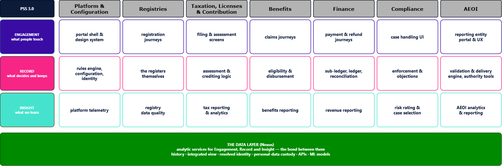

# The Data Layer in Blyce 2030

*First of five short documents on the data layer for the Public Services Suite (PSS 3.0). Written for the whole Product Vision & Design unit — product owners, business analysts, UX designers and architects alike. It answers one question: what is a data layer, from Blyce 3.0's perspective? The other four answer how it helps build systems of Insight, Record and Engagement, and what problems it must solve. Nexus is the name of this data layer.*

**Part:** 1 — Start here · **Document:** 1 of 22 · **Version:** 0.1 · **Status:** Draft · **Last Updated:** 2026-09-22

## **The short answer**

The data layer is what lets **one configurable suite serve any legislation without custom development**.

It does that by holding three things no single system holds on its own:

* **History** — what was true, and when it changed.
* **The integrated view** — what is true *across* value streams, not only inside one.
* **Resolved identity** — who is actually the same person or business across different registers.

It also holds what must be kept *safely* rather than wherever happens to be convenient — above all personal data, so that erasure and retention become obligations we can enforce instead of promise.

And it offers all of this as services — APIs, machine-learning models and AI infrastructure — to every part of the suite.

Everything else in this document follows from that.

## **The matrix we work in**

PSS 3.0 is organised as three types of system across seven value streams — Platform & Configuration, Registries, Taxation/Licenses/Contribution, Benefits, Finance, Compliance, and AEOI.

*AEOI is the Automatic Exchange of Information standard: financial institutions report accounts held by foreign tax residents, and authorities exchange that data annually with partner jurisdictions.*

* **Engagement** — what people touch: the portal shell and design system, registration journeys, filing and assessment screens, claims journeys, payment and refund journeys, case handling UI.
* **Record** — what decides and keeps: the rules engine, configuration and identity, the registers themselves, assessment and crediting logic, eligibility and disbursement, ledger and reconciliation, enforcement and objections.
* **Insight** — what we learn: platform telemetry, registry data quality, tax, benefits and revenue reporting, risk rating and case selection, AEOI analytics.

*The three types of system are technically independent but functionally belong together.* Each can be built, changed and deployed on its own — yet a citizen never experiences them separately. Filing a return is all three at once.

## **Where the data layer sits**

The data layer is not a fourth row. It is **the bond between the three**: it provides analytic services to Engagement, Record and Insight alike, and it is how data moves between them.

* **For Engagement** — forms pre-filled from what is already known, ready-to-display views, explanations of how a number was reached.
* **For Record** — duplicate resolution, assessment of prerequisites for go / no-go decisions, history, custody of personal data.
* **For Insight** — the integrated view, reporting, risk rating and the models behind it.

*Diagram: the three system types across the seven value streams, with the data layer beneath them. (Editable source: `Data_Layer_Matrix.drawio`.)*

## **Who is authoritative — and why we are not deciding that yet**

The suite's vision states that the system of record is the single source of truth. That is the right starting position. It is not yet a universal rule, and this document deliberately does not write one into the architecture, because **the data layer's role varies with the kind of data**.

| Role | When it applies | Example |
| --- | --- | --- |
| **Primary custodian** — the data layer holds the authoritative copy | The obligation cannot be met anywhere else | Personal data, held so that erasure and retention are enforceable rather than promised; the core holds a reference, not the raw value |
| **Sole holder** — nobody else has it at all | The information exists in no single system | The three things named above: history, the integrated view, resolved identity |
| **Derived** — a Record module decides, the data layer follows | A decision must be correct right now, within one value stream | Whether this claim is eligible; the current balance on an account |

Three open questions have to be answered before this can be settled, and each carries real consequences:

1. **How simple can the core stay?** If every jurisdiction's variation, every historical obligation and every new field must land in the core's own databases, the core becomes the per-client complex thing the suite exists to eliminate. Pushing that outward — the core tracks events, hands work to an engine, takes the answer back — keeps it simple, but moves it further from being the single source of truth.
2. **Where does personal data live?** Spread through core databases wherever it was convenient, erasure and retention are promises we cannot keep. Concentrating custody in the data layer makes them mechanical — and makes the data layer primary for the most sensitive data we hold.
3. **What status does the event stream have?** If modules communicate through events, the record of what happened may itself be authoritative — neither "core" nor "derived" in any simple sense.

**This is a decision for the Architecture Retreat, not for this document.** What we commit to here is narrower, and safe whichever way it goes: for any given piece of data there is **exactly one authoritative place, it is named explicitly, and it is never left ambiguous**. Which system that is depends on the data.

## **The order we design in**

The design sequence is fixed:

1. Which data-driven decisions are to be made?
2. What data must be recorded in the core?
3. Through what engagement will this data be obtained?

Insight first, then Record, then Engagement — which is why these five documents are ordered that way.

Skip the sequence and the failure is silent and permanent. Screens get built; the core records whatever the screens happen to collect; a year later someone asks *how long does an assessment actually take?* — and nobody can answer, because status changes were never kept with their dates. **No report can recover data the core never wrote down.**

## **Why this is the zero-custom-development lever**

"Supporting any legislation, reducing custom development to zero" is the hardest promise in the suite. For the data layer it reduces to one rule: **rules, rates, thresholds, exemptions and report definitions are data, not code.**

* A rate change mid-budget-cycle is a data change, not a release.
* A new country's reporting is configuration over the same model, not a new report build.
* A jurisdiction's extra field is configuration, not a new column and a migration.

When that holds, a new country is an onboarding. When it does not, it is a project — and we are back to teams aligned to clients instead of to outcomes.

## **Where to go next**

* `Data_Layer_for_Insight.md` — the decisions we serve, and why they come first.
* `Data_Layer_for_Record.md` — what the data layer adds that the core does not hold.
* `Data_Layer_for_Engagement.md` — ending "each portal has its own database".
* `Data_Layer_Problems.md` — the problems we must solve, and how we will know whether we did.
