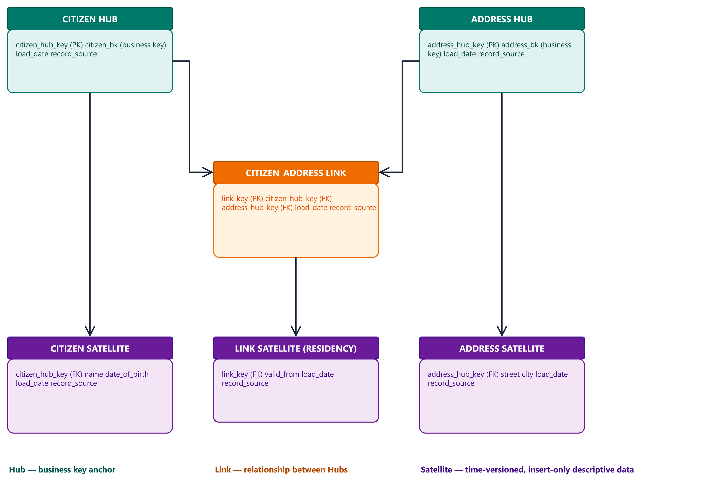

# Data Vault 2.0 at Nexus

*Companion document to* `Nexus_Constitution.md` *§6 (Technologies and Methodologies, "Data Modeling & Structuring") and its Glossary entry for Data Vault 2.0. This document expands on what Hubs, Links, and Satellites actually are, argues specifically why Data Vault 2.0 belongs in the Silver layer of the Medallion Architecture (see* `Medallion_Architecture.md`*) and nowhere else, and compares it honestly against the two modeling techniques most engineers would otherwise reach for — 3NF and the Kimball star schema.*

**Version:** 1.0 · **Status:** Draft · **Last Updated:** 2026-08-31

## **Executive Summary**

Constitution §6 names Data Vault 2.0 in one line, under "Data Modeling & Structuring": it "handles complex, rapidly changing enterprise data models for auditing and extreme agility." That line doesn't say what a Hub, a Link, or a Satellite actually is. It doesn't say why this modeling technique belongs specifically in Silver rather than Bronze or Gold — both of which Constitution §6 also names. And it doesn't explain why Data Vault beats the two modeling techniques most engineers trained on enterprise data warehousing would default to instead: third normal form (3NF) and the Kimball star schema. This document is that expansion.

The short version: Data Vault's insert-only, Hub/Link/Satellite structure is not a stylistic modeling preference — it is the same append-only, time-versioned discipline Constitution §5 ("Immutability & Radical Traceability") already mandates for Bronze, carried one layer up to the one place in the pipeline that needs it most. Silver is where Nexus first has typed, resolved business keys to build on, and it is where data from multiple Dominions must integrate without yet knowing every future consumer's shape — a Gold table, an API, a feature store not yet designed. Hubs and Links map almost directly onto the identity-resolution model already committed to in `nexus_foundations.md`, Annex B. New Dominions and new attributes are absorbed by adding Satellites and Links, never by altering what already exists — the same non-breaking evolution Constitution §4 already commits Nexus to elsewhere. 3NF and Kimball both solve real problems, just not this one, at this layer.

## **What Data Vault 2.0 Is**

Data Vault 2.0 decomposes a data model into three kinds of table, each with a single, narrow job:

* **Hubs** — the business-key anchors. A Hub holds nothing but a surrogate key, the resolved business key it represents, a load date, and a record source. A `Citizen Hub` keyed on a resolved identity and an `Institution Hub` keyed on a registered institution ID are Hubs. A Hub never holds a descriptive attribute — no name, no address, no status — only the fact that this business key exists and when Nexus first learned about it.
* **Links** — the relationships between Hubs. A `Citizen-Owns-Property Link` connects a `Citizen Hub` row to a `Property Hub` row. A Link, like a Hub, carries no descriptive attributes of its own — only the foreign keys of the Hubs it connects, a load date, and a record source. Relationships are first-class rows, not foreign keys bolted onto a Hub.
* **Satellites** — the descriptive, time-versioned attributes hanging off a Hub or a Link. A `Citizen Satellite` might carry name and date of birth; an `Address Satellite` might carry street and city. Every Satellite row carries a load date and is never updated in place — a changed name doesn't overwrite the old row, it inserts a new one. The current value is simply the Satellite row with the latest load date for that key; every prior value stays exactly where it was written.

The discipline underneath all three: Data Vault tables are insert-only. Nothing is ever updated or deleted. A Satellite row is superseded by a newer row, never rewritten — the same guarantee Constitution §5 ("Immutability & Radical Traceability") already requires of Bronze, expressed at the Silver layer, where the data is now typed and resolved rather than raw.

*Diagram: Data Vault 2.0 — a Citizen Hub and an Address Hub, connected by a Citizen-Address Link, with Satellites carrying the time-versioned descriptive attributes for each. (Local image file, Data_Vault_2.0.png; not yet attached to this Confluence page — no attachment tool is available in this sync session, so it is noted here rather than embedded as a broken reference.)*

*Editable source: `Data_Vault_2.0.drawio`.*

## **Why Silver, Specifically**

`Medallion_Architecture.md` already sets the boundary this document has to respect: Bronze is raw and schema-less, Silver is "cleaned, typed, deduplicated, Dominion-scoped... still Dominion-shaped — it hasn't been aggregated for any particular audience yet," and Gold is "aggregated, joined across Dominions where needed, and shaped for a specific consumption pattern." Data Vault fits exactly one of those three descriptions.

* **Not Bronze.** A Hub needs a typed, resolved business key to anchor itself on. Bronze is schema-less raw payloads by design — there is no resolved key yet to build a Hub around, and no cleaning has happened for a Satellite to describe. Data Vault has nothing to attach to until Bronze has already been parsed and typed.
* **Not Gold.** Gold is deliberately denormalized and shaped for one consumption pattern — a reporting table, an API response, a feature store — because it's answering a known question fast. Data Vault is the opposite on purpose: it stays normalized and integration-shaped, because at the point it's built, Nexus doesn't yet know every future consumer or every future question. Building a Hub/Link/Satellite model in Gold would mean giving up the one property Data Vault exists to provide.
* **Exactly Silver.** Silver is the one zone that needs both properties at once: enough structure to be trustworthy — typed, resolved, deduplicated — and the ability to integrate data across multiple Dominions without knowing in advance every future consumer's shape. That is precisely what Data Vault is built to do, and precisely why Constitution §6 places it in "Data Modeling & Structuring" alongside Medallion rather than as a competing storage pattern.

## **Why It Beats the Alternatives, for Nexus Specifically**

Every enterprise data platform faces this same modeling choice at the integration layer. Nexus's answer isn't the default one, and the two rejected alternatives are both legitimate techniques — just not for this layer, in this architecture.

* **3NF (third normal form) — rejected.** 3NF is the traditional enterprise-integration answer, and it isn't wrong in the abstract — it's just brittle in exactly the way Nexus can't afford. A 3NF schema is designed up front around a known set of entities and relationships; when a new Dominion's data model doesn't match what was assumed, the fix is an `ALTER TABLE` against tables other Dominions already depend on. Worse, 3NF's normal mode of operation is updating rows in place — a changed address overwrites the old one. That directly conflicts with Constitution §5 ("Immutability & Radical Traceability"): the moment Silver starts overwriting history, "what did we believe about this citizen last Tuesday" stops being answerable from Silver at all.
* **Kimball star schema (dimensional modeling) — rejected for Silver, specifically.** A star schema isn't a bad technique — it's the right technique for Gold. It's a consumption-shaped, denormalized pattern, built around one audience's known query patterns: a fact table, a handful of conformed dimensions, optimized for a specific class of report. Building star schemas in Silver means picking one audience's shape before every Dominion has even finished contributing, and before anyone knows what the second, third, and tenth consumer will actually need. That's exactly the job Gold already exists to do, one layer up.
* **Data Vault 2.0 — the choice.** Insert-only Satellites map directly onto the append-only, time-travel discipline Constitution §5 ("Immutability & Radical Traceability") already requires everywhere else in Nexus — nothing new is being invented at Silver, the same guarantee is just being carried one layer up, now over typed and resolved data instead of raw payloads. The Hub/Link structure maps almost 1:1 onto Annex B's identity model: a Hub is structurally the same idea as a resolved `Subject` / `LocalIdentity` anchor — a thin, stable identifier that never drifts — and a Link is structurally the same idea as a `SAME_AS` relationship or any other cross-Dominion association: a first-class row describing a relationship, not a foreign key silently bolted onto an entity. And because new Dominions or new attributes are absorbed by adding new Satellites or Links, never by altering what's already there, Data Vault gets the "safe to evolve without breaking what's there" property Constitution §4 already commits Nexus to elsewhere — the same foundation `Hexagonal_Architecture.md` invokes for adapters at the system's edge, here applied to the data model itself.

## **Worked Example: Onboarding the Vehicle Registry Dominion**

Nexus is live. The Civil Registry Dominion's `Citizen Hub`, `Address Hub`, `Citizen-Address Link`, and their Satellites have been running in production for months, with other Dominions already querying Silver and building Gold products on top of them. A new Dominion — Vehicle Registry — is ready to join. It needs to register vehicles and record which citizen owns which vehicle.

**In Data Vault:**

1. A new `Vehicle Hub` is created — surrogate key, `vehicle_bk` (e.g. a VIN), load date, record source. This is a brand-new table; it touches nothing that exists.
2. A new `Citizen-Owns-Vehicle Link` is created, connecting `Citizen Hub` to the new `Vehicle Hub`. It references `Citizen Hub`'s existing key but does not alter the `Citizen Hub` table itself — a Link only ever adds a new row to a new table.
3. A new `Vehicle Satellite` is created for descriptive attributes — make, model, registration date, load date, record source.
4. The Vehicle Registry Dominion starts loading. `Citizen Hub`, `Address Hub`, `Citizen-Address Link`, and their existing Satellites are never touched — not their schema, not their data, not a single row. Every Gold product already built on top of them keeps running, unmodified, through the entire onboarding.

Zero migration downtime, because there was never a migration — only new tables and new rows.

**In 3NF**, the same onboarding looks different. If citizen ownership was modeled as a `vehicles` table with a `citizen_id` foreign key back to a central `citizens` table, adding Vehicle Registry likely means an `ALTER TABLE citizens ADD COLUMN` (if a citizen-side attribute is needed) or, worse, discovering that the existing `citizens` table's assumptions — one address per citizen, say — don't hold for how Vehicle Registry needs to model ownership history, forcing a migration that touches a table every other Dominion already depends on. That migration needs a maintenance window, a rollback plan, and coordination with every consumer of `citizens` — for a change that, in Data Vault, was three new tables and zero edits to anything already in production.

This is the concrete shape of the trade Constitution §4 already committed Nexus to: a platform that's safe to evolve is one where adding something new never requires touching what's already there.

## **Strengths**

| Strength | What it actually buys Nexus |
| --- | --- |
| Full history preserved | Every Satellite version is kept — a changed name or address is a new row, not a lost one. "What did we believe last Tuesday" is a query, not a restore. |
| Parallel-loadable | Hubs, Links, and Satellites can load independently of each other — a new Satellite doesn't wait on its Hub's next run. This matches the "Asynchronous by Default" principle Constitution §5 already requires of Nexus's pipelines. |
| Auditability | Every row's load date and record source are structural, not bolted on — directly serving Constitution §5 ("Immutability & Radical Traceability") and the audit requirements `nexus_foundations.md` Annex A already commits to elsewhere in the pipeline. |
| Non-breaking schema evolution | New Dominions and new attributes arrive as new Hubs, Links, or Satellites — never as an alteration to a table another Dominion already depends on. |
| Business keys stay stable | A Hub's business key is the one thing that almost never needs to change, so the anchor every Link and Satellite depends on is the most stable part of the model, not the most volatile. |

## **Honest Trade-Offs**

| Trade-off | The real cost |
| --- | --- |
| Query complexity | Reconstructing a full picture of one citizen means joining across many Hub, Link, and Satellite tables — a query no BI Engineer wants to hand-write against Silver directly. This is exactly why Gold exists: to pre-join Data Vault's normalized structure into something a report or an API can query in one shot. |
| More tables to operate and name consistently | A single `citizens` table in 3NF becomes a Hub, at least one Satellite, and a Link for every relationship it participates in. Naming-convention discipline — `_hub`, `_link`, `_sat` suffixes, consistent business-key naming across Dominions — becomes load-bearing; an inconsistent Dominion makes the whole Data Vault harder to navigate, not just its own corner of it. |
| Unfamiliar to most engineers | Engineers coming from a 3NF or Kimball background have to unlearn "update the row" and "denormalize for the report" before Data Vault feels natural rather than needlessly indirect. This is a real onboarding cost — the same kind of cognitive shift Constitution §8 already names for the move from relational to schema-less thinking, not a cost this document should pretend away. |

## **Verdict**

Constitution §6's one line — "handles complex, rapidly changing enterprise data models for auditing and extreme agility" — is a fair summary of what Data Vault 2.0 delivers, but it doesn't explain why Silver specifically is where that delivery happens. Bronze has no resolved keys for a Hub to anchor on; Gold has already committed to one audience's shape, which is exactly what Data Vault is built to defer. Silver is the one layer that needs structure and integration across Dominions at the same time, before every future consumer is known — and insert-only Hubs, Links, and Satellites are what let new Dominions and new attributes arrive without altering a single thing already in production. 3NF and Kimball both solve real problems elsewhere in this documentation set's own logic — Kimball is what Gold already is, and 3NF's brittleness is precisely what Constitution §5's immutability mandate rules out at Silver. Data Vault 2.0 is not the more sophisticated choice for its own sake; it is the one modeling technique that was never going to force a migration the day a new Dominion shows up.
