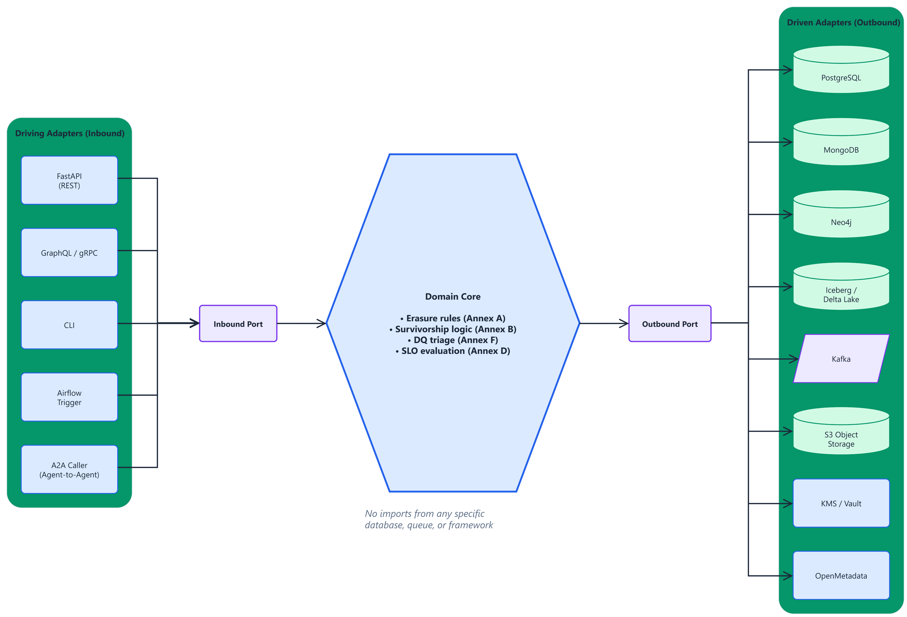

# **Hexagonal Architecture at Nexus**

*Companion document to* **`Nexus_Constitution.md`** *§5.5 (Strict Boundary Enforcement). This document expands on why Nexus is built with Hexagonal Architecture, states its strengths and its honest trade-offs, and argues specifically why this is the right foundation for a data product that must run across on-premise, cloud, and hybrid deployments.*

**Version:** 1.0 · **Status:** Draft · **Last Updated:** 2026-08-27

## **Executive Summary**

Hexagonal Architecture — also known as "Ports & Adapters" — is a way of building software so that the business rules never know, and never care, what database, message queue, or API framework happens to be plugged in around them. The rules live in one protected core; everything that talks to the outside world is an interchangeable adapter around it.

Nexus adopts this deliberately, not as a fashionable pattern, but because of a fact stated plainly in the Constitution: Nexus must deploy across On-Premise infrastructure and Cloud Services, adapting to whatever a given client already has (Constitution §1). A data platform whose core rules are wired directly into one specific database or one specific cloud service cannot do that without being rewritten, or forked, per client. Hexagonal Architecture is what makes "one core, many deployments" possible at all.

This is not a cost-free choice. It adds real upfront complexity, and it only pays off if the boundary is actually enforced. Both sides of that trade-off are stated here in full — an executive summary that only listed the benefits would not be trustworthy.

## **What Is Hexagonal Architecture?**

The everyday analogy: a wall socket doesn't care what you plug into it, as long as the plug matches the standard. The building's wiring — the part that is expensive and dangerous to change — is never touched when you swap a lamp for a heater. Hexagonal Architecture applies the same idea to software: the "wiring" is the business logic, and everything else is a plug.



*Editable source: `Hexagonal_Architecture.drawio`.*

In Nexus's own vocabulary: the **Domain Core** is a Dominion's actual business logic — the rules that decide what counts as a valid schema change, how two records get resolved into one `Subject 360`, whether a DQ failure auto-quarantines or escalates. The **Adapters** are every specific technology named in Constitution §6 — Postgres, MongoDB, Neo4j, Iceberg, Kafka, FastAPI, OpenMetadata. The **Ports** are the strict interface contracts between them, which is what Constitution §5.1 (API-First & Contract-Driven Interactions) already requires at the edges.

## **Worked Examples**

The diagram above is abstract by necessity — it has to cover every Dominion. The concrete effect of the boundary is easiest to see one port at a time.

### Example: Object Storage

Somewhere in the domain core, a rule decides that a raw file — a PDF, an image, a video — needs to be persisted (Constitution §6: "Unstructured Object Storage, S3 API Compatible"). The core knows *that* a blob needs saving and *what key/metadata* it belongs under. It must never know or care *where* that blob physically ends up — that answer changes per client, and sometimes per environment for the same client.

So the core only ever calls an **Outbound Port** it owns the definition of:

```
ObjectStoragePort:
    put(key, bytes, metadata) -> ObjectRef
    get(key) -> bytes
    delete(key) -> None
```

Every concrete backend is a **Driven Adapter** that implements this same contract — same method names, same inputs, same guarantees — and nothing else in the core changes when the adapter changes:

| Client's infrastructure | Concrete adapter | What's actually plugged in |
|---|---|---|
| AWS-native client | `S3StorageAdapter` | `boto3` client against AWS S3 |
| Azure-native client | `AzureBlobStorageAdapter` | Azure SDK against Blob Storage containers |
| GCP-native client | `GCSStorageAdapter` | `google-cloud-storage` against a GCS bucket |
| On-premise client | `OnPremStorageAdapter` | A self-hosted, S3-API-compatible store (e.g. MinIO) against the client's own disks |

Whichever one is wired in is a deployment-time decision (dependency injection / config), not a code change to the erasure rules, the survivorship logic, or anything else in the core. Onboarding a fifth client running a different object store means writing one new adapter class against the same `ObjectStoragePort` contract — the domain core, and every rule already certified inside it, is never touched.

### Example: Updating a Record in a Database

Survivorship logic (Annex B) decides that two duplicate records resolve into one `Subject 360`: the surviving record gets a set of merged fields, the losing record gets superseded. The core knows *which fields change* and *why* — it must never know or care *how* that change is physically written to whatever database a given client runs.

So, again, the core only ever calls one port it owns:

```
RecordStorePort:
    update(collection, key, changes) -> None
    read(collection, key) -> Record
```

This is the case worth calling out explicitly, because "update a record" is *not* the same operation across databases — each one has its own native method for it, and that's exactly the difference the adapter is there to absorb:

| Database | Concrete adapter | The database's own way of doing "update" |
|---|---|---|
| PostgreSQL | `PostgresRecordAdapter` | An SQL `UPDATE ... SET ... WHERE id = :key` statement, run inside a transaction |
| SQL Server | `SqlServerRecordAdapter` | T-SQL `UPDATE`, same relational shape, its own driver (`pyodbc`) and locking behavior |
| MongoDB | `MongoRecordAdapter` | No `UPDATE` statement at all — the same `changes` are translated into `update_one({_id: key}, {"$set": changes})` |
| DuckDB | `DuckDBRecordAdapter` | SQL `UPDATE`, but DuckDB is embedded and effectively single-writer — this adapter is also where concurrent `update()` calls get serialized before they reach the file |

The domain core calls `RecordStorePort.update(collection, key, changes)` exactly once, the same way, regardless of which row of that table is behind it. Postgres's transaction, SQL Server's own driver, Mongo's operator-based partial update, and DuckDB's single-writer constraint are all real differences — but every one of them is absorbed inside the matching adapter, never leaked into the survivorship rule that triggered the update.

This is the general pattern behind every row in Constitution §6: one contract lives in the core, and one adapter per concrete technology absorbs that technology's own way of doing the same job.

## **Why This Is the Right Call for a Data Product Like Nexus, Specifically**

This isn't a generic architecture preference — it follows directly from Nexus's deployment reality, which is genuinely unusual for a data platform:

* **A different client, a different infrastructure, the same core.** One client runs on-premise on their own Kubernetes cluster (Annex D.4); another runs in the cloud; a third runs the hybrid topology in Annex G, with a client-key-encrypted cloud backup behind an on-premise primary. If the erasure logic, survivorship rules, or DQ triage were written against a specific database's API, each of these would need its own fork of that logic. With the boundary enforced, onboarding a client who insists on a database they already operate and license is one new adapter — the core logic that was already reviewed, tested, and trusted is never touched, let alone re-certified.
* **Compliance-critical logic holds by construction, not by convention.** Annex A's crypto-shredding and legal-hold checks live in the domain core, not in a Postgres adapter or a MongoDB adapter. That means a client's choice of storage technology can never accidentally bypass GDPR erasure — the guarantee is structural, not something every adapter has to remember to re-implement correctly.
* **Technology changes without a rewrite.** Constitution §1 names cost and resource efficiency as a core motivation. Swapping Iceberg for Delta Lake, or replacing one message broker, becomes a contained adapter change — not a rewrite of the rules that make Nexus what it is.
* **It is the concrete mechanism behind an existing principle.** Constitution §5.5 already commits Nexus to this boundary in one sentence. This document is that sentence, expanded into the reasoning an engineer — or a client's technical stakeholder — would actually ask for.

## **Strengths**

| Strength | What it actually buys Nexus |
|---|---|
| Deployment portability | The same core runs on-premise, in the cloud, or hybrid (Annex G) without modification — this is the whole reason it was adopted. |
| Technology substitutability | A storage or messaging technology can be replaced by writing a new adapter, without touching business rules. |
| Testability | Domain logic (erasure decisions, survivorship, DQ triage) can be unit-tested with no live database, queue, or cluster — faster, cheaper CI, and confidence that isn't dependent on infrastructure being up. |
| Uniform policy enforcement | GDPR, data quality, and identity-resolution rules are enforced once, centrally — not re-implemented, and potentially re-implemented incorrectly, in every adapter. |
| Safer evolution | Matches the "Evolutionary Design and Safe Destructibility" foundation in Constitution §4 — an adapter can be deleted and rebuilt without threatening the core it plugs into. |
| A clear mental model | New engineers have one answer to "where does this code go" — a genuine onboarding-speed benefit that's easy to underrate. |

## **Honest Trade-Offs**

| Trade-off | The real cost |
|---|---|
| Upfront complexity | More interfaces and layers than a straightforward CRUD application. For a tiny, short-lived data product, this can be genuine over-engineering — the pattern earns its cost on systems built to last and to vary, not on throwaway tools. |
| A real learning curve | New engineers need time to internalize what belongs in the core versus an adapter. This is not intuitive on day one. |
| Not self-enforcing | Declaring "we use Hexagonal Architecture" does not stop someone importing a database row type directly into domain logic. The boundary only holds if it's actively defended — through code review discipline and, ideally, automated dependency-direction checks (architecture tests / linting) — not through good intentions alone. |
| A small but real performance cost | The extra indirection must stay a thin pass-through. For a Tier 1 data product (Annex D: p99 ≤ 300ms), the abstraction layer itself must never become the latency problem — this needs active attention, not an assumption that it's free. |
| It solves a code problem, not an organizational one | A cleanly bounded core with no accountable Dominion owner (Annex C) is still an ungoverned data product. This architecture protects the boundary between logic and infrastructure; it says nothing about who is allowed to change that logic in the first place. |

## **Verdict**

Given Nexus's actual deployment reality — one client's Kubernetes cluster today, a different client's topology tomorrow, cloud for some, a hybrid on-premise-plus-cloud-backup model for others — the alternative to this architecture is not "a simpler system." It's a core that is quietly coupled to one client's infrastructure, forked the first time a second client's constraints don't match it, with no structural guarantee that compliance logic like GDPR erasure survives the fork correctly. The complexity this pattern adds is a deliberate, bounded cost, paid once, in exchange for not paying an unbounded, repeated cost — a new fork, and a new compliance review, for every future client whose infrastructure looks different from the last one.
