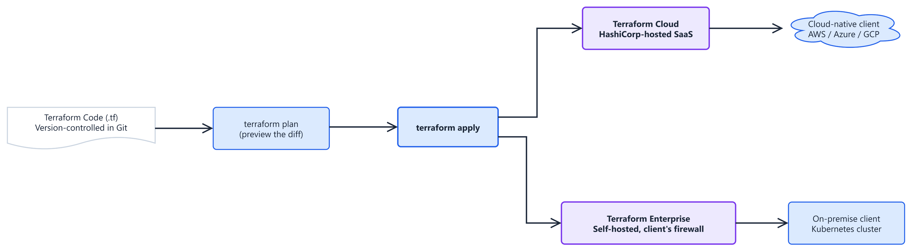

# **Infrastructure as Code at Nexus**

*Companion document to* **`Nexus_Constitution.md`** *§5.6 (Infrastructure as Code (IaC) as Mandatory). This document expands on why Nexus provisions every environment through code rather than by hand, surveys the alternatives, and argues specifically why Terraform — and its two operating flavors — is the right tool for a data product that must stand up a new dedicated deployment per client, on-premise or in the cloud, over and over again.*

**Version:** 1.0 · **Status:** Draft · **Last Updated:** 2026-08-27

## **Executive Summary**

Infrastructure as Code (IaC) means an environment — networks, clusters, databases, storage buckets, IAM roles, every piece of plumbing a Dominion runs on — is defined in version-controlled, declarative files, and built by running that code, never by a person clicking through a console or SSHing in to run one-off commands.

Nexus mandates this for a reason stated plainly in the Constitution: manual infrastructure configuration is prohibited (§5.6), and the default tenancy model is one dedicated deployment per client, each running on its own benchmarked Kubernetes cluster (`nexus_foundations.md`, Annex G). That default only survives contact with a fifth client, a tenth client, a fiftieth client if standing up a new environment is a repeatable, reviewable, automatable operation — not an engineer's memory of what they clicked last time.

This document picks Terraform specifically, not by default but by argument: what the realistic alternatives are, why Terraform's own history produced the model the rest of the industry converged on, and why its two operating flavors — Terraform Cloud and Terraform Enterprise — map directly onto Nexus's own cloud/on-premise duality. As with the Hexagonal Architecture document, the trade-offs are stated in full; a page that only listed advantages would not be trustworthy.

## **What Is Infrastructure as Code?**

The everyday analogy: a building built from an architect's blueprint can be inspected before a single brick is laid, rebuilt identically if it burns down, and hip-checked room by room without guessing what's structural. A building assembled from memory and verbal instructions can't be any of those things — and neither can a server fleet configured by hand. IaC is the blueprint discipline applied to infrastructure: the file *is* the environment, on paper, before it is real.



*Editable source: `IaC_Terraform_Workflow.drawio`.*

The same `terraform plan` / `terraform apply` workflow runs whether the target is a cloud client or an on-premise one — only which Terraform flavor executes it, and which infrastructure it lands on, changes. That symmetry is the point: it is Constitution §5.4 (Decoupled Compute and Storage) and §1 (Agnostic Deployment), applied to the tooling that builds the environment itself, not just the software that runs on it.

## **The Alternatives (and Why They Don't Fit Nexus)**

IaC is not a single tool — it's a category, and the category has real alternatives worth naming honestly before arguing for one of them:

| Approach | What it is | Why it falls short for Nexus |
|---|---|---|
| **ClickOps (manual console configuration)** | An engineer creates resources by hand in a cloud console or on-prem hypervisor UI. | Explicitly prohibited by Constitution §5.6. Not reproducible, not reviewable in a pull request, and a departed engineer's tribal knowledge of "what was clicked" is a single point of failure — the opposite of the auditability the rest of this documentation set demands. |
| **Ad-hoc shell scripts** | Bash/PowerShell scripts that call cloud CLIs (`aws`, `az`, `gcloud`) imperatively. | Describes *steps*, not *desired state* — re-running a script against an already-provisioned environment is unsafe, and nothing tells you what changed since last run without re-reading every script. No native concept of a diff before applying. |
| **Configuration management (Ansible, Puppet, Chef)** | Declarative-ish tools built to configure the *inside* of an existing machine — installed packages, running services, config files. | The right tool for a different job. They assume the machine already exists; provisioning the machine, network, and cloud account structure itself is not their design center. Nexus uses this category alongside Terraform where it fits (post-provision configuration), not instead of it. |
| **Cloud-native/proprietary IaC (AWS CloudFormation, Azure ARM/Bicep, GCP Deployment Manager)** | Declarative, state-aware provisioning — genuinely IaC — but each is native to exactly one cloud. | Directly violates Constitution §1's Agnostic Deployment mandate: a CloudFormation template does not run against an on-premise Kubernetes cluster or a different client's Azure tenant. Choosing one means forking the provisioning logic per client, the exact failure mode this document set exists to prevent (see `Hexagonal_Architecture.md`'s parallel argument for the application layer). |
| **Pulumi** | Declarative, multi-cloud, state-aware — but configuration is written in a general-purpose language (Python, TypeScript, Go) rather than a purpose-built one. | A legitimate peer to Terraform on capability. Loses out specifically on ecosystem maturity and the size of the hiring/community pool (see below) — a real trade-off, not a disqualification. |

Terraform is the only option in this table that is simultaneously declarative, state-aware, provider-agnostic across cloud *and* on-premise targets, and not tied to a single vendor's roadmap.

## **Why Terraform: A Brief History**

Terraform was released by HashiCorp in July 2014, founded two years earlier by Mitchell Hashimoto and Armon Dadgar out of a direct frustration with the ClickOps and single-cloud-script status quo. Its founding bet was narrow and specific: infrastructure should be described declaratively, in a human-readable configuration language, and a single engine should be able to target *any* provider through a common plugin interface — rather than one company owning both the language and the one cloud it talks to.

Three decisions from that original design turned out to matter more than anything since:

* **HCL (HashiCorp Configuration Language).** A declarative language designed to be readable by people who are not full-time programmers — a deliberate middle ground between raw JSON (verbose, unpleasant to hand-write) and a general-purpose language (powerful, but now every reader needs to be a programmer to understand infrastructure).
* **The state file.** Terraform maintains a record (`terraform.tfstate`) mapping every resource in the configuration to the real-world object it produced. This is what makes `terraform plan` possible at all — a preview of exactly what will change, computed by diffing desired state against last-known state, before anything is touched. No other approach in the table above gives you a reviewable diff for free.
* **The provider plugin model.** Anyone — HashiCorp, a cloud vendor, or a third party — can write a provider that speaks Terraform's plugin protocol. This is why Terraform grew a provider ecosystem instead of a fixed vendor list.

Worth stating plainly, in keeping with this document set's habit of not hiding the inconvenient part: in August 2023, HashiCorp re-licensed Terraform from the open-source MPL 2.0 to the Business Source License (BUSL), restricting competing commercial use. The community response was the Linux Foundation-backed OpenTofu fork, an MPL-licensed, drop-in-compatible continuation of the pre-license-change codebase. Both are viable today; Nexus's choice of Terraform proper vs. OpenTofu is an implementation detail this document does not settle, because the argument below — the provider model, the state-diff workflow, the Cloud/Enterprise flavor split — holds identically for either, since OpenTofu is a fork of the same engine at the point of the license change.

## **Why It Became the Industry Standard**

None of this happens by accident of timing; each strength below is a direct consequence of the 2014 design bet:

* **One workflow, every vendor.** The provider model means the same `plan`/`apply` habit an engineer builds on AWS transfers directly to Azure, GCP, Kubernetes, VMware, Vault, Datadog, or a client's on-premise stack — thousands of providers, official and community, in the public Terraform Registry. This is the single biggest reason it fits Nexus: Constitution §1 requires the platform itself to be environment-agnostic, and Terraform is the one provisioning layer that already is.
* **A safety net, not a leap of faith.** `terraform plan` is a mandatory preview before any change touches real infrastructure — exactly the kind of reviewable, auditable step this document set requires everywhere else (Constitution's immutable audit trail, §3). Applying blind is possible with a shell script; it is the exception, not the workflow, with Terraform.
* **Reusable modules.** A Terraform module encapsulating "one client's dedicated Kubernetes-based deployment" (Annex G) is written once and instantiated per client, the same way a Driven Adapter is written once and reused per Dominion in the Hexagonal Architecture. Onboarding client N+1 becomes a module invocation with different variables, not a rewritten runbook.
* **Critical mass, compounding.** The dominant market position produces its own advantage: the largest hiring pool of engineers who already know it, the deepest well of community modules and Stack Overflow answers, and cloud vendors who now ship day-one Terraform provider support for new services as a matter of course. This mirrors the "clear mental model" strength named for Hexagonal Architecture — a genuine onboarding-speed benefit that compounds the longer the industry standardizes on one tool.
* **Cloud *and* on-premise, natively.** Providers exist for vSphere, bare-metal (via `null_resource` and provisioners), and on-premise Kubernetes distributions — not just the public clouds. This is what makes Terraform usable for the on-premise half of Nexus's client base, not only the cloud-native half.

## **The Two Flavors: Terraform Enterprise and Terraform Cloud**

Writing `.tf` files is only half the workflow — someone or something still has to store the state file safely, run `plan`/`apply`, enforce who's allowed to approve a change, and keep a run history. HashiCorp ships that remote-execution layer as one product in two operating flavors, and — deliberately — they map onto exactly the same on-premise/cloud split Nexus already has to solve everywhere else:

| | **Terraform Cloud** | **Terraform Enterprise** |
|---|---|---|
| Who hosts it | HashiCorp, as multi-tenant SaaS | The client, self-hosted behind their own firewall — same product, single-tenant, on their infrastructure |
| State & run location | Leaves the client's network, stored in HashiCorp's cloud | Never leaves the client's network |
| Best fit | Cloud-native clients with no data-residency objection to a SaaS control plane | On-premise clients whose Annex G residency declaration forbids state or run logs leaving their perimeter |
| Policy as code | Sentinel / OPA, team access controls, cost estimation — included | Same feature set, run on infrastructure the client already controls |
| Operational cost | No infrastructure to run; HashiCorp's uptime, HashiCorp's SLA | The client (or Nexus, on their behalf) operates and patches it, like any other on-premise service |

Both flavors run the identical `plan`/`apply` workflow against the identical HCL — the same relationship as Terraform Cloud and Terraform Enterprise as exists between the two flavors of a Driven Adapter in the Hexagonal Architecture: same contract, different concrete implementation, chosen per client's actual constraints rather than forced onto all of them. A cloud-native client goes on Terraform Cloud by default; an on-premise client whose data-residency declaration (Annex G) forbids sending state to an external SaaS goes on Terraform Enterprise instead. Neither choice touches the `.tf` modules themselves.

*(A third, simpler mode exists underneath both: the open-source Terraform CLI with no Cloud/Enterprise control plane at all, state stored in a plain backend such as an S3-compatible bucket. This is a legitimate starting point for a single small deployment, but it lacks the run history, access control, and policy-as-code guarantees the table above assumes — Nexus treats it as the substrate both flavors are built on, not a third flavor in its own right.)*

## **Worked Example: A Private VM Running PostgreSQL**

Everything above is easiest to see as actual HCL. Here is the smallest realistic version of a recurring Nexus need — a virtual machine, sitting in a private (no public IP) subnet of its own VPC, with PostgreSQL installed on boot:

```hcl
resource "aws_vpc" "main" {
  cidr_block = "10.0.0.0/16"
}

resource "aws_subnet" "private" {
  vpc_id     = aws_vpc.main.id
  cidr_block = "10.0.1.0/24"
  # No map_public_ip_on_launch: this subnet has no route to the internet.
}

resource "aws_security_group" "db" {
  vpc_id = aws_vpc.main.id

  ingress {
    from_port   = 5432
    to_port     = 5432
    protocol    = "tcp"
    cidr_blocks = [aws_vpc.main.cidr_block] # reachable only from inside this VPC
  }
}

resource "aws_instance" "postgres_vm" {
  ami                    = "ami-0abcdef1234567890" # a current Ubuntu LTS AMI
  instance_type          = "t3.micro"
  subnet_id              = aws_subnet.private.id
  vpc_security_group_ids = [aws_security_group.db.id]

  user_data = <<-EOF
    #!/bin/bash
    apt-get update
    apt-get install -y postgresql
    systemctl enable --now postgresql
  EOF
}
```

Four resources, one `terraform apply`: a private network, a subnet with no route out, a firewall rule scoped to that network only, and a VM that installs and starts PostgreSQL the moment it boots. Nothing here is reachable from the public internet — the database is only ever reached from something else already inside `aws_vpc.main`.

This is deliberately the minimum, not a production template. A real Dominion deployment would add, at least: the database password pulled from a secrets manager rather than left out of `user_data` entirely, an encrypted root volume, a pinned AMI (built and scanned in advance) instead of a hand-picked one, and a NAT gateway or bastion if anything in the private subnet ever needs outbound access. Every one of those is an additional resource block in the same file — the shape of the example doesn't change, only its length.

## **Strengths**

| Strength | What it actually buys Nexus |
|---|---|
| Deployment portability | The same provider model that lets Hexagonal Architecture's adapters swap per client lets Terraform provision AWS, Azure, GCP, or an on-premise cluster from the same `plan`/`apply` habit. |
| Reviewable change | Every infrastructure change is a diff in a pull request before it's a diff in production — matching the immutable audit trail Constitution §3 requires of the data plane itself. |
| Reproducibility | A new client's dedicated deployment (Annex G's default tenancy model) is a module instantiation, not a rebuilt runbook — the same environment, byte-for-byte, every time. |
| Disaster recovery, made mechanical | Annex E's requirement to automate backup and replication tooling on the on-premise Kubernetes deployment is itself something Terraform provisions and can rebuild from scratch after a loss — DR that depends on a document is not DR. |
| A clear mental model | One workflow for every environment means a new engineer's first `terraform plan` on a cloud client transfers directly to their first `terraform plan` on an on-premise one. |

## **Honest Trade-Offs**

| Trade-off | The real cost |
|---|---|
| A real learning curve | HCL, the state model, and module composition are not intuitive on day one — this is the same "not free" caveat the Hexagonal Architecture document makes about ports and adapters. |
| State is a single point of failure if mismanaged | A lost or corrupted state file breaks Terraform's ability to reconcile reality with configuration. This is exactly why Terraform Cloud/Enterprise's managed remote state — not a laptop's local `.tfstate` — is the required posture, never optional, for anything beyond a throwaway experiment. |
| Drift is possible, not impossible | Someone can still ClickOps a change directly against a resource Terraform manages. The tool cannot enforce the "no manual configuration" rule in Constitution §5.6 by itself — that still requires access controls and review discipline, the same "not self-enforcing" caveat the Hexagonal Architecture document is honest about for its own boundary. |
| Licensing is now a live decision, not a settled one | The 2023 BUSL re-license and the OpenTofu fork mean "which engine" is a choice with a maintenance and community-trajectory dimension that didn't exist before 2023 — worth revisiting periodically, not a one-time decision to forget. |
| Provider quality is uneven | Official cloud providers are excellent; some community and long-tail providers lag the underlying API. An on-premise or niche target should have its provider's maturity checked before it becomes load-bearing. |

## **Verdict**

Given Nexus's own mandate — one dedicated deployment per client, on-premise or cloud, reproducible and auditable, per Constitution §5.6 and Annex G — the realistic alternative to Terraform is not "no tooling." It's either a single-cloud proprietary tool that forks the moment a second client's cloud doesn't match the first, or hand-run scripts that turn every new client onboarding into a bespoke, unreviewable, tribal-knowledge exercise — the infrastructure equivalent of the coupled core the Hexagonal Architecture document already rejects for the application layer. Terraform's provider model, plan-before-apply safety net, and Cloud/Enterprise flavor split are what let one team provision every client's environment, cloud or on-premise, from the same reviewed, version-controlled source — the same "one core, many deployments" outcome, applied one layer below the application it hosts.
