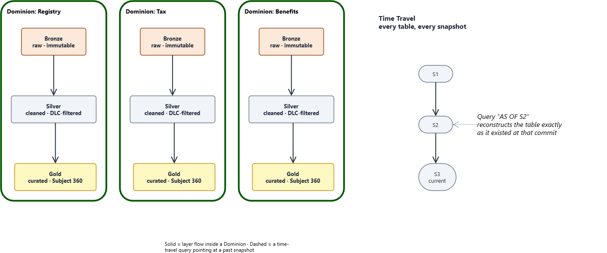

# **Lakehouse Architecture at Nexus**

*Companion document to* **`Data_Principles.md`** *T1 (History is never overwritten) and L2 (Open formats; no vendor dependency). This document compares the Lakehouse against the Data Lake and Data Mesh — three ideas frequently confused for competitors on the same axis — and argues why time-travel is the specific mechanism that turns traceability and auditability from a policy statement into a structural guarantee.*

**Part:** 3 — How it is built · **Document:** 15 of 22 · **Version:** 0.1 · **Status:** Draft · **Last Updated:** 2026-09-22

## **Executive Summary**

Nexus commits to three ideas at once: a **Data Mesh** of Dominion-owned data products, a **Medallion** Bronze/Silver/Gold layering, and a **Lakehouse** (Apache Iceberg / Delta Lake) underneath it with ACID transactions and time-travel. Read quickly, these can sound like three competing architecture choices. They are not — they answer three different questions, and Nexus needs an answer to all three at once.

This document draws that distinction explicitly, then makes the specific case for time-travel: not as a nice analytical feature, but as the mechanism that makes Data Principles T1 (History is never overwritten) real, and the one that turns an audit request from an archaeology project into a query.

## **Three Different Questions, Not Three Competing Architectures**

The confusion is understandable — Data Lake, Lakehouse, and Data Mesh are all discussed as "modern data architecture," and all three showed up in the same industry conversation over the last decade. But they sit on two different axes entirely:

* **Data Lake and Lakehouse** answer *where and how are the bytes stored, and what guarantees does that storage give?* — a **storage architecture** question.
* **Data Mesh** answers *who owns this data, and who is accountable for its quality?* — an **organizational** question.

Nexus doesn't pick one of the three. It runs a Lakehouse (storage layer), organized as a Data Mesh (ownership layer), with the Medallion pattern (Bronze/Silver/Gold) as the layering convention applied *inside* each Dominion's own slice of that Lakehouse. The diagram below is the shape of that: Dominions run down the columns, Medallion layers run across the rows, and every resulting Iceberg/Delta table — regardless of which Dominion owns it or which layer it's in — carries the same time-travel guarantee.

*Editable source: `Lakehouse_Mesh_Matrix.drawio`.*

### Data Lake vs. Lakehouse (the storage axis)

| | **Data Lake** | **Lakehouse** |
|---|---|---|
| What it is | Files (Parquet, CSV, JSON) sitting in cheap object storage, read with whatever schema the reader expects | The same cheap object storage, plus a transactional metadata layer (Iceberg / Delta Lake) tracking every table's schema and history |
| Schema | Schema-on-read — enforced only by whoever happens to be reading, if at all | Schema-on-write, with governed evolution — the table itself knows and enforces its shape |
| Transactions | None. Two concurrent writers can corrupt each other's output; a failed job can leave partial files behind | Full ACID — a write either commits completely as a new snapshot or doesn't happen at all |
| Time travel | Not native. You'd have to hand-roll your own versioned-file-naming scheme and hope nothing ever collides | Native. Every commit is a snapshot; querying `AS OF` a timestamp or snapshot ID is a first-class operation |
| Known failure mode | Becomes a "data swamp" — exactly the risk the Technical Foundations risk register names for an undisciplined lake | Requires a catalog service and carries real metadata overhead (see Honest Trade-Offs) |

A Data Lake is not wrong — it's the substrate a Lakehouse is built on top of. Nexus's choice is specifically to never leave that substrate bare: every Bronze/Silver/Gold table is a Lakehouse table (Iceberg/Delta), not a loose pile of Parquet files, precisely to avoid the data-swamp failure mode the Technical Foundations risk register names.

### What ACID Transactions Actually Guarantee — and Why Nexus Can't Skip Them

"Full ACID" in the table above is doing a lot of work in one word. Each letter is a separate, concrete guarantee, and Nexus's own use case is exactly the shape that breaks without every one of them:

* **Atomicity** — a write either completes entirely, as one new snapshot, or it doesn't happen at all. There is no state where half of it landed. When survivorship logic (Annex B) merges two Dominions' records into one `Subject 360`, this is what prevents a reader from ever seeing a torn result — a new name paired with a stale address because the merge was interrupted halfway.
* **Consistency** — every committed snapshot satisfies the table's declared schema and constraints. A writer cannot leave the table in a shape nothing downstream expects; Silver and Gold can trust that whatever committed upstream was, by definition, well-formed.
* **Isolation** — concurrent writers don't see each other's uncommitted work. Nexus routinely has more than one writer aimed at the same table region at once — a Kafka streaming job ingesting in real time, an Airflow batch job backfilling history, a compaction job tidying small files. Without isolation, these can interleave and corrupt the very immutable record Annex A depends on; with it, each writer either sees the table before or after another's commit, never mid-write.
* **Durability** — once a snapshot is committed, it survives. A crash the instant after commit does not roll it back or corrupt it. This is what lets a snapshot be trusted as permanent history, not a best-effort write that might quietly vanish.

Why this is a compliance requirement for Nexus, not just a performance nicety: the entire time-travel argument made below only holds if every snapshot is guaranteed complete and consistent. If a snapshot could represent a half-applied write, then `AS OF <snapshot>` could return a torn, non-representative state — and every claim in the next two sections (reproducing a historical report exactly, proving nothing changed outside a reviewed process) would quietly stop being true. ACID isn't a feature alongside time travel; it's the precondition that makes time travel mean anything at all.

### Data Mesh (the ownership axis)

Data Mesh isn't a storage technology at all — it's an organizational answer to a different problem: a single central data team cannot stay the bottleneck and the domain expert for every dataset in a large organization at once. Its four principles, and Nexus's concrete answer to each:

| Data Mesh principle | Nexus's mechanism |
|---|---|
| Domain-oriented ownership | The **Dominion** — a bounded, domain-aligned unit of ownership mapped to one accountable team (`Foundations.md`, Annex C) |
| Data as a product | A Dominion's data product must pass the **certification gate** (Annex C.6) before any other team may consume it — ownership with a real quality bar, not a label |
| Self-serve data platform | Nexus itself: the shared Lakehouse, ingestion, and serving infrastructure every Dominion builds on, so no Dominion reinvents storage or compute |
| Federated computational governance | Cross-Dominion rules — GDPR erasure (Annex A), identity resolution (Annex B), data quality baselines (Annex F) — are enforced platform-wide, not negotiated per Dominion |

A Dominion is a Data Mesh concept; a Bronze/Silver/Gold Iceberg table is a Lakehouse concept. Conflating them — treating "should we do Data Mesh or a Lakehouse" as an either/or choice — is a category error this document deliberately avoids: Nexus's actual answer is a Lakehouse, organized as a Data Mesh, every time.

## **Why Time-Travel Grants Traceability**

Time travel is not a query convenience bolted onto Iceberg and Delta Lake — it falls directly out of how they store data. Neither format overwrites a file in place. Every write — an insert, an update, a compaction — produces new data files and a new **snapshot**: an immutable pointer to the exact set of files that made up the table at that moment. `SELECT ... FOR SYSTEM_TIME AS OF <snapshot-or-timestamp>` doesn't reconstruct anything from a log; it just reads the file set a past snapshot already points to.

This is the concrete mechanism behind Data Principles T1 (History is never overwritten): storage that is append-only and immutable, with a complete audit trail and time travel. Without it, T1 is a policy statement someone has to remember to honor. With it, "what did this table look like on a given date" is not a special operation requiring a restored backup — it's the same query language, pointed at an older snapshot.

Two places this already matters concretely elsewhere in this documentation set:

* **Identity resolution (Annex B).** When survivorship logic merges two Dominions' records into one `Subject 360`, the pre-merge state doesn't disappear — it's still exactly reconstructable by time-traveling Silver to the snapshot before the merge. "What did we believe about this citizen last Tuesday, and why did it change" is answerable, not lost.
* **GDPR erasure (Annex A).** Time travel and "the right to be forgotten" look like a direct contradiction — if every snapshot is queryable forever, is data ever really erased? Annex A resolves this deliberately: erasure destroys the subject's encryption key (crypto-shredding), not the row. Every past and future snapshot still time-travels correctly — but the erased subject's fields are unrecoverable ciphertext in all of them, from the moment the key is destroyed onward. Traceability and erasure coexist because they operate at different layers: time travel preserves *structure*, crypto-shredding removes *readability*.

## **Why Time-Travel Matters for Auditing**

Traceability is the technical capability — *can we reconstruct a past state?* Auditing is the governance demand built on top of it — *can we produce defensible, reproducible evidence of what the system reported, when, and why, to someone who wasn't in the room?* Data Principles T1 and T2 demand it, and so do ISO 27001/27002 and SOC 2, both of which require an audit trail that is actually trustworthy — not a log table an application could have failed to write to, or a row an engineer could have quietly `UPDATE`d.

What time travel turns from aspiration into mechanism:

* **Reproducing a historical report exactly.** "What did the Gold layer report to a regulator on March 3rd" is answered by querying Gold `AS OF` that date — the same numbers, byte-for-byte, because the underlying snapshot never changed. A mutable table that has since been updated cannot make this promise at all; the historical truth is already gone.
* **Proving nothing changed outside a reviewed process.** Two consecutive snapshots can be diffed directly. If a change to a Tier 1 dataset didn't go through the expected pipeline run, the snapshot history shows a commit that doesn't match any known job — an anomaly an audit log would only show if someone remembered to write to it.
* **Reconstructing a data-quality incident.** Annex F's DQ triage can point back to the exact Bronze/Silver snapshot a bad record entered on, and to the exact survivorship decision (Annex B) that followed — an incident review with evidence, not recollection.
* **Validating disaster-recovery drills.** Annex E requires that DR restores are actually tested, not assumed. Restoring to a known snapshot and confirming it matches what the snapshot history says it should contain is a verifiable drill, not a hope.

This is the same pattern this document set keeps returning to: compliance-critical guarantees that hold **by construction, not by convention** (the same phrase `Hexagonal_Architecture.md` uses for GDPR erasure holding regardless of which database adapter is behind it). An audit log is a convention — code has to remember to write to it correctly, every time, forever. A Lakehouse snapshot history is structural — it is the storage format itself, and it cannot selectively forget to run.

## **Strengths**

| Strength | What it actually buys Nexus |
|---|---|
| One mechanism, every Dominion | Every Dominion's Bronze/Silver/Gold tables get ACID transactions and time travel identically — no Dominion has to build its own versioning scheme. |
| Audit trail that can't drift | The snapshot history is the storage engine's own bookkeeping, not a separate log that application code has to remember to write to correctly. |
| GDPR and traceability coexist | Crypto-shredding (Annex A) operates at the field-readability layer; time travel operates at the structural layer — neither has to compromise the other. |
| Cheap storage, warehouse guarantees | The same object storage that would otherwise be a bare Data Lake gets ACID and schema evolution without moving to a proprietary warehouse format. |
| Decentralized ownership without decentralized chaos | Data Mesh gives each Dominion autonomy; the shared Lakehouse and platform-wide governance (Annexes A, B, F) keep that autonomy from fragmenting into incompatible, ungoverned silos. |

## **Honest Trade-Offs**

| Trade-off | The real cost |
|---|---|
| Time travel isn't free storage-wise | Every snapshot retains its own data files until a retention/expiration policy runs. Left unmanaged, "keep everything forever" becomes a real, growing storage bill — snapshot expiration is an operational job Nexus must actually schedule, not a one-time setting. |
| A catalog is now a dependency | Iceberg and Delta Lake both need a catalog (e.g., a Hive metastore, AWS Glue, or a self-hosted alternative) to resolve table names to metadata. That catalog's availability becomes load-bearing for every query — one more component to run reliably, especially on-premise. |
| Time travel is not a backup | It protects against logical mistakes — a bad merge, a bug that wrote garbage — by letting you read an earlier snapshot. It does *not* protect against the underlying object storage itself being destroyed; that is what Annex E's actual backup and replication requirement is for. Confusing the two is a real risk this document flags explicitly. |
| Data Mesh's cost is organizational, not technical | Federated governance only works if every Dominion has a genuinely accountable owner (Annex C) engaged enough to meet the certification gate. A Dominion with no real owner produces the same "data swamp" risk the Technical Foundations risk register names for an undisciplined lake — the Lakehouse's technical guarantees don't fix an ownership gap. |
| The cognitive shift is real | `Data_Layer_Problems.md` names this directly: moving a team from decades of relational-table thinking to a schema-flexible, snapshot-versioned Lakehouse mindset is a genuine cultural hurdle, not a documentation problem that solves itself. |

## **Verdict**

Treating Data Lake, Lakehouse, and Data Mesh as three flavors to choose between is the wrong question — Nexus needs an answer to what storage guarantees the bytes carry *and* an answer to who owns them, and those answers come from different places. The Lakehouse is what keeps a cheap, flexible Data Lake from decaying into the swamp the Technical Foundations risk register warns about; the Data Mesh is what lets Dominion ownership scale without one central team becoming the bottleneck for every dataset in the platform. Time travel is not a feature of convenience sitting on top of that choice — it is the specific, structural reason Data Principles T1's traceability promise and the audit guarantees of Data Principles T2 are things the storage engine enforces, not things an engineer has to remember to log correctly, forever, without exception.
