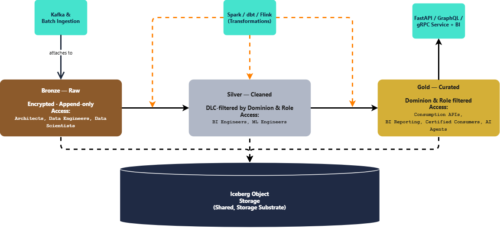

# Medallion Architecture at Nexus

*Companion document to* `Data_Principles.md` *P3 (Storage and compute scale independently) and Q2 (Quality is a precondition, not a clean-up). This document expands on what the Medallion Architecture (Bronze/Silver/Gold) actually is, why decoupling storage from processing is the specific mechanism that makes the layering work, and who — by role — is allowed to touch each layer.*

**Part:** 3 — How it is built · **Document:** 13 of 22 · **Version:** 0.1 · **Status:** Draft · **Last Updated:** 2026-09-22

## **Executive Summary**

The Medallion Architecture is usually summed up in one line: Bronze (raw), Silver (cleaned), Gold (curated), each with its own security posture. That line does real work, but it doesn't say *why* three layers instead of one, *why* storage and processing have to be decoupled for the pattern to hold, or *exactly* who is allowed to read what. This document is that expansion.

The short version: Medallion is a data-quality and access-control pipeline expressed as physical layers, not a storage format. Iceberg/Delta tables (see `Lakehouse_Architecture.md`) are what each layer is *stored in*; Medallion is what each layer *means*. Decoupling storage from processing (Data Principles P3, "Storage and compute scale independently") is what lets each layer run a different compute engine, at a different cadence, with a different access policy, on top of the exact same underlying files — without one layer's workload ever blocking or corrupting another's.

## **What Is the Medallion Architecture?**

Three layers, each a transformation and a trust boundary on top of the last:

* **Bronze (Raw):** Data lands exactly as the source sent it — no schema enforcement, no cleaning, no deduplication. Append-only, immutable, fully encrypted. This is the system of record: if a downstream layer is ever wrong, Bronze is what you replay against to rebuild it.
* **Silver (Cleaned):** Bronze is parsed, typed, deduplicated, and conformed to a schema. Identity resolution (Annex B) and survivorship rules run here. Silver is *correct*, but still Dominion-shaped — it hasn't been aggregated for any particular audience yet.
* **Gold (Curated):** Silver is aggregated, joined across Dominions where needed, and shaped for a specific consumption pattern — a reporting table, an API response, a feature store. Gold is opinionated on purpose: it exists to answer a known question fast, not to hold every fact.

Each hop is a one-way, reproducible transformation. Nothing is ever written backward from Gold into Silver or from Silver into Bronze — the same discipline that makes Bronze's append-only guarantee (Data Principles T1, "History is never overwritten") meaningful survives all the way up the stack.

*Editable source: `Medallion_Architecture.drawio`.*

## **Why Separate Storage from Processing?**

If Bronze, Silver, and Gold lived inside one tightly coupled storage-plus-compute system — a single warehouse cluster, say — every layer would be forced onto the same hardware, the same scaling curve, and the same maintenance windows. That's the wrong shape for what each layer actually needs:

* **Bronze** needs to absorb high-volume, bursty writes cheaply and reliably. It does not need query performance — nobody runs an ad-hoc analytical query against raw Bronze.
* **Silver** needs heavy, scheduled batch compute — deduplication, identity resolution, DQ checks (Annex F) — that runs for minutes at a time, on a predictable cadence, and can be paused without anyone noticing.
* **Gold** needs the opposite: low, predictable read latency for APIs and dashboards, serving many small queries concurrently, with compute that can scale up and down independently of whatever batch job is currently churning through Silver.

Three different load shapes, three different scaling needs — one shared, dumb, cheap storage layer underneath all of them. This is Data Principles P3 (Storage and compute scale independently) applied concretely: Iceberg/Delta tables on object storage are the one constant; Kafka ingestion, Spark/dbt batch jobs, and FastAPI serving layers are independent, swappable compute engines that each attach to their own layer without contending for the others' resources. A slow Silver transformation job never degrades Gold's API latency, because they were never running on the same compute in the first place. And because storage is decoupled from any one engine, a client's on-premise Kubernetes cluster (Annex D.4) can size Bronze, Silver, and Gold compute independently — rather than provisioning one oversized cluster to cover the worst-case load of all three layers at once.

## **Who Can Access What**

Access tightens as data moves up the stack — not because higher layers are "more sensitive" in the abstract, but because each layer answers to a different threat model and a different audience.

| Layer | Data State | Security Control | Who Can Access | Why |
| --- | --- | --- | --- | --- |
| **Bronze** | Raw, unvalidated, may contain uncleaned PII | Fully encrypted at rest, per-subject DEKs (Annex A — see `Encryption_Key_Custody.md` for the full mechanism) | Architects, Data Engineers, Data Scientists only | Bronze is the highest-risk surface — it's the one layer where a raw, unredacted source payload can appear before any masking or cleaning runs |
| **Silver** | Cleaned, typed, deduplicated, Dominion-scoped | Data-Level Controls (DLC), filtered by Dominion and Role | BI Engineers, ML Engineers | Silver is trustworthy enough to build on, but still shaped around one Dominion's internal logic — not yet safe to hand to a consumer outside it |
| **Gold** | Aggregated, curated, shaped for a specific consumption pattern | Strict filtering by Dominion and Role, enforced at the API/reporting boundary | Consumption APIs, reporting tools, and any team or external partner the Dominion has certified access for (Annex C.6) | Gold is the only layer designed to be handed outside the Dominion that produced it — everything sensitive has already been resolved, masked, or aggregated away by the time data reaches here |

The Certification Gate (Annex C.6) is what makes this enforceable rather than aspirational: a Gold data product cannot be consumed by another Dominion until its owner has certified it in OpenMetadata. Access isn't just narrower at Gold — it's the only layer that was ever designed to leave the Dominion that owns it.

## **Worked Examples**

Three scenarios, same three layers each time — the point isn't that Medallion handles one kind of question well, it's that the same layering answers an ingestion question, a historical-reconstruction question, and a strategic-planning question without changing shape.

### **Example 1: One Citizen Record, Three Layers**

A citizen's address-change form is submitted through the Backend and lands in Nexus.

1. **Bronze:** The raw form payload — every field the Backend sent, unvalidated — is appended as-is, encrypted under that citizen's DEK. A Data Engineer debugging an ingestion bug can read this row; a BI Engineer cannot.
2. **Silver:** A scheduled dbt job parses the payload, validates the address against a reference dataset, and resolves the citizen's identity against existing `LocalIdentity` records (Annex B). The row is now a clean, typed record scoped to the Civil Registry Dominion. A BI Engineer building a Dominion-internal report can read it; a partner-facing API cannot.
3. **Gold:** A separate job aggregates this citizen's resolved profile into a `Subject 360` view (Annex B.5), joined with data other certified Dominions have contributed. This is what a certified consumption API actually returns — the only one of the three representations any system outside Nexus ever sees.

The same underlying fact — this citizen's new address — exists in three different forms, at three different access levels, at the same time. Nothing was overwritten to get there.

### **Example 2: Citizen Mobility — Historical Addresses and Asset Location**

A caseworker needs more than "where does this citizen live today." They need every address the citizen has ever had, and what's registered to them right now — a property, a vehicle — across Dominions that don't report to each other.

1. **Bronze:** Every address-change form this citizen has ever submitted is still sitting there as its own row. Bronze never overwrites — it only appends (Data Principles T1, "History is never overwritten") — so the address from three moves ago exists in exactly the same form it did the day it was submitted.
2. **Silver:** Each submission has already been cleaned and identity-resolved into the Civil Registry Dominion's Silver table, but resolving *which* address is "current" happens through survivorship rules (Annex B.3) applied at query time — the superseded ones are never deleted, just no longer marked authoritative.
3. **Gold:** A `Subject 360` view (Annex B.5) doesn't only expose current state — because it's built on Iceberg/Delta snapshots (see `Lakehouse_Architecture.md`), the same view can be queried *as of* any past date to reconstruct the citizen's full address history. And because Gold is where Dominions join, that same view pulls the Property Registry Dominion's Gold table for owned real estate and the Vehicle Registry Dominion's for registered vehicles — one certified query, one citizen, every address they've had and everything currently registered to them, without the caseworker's tool ever touching another Dominion's Bronze or Silver.

This is the direct payoff of never overwriting Bronze: "where has this citizen lived, and what do they own" is a query against Gold, not a request to IT to go reconstruct it from backups.

### **Example 3: Do We Need a New Tax Office?**

A Dominion is asked a planning question with a real budget attached: is citizen density in a given region high enough, and far enough from the nearest existing tax office, to justify opening a new one?

1. **Bronze:** Tax filings and address-change events keep landing exactly as they always have — this question doesn't require touching Bronze at all, which is itself the point: the raw layer stays untouched by an analytical question that has nothing to do with ingestion correctness.
2. **Silver:** The Tax Dominion's cleaned, deduplicated filing records already exist here, resolvable against the Civil Registry Dominion's current addresses through identity resolution (Annex B) — but Silver alone doesn't answer a planning question; it's still shaped around individual filings, not regional patterns.
3. **Gold:** The Tax Dominion certifies a "citizen density by geographic zone" table — Silver's filings aggregated and joined against existing office locations and travel-time isochrones. A BI Engineer builds the capacity-vs-distance dashboard directly off this one certified Gold table. The answer — which zones exceed a per-office load threshold and sit farthest from coverage — comes out of that aggregation, not a guess.

Nobody had to query raw filings or write a one-off script against Bronze to answer this. The question a planner actually asks — "where's the gap" — is exactly the shape Gold exists to answer.

## **Strengths**

| Strength | What it actually buys Nexus |
| --- | --- |
| Independent scaling per layer | Bronze ingestion spikes, Silver batch jobs, and Gold query load never contend for the same compute |
| A narrowing trust boundary | Access tightens layer by layer instead of being an all-or-nothing decision on one big table |
| Reproducibility | Any Silver or Gold table can be rebuilt from Bronze by replaying the same transformation — the pipeline is a pure function of Bronze plus code |
| A clear place for every question | "Is this raw, is this clean, or is this ready to serve" has one obvious answer per layer, instead of being a judgment call on a single flat schema |
| Matches the Certification Gate | Gold's boundary lines up exactly with Annex C.6 — the layer designed to leave the Dominion is the layer the certification gate actually governs |

## **Honest Trade-Offs**

| Trade-off | The real cost |
| --- | --- |
| Storage multiplies | The same fact is stored, in some form, in up to three layers. This is a deliberate trade of storage cost (cheap) for reproducibility and access control (not optional) — but it is not free. |
| Freshness lag is structural | Gold is only as fresh as the last Silver run, which is only as fresh as the last Bronze ingestion. A layered pipeline cannot be instantaneous end-to-end by construction — this is why Annex D's Freshness SLI is measured per layer, not once for the whole system. |
| Silver's transformation logic is a governance surface, not just code | Deduplication and survivorship rules (Annex B) decide what "the truth" is for a Dominion. Getting this wrong doesn't just break a report — it silently corrupts every Gold product built on top of it. |
| Three layers are three things to operate | Ingestion, batch transformation, and serving are three separate systems to monitor, alert on, and keep within their own Tier's SLO (Annex D) — not one system with three views. |

## **Verdict**

Medallion isn't a storage format choice — it's what happens when you take Data Principles P3 (Storage and compute scale independently) and apply it deliberately, layer by layer, to both compute *and* access. Bronze, Silver, and Gold could theoretically live in one undifferentiated table with row-level flags for "is this clean" and "who can see this" — but that collapses three different load shapes and three different trust boundaries onto one piece of infrastructure, which is precisely the coupling Nexus's architecture exists to avoid. Three layers, three independently scaled compute engines, one shared cheap storage substrate, and an access boundary that narrows exactly in step with how trustworthy the data has become — that is the concrete mechanism behind Data Principles Q2 (Quality is a precondition, not a clean-up).
