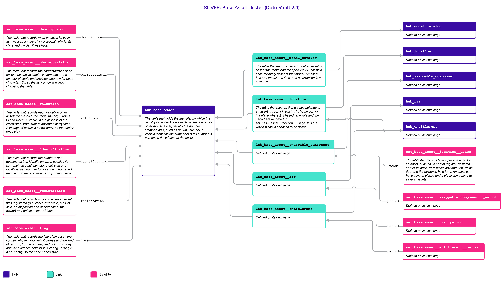
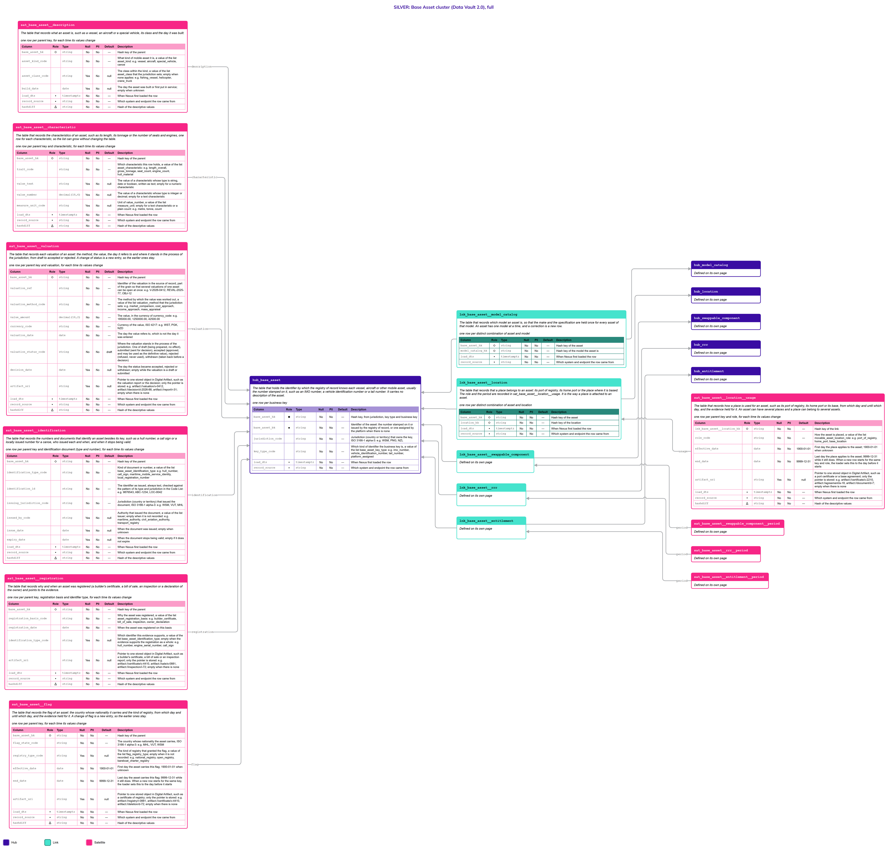

# Base Asset

## Header

| **Field** | **Value** |
| --- | --- |
| Object | Base Asset |
| Parent object | Movable Assets |
| Owner domain | Registries |
| Shared with | Taxation Contributions and Licences, Finance, Compliance |
| Scope | Shared |
| Status | Draft |
| Version | 0.1 |
| Last updated | 2026-10-24 |

## Definition

A Base Asset is the body of a mobile asset that the State identifies, registers, taxes or regulates: the hull of a vessel, the fuselage of an aircraft, the frame of a special vehicle. It keeps its identity for life, through the number stamped on it (an IMO number, a vehicle identification number, a tail number) or, where there is none, a number the platform assigns, as for a canoe. The parts that can be swapped, such as engines, are on the page [Swappable Component](Swappable_Component.md), and the make and the specification are on the page [Model Catalog](Model_Catalog.md).

Who holds a base asset, and every other right, restriction or responsibility over it, is the object [RRR](RRR.md); a licence to use it, such as to fish or to carry tourists, is an [Entitlement](Entitlement.md). The flag, which is the nationality of the asset, is not the holder's country and can change. A base asset has its own identifiers, its own proof of registration, its own characteristics and its own value.

## Why it is its own object

- **It is the part that keeps its identity.** The hull stays the same ship when the engine is replaced. Everything the State records over the life of the asset hangs from this key.
- **It carries the registration.** The registry grants the flag and the number to the asset as a whole, not to its parts.
- **Its flag can change.** An open registry, such as those of the Marshall Islands and Vanuatu, lets an owner of any country flag a ship there and move it later. The flag is therefore a history of its own and not a column.
- **It is valued on its own.** The value of the asset does not include the parts that can be taken off it, which have their own value.

If the hull and the parts were one table, a swapped engine would rewrite the history of the ship.

## Vault objects

| **Type** | **Name** | **Definition** | **Grain** | **Business key** |
| --- | --- | --- | --- | --- |
| Hub | `hub_base_asset` | The table that holds the identifier by which the registry of record knows each vessel, aircraft or other mobile asset, usually the number stamped on it, such as an IMO number, a vehicle identification number or a tail number. It carries no description of the asset. | one row per business key | `base_asset_bk`: the stamped identifier, or one assigned by the platform when there is none, with the jurisdiction and the key type |
| Link | `lnk_base_asset__model_catalog` | The table that records which model an asset is, so that the make and the specification are held once for every asset of that model. An asset has one model at a time, and a correction is a new row. | one row per distinct combination of asset and model | `hub_base_asset`, `hub_model_catalog` |
| Link | `lnk_base_asset__location` | The table that records that a place belongs to an asset: its port of registry, its home port or the place where it is based. The role and the period are recorded in `sat_base_asset__location__usage`. It is the way a place is attached to an asset. | one row per distinct combination of asset and location | `hub_base_asset`, `hub_location` |
| Satellite | `sat_base_asset__description` | The table that records what an asset is, such as a vessel, an aircraft or a special vehicle, its class and the day it was built. | one row per parent key, for each time its values change | — |
| Satellite | `sat_base_asset__characteristic` | The table that records the characteristics of an asset, such as its length, its tonnage or the number of seats and engines, one row for each characteristic, so the list can grow without changing the table. | one row per parent key and characteristic, for each time its values change | — |
| Satellite | `sat_base_asset__valuation` | The table that records each valuation of an asset: the method, the value, the day it refers to and where it stands in the process of the jurisdiction, from draft to accepted or rejected. A change of status is a new entry, so the earlier ones stay. | one row per parent key and valuation, for each time its values change | — |
| Satellite | `sat_base_asset__identification` | The table that records the numbers and documents that identify an asset besides its key, such as a hull number, a call sign or a locally issued number for a canoe, who issued each and when, and when it stops being valid. | one row per parent key and identification document (type and number), for each time its values change | — |
| Satellite | `sat_base_asset__registration` | The table that records why and when an asset was registered (a builder's certificate, a bill of sale, an inspection or a declaration of the owner) and points to the evidence. | one row per parent key, registration basis and identifier type, for each time its values change | — |
| Satellite | `sat_base_asset__flag` | The table that records the flag of an asset: the country whose nationality it carries and the kind of registry, from which day and until which day, and the evidence held for it. A change of flag is a new entry, so the earlier ones stay. | one row per parent key, for each time its values change | — |
| Satellite | `sat_base_asset__location__usage` | The table that records how a place is used for an asset, such as its port of registry, its home port or its base, from which day and until which day, and the evidence held for it. An asset can have several places and a place can belong to several assets. | one row per parent key and role, for each time its values change | — |

`base_asset_hk` is computed from `jurisdiction_code`, `key_type_code` and the normalized `base_asset_bk`, joined with a fixed separator. Normalization: trimmed, case-folded, Unicode-normalized. The hash algorithm is a platform decision and is not named here. Satellites carry only the parent's hash key.

`lnk_base_asset__model_catalog` says which model the asset is; `lnk_base_asset__swappable_component` says that a part is **fitted to** the asset and is defined on the page [Swappable Component](Swappable_Component.md). `lnk_base_asset__location` says where the asset is **based**, with the shape of `lnk_location__natural_person`. Who **holds** the asset is not here: every right, restriction and responsibility over it, ownership, a mortgage and an embargo included, is an RRR joined by `lnk_base_asset__rrr`, and every licence that applies to it is an Entitlement joined by `lnk_base_asset__entitlement`. Both Links are defined on the Legal pages and drawn here. Each Link on this page has its own Satellite for the details, except the Link to the model, which has none.

**Related pages.** The diagrams on this page draw the objects defined elsewhere with a note.

- [Movable Assets](Movable_Assets.md): the family page, with the rules that the three parts share and the decisions that are open for all.
- [Swappable Component](Swappable_Component.md): `hub_swappable_component`, and the Link `lnk_base_asset__swappable_component` with its Satellite `sat_base_asset__swappable_component__period`, defined there.
- [Model Catalog](Model_Catalog.md): `hub_model_catalog`, joined by `lnk_base_asset__model_catalog`, which is defined on this page.
- [Location](Location.md): `hub_location`, joined by `lnk_base_asset__location`.
- [RRR](RRR.md), with [Legal](Legal.md): the rights, restrictions and responsibilities over an asset, ownership included, joined by `lnk_base_asset__rrr`, which is defined there. Who holds them is a [Party](Party.md), a [Natural Person](Natural_Person.md) or a [Legal Entity](Legal_Entity.md); a government, an agency or a foreign government agency is a Legal Entity classified as public.
- [Entitlement](Entitlement.md): the permits that apply to an asset, joined by `lnk_base_asset__entitlement`, which is defined there.

## Fields

*Indicators in Role: ◆ own hash key · ◇ hash key of another object · ● business key · ▪ load metadata · Δ hashdiff. Default: — means no default, so the loader must supply the value; a literal is a default in the sense of Iceberg format version 3.*

### hub_base_asset

| **Column** | **Role** | **Type** | **Null** | **PII** | **Default** | **Description** |
| --- | --- | --- | --- | --- | --- | --- |
| `base_asset_hk` | ◆ | `string` | No | No | — | Hash key, from jurisdiction, key type and business key |
| `base_asset_bk` | ● | `string` | No | No | — | Identifier of the asset: the number stamped on it or issued by the registry of record, or one assigned by the platform when there is none |
| `jurisdiction_code` |  | `string` | No | No | — | Jurisdiction (country or territory) that owns the key, ISO 3166-1 alpha-3: e.g. `WSM`, `PNG`, `NZL` |
| `key_type_code` |  | `string` | No | No | — | Which kind of identifier the business key is, a value of the list `base_asset_key_type`: e.g. `imo_number`, `vehicle_identification_number`, `tail_number`, `platform_assigned` |
| `load_dts` | ▪ | `timestamptz` | No | No | — | When Nexus first loaded the row |
| `record_source` | ▪ | `string` | No | No | — | Which system and endpoint the row came from |

### lnk_base_asset__model_catalog

| **Column** | **Role** | **Type** | **Null** | **PII** | **Default** | **Description** |
| --- | --- | --- | --- | --- | --- | --- |
| `base_asset_hk` | ◇ | `string` | No | No | — | Hash key of the asset |
| `model_catalog_hk` | ◇ | `string` | No | No | — | Hash key of the model the asset is |
| `load_dts` | ▪ | `timestamptz` | No | No | — | When Nexus first loaded the row |
| `record_source` | ▪ | `string` | No | No | — | Which system and endpoint the row came from |

### lnk_base_asset__location

| **Column** | **Role** | **Type** | **Null** | **PII** | **Default** | **Description** |
| --- | --- | --- | --- | --- | --- | --- |
| `base_asset_hk` | ◇ | `string` | No | No | — | Hash key of the asset |
| `location_hk` | ◇ | `string` | No | No | — | Hash key of the location |
| `load_dts` | ▪ | `timestamptz` | No | No | — | When Nexus first loaded the row |
| `record_source` | ▪ | `string` | No | No | — | Which system and endpoint the row came from |

### sat_base_asset__description

| **Column** | **Role** | **Type** | **Null** | **PII** | **Default** | **Description** |
| --- | --- | --- | --- | --- | --- | --- |
| `base_asset_hk` | ◇ | `string` | No | No | — | Hash key of the parent |
| `asset_kind_code` |  | `string` | No | No | — | What kind of mobile asset it is, a value of the list `asset_kind`: e.g. `vessel`, `aircraft`, `special_vehicle`, `canoe` |
| `asset_class_code` |  | `string` | Yes | No | null | The class within the kind, a value of the list `asset_class` that the jurisdiction sets; empty when none applies: e.g. `fishing_vessel`, `helicopter`, `crane_truck` |
| `build_date` |  | `date` | Yes | No | null | The day the asset was built or first put in service; empty when unknown |
| `load_dts` | ▪ | `timestamptz` | No | No | — | When Nexus first loaded the row |
| `record_source` | ▪ | `string` | No | No | — | Which system and endpoint the row came from |
| `hashdiff` | Δ | `string` | No | No | — | Hash of the descriptive values |

### sat_base_asset__characteristic

The characteristics of an asset are an open list, such as its length, its tonnage, the number of seats or engines, and whatever a jurisdiction adds. Each is a row and not a column (Principles, "Traits as rows"). A new characteristic is a new value of the Code List `asset_characteristic` and changes no table. The Code List says, for each one, which value column is used (`value_data_type_code`), and the load checks the value against it. A characteristic that is not personal data has no in-place twin: history is kept.

| **Column** | **Role** | **Type** | **Null** | **PII** | **Default** | **Description** |
| --- | --- | --- | --- | --- | --- | --- |
| `base_asset_hk` | ◇ | `string` | No | No | — | Hash key of the parent |
| `trait_code` |  | `string` | No | No | — | Which characteristic this row holds, a value of the list `asset_characteristic`: e.g. `length_overall`, `gross_tonnage`, `seat_count`, `engine_count`, `hull_material` |
| `value_text` |  | `string` | Yes | No | null | The value of a characteristic whose type is `string`, `date` or `boolean`, written as text; empty for a numeric characteristic |
| `value_number` |  | `decimal(18,6)` | Yes | No | null | The value of a characteristic whose type is `integer` or `decimal`; empty for a text characteristic |
| `measure_unit_code` |  | `string` | Yes | No | null | Unit of `value_number`, a value of the list `measure_unit`; empty for a text characteristic or a plain count: e.g. `metre`, `tonne`, `count` |
| `load_dts` | ▪ | `timestamptz` | No | No | — | When Nexus first loaded the row |
| `record_source` | ▪ | `string` | No | No | — | Which system and endpoint the row came from |
| `hashdiff` | Δ | `string` | No | No | — | Hash of the descriptive values |

### sat_base_asset__valuation

Same shape and same rules as `sat_base_parcel__valuation`. An asset is valued on its own, and the value of a component fitted to it is not included. The definitive value is the Gold view `cur_base_asset__valuation_definitive`.

| **Column** | **Role** | **Type** | **Null** | **PII** | **Default** | **Description** |
| --- | --- | --- | --- | --- | --- | --- |
| `base_asset_hk` | ◇ | `string` | No | No | — | Hash key of the parent |
| `valuation_ref` |  | `string` | No | No | — | Identifier of the valuation in the source of record, part of the grain so that several valuations of one asset can be open at once: e.g. `V-2026-0412`, `REVAL-2025-77`, `OBJ-12` |
| `valuation_method_code` |  | `string` | No | No | — | The method by which the value was worked out, a value of the list `valuation_method` that the jurisdiction sets: e.g. `market_comparison`, `cost_approach`, `income_approach`, `mass_appraisal` |
| `value_amount` |  | `decimal(18,2)` | No | No | — | The value, in the currency of `currency_code`: e.g. `185000.00`, `1250000.00`, `42500.00` |
| `currency_code` |  | `string` | No | No | — | Currency of the value, ISO 4217: e.g. `WST`, `PGK`, `NZD` |
| `valuation_date` |  | `date` | No | No | — | The day the value refers to, which is not the day it was entered |
| `valuation_status_code` |  | `string` | No | No | `draft` | Where the valuation stands in the process of the jurisdiction. One of `draft` (being prepared, no effect), `submitted` (sent for decision), `accepted` (approved, and may be used as the definitive value), `rejected` (refused, never used), `withdrawn` (taken back before a decision) |
| `decision_date` |  | `date` | Yes | No | null | The day the status became `accepted`, `rejected` or `withdrawn`; empty while the valuation is a draft or submitted |
| `artifact_uri` |  | `string` | Yes | No | null | Pointer to one stored object in Digital Artifact, such as the valuation report or the decision; only the pointer is stored: e.g. `artifact://valuation/v-0412`, `artifact://decision/d-2026-88`, `artifact://report/r-31`; empty when there is none |
| `load_dts` | ▪ | `timestamptz` | No | No | — | When Nexus first loaded the row |
| `record_source` | ▪ | `string` | No | No | — | Which system and endpoint the row came from |
| `hashdiff` | Δ | `string` | No | No | — | Hash of the descriptive values |

### sat_base_asset__identification

| **Column** | **Role** | **Type** | **Null** | **PII** | **Default** | **Description** |
| --- | --- | --- | --- | --- | --- | --- |
| `base_asset_hk` | ◇ | `string` | No | No | — | Hash key of the parent |
| `identification_type_code` |  | `string` | No | No | — | Kind of document or number, a value of the list `base_asset_identification_type`: e.g. `hull_number`, `call_sign`, `maritime_mobile_service_identity`, `local_registration_number` |
| `identification_id` |  | `string` | No | No | — | The identifier as issued, always text, checked against the pattern of its type and jurisdiction in the Code List: e.g. `9876543`, `ABC-1234`, `LOC-0042` |
| `issuing_jurisdiction_code` |  | `string` | No | No | — | Jurisdiction (country or territory) that issued the document, ISO 3166-1 alpha-3: e.g. `WSM`, `VUT`, `MHL` |
| `issued_by_code` |  | `string` | Yes | No | null | Authority that issued the document, a value of the list `issuer`; empty when it is not recorded: e.g. `maritime_authority`, `civil_aviation_authority`, `transport_registry` |
| `issue_date` |  | `date` | Yes | No | null | When the document was issued; empty when unknown |
| `expiry_date` |  | `date` | Yes | No | null | When the document stops being valid; empty if it does not expire |
| `load_dts` | ▪ | `timestamptz` | No | No | — | When Nexus first loaded the row |
| `record_source` | ▪ | `string` | No | No | — | Which system and endpoint the row came from |
| `hashdiff` | Δ | `string` | No | No | — | Hash of the descriptive values |

### sat_base_asset__registration

| **Column** | **Role** | **Type** | **Null** | **PII** | **Default** | **Description** |
| --- | --- | --- | --- | --- | --- | --- |
| `base_asset_hk` | ◇ | `string` | No | No | — | Hash key of the parent |
| `registration_basis_code` |  | `string` | No | No | — | Why the asset was registered, a value of the list `asset_registration_basis`: e.g. `builder_certificate`, `bill_of_sale`, `inspection`, `owner_declaration` |
| `registration_date` |  | `date` | No | No | — | When the asset was registered on this basis |
| `identification_type_code` |  | `string` | Yes | No | null | Which identifier this evidence supports, a value of the list `base_asset_identification_type`; empty when the evidence supports the registration as a whole: e.g. `hull_number`, `engine_serial_number`, `call_sign` |
| `artifact_uri` |  | `string` | Yes | No | null | Pointer to one stored object in Digital Artifact, such as a builder's certificate, a bill of sale or an inspection report; only the pointer is stored: e.g. `artifact://certificate/c-4410`, `artifact://sale/s-0881`, `artifact://inspection/i-72`; empty when there is none |
| `load_dts` | ▪ | `timestamptz` | No | No | — | When Nexus first loaded the row |
| `record_source` | ▪ | `string` | No | No | — | Which system and endpoint the row came from |
| `hashdiff` | Δ | `string` | No | No | — | Hash of the descriptive values |

### sat_base_asset__flag

The flag is the nationality of the asset. It can change, as when an owner moves to an open registry, so each flag is a row with its period and the earlier ones stay. It is not the owner's country.

| **Column** | **Role** | **Type** | **Null** | **PII** | **Default** | **Description** |
| --- | --- | --- | --- | --- | --- | --- |
| `base_asset_hk` | ◇ | `string` | No | No | — | Hash key of the parent |
| `flag_state_code` |  | `string` | No | No | — | The country whose nationality the asset carries, ISO 3166-1 alpha-3: e.g. `MHL`, `VUT`, `WSM` |
| `registry_type_code` |  | `string` | Yes | No | null | The kind of registry that granted the flag, a value of the list `flag_registry_type`; empty when it is not recorded: e.g. `national_registry`, `open_registry`, `bareboat_charter_registry` |
| `effective_date` |  | `date` | No | No | `1900-01-01` | First day the asset carries this flag; `1900-01-01` when unknown |
| `end_date` |  | `date` | No | No | `9999-12-31` | Last day the asset carries this flag; `9999-12-31` while it still does. When a new row starts for the same key, the loader sets this to the day before it starts |
| `artifact_uri` |  | `string` | Yes | No | null | Pointer to one stored object in Digital Artifact, such as a certificate of registry; only the pointer is stored: e.g. `artifact://registry/r-0881`, `artifact://certificate/c-4410`, `artifact://deletion/d-72`; empty when there is none |
| `load_dts` | ▪ | `timestamptz` | No | No | — | When Nexus first loaded the row |
| `record_source` | ▪ | `string` | No | No | — | Which system and endpoint the row came from |
| `hashdiff` | Δ | `string` | No | No | — | Hash of the descriptive values |

### sat_base_asset__location__usage

| **Column** | **Role** | **Type** | **Null** | **PII** | **Default** | **Description** |
| --- | --- | --- | --- | --- | --- | --- |
| `lnk_base_asset__location_hk` | ◇ | `string` | No | No | — | Hash key of the link |
| `role_code` |  | `string` | No | No | — | How the asset is placed, a value of the list `movable_asset_location_role`: e.g. `port_of_registry`, `home_port`, `base_location` |
| `effective_date` |  | `date` | No | No | `1900-01-01` | First day the place applies to the asset; `1900-01-01` when unknown |
| `end_date` |  | `date` | No | No | `9999-12-31` | Last day the place applies to the asset; `9999-12-31` while it still does. When a new row starts for the same key and role, the loader sets this to the day before it starts |
| `artifact_uri` |  | `string` | Yes | No | null | Pointer to one stored object in Digital Artifact, such as a port certificate or a base agreement; only the pointer is stored: e.g. `artifact://certificate/c-2210`, `artifact://agreement/a-18`, `artifact://document/d-7`; empty when there is none |
| `load_dts` | ▪ | `timestamptz` | No | No | — | When Nexus first loaded the row |
| `record_source` | ▪ | `string` | No | No | — | Which system and endpoint the row came from |
| `hashdiff` | Δ | `string` | No | No | — | Hash of the descriptive values |

## Sources and mapping

No endpoints declared yet

## Jurisdictions map

| **Edge case** | **Where it happens** | **Approach** | **Vault effect** |
| --- | --- | --- | --- |
| A ship flagged in an open registry whose owner is in another country | Open registries such as the Marshall Islands and Vanuatu | The flag and the holder are separate facts; the flag is the nationality of the asset | A row in `sat_base_asset__flag` with `registry_type_code` `open_registry`; the holder in an RRR through `lnk_base_asset__rrr` |
| An asset that changes flag | Any jurisdiction with open registries | Each flag is a row with its period and the earlier ones stay | A new row in `sat_base_asset__flag`; the earlier row gets its `end_date` |
| A small craft with no stamped identifier, such as a canoe | Pacific jurisdictions | The platform assigns the key, and the number that the local authority issues is an identifier of its own | `key_type_code` `platform_assigned` in `hub_base_asset`; a `local_registration_number` row in `sat_base_asset__identification` |
| An asset known by a local number and later by an international one | Any jurisdiction | The two numbers are identifiers of one asset; how they are joined is open (see Open decisions) | Rows of `sat_base_asset__identification`; the join is open |
| An asset under an embargo, a detention or a seizure | Any jurisdiction | The restriction is an RRR of the class restriction, imposed by an authority, with its period and its evidence; it does not change the holder | `lnk_base_asset__rrr` and `rrr_class_code` `restriction`, on [RRR](RRR.md) |
| An aircraft registered in one country and based in another | Any jurisdiction | The place where it is based is a Location with its own role | `lnk_base_asset__location` with the role `base_location` |
| The value is revised by a method the jurisdiction sets | Jurisdictions that revalue assets on a cycle | Each valuation has its own reference and goes through the status process | Rows of `sat_base_asset__valuation` |

## Examples

Illustrative data. A cargo ship flagged in Vanuatu after it left the Marshall Islands; it has an engine described on the page [Swappable Component](Swappable_Component.md).

`hub_base_asset`

| **base_asset_bk** | **jurisdiction_code** | **key_type_code** |
| --- | --- | --- |
| 9876543 | VUT | imo_number |

`sat_base_asset__description`

| **asset_kind_code** | **asset_class_code** | **build_date** |
| --- | --- | --- |
| vessel | cargo_vessel | 2012-04-18 |

`sat_base_asset__flag`

| **flag_state_code** | **registry_type_code** | **effective_date** | **end_date** |
| --- | --- | --- | --- |
| MHL | open_registry | 2012-06-01 | 2021-02-28 |
| VUT | open_registry | 2021-03-01 | 9999-12-31 |

`sat_base_asset__characteristic`

| **trait_code** | **value_text** | **value_number** | **measure_unit_code** |
| --- | --- | --- | --- |
| length_overall | (empty) | 172.5 | metre |
| gross_tonnage | (empty) | 18200 | tonne |
| engine_count | (empty) | 1 | count |

The ship is owned by a shipping company since 2021-03-01: an RRR of the class right and the type `full_ownership`, joined to the ship by `lnk_base_asset__rrr` and to the company by `lnk_party__rrr`. It was detained from 2025-03-10 to 2025-03-24: an RRR `DET-0071` of the class restriction and the type `detention`, with the maritime authority taking part as `authority` (see [RRR](RRR.md)).

## Modeling considerations

- **The key is the stamped identifier.** The business key is the number stamped on the asset when there is one, so the asset keeps its key through a change of owner, flag or name. A number issued later, such as a call sign or a local registration number, is an identifier and not a key (`sat_base_asset__identification`).
- **The flag is its own history.** It is a Satellite and not a column of the description, because it changes on its own and for its own reasons, and it is not the nationality of the holder.
- **A restriction is an RRR.** An embargo, a detention, a seizure, a mortgage or a lien binds the asset whoever owns it, and has a period and evidence. It is an RRR of the class restriction, not a column or a Satellite of the asset (see [RRR](RRR.md)). Whether an asset is restricted today is worked out in Gold from the status and the period (R13).
- **The model is joined by a Link.** `lnk_base_asset__model_catalog` joins the asset to its model, so the specification is held once. The asset's own measured characteristics are rows of `sat_base_asset__characteristic`, which override nothing in the catalog.
- **The characteristics are an open list.** The length, the tonnage, the number of seats and engines and the like are rows of `sat_base_asset__characteristic`, not columns (Principles, "Traits as rows").
- **The current position is not stored.** A vessel or an aircraft moves. Where it is based is a Location with a role; where it is at this moment is operational data and is outside this model.
- **Shared rules.** Valuation and its statuses, identification and registration, validity ranges and codes follow the rules written on the page [Movable Assets](Movable_Assets.md), which are those of the page [Immovable Assets](Immovable_Assets.md). What is only the asset's: the definitive value is the Gold view `cur_base_asset__valuation_definitive`; the roles of a place for an asset are `port_of_registry`, `home_port` and `base_location`, the list `movable_asset_location_role`; who holds the asset and what binds it are the Legal objects.

## Diagram

Two pictures of the same cluster. Read the simplified one first, then use the full one when you need the columns. Colors: Hub indigo, Link teal, Satellite magenta; a Satellite updated in place is lighter, with a dashed border. Arrows run from the child to its parent. Objects defined on another page are drawn with a note and no table.

### Simplified version

The shape of the cluster: 1 Hub, 2 Links and 7 Satellites, with the Hubs of the model and Location, the Link and the Satellite of the parts, and the Hubs, Links and Satellites of the RRR and the Entitlement, drawn as defined on another page. Each has its name and definition. Use it to see how the objects relate. It has no columns.

### Full version

The same objects, each with its Fields table (column, role, type, null, PII, default, description). Use it to check exactly what is stored. It is wide: zoom in or open the image on its own.

## Open decisions

| **Decision** | **Owner** | **How it is decided** | **Decide by** |
| --- | --- | --- | --- |
| The decisions shared by the three parts of the family: the valuation process, the depth of the containment of parts and the holders of parts | Data Architecture Engineer and Data Product Owner | Written once, on the page [Movable Assets](Movable_Assets.md) | See that page |
| How an asset known by a local number and later by an international one is joined to the same row, and who vouches for the match | Data Architecture Engineer and Data Product Owner | Decided with the first jurisdiction that registers an asset under two numbers; the direction is an enrichment layer, as for the places of a Location | Before the first such asset is loaded |
| Which characteristics are required for each kind of asset, and their units | Data Product Owner | Set as values of the Code List list `asset_characteristic` | When a jurisdiction is configured |
| Which source of record supplies `base_asset_bk` in each jurisdiction, and who assigns the key where none exists | Platform configuration | Set in the Nexus configuration for each jurisdiction | When a jurisdiction is configured |
| The kinds, classes and positions of assets and parts | Data Product Owner | Set as values of the Code List lists `asset_kind`, `asset_class`, `flag_registry_type` and `movable_asset_location_role`; the kinds of bond are on [RRR](RRR.md) | When a jurisdiction is configured |
