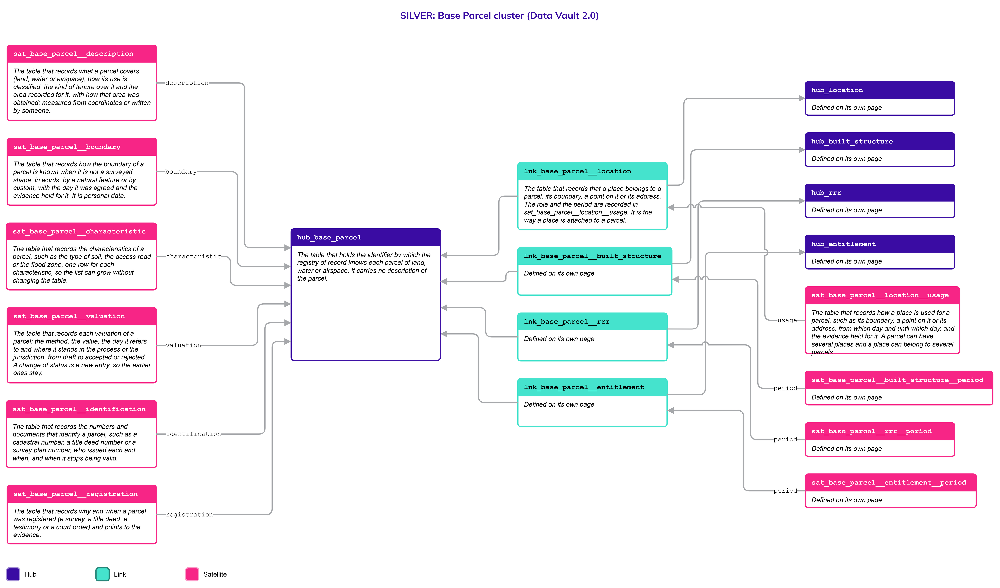
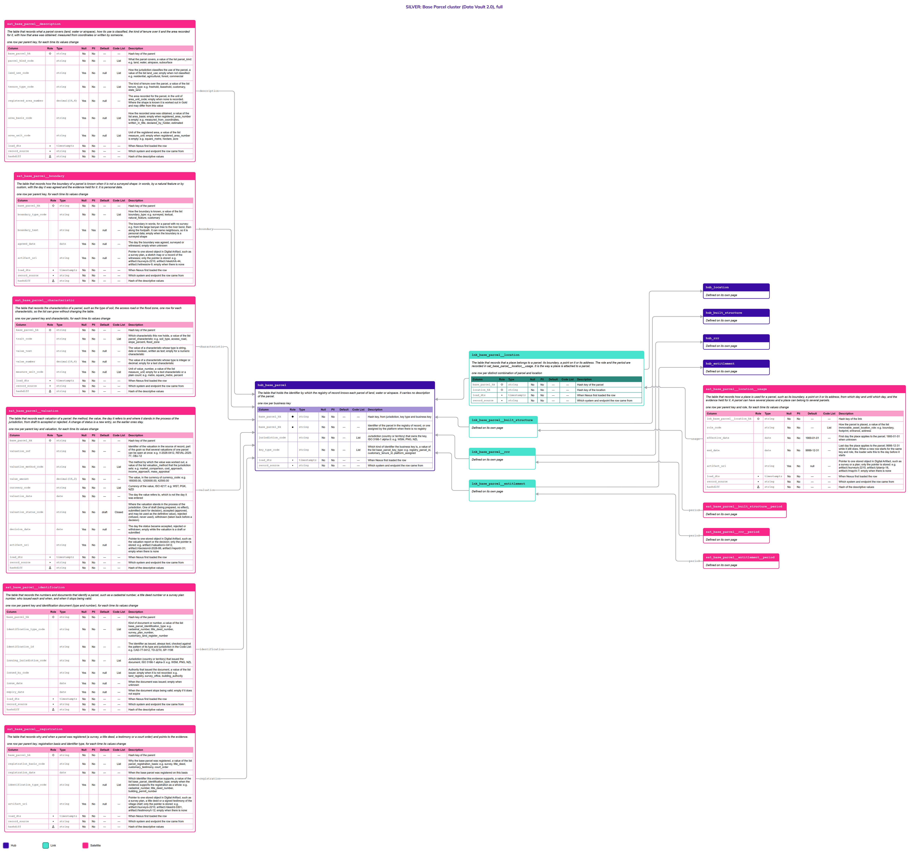

# Base Parcel

## Header

| **Field** | **Value** |
| --- | --- |
| Object | Base Parcel |
| Parent object | Immovable Assets |
| Owner domain | Registries |
| Shared with | Taxation Contributions and Licences, Finance, Compliance |
| Scope | Shared |
| Status | Draft |
| Version | 0.1 |
| Last updated | 2026-10-24 |

## Definition

A Base Parcel is a bounded portion of land, water or airspace over which someone holds a right, a restriction or a responsibility. The State needs to identify it, register who holds it, value it for tax and place it on the map. It may be surveyed as a polygon or a three-dimensional space, or known only by words or natural features, as in customary tenure. Land may belong to the State or to a tribe.

Who holds a parcel, and every other right, restriction or responsibility over it, is the object [RRR](RRR.md); what someone may do with it, such as farm it or build on it, is an [Entitlement](Entitlement.md). A parcel can hold many structures, and the structures are described on the page [Built Structure](Built_Structure.md). A parcel has its own identifiers, its own proof of registration, its own characteristics and its own value.

## Why it is its own object

- **A parcel outlives its structures.** A house is demolished and the parcel stays. The parcel is not touched when a structure is built, extended or divided into units.
- **It has its own key.** A parcel is known by the cadastre or a customary register. A building permit or a unit number is the key of a structure, on the page [Built Structure](Built_Structure.md).
- **It has its own holders.** A parcel can be State land or belong to a tribe, while the hotel on it is private. The holder of the land can differ from the holder of what stands on it, as in a lease.
- **It is valued on its own.** Land is valued by methods and on cycles that differ from those of a building, and the value of the land never includes the buildings.

If the parcel and the structure were one table, a demolished house would end the parcel, and the value of the land could not be revised without touching the building.

## Vault objects

| **Type** | **Name** | **Definition** | **Grain** | **Business key** |
| --- | --- | --- | --- | --- |
| Hub | `hub_base_parcel` | The table that holds the identifier by which the registry of record knows each parcel of land, water or airspace. It carries no description of the parcel. | one row per business key | `base_parcel_bk`: the identifier in the registry of record, or one assigned by the platform when there is none, with the jurisdiction and the key type |
| Link | `lnk_base_parcel__location` | The table that records that a place belongs to a parcel: its boundary, a point on it or its address. The role and the period are recorded in `sat_base_parcel__location__usage`. It is the way a place is attached to a parcel. | one row per distinct combination of parcel and location | `hub_base_parcel`, `hub_location` |
| Satellite | `sat_base_parcel__description` | The table that records what a parcel covers (land, water or airspace), how its use is classified, the kind of tenure over it and the area recorded for it, with how that area was obtained: measured from coordinates or written by someone. | one row per parent key, for each time its values change | — |
| Satellite | `sat_base_parcel__boundary` | The table that records how the boundary of a parcel is known when it is not a surveyed shape: in words, by a natural feature or by custom, with the day it was agreed and the evidence held for it. It is personal data. | one row per parent key, for each time its values change | — |
| Satellite | `sat_base_parcel__characteristic` | The table that records the characteristics of a parcel, such as the type of soil, the access road or the flood zone, one row for each characteristic, so the list can grow without changing the table. | one row per parent key and characteristic, for each time its values change | — |
| Satellite | `sat_base_parcel__valuation` | The table that records each valuation of a parcel: the method, the value, the day it refers to and where it stands in the process of the jurisdiction, from draft to accepted or rejected. A change of status is a new entry, so the earlier ones stay. | one row per parent key and valuation, for each time its values change | — |
| Satellite | `sat_base_parcel__identification` | The table that records the numbers and documents that identify a parcel, such as a cadastral number, a title deed number or a survey plan number, who issued each and when, and when it stops being valid. | one row per parent key and identification document (type and number), for each time its values change | — |
| Satellite | `sat_base_parcel__registration` | The table that records why and when a parcel was registered (a survey, a title deed, a testimony or a court order) and points to the evidence. | one row per parent key, registration basis and identifier type, for each time its values change | — |
| Satellite | `sat_base_parcel__location__usage` | The table that records how a place is used for a parcel, such as its boundary, a point on it or its address, from which day and until which day, and the evidence held for it. A parcel can have several places and a place can belong to several parcels. | one row per parent key and role, for each time its values change | — |

`base_parcel_hk` is computed from `jurisdiction_code`, `key_type_code` and the normalized `base_parcel_bk`, joined with a fixed separator. Normalization: trimmed, case-folded, Unicode-normalized. The hash algorithm is a platform decision and is not named here. Satellites carry only the parent's hash key.

`lnk_base_parcel__location` says where the parcel **is**, with the shape of `lnk_location__natural_person`; the surveyed boundary of a parcel is a geometry of Location, not a column here. Who **holds** the parcel is not here: every right, restriction and responsibility over it, ownership included, is an RRR joined by `lnk_base_parcel__rrr`, and every permit that applies to it is an Entitlement joined by `lnk_base_parcel__entitlement`. Both Links are defined on the Legal pages and drawn here. The Link to Location has its own Satellite for the details.

**Related pages.** The details of every object below are on its own page; the diagrams on this page draw them with a note.

- [Immovable Assets](Immovable_Assets.md): the family page, with the rules that both parts share and the decisions that are open for both.
- [Built Structure](Built_Structure.md): `hub_built_structure`, and the Link `lnk_base_parcel__built_structure` with its Satellite `sat_base_parcel__built_structure__period`, which say that a structure **stands on** a parcel.
- [Location](Location.md): `hub_location`, joined by `lnk_base_parcel__location`.
- [RRR](RRR.md), with [Legal](Legal.md): the rights, restrictions and responsibilities over a parcel, ownership included, joined by `lnk_base_parcel__rrr`, which is defined there. Who holds them is a [Party](Party.md), a [Natural Person](Natural_Person.md) or a [Legal Entity](Legal_Entity.md); a government, an agency or a foreign government agency is a Legal Entity classified as public.
- [Entitlement](Entitlement.md): the permits that apply to a parcel, joined by `lnk_base_parcel__entitlement`, which is defined there.

## Fields

*Indicators in Role: ◆ own hash key · ◇ hash key of another object · ● business key · ▪ load metadata · Δ hashdiff. Default: — means no default, so the loader must supply the value; a literal is a default in the sense of Iceberg format version 3. Code List: `List` — the values are a list of the Code List object and the column has a row in the table of the Code List page; `Closed` — a closed list, written in the Description as One of; `—` — the column is not a code.*

### hub_base_parcel

| **Column** | **Role** | **Type** | **Null** | **PII** | **Default** | **Code List** | **Description** |
| --- | --- | --- | --- | --- | --- | --- | --- |
| `base_parcel_hk` | ◆ | `string` | No | No | — | — | Hash key, from jurisdiction, key type and business key |
| `base_parcel_bk` | ● | `string` | No | No | — | — | Identifier of the parcel in the registry of record, or one assigned by the platform when there is no registry |
| `jurisdiction_code` |  | `string` | No | No | — | List | Jurisdiction (country or territory) that owns the key, ISO 3166-1 alpha-3: e.g. `WSM`, `PNG`, `NZL` |
| `key_type_code` |  | `string` | No | No | — | List | Which kind of identifier the business key is, a value of the list `base_parcel_key_type`: e.g. `registry_parcel_id`, `customary_tenure_id`, `platform_assigned` |
| `load_dts` | ▪ | `timestamptz` | No | No | — | — | When Nexus first loaded the row |
| `record_source` | ▪ | `string` | No | No | — | — | Which system and endpoint the row came from |

### lnk_base_parcel__location

| **Column** | **Role** | **Type** | **Null** | **PII** | **Default** | **Code List** | **Description** |
| --- | --- | --- | --- | --- | --- | --- | --- |
| `base_parcel_hk` | ◇ | `string` | No | No | — | — | Hash key of the parcel |
| `location_hk` | ◇ | `string` | No | No | — | — | Hash key of the location |
| `load_dts` | ▪ | `timestamptz` | No | No | — | — | When Nexus first loaded the row |
| `record_source` | ▪ | `string` | No | No | — | — | Which system and endpoint the row came from |

### sat_base_parcel__description

| **Column** | **Role** | **Type** | **Null** | **PII** | **Default** | **Code List** | **Description** |
| --- | --- | --- | --- | --- | --- | --- | --- |
| `base_parcel_hk` | ◇ | `string` | No | No | — | — | Hash key of the parent |
| `parcel_kind_code` |  | `string` | No | No | — | List | What the parcel covers, a value of the list `parcel_kind`: e.g. `land`, `water`, `airspace`, `subsurface` |
| `land_use_code` |  | `string` | Yes | No | null | List | How the jurisdiction classifies the use of the parcel, a value of the list `land_use`; empty when not classified: e.g. `residential`, `agricultural`, `forest`, `commercial` |
| `tenure_type_code` |  | `string` | No | No | — | List | The kind of tenure over the parcel, a value of the list `tenure_type`: e.g. `freehold`, `leasehold`, `customary`, `state_land` |
| `registered_area_number` |  | `decimal(18,4)` | Yes | No | null | — | The area recorded for the parcel, in the unit of `area_unit_code`; empty when none is recorded. Where the shape is known it is worked out in Gold and may differ from this value |
| `area_basis_code` |  | `string` | Yes | No | null | List | How the recorded area was obtained, a value of the list `area_basis`; empty when `registered_area_number` is empty: e.g. `measured_from_coordinates`, `written_in_title`, `declared_by_holder`, `estimated` |
| `area_unit_code` |  | `string` | Yes | No | null | List | Unit of the registered area, a value of the list `measure_unit`; empty when `registered_area_number` is empty: e.g. `square_metre`, `hectare`, `acre` |
| `load_dts` | ▪ | `timestamptz` | No | No | — | — | When Nexus first loaded the row |
| `record_source` | ▪ | `string` | No | No | — | — | Which system and endpoint the row came from |
| `hashdiff` | Δ | `string` | No | No | — | — | Hash of the descriptive values |

### sat_base_parcel__boundary

A parcel with no survey is known by words or by a natural feature, as in customary tenure. This Satellite is personal data because the words can name neighbours. The surveyed shape, when there is one, is not here: it is a Location (see Modeling considerations).

| **Column** | **Role** | **Type** | **Null** | **PII** | **Default** | **Code List** | **Description** |
| --- | --- | --- | --- | --- | --- | --- | --- |
| `base_parcel_hk` | ◇ | `string` | No | No | — | — | Hash key of the parent |
| `boundary_type_code` |  | `string` | No | No | — | List | How the boundary is known, a value of the list `boundary_type`: e.g. `surveyed`, `textual`, `natural_feature`, `customary` |
| `boundary_text` |  | `string` | Yes | Yes | null | — | The boundary in words, for a parcel with no survey: e.g. `from the large banyan tree to the river bend, then along the footpath`. It can name neighbours, so it is personal data; empty when the boundary is a surveyed shape |
| `agreed_date` |  | `date` | Yes | No | null | — | The day the boundary was agreed, surveyed or witnessed; empty when unknown |
| `artifact_uri` |  | `string` | Yes | No | null | — | Pointer to one stored object in Digital Artifact, such as a survey plan, a sketch map or a record of the witnesses; only the pointer is stored: e.g. `artifact://survey/s-2210`, `artifact://sketch/k-44`, `artifact://witness/w-9`; empty when there is none |
| `load_dts` | ▪ | `timestamptz` | No | No | — | — | When Nexus first loaded the row |
| `record_source` | ▪ | `string` | No | No | — | — | Which system and endpoint the row came from |
| `hashdiff` | Δ | `string` | No | No | — | — | Hash of the descriptive values |

### sat_base_parcel__characteristic

The characteristics of a parcel are an open list, so each is a row and not a column (Principles, "Traits as rows"). A new characteristic is a new value of the Code List `parcel_characteristic` and changes no table. The Code List says, for each one, which value column is used (`value_data_type_code`), and the load checks the value against it. A characteristic that is not personal data has no in-place twin: history is kept.

| **Column** | **Role** | **Type** | **Null** | **PII** | **Default** | **Code List** | **Description** |
| --- | --- | --- | --- | --- | --- | --- | --- |
| `base_parcel_hk` | ◇ | `string` | No | No | — | — | Hash key of the parent |
| `trait_code` |  | `string` | No | No | — | List | Which characteristic this row holds, a value of the list `parcel_characteristic`: e.g. `soil_type`, `access_road`, `slope_percent`, `flood_zone` |
| `value_text` |  | `string` | Yes | No | null | — | The value of a characteristic whose type is `string`, `date` or `boolean`, written as text; empty for a numeric characteristic |
| `value_number` |  | `decimal(18,6)` | Yes | No | null | — | The value of a characteristic whose type is `integer` or `decimal`; empty for a text characteristic |
| `measure_unit_code` |  | `string` | Yes | No | null | List | Unit of `value_number`, a value of the list `measure_unit`; empty for a text characteristic or a plain count: e.g. `metre`, `square_metre`, `percent` |
| `load_dts` | ▪ | `timestamptz` | No | No | — | — | When Nexus first loaded the row |
| `record_source` | ▪ | `string` | No | No | — | — | Which system and endpoint the row came from |
| `hashdiff` | Δ | `string` | No | No | — | — | Hash of the descriptive values |

### sat_base_parcel__valuation

One row for each valuation and each change of its status. The value, the method and the status are one fact, so they share a Satellite. The row of a status change repeats the value, and the earlier rows stay. Which method a jurisdiction uses, which status changes are allowed and who decides them are values and rules of the Code List (`valuation_method`, `valuation_status`). The definitive value is not stored: the Gold view `cur_base_parcel__valuation_definitive` returns, for each parcel, the accepted valuation with the latest `valuation_date` (R13).

| **Column** | **Role** | **Type** | **Null** | **PII** | **Default** | **Code List** | **Description** |
| --- | --- | --- | --- | --- | --- | --- | --- |
| `base_parcel_hk` | ◇ | `string` | No | No | — | — | Hash key of the parent |
| `valuation_ref` |  | `string` | No | No | — | — | Identifier of the valuation in the source of record, part of the grain so that several valuations of one parcel can be open at once: e.g. `V-2026-0412`, `REVAL-2025-77`, `OBJ-12` |
| `valuation_method_code` |  | `string` | No | No | — | List | The method by which the value was worked out, a value of the list `valuation_method` that the jurisdiction sets: e.g. `market_comparison`, `cost_approach`, `income_approach`, `mass_appraisal` |
| `value_amount` |  | `decimal(18,2)` | No | No | — | — | The value, in the currency of `currency_code`: e.g. `185000.00`, `1250000.00`, `42500.00` |
| `currency_code` |  | `string` | No | No | — | List | Currency of the value, ISO 4217: e.g. `WST`, `PGK`, `NZD` |
| `valuation_date` |  | `date` | No | No | — | — | The day the value refers to, which is not the day it was entered |
| `valuation_status_code` |  | `string` | No | No | `draft` | Closed | Where the valuation stands in the process of the jurisdiction. One of `draft` (being prepared, no effect), `submitted` (sent for decision), `accepted` (approved, and may be used as the definitive value), `rejected` (refused, never used), `withdrawn` (taken back before a decision) |
| `decision_date` |  | `date` | Yes | No | null | — | The day the status became `accepted`, `rejected` or `withdrawn`; empty while the valuation is a draft or submitted |
| `artifact_uri` |  | `string` | Yes | No | null | — | Pointer to one stored object in Digital Artifact, such as the valuation report or the decision; only the pointer is stored: e.g. `artifact://valuation/v-0412`, `artifact://decision/d-2026-88`, `artifact://report/r-31`; empty when there is none |
| `load_dts` | ▪ | `timestamptz` | No | No | — | — | When Nexus first loaded the row |
| `record_source` | ▪ | `string` | No | No | — | — | Which system and endpoint the row came from |
| `hashdiff` | Δ | `string` | No | No | — | — | Hash of the descriptive values |

### sat_base_parcel__identification

| **Column** | **Role** | **Type** | **Null** | **PII** | **Default** | **Code List** | **Description** |
| --- | --- | --- | --- | --- | --- | --- | --- |
| `base_parcel_hk` | ◇ | `string` | No | No | — | — | Hash key of the parent |
| `identification_type_code` |  | `string` | No | No | — | List | Kind of document or number, a value of the list `base_parcel_identification_type`: e.g. `cadastral_number`, `title_deed_number`, `survey_plan_number`, `customary_land_register_number` |
| `identification_id` |  | `string` | No | No | — | — | The identifier as issued, always text, checked against the pattern of its type and jurisdiction in the Code List: e.g. `CAD-77-0412`, `TD-2210`, `SP-1198` |
| `issuing_jurisdiction_code` |  | `string` | No | No | — | List | Jurisdiction (country or territory) that issued the document, ISO 3166-1 alpha-3: e.g. `WSM`, `PNG`, `NZL` |
| `issued_by_code` |  | `string` | Yes | No | null | List | Authority that issued the document, a value of the list `issuer`; empty when it is not recorded: e.g. `land_registry`, `survey_office`, `building_authority` |
| `issue_date` |  | `date` | Yes | No | null | — | When the document was issued; empty when unknown |
| `expiry_date` |  | `date` | Yes | No | null | — | When the document stops being valid; empty if it does not expire |
| `load_dts` | ▪ | `timestamptz` | No | No | — | — | When Nexus first loaded the row |
| `record_source` | ▪ | `string` | No | No | — | — | Which system and endpoint the row came from |
| `hashdiff` | Δ | `string` | No | No | — | — | Hash of the descriptive values |

### sat_base_parcel__registration

| **Column** | **Role** | **Type** | **Null** | **PII** | **Default** | **Code List** | **Description** |
| --- | --- | --- | --- | --- | --- | --- | --- |
| `base_parcel_hk` | ◇ | `string` | No | No | — | — | Hash key of the parent |
| `registration_basis_code` |  | `string` | No | No | — | List | Why the base parcel was registered, a value of the list `parcel_registration_basis`: e.g. `survey`, `title_deed`, `customary_testimony`, `court_order` |
| `registration_date` |  | `date` | No | No | — | — | When the base parcel was registered on this basis |
| `identification_type_code` |  | `string` | Yes | No | null | List | Which identifier this evidence supports, a value of the list `base_parcel_identification_type`; empty when the evidence supports the registration as a whole: e.g. `cadastral_number`, `title_deed_number`, `building_permit_number` |
| `artifact_uri` |  | `string` | Yes | No | null | — | Pointer to one stored object in Digital Artifact, such as a survey plan, a title deed or a signed testimony of the village chief; only the pointer is stored: e.g. `artifact://survey/s-2210`, `artifact://deed/d-3301`, `artifact://testimony/t-12`; empty when there is none |
| `load_dts` | ▪ | `timestamptz` | No | No | — | — | When Nexus first loaded the row |
| `record_source` | ▪ | `string` | No | No | — | — | Which system and endpoint the row came from |
| `hashdiff` | Δ | `string` | No | No | — | — | Hash of the descriptive values |

### sat_base_parcel__location__usage

| **Column** | **Role** | **Type** | **Null** | **PII** | **Default** | **Code List** | **Description** |
| --- | --- | --- | --- | --- | --- | --- | --- |
| `lnk_base_parcel__location_hk` | ◇ | `string` | No | No | — | — | Hash key of the link |
| `role_code` |  | `string` | No | No | — | List | How the parcel is placed, a value of the list `immovable_asset_location_role`: e.g. `boundary`, `footprint`, `entrance`, `address` |
| `effective_date` |  | `date` | No | No | `1900-01-01` | — | First day the place applies to the parcel; `1900-01-01` when unknown |
| `end_date` |  | `date` | No | No | `9999-12-31` | — | Last day the place applies to the parcel; `9999-12-31` while it still does. When a new row starts for the same key and role, the loader sets this to the day before it starts |
| `artifact_uri` |  | `string` | Yes | No | null | — | Pointer to one stored object in Digital Artifact, such as a survey or a plan; only the pointer is stored: e.g. `artifact://survey/s-2210`, `artifact://plan/p-18`, `artifact://map/m-7`; empty when there is none |
| `load_dts` | ▪ | `timestamptz` | No | No | — | — | When Nexus first loaded the row |
| `record_source` | ▪ | `string` | No | No | — | — | Which system and endpoint the row came from |
| `hashdiff` | Δ | `string` | No | No | — | — | Hash of the descriptive values |

## Sources and mapping

No endpoints declared yet

## Jurisdictions map

| **Edge case** | **Where it happens** | **Approach** | **Vault effect** |
| --- | --- | --- | --- |
| Land held by custom, with no survey and no title | Pacific jurisdictions such as Samoa, Papua New Guinea and Vanuatu | The parcel is known by words or natural features, registered on the testimony of the community, and its key is assigned by the platform when the registry has none (R7: a scenario of the same object) | `key_type_code` `platform_assigned` in `hub_base_parcel`; `sat_base_parcel__boundary` with `boundary_type_code` `customary`; a `customary_testimony` row in `sat_base_parcel__registration` |
| A parcel that is surveyed | Jurisdictions with a cadastre | The boundary is a shape of Location, attached to the parcel with the role `boundary` | `lnk_base_parcel__location` and `sat_base_parcel__location__usage`, `lnk_geometry__location` |
| A parcel with several structures | Any jurisdiction | One row in the Link for each structure; each structure is its own Hub row | Rows of `lnk_base_parcel__built_structure` |
| A structure that stands on more than one parcel | Any jurisdiction with large buildings or piers | The same structure is joined to each parcel | Rows of `lnk_base_parcel__built_structure` |
| The building is held by someone other than the holder of the land | Jurisdictions with leasehold or ground rent | Each has its own bond, an RRR | `lnk_built_structure__rrr` and `lnk_base_parcel__rrr` with different parties, on [RRR](RRR.md) |
| A structure is demolished or moved | Any jurisdiction | The structure stays on record; the period on the parcel ends with a reason | `end_date` and `end_reason_code` in `sat_base_parcel__built_structure__period` |
| A parcel is divided or two parcels are merged, or a building is divided or joined | Any jurisdiction | The operation is a fact to track for the parcel or the building. It may be only a change on the register, or a geographic process that cuts or joins the shapes. The new parcels are new Hub rows; the old one ends. How the operation is recorded is open (see Open decisions) | New rows in `hub_base_parcel` or `hub_built_structure`; the operation itself is open |
| The value is revised on a fixed cycle by a method the jurisdiction sets | Jurisdictions that revalue every parcel on a cycle | Each revaluation is a valuation with its own reference and goes through the status process of the jurisdiction | Rows of `sat_base_parcel__valuation` and `sat_built_structure__valuation` with their `valuation_method_code` |
| Two accepted values for one parcel at once, from two processes | Jurisdictions that allow different values for different purposes, such as tax and insurance | Allowed or not by the jurisdiction. Both are stored. The risk is not two values but not noticing that there are two, so Gold flags an asset with more than one accepted value where the jurisdiction does not allow it | Rows with `accepted` in the valuation Satellites; the check is in Gold |
| The area is measured in one jurisdiction and written by someone in another | Jurisdictions with coordinates for every parcel, and jurisdictions where the area is copied from a document | The area keeps how it was obtained | `area_basis_code` in `sat_base_parcel__description` |
| A valuation is refused, objected to or taken back | Jurisdictions with an appeal process | The valuation stays on record with its status; it never becomes the definitive value | `valuation_status_code` `rejected` or `withdrawn` |
| Land that belongs to the State, to a tribe, or to the State and lent to a tribe | Jurisdictions with State land or tribal land: in some the tribe holds the land, in others the government holds it and lends it to the tribe | The State is a Legal Entity classified as public and the tribe is a Legal Entity classified as collective, so each takes part in an RRR through the same Link, and the loan is the tribe's RRR, derived from the State's, with its own dates | Two RRRs over the parcel joined by `lnk_rrr__rrr_hierarchy`, with an `rrr_type_code` such as `state_title` for the State and `customary_title` or `state_lease` for the tribe, on [RRR](RRR.md) |
| A parcel of water or airspace | Jurisdictions that register water or airspace rights | The same object, with another `parcel_kind_code` and a three-dimensional shape in Location | `parcel_kind_code` in `sat_base_parcel__description` |

## Examples

Illustrative data. The first example is a surveyed parcel in New Zealand; the second is a customary parcel in Papua New Guinea; the third is a valuation that goes through its status.

**A surveyed parcel (New Zealand).** The parcel `P-5501` holds the building `S-100`, which is described on the page [Built Structure](Built_Structure.md).

`hub_base_parcel`

| **base_parcel_bk** | **jurisdiction_code** | **key_type_code** |
| --- | --- | --- |
| P-5501 | NZL | registry_parcel_id |

`sat_base_parcel__description`

| **parcel_kind_code** | **land_use_code** | **tenure_type_code** | **registered_area_number** | **area_unit_code** |
| --- | --- | --- | --- | --- |
| land | residential | freehold | 1250.0000 | square_metre |

**A customary parcel (Papua New Guinea).** There is no survey and no title. The parcel has a platform-assigned key and is registered on the testimony of the village chief.

`hub_base_parcel`

| **base_parcel_bk** | **jurisdiction_code** | **key_type_code** |
| --- | --- | --- |
| BP-90012 | PNG | platform_assigned |

`sat_base_parcel__boundary`

| **boundary_type_code** | **boundary_text** | **agreed_date** |
| --- | --- | --- |
| customary | from the large banyan tree to the river bend, then along the footpath | 2024-03-12 |

`sat_base_parcel__registration`

| **registration_basis_code** | **registration_date** | **artifact_uri** |
| --- | --- | --- |
| customary_testimony | 2024-03-12 | `artifact://testimony/t-12` |

**A valuation that goes through its status.** The parcel `P-5501` is revalued in 2026. The first draft is refused and a second is accepted.

`sat_base_parcel__valuation`

| **valuation_ref** | **valuation_method_code** | **value_amount** | **currency_code** | **valuation_date** | **valuation_status_code** | **decision_date** |
| --- | --- | --- | --- | --- | --- | --- |
| REVAL-2026-01 | mass_appraisal | 410000.00 | NZD | 2026-09-01 | draft | (empty) |
| REVAL-2026-01 | mass_appraisal | 410000.00 | NZD | 2026-09-01 | submitted | (empty) |
| REVAL-2026-01 | mass_appraisal | 410000.00 | NZD | 2026-09-01 | rejected | 2026-10-05 |
| REVAL-2026-02 | market_comparison | 435000.00 | NZD | 2026-09-01 | accepted | 2026-10-20 |

The definitive value in Gold is `435000.00` from `REVAL-2026-02`. The refused valuation stays on record.

## Modeling considerations

- **Parcel and structure are two Hubs.** The parcel and the structure each have their own key, lifecycle and holders, so each is its own Hub, and the parcel has its own Links to Location and to Party. They are joined by `lnk_base_parcel__built_structure`, defined on the page [Built Structure](Built_Structure.md). Why there is no umbrella Hub is on the page [Immovable Assets](Immovable_Assets.md).
- **A parcel can have several Locations.** The address, the shape and the zone of a parcel can each be its own Location, one row for each in `lnk_base_parcel__location` with its own role, when the sources deliver them separately; when one source delivers them together they hang off one Location. The Vault does not deduce one from another, because in some jurisdictions that is not possible; the enrichment layer described on the [Location](Location.md) page does it and contrasts the result with what the sources delivered.
- **The shape of a parcel is a Location.** Whether a parcel is a polygon, a point or a three-dimensional volume is a geometry of Location, joined by `lnk_base_parcel__location`. The Satellite `sat_base_parcel__boundary` holds only what a shape cannot: the boundary in words, by a natural feature or by custom. A parcel can have both.
- **The characteristics are an open list.** The type of soil, the access road, the flood zone and the like are rows of `sat_base_parcel__characteristic`, not columns. The Code List says for each characteristic which value column it uses and in which unit, and the load checks the value (Principles, "Traits as rows"). A characteristic that is a fact about a parcel and not about a person is not personal data, so there is no in-place twin.
- **Shared rules.** Valuation and its statuses, two accepted values, identification and registration, the roles of a place, validity ranges and codes follow the rules written on the page [Immovable Assets](Immovable_Assets.md). What is only the parcel's: the definitive value is the Gold view `cur_base_parcel__valuation_definitive`; `sat_base_parcel__registration` keeps the pointer to the evidence of the registration; holders, restrictions and permits are the Legal objects, joined by `lnk_base_parcel__rrr` and `lnk_base_parcel__entitlement` (when the State holds land and lends it to a tribe there are two RRRs over the same parcel, the State's and the tribe's); the roles of a place for a parcel are `boundary` and `address`.
- **Area, distance and containment in space are not stored.** The area of a shape, the distance between two parcels and whether a structure lies inside a parcel are computed in Gold (R13). The area that someone wrote, in a title or a declaration, is a fact and is stored as such with `area_basis_code`; where the jurisdiction has coordinates, the area measured from them is a Gold value.

## Diagram

Two pictures of the same cluster. Read the simplified one first, then use the full one when you need the columns. Colors: Hub indigo, Link teal, Satellite magenta; a Satellite updated in place is lighter, with a dashed border. Arrows run from the child to its parent. Objects defined on another page are drawn with a note and no table.

### Simplified version

The shape of the cluster: 1 Hub, 1 Link and 7 Satellites, with the Hub, the Link and the Satellite of the structure, and the Hubs, Links and Satellites of the RRR and the Entitlement, drawn as defined on another page. Each has its name and definition. Use it to see how the objects relate. It has no columns.

### Full version

The same objects, each with its Fields table (column, role, type, null, PII, default, description). Use it to check exactly what is stored. It is wide: zoom in or open the image on its own.

## Open decisions

| **Decision** | **Owner** | **How it is decided** | **Decide by** |
| --- | --- | --- | --- |
| The decisions shared with the other part of the family: divide and merge operations, the valuation process and two accepted values | Data Architecture Engineer and Data Product Owner | Written once, on the page [Immovable Assets](Immovable_Assets.md) | See that page |
| Which characteristics are required for each kind of parcel, and their units | Data Product Owner | Set as values of the Code List list `parcel_characteristic` | When a jurisdiction is configured |
| Which source of record supplies `base_parcel_bk` in each jurisdiction, and who assigns the key where none exists | Platform configuration | Set in the Nexus configuration for each jurisdiction | When a jurisdiction is configured |
| The roles of a place for a parcel | Data Product Owner | Set as values of the Code List list `immovable_asset_location_role`; the kinds of bond are on [RRR](RRR.md) | When a jurisdiction is configured |
