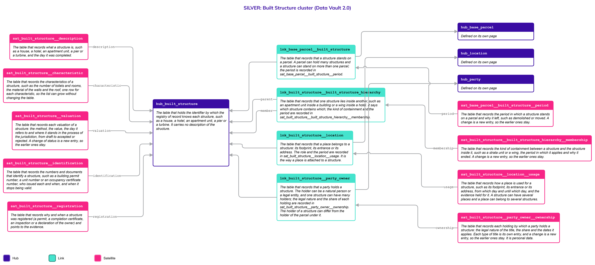
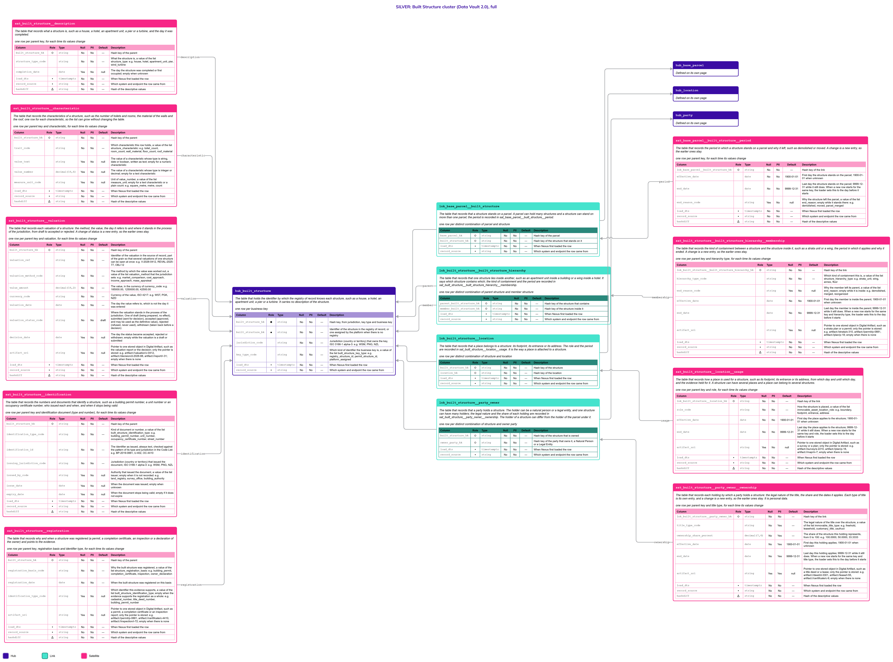

# Built Structure

## Header

| **Field** | **Value** |
| --- | --- |
| Object | Built Structure |
| Parent object | Immovable Assets |
| Owner domain | Registries |
| Shared with | Taxation Contributions and Licences, Finance, Compliance |
| Scope | Shared |
| Status | Draft |
| Version | 0.1 |
| Last updated | 2026-10-23 |

## Definition

A Built Structure is what is built on a parcel and stays: a house, a hotel, an apartment unit, a pier, a turbine. A structure can contain other structures, such as the apartment units of a building under strata title, each with its own holder, and each structure is built from sub-structures. The State needs to identify it, register who holds it and value it for tax.

The holder of a structure is a Party: a natural person or a legal entity, which includes a public body such as a government agency. The structure stands on a parcel, described on the page [Base Parcel](Base_Parcel.md). Every structure has its own identifiers, its own proof of registration, its own characteristics and its own value.

## Why it is its own object

- **A structure has a life of its own.** It is built, extended, divided into units, demolished or moved, while the parcel is unchanged.
- **It has its own key.** A structure is known by a building permit, a unit number or an occupancy certificate. The cadastre key is the key of the parcel, on the page [Base Parcel](Base_Parcel.md).
- **It has its own holders.** The holder of a building can differ from the holder of the land under it, as in a lease, and each unit of a strata building has its own holder.
- **It is valued on its own.** A building is valued by methods and on cycles that differ from those of land, and the value of one never includes the other.
- **Containment has no fixed depth.** A building holds wings, floors and units, and a unit can be divided again. The same containment Link is used again for each level.

If the parcel and the structure were one table, a unit in a strata building would need a parcel of its own.

## Vault objects

| **Type** | **Name** | **Definition** | **Grain** | **Business key** |
| --- | --- | --- | --- | --- |
| Hub | `hub_built_structure` | The table that holds the identifier by which the registry of record knows each structure, such as a house, a hotel, an apartment unit, a pier or a turbine. It carries no description of the structure. | one row per business key | `built_structure_bk`: the identifier in the registry of record, or one assigned by the platform when there is none, with the jurisdiction and the key type |
| Link | `lnk_base_parcel__built_structure` | The table that records that a structure stands on a parcel. A parcel can hold many structures and a structure can stand on more than one parcel; the period is recorded in `sat_base_parcel__built_structure__period`. | one row per distinct combination of parcel and structure | `hub_base_parcel`, `hub_built_structure` |
| Link | `lnk_built_structure__built_structure_hierarchy` | The table that records that one structure lies inside another, such as an apartment unit inside a building or a wing inside a hotel. It says which structure contains which; the kind of containment and the period are recorded in `sat_built_structure__built_structure_hierarchy__membership`. | one row per distinct combination of parent structure and member structure | `hub_built_structure` (parent), `hub_built_structure` (member) |
| Link | `lnk_built_structure__location` | The table that records that a place belongs to a structure: its footprint, its entrance or its address. The role and the period are recorded in `sat_built_structure__location__usage`. It is the way a place is attached to a structure. | one row per distinct combination of structure and location | `hub_built_structure`, `hub_location` |
| Link | `lnk_built_structure__party_owner` | The table that records that a party holds a structure. The holder can be a natural person or a legal entity, and one structure can have many holders; the legal nature and the share of each holding are recorded in `sat_built_structure__party_owner__ownership`. The holder of a structure can differ from the holder of the parcel under it. | one row per distinct combination of structure and owner party | `hub_built_structure`, `hub_party` (owner) |
| Satellite | `sat_built_structure__description` | The table that records what a structure is, such as a house, a hotel, an apartment unit, a pier or a turbine, and the day it was completed. | one row per parent key, for each time its values change | — |
| Satellite | `sat_built_structure__characteristic` | The table that records the characteristics of a structure, such as the number of toilets and rooms, the material of the walls and the roof, one row for each characteristic, so the list can grow without changing the table. | one row per parent key and characteristic, for each time its values change | — |
| Satellite | `sat_built_structure__valuation` | The table that records each valuation of a structure: the method, the value, the day it refers to and where it stands in the process of the jurisdiction, from draft to accepted or rejected. A change of status is a new entry, so the earlier ones stay. | one row per parent key and valuation, for each time its values change | — |
| Satellite | `sat_built_structure__identification` | The table that records the numbers and documents that identify a structure, such as a building permit number, a unit number or an occupancy certificate number, who issued each and when, and when it stops being valid. | one row per parent key and identification document (type and number), for each time its values change | — |
| Satellite | `sat_built_structure__registration` | The table that records why and when a structure was registered (a permit, a completion certificate, an inspection or a declaration of the owner) and points to the evidence. | one row per parent key, registration basis and identifier type, for each time its values change | — |
| Satellite | `sat_base_parcel__built_structure__period` | The table that records the period in which a structure stands on a parcel and why it left, such as demolished or moved. A change is a new entry, so the earlier ones stay. | one row per parent key, for each time its values change | — |
| Satellite | `sat_built_structure__built_structure_hierarchy__membership` | The table that records the kind of containment between a structure and the structure inside it, such as a strata unit or a wing, the period in which it applies and why it ended. A change is a new entry, so the earlier ones stay. | one row per parent key and hierarchy type, for each time its values change | — |
| Satellite | `sat_built_structure__location__usage` | The table that records how a place is used for a structure, such as its footprint, its entrance or its address, from which day and until which day, and the evidence held for it. A structure can have several places and a place can belong to several structures. | one row per parent key and role, for each time its values change | — |
| Satellite | `sat_built_structure__party_owner__ownership` | The table that records each holding by which a party holds a structure: the legal nature of the title, the share and the dates it applies. Each type of title is its own entry, and a change is a new entry, so the earlier ones stay. It is personal data. | one row per parent key and title type, for each time its values change | — |

`built_structure_hk` is computed from `jurisdiction_code`, `key_type_code` and the normalized `built_structure_bk`, joined with a fixed separator. Normalization: trimmed, case-folded, Unicode-normalized. The hash algorithm is a platform decision and is not named here. Satellites carry only the parent's hash key.

`lnk_base_parcel__built_structure` says that a structure **stands on** a parcel; `lnk_built_structure__built_structure_hierarchy` says that a structure **lies inside** another, so an apartment unit is a structure inside the building and the building is a structure on the parcel. `lnk_built_structure__location` says where the structure **is**, with the shape of `lnk_location__natural_person`. `lnk_built_structure__party_owner` says that a Party **holds** the structure, with the shape of `lnk_legal_entity__party_owner`. A government or a government agency holds in the same way, as a Legal Entity classified as public. Each Link has its own Satellite for the details.

**Related pages.** The details of every object below are on its own page; the diagrams on this page draw them with a note.

- [Immovable Assets](Immovable_Assets.md): the family page, with the rules that both parts share and the decisions that are open for both.
- [Base Parcel](Base_Parcel.md): `hub_base_parcel`, joined by `lnk_base_parcel__built_structure`, which is defined on this page.
- [Location](Location.md): `hub_location`, joined by `lnk_built_structure__location`.
- [Party](Party.md), with [Natural Person](Natural_Person.md) and [Legal Entity](Legal_Entity.md): `hub_party`, joined by `lnk_built_structure__party_owner`.

## Fields

*Indicators in Role: ◆ own hash key · ◇ hash key of another object · ● business key · ▪ load metadata · Δ hashdiff. Default: — means no default, so the loader must supply the value; a literal is a default in the sense of Iceberg format version 3.*

### hub_built_structure

| **Column** | **Role** | **Type** | **Null** | **PII** | **Default** | **Description** |
| --- | --- | --- | --- | --- | --- | --- |
| `built_structure_hk` | ◆ | `string` | No | No | — | Hash key, from jurisdiction, key type and business key |
| `built_structure_bk` | ● | `string` | No | No | — | Identifier of the structure in the registry of record, or one assigned by the platform when there is no registry |
| `jurisdiction_code` |  | `string` | No | No | — | Jurisdiction (country or territory) that owns the key, ISO 3166-1 alpha-3: e.g. `WSM`, `PNG`, `NZL` |
| `key_type_code` |  | `string` | No | No | — | Which kind of identifier the business key is, a value of the list `built_structure_key_type`: e.g. `registry_structure_id`, `permit_structure_id`, `platform_assigned` |
| `load_dts` | ▪ | `timestamptz` | No | No | — | When Nexus first loaded the row |
| `record_source` | ▪ | `string` | No | No | — | Which system and endpoint the row came from |

### lnk_base_parcel__built_structure

| **Column** | **Role** | **Type** | **Null** | **PII** | **Default** | **Description** |
| --- | --- | --- | --- | --- | --- | --- |
| `base_parcel_hk` | ◇ | `string` | No | No | — | Hash key of the parcel |
| `built_structure_hk` | ◇ | `string` | No | No | — | Hash key of the structure that stands on it |
| `load_dts` | ▪ | `timestamptz` | No | No | — | When Nexus first loaded the row |
| `record_source` | ▪ | `string` | No | No | — | Which system and endpoint the row came from |

### lnk_built_structure__built_structure_hierarchy

A containment between two structures. The **parent** is the structure that contains, such as a building, and the **member** is the structure inside it, such as an apartment unit or a wing. Both are rows of `hub_built_structure`. A member can itself be a parent, so the levels are not built into the tables.

| **Column** | **Role** | **Type** | **Null** | **PII** | **Default** | **Description** |
| --- | --- | --- | --- | --- | --- | --- |
| `parent_built_structure_hk` | ◇ | `string` | No | No | — | Hash key of the structure that contains |
| `member_built_structure_hk` | ◇ | `string` | No | No | — | Hash key of the structure inside it |
| `load_dts` | ▪ | `timestamptz` | No | No | — | When Nexus first loaded the row |
| `record_source` | ▪ | `string` | No | No | — | Which system and endpoint the row came from |

### lnk_built_structure__location

| **Column** | **Role** | **Type** | **Null** | **PII** | **Default** | **Description** |
| --- | --- | --- | --- | --- | --- | --- |
| `built_structure_hk` | ◇ | `string` | No | No | — | Hash key of the structure |
| `location_hk` | ◇ | `string` | No | No | — | Hash key of the location |
| `load_dts` | ▪ | `timestamptz` | No | No | — | When Nexus first loaded the row |
| `record_source` | ▪ | `string` | No | No | — | Which system and endpoint the row came from |

### lnk_built_structure__party_owner

| **Column** | **Role** | **Type** | **Null** | **PII** | **Default** | **Description** |
| --- | --- | --- | --- | --- | --- | --- |
| `built_structure_hk` | ◇ | `string` | No | No | — | Hash key of the structure that is owned |
| `owner_party_hk` | ◇ | `string` | No | No | — | Hash key of the party that owns it, a Natural Person or a Legal Entity |
| `load_dts` | ▪ | `timestamptz` | No | No | — | When Nexus first loaded the row |
| `record_source` | ▪ | `string` | No | No | — | Which system and endpoint the row came from |

### sat_built_structure__description

| **Column** | **Role** | **Type** | **Null** | **PII** | **Default** | **Description** |
| --- | --- | --- | --- | --- | --- | --- |
| `built_structure_hk` | ◇ | `string` | No | No | — | Hash key of the parent |
| `structure_type_code` |  | `string` | No | No | — | What the structure is, a value of the list `structure_type`: e.g. `house`, `hotel`, `apartment_unit`, `pier`, `wind_turbine` |
| `completion_date` |  | `date` | Yes | No | null | The day the structure was completed or first occupied; empty when unknown |
| `load_dts` | ▪ | `timestamptz` | No | No | — | When Nexus first loaded the row |
| `record_source` | ▪ | `string` | No | No | — | Which system and endpoint the row came from |
| `hashdiff` | Δ | `string` | No | No | — | Hash of the descriptive values |

### sat_built_structure__characteristic

The characteristics of a structure are an open list: the number of toilets, rooms and floors, the material of the walls and the roof, and whatever a jurisdiction adds. Each is a row and not a column (Principles, "Traits as rows"). A new characteristic is a new value of the Code List `structure_characteristic` and changes no table. The Code List says, for each one, which value column is used (`value_data_type_code`), and the load checks the value against it. A characteristic that is not personal data has no in-place twin: history is kept.

| **Column** | **Role** | **Type** | **Null** | **PII** | **Default** | **Description** |
| --- | --- | --- | --- | --- | --- | --- |
| `built_structure_hk` | ◇ | `string` | No | No | — | Hash key of the parent |
| `trait_code` |  | `string` | No | No | — | Which characteristic this row holds, a value of the list `structure_characteristic`: e.g. `toilet_count`, `room_count`, `wall_material`, `floor_count`, `roof_material` |
| `value_text` |  | `string` | Yes | No | null | The value of a characteristic whose type is `string`, `date` or `boolean`, written as text; empty for a numeric characteristic |
| `value_number` |  | `decimal(18,6)` | Yes | No | null | The value of a characteristic whose type is `integer` or `decimal`; empty for a text characteristic |
| `measure_unit_code` |  | `string` | Yes | No | null | Unit of `value_number`, a value of the list `measure_unit`; empty for a text characteristic or a plain count: e.g. `square_metre`, `metre`, `count` |
| `load_dts` | ▪ | `timestamptz` | No | No | — | When Nexus first loaded the row |
| `record_source` | ▪ | `string` | No | No | — | Which system and endpoint the row came from |
| `hashdiff` | Δ | `string` | No | No | — | Hash of the descriptive values |

### sat_built_structure__valuation

Same shape and same rules as `sat_base_parcel__valuation`. A structure is valued on its own, so the value of a parcel never includes it. The definitive value is the Gold view `cur_built_structure__valuation_definitive`.

| **Column** | **Role** | **Type** | **Null** | **PII** | **Default** | **Description** |
| --- | --- | --- | --- | --- | --- | --- |
| `built_structure_hk` | ◇ | `string` | No | No | — | Hash key of the parent |
| `valuation_ref` |  | `string` | No | No | — | Identifier of the valuation in the source of record, part of the grain so that several valuations of one structure can be open at once: e.g. `V-2026-0412`, `REVAL-2025-77`, `OBJ-12` |
| `valuation_method_code` |  | `string` | No | No | — | The method by which the value was worked out, a value of the list `valuation_method` that the jurisdiction sets: e.g. `market_comparison`, `cost_approach`, `income_approach`, `mass_appraisal` |
| `value_amount` |  | `decimal(18,2)` | No | No | — | The value, in the currency of `currency_code`: e.g. `185000.00`, `1250000.00`, `42500.00` |
| `currency_code` |  | `string` | No | No | — | Currency of the value, ISO 4217: e.g. `WST`, `PGK`, `NZD` |
| `valuation_date` |  | `date` | No | No | — | The day the value refers to, which is not the day it was entered |
| `valuation_status_code` |  | `string` | No | No | `draft` | Where the valuation stands in the process of the jurisdiction. One of `draft` (being prepared, no effect), `submitted` (sent for decision), `accepted` (approved, and may be used as the definitive value), `rejected` (refused, never used), `withdrawn` (taken back before a decision) |
| `decision_date` |  | `date` | Yes | No | null | The day the status became `accepted`, `rejected` or `withdrawn`; empty while the valuation is a draft or submitted |
| `artifact_uri` |  | `string` | Yes | No | null | Pointer to one stored object in Digital Artifact, such as the valuation report or the decision; only the pointer is stored: e.g. `artifact://valuation/v-0412`, `artifact://decision/d-2026-88`, `artifact://report/r-31`; empty when there is none |
| `load_dts` | ▪ | `timestamptz` | No | No | — | When Nexus first loaded the row |
| `record_source` | ▪ | `string` | No | No | — | Which system and endpoint the row came from |
| `hashdiff` | Δ | `string` | No | No | — | Hash of the descriptive values |

### sat_built_structure__identification

| **Column** | **Role** | **Type** | **Null** | **PII** | **Default** | **Description** |
| --- | --- | --- | --- | --- | --- | --- |
| `built_structure_hk` | ◇ | `string` | No | No | — | Hash key of the parent |
| `identification_type_code` |  | `string` | No | No | — | Kind of document or number, a value of the list `built_structure_identification_type`: e.g. `building_permit_number`, `unit_number`, `occupancy_certificate_number`, `street_number` |
| `identification_id` |  | `string` | No | No | — | The identifier as issued, always text, checked against the pattern of its type and jurisdiction in the Code List: e.g. `BP-2019-0881`, `U-402`, `OC-4410` |
| `issuing_jurisdiction_code` |  | `string` | No | No | — | Jurisdiction (country or territory) that issued the document, ISO 3166-1 alpha-3: e.g. `WSM`, `PNG`, `NZL` |
| `issued_by_code` |  | `string` | Yes | No | null | Authority that issued the document, a value of the list `issuer`; empty when it is not recorded: e.g. `land_registry`, `survey_office`, `building_authority` |
| `issue_date` |  | `date` | Yes | No | null | When the document was issued; empty when unknown |
| `expiry_date` |  | `date` | Yes | No | null | When the document stops being valid; empty if it does not expire |
| `load_dts` | ▪ | `timestamptz` | No | No | — | When Nexus first loaded the row |
| `record_source` | ▪ | `string` | No | No | — | Which system and endpoint the row came from |
| `hashdiff` | Δ | `string` | No | No | — | Hash of the descriptive values |

### sat_built_structure__registration

| **Column** | **Role** | **Type** | **Null** | **PII** | **Default** | **Description** |
| --- | --- | --- | --- | --- | --- | --- |
| `built_structure_hk` | ◇ | `string` | No | No | — | Hash key of the parent |
| `registration_basis_code` |  | `string` | No | No | — | Why the built structure was registered, a value of the list `structure_registration_basis`: e.g. `building_permit`, `completion_certificate`, `inspection`, `owner_declaration` |
| `registration_date` |  | `date` | No | No | — | When the built structure was registered on this basis |
| `identification_type_code` |  | `string` | Yes | No | null | Which identifier this evidence supports, a value of the list `built_structure_identification_type`; empty when the evidence supports the registration as a whole: e.g. `cadastral_number`, `title_deed_number`, `building_permit_number` |
| `artifact_uri` |  | `string` | Yes | No | null | Pointer to one stored object in Digital Artifact, such as a permit, a completion certificate or an inspection report; only the pointer is stored: e.g. `artifact://permit/p-0881`, `artifact://certificate/c-4410`, `artifact://inspection/i-72`; empty when there is none |
| `load_dts` | ▪ | `timestamptz` | No | No | — | When Nexus first loaded the row |
| `record_source` | ▪ | `string` | No | No | — | Which system and endpoint the row came from |
| `hashdiff` | Δ | `string` | No | No | — | Hash of the descriptive values |

### sat_base_parcel__built_structure__period

| **Column** | **Role** | **Type** | **Null** | **PII** | **Default** | **Description** |
| --- | --- | --- | --- | --- | --- | --- |
| `lnk_base_parcel__built_structure_hk` | ◇ | `string` | No | No | — | Hash key of the link |
| `effective_date` |  | `date` | No | No | `1900-01-01` | First day the structure stands on the parcel; `1900-01-01` when unknown |
| `end_date` |  | `date` | No | No | `9999-12-31` | Last day the structure stands on the parcel; `9999-12-31` while it still does. When a new row starts for the same key, the loader sets this to the day before it starts |
| `end_reason_code` |  | `string` | Yes | No | null | Why the structure left the parcel, a value of the list `end_reason`; empty while it stands there: e.g. `demolished`, `moved`, `parcel_merged` |
| `load_dts` | ▪ | `timestamptz` | No | No | — | When Nexus first loaded the row |
| `record_source` | ▪ | `string` | No | No | — | Which system and endpoint the row came from |
| `hashdiff` | Δ | `string` | No | No | — | Hash of the descriptive values |

### sat_built_structure__built_structure_hierarchy__membership

The kind of containment, its period and the reason it ended are one fact, so they share a Satellite. The kind is part of the grain: a unit can lie in a building of the strata plan and in a wing of the permit. Within one kind, a member has at most one open row.

| **Column** | **Role** | **Type** | **Null** | **PII** | **Default** | **Description** |
| --- | --- | --- | --- | --- | --- | --- |
| `lnk_built_structure__built_structure_hierarchy_hk` | ◇ | `string` | No | No | — | Hash key of the link |
| `hierarchy_type_code` |  | `string` | No | No | — | Which kind of containment this is, a value of the list `structure_hierarchy_type`: e.g. `strata_unit`, `wing`, `annex`, `floor` |
| `end_reason_code` |  | `string` | Yes | No | null | Why the member left its parent, a value of the list `end_reason`; empty while it is inside: e.g. `demolished`, `merged`, `reorganized` |
| `effective_date` |  | `date` | No | No | `1900-01-01` | First day the member is inside the parent; `1900-01-01` when unknown |
| `end_date` |  | `date` | No | No | `9999-12-31` | Last day the member is inside the parent; `9999-12-31` while it still does. When a new row starts for the same key and hierarchy type, the loader sets this to the day before it starts |
| `artifact_uri` |  | `string` | Yes | No | null | Pointer to one stored object in Digital Artifact, such as a strata plan or a permit; only the pointer is stored: e.g. `artifact://strata/s-310`, `artifact://permit/p-0881`, `artifact://plan/p-18`; empty when there is none |
| `load_dts` | ▪ | `timestamptz` | No | No | — | When Nexus first loaded the row |
| `record_source` | ▪ | `string` | No | No | — | Which system and endpoint the row came from |
| `hashdiff` | Δ | `string` | No | No | — | Hash of the descriptive values |

### sat_built_structure__location__usage

| **Column** | **Role** | **Type** | **Null** | **PII** | **Default** | **Description** |
| --- | --- | --- | --- | --- | --- | --- |
| `lnk_built_structure__location_hk` | ◇ | `string` | No | No | — | Hash key of the link |
| `role_code` |  | `string` | No | No | — | How the structure is placed, a value of the list `immovable_asset_location_role`: e.g. `boundary`, `footprint`, `entrance`, `address` |
| `effective_date` |  | `date` | No | No | `1900-01-01` | First day the place applies to the structure; `1900-01-01` when unknown |
| `end_date` |  | `date` | No | No | `9999-12-31` | Last day the place applies to the structure; `9999-12-31` while it still does. When a new row starts for the same key and role, the loader sets this to the day before it starts |
| `artifact_uri` |  | `string` | Yes | No | null | Pointer to one stored object in Digital Artifact, such as a survey or a plan; only the pointer is stored: e.g. `artifact://survey/s-2210`, `artifact://plan/p-18`, `artifact://map/m-7`; empty when there is none |
| `load_dts` | ▪ | `timestamptz` | No | No | — | When Nexus first loaded the row |
| `record_source` | ▪ | `string` | No | No | — | Which system and endpoint the row came from |
| `hashdiff` | Δ | `string` | No | No | — | Hash of the descriptive values |

### sat_built_structure__party_owner__ownership

| **Column** | **Role** | **Type** | **Null** | **PII** | **Default** | **Description** |
| --- | --- | --- | --- | --- | --- | --- |
| `lnk_built_structure__party_owner_hk` | ◇ | `string` | No | No | — | Hash key of the link |
| `title_type_code` |  | `string` | No | Yes | — | The legal nature of the title over the structure, a value of the list `immovable_title_type`: e.g. `freehold`, `leasehold`, `customary_title`, `usufruct` |
| `ownership_share_percent` |  | `decimal(7,4)` | No | Yes | — | The share of the structure this holding represents, from 0 to 100: e.g. `100.0000`, `50.0000`, `33.3333` |
| `effective_date` |  | `date` | No | Yes | `1900-01-01` | First day this holding applies; `1900-01-01` when unknown |
| `end_date` |  | `date` | No | Yes | `9999-12-31` | Last day this holding applies; `9999-12-31` while it still does. When a new row starts for the same key and title type, the loader sets this to the day before it starts |
| `artifact_uri` |  | `string` | Yes | Yes | null | Pointer to one stored object in Digital Artifact, such as a title deed or a lease; only the pointer is stored: e.g. `artifact://deed/d-3301`, `artifact://lease/l-55`, `artifact://certificate/c-9`; empty when there is none |
| `load_dts` | ▪ | `timestamptz` | No | No | — | When Nexus first loaded the row |
| `record_source` | ▪ | `string` | No | No | — | Which system and endpoint the row came from |
| `hashdiff` | Δ | `string` | No | No | — | Hash of the descriptive values |

## Sources and mapping

No endpoints declared yet

## Jurisdictions map

| **Edge case** | **Where it happens** | **Approach** | **Vault effect** |
| --- | --- | --- | --- |
| A building with many apartment units, each with its own holder (strata title) | Jurisdictions with unit or strata titles | The building is a structure on the parcel; each unit is a structure inside the building, with its own identifier, value and holder | `lnk_built_structure__built_structure_hierarchy` with `hierarchy_type_code` `strata_unit`; `lnk_built_structure__party_owner` for each unit |
| A parcel with several structures | Any jurisdiction | One row in the Link for each structure; each structure is its own Hub row | Rows of `lnk_base_parcel__built_structure` |
| A structure that stands on more than one parcel | Any jurisdiction with large buildings or piers | The same structure is joined to each parcel | Rows of `lnk_base_parcel__built_structure` |
| The building is held by someone other than the holder of the land | Jurisdictions with leasehold or ground rent | Each has its own holding | `lnk_built_structure__party_owner` and `lnk_base_parcel__party_owner` with different parties and `title_type_code` |
| A structure is demolished or moved | Any jurisdiction | The structure stays on record; the period on the parcel ends with a reason | `end_date` and `end_reason_code` in `sat_base_parcel__built_structure__period` |
| A parcel is divided or two parcels are merged, or a building is divided or joined | Any jurisdiction | The operation is a fact to track for the parcel or the building. It may be only a change on the register, or a geographic process that cuts or joins the shapes. The new parcels are new Hub rows; the old one ends. How the operation is recorded is open (see Open decisions) | New rows in `hub_base_parcel` or `hub_built_structure`; the operation itself is open |
| A characteristic that only one jurisdiction records, such as the number of toilets or the material of the walls | Any jurisdiction | A new value of the Code List `structure_characteristic`; no table changes | A new `trait_code` in `sat_built_structure__characteristic` |
| The value is revised on a fixed cycle by a method the jurisdiction sets | Jurisdictions that revalue every parcel on a cycle | Each revaluation is a valuation with its own reference and goes through the status process of the jurisdiction | Rows of `sat_base_parcel__valuation` and `sat_built_structure__valuation` with their `valuation_method_code` |
| A valuation is refused, objected to or taken back | Jurisdictions with an appeal process | The valuation stays on record with its status; it never becomes the definitive value | `valuation_status_code` `rejected` or `withdrawn` |
| A structure with no permit, as in informal housing | Any jurisdiction | The structure is registered on the declaration of the owner or an inspection | An `owner_declaration` or `inspection` row in `sat_built_structure__registration`; no row in `sat_built_structure__identification` |

## Examples

Illustrative data. The first example is a building under strata title on a parcel in New Zealand; the second is how the structure is placed on the parcel.

**A building with units (New Zealand).** The parcel `P-5501` (described on the page [Base Parcel](Base_Parcel.md)) holds the building `S-100`, which contains the unit `S-100-402`. The unit has its own holder.

`hub_built_structure`, `sat_built_structure__description` and `lnk_built_structure__built_structure_hierarchy`

| **built_structure_bk** | **structure_type_code** | **Parent** | **hierarchy_type_code** |
| --- | --- | --- | --- |
| S-100 | house (a building of units) | (none) | — |
| S-100-402 | apartment_unit | `S-100` | strata_unit |

`lnk_base_parcel__built_structure` and `sat_base_parcel__built_structure__period`

| **base_parcel_bk** | **built_structure_bk** | **effective_date** | **end_date** | **end_reason_code** |
| --- | --- | --- | --- | --- |
| P-5501 | S-100 | 2019-06-01 | 9999-12-31 | (empty) |

`sat_built_structure__characteristic` for the unit `S-100-402`

| **trait_code** | **value_text** | **value_number** | **measure_unit_code** |
| --- | --- | --- | --- |
| room_count | (empty) | 3 | (empty) |
| toilet_count | (empty) | 1 | (empty) |
| floor_area | (empty) | 68.5 | square_metre |
| wall_material | brick | (empty) | (empty) |

`sat_built_structure__identification` for the unit `S-100-402`

| **identification_type_code** | **identification_id** | **issuing_jurisdiction_code** | **issued_by_code** | **issue_date** |
| --- | --- | --- | --- | --- |
| unit_number | U-402 | NZL | land_registry | 2019-05-20 |

`sat_built_structure__party_owner__ownership` for the unit `S-100-402`

| **holder** | **title_type_code** | **ownership_share_percent** | **effective_date** | **end_date** |
| --- | --- | --- | --- | --- |
| a natural person | freehold | 100.0000 | 2019-06-01 | 9999-12-31 |

The valuation of a structure goes through its status in the same way as that of a parcel; see the example on the page [Base Parcel](Base_Parcel.md).

## Modeling considerations

- **A structure can have several Locations,** as a parcel can: its footprint, its entrance and its address can each be their own Location, with their own role in `lnk_built_structure__location`. The Vault does not deduce one from another; see the [Location](Location.md) page.
- **Parcel and structure are two Hubs.** The structure has its own key, lifecycle and holders, so it is its own Hub, with its own Links to Location and to Party. It is joined to the parcel by `lnk_base_parcel__built_structure`, which is defined on this page and drawn on the page [Base Parcel](Base_Parcel.md). Why there is no umbrella Hub is on the page [Immovable Assets](Immovable_Assets.md).
- **The Link to the parcel is many to many.** A parcel can hold many structures and a structure, such as a pier or a large building, can stand on more than one parcel. The period and the reason it ended are in `sat_base_parcel__built_structure__period`.
- **Containment has no fixed depth.** `lnk_built_structure__built_structure_hierarchy` joins the Hub to itself, as the hierarchy of Legal Entities does. How many levels a kind of containment may have is `max_depth_count` of the hierarchy type in the Code List (`sat_code_value__validation`). The level of a structure and its path to the parcel are computed in Gold (R13).
- **A structure has at most one open parent for each kind of containment.** At most one row with `end_date` `9999-12-31` for each member and `hierarchy_type_code`. A structure cannot be its own ancestor; a row that would close a loop is parked by the load.
- **The characteristics are an open list.** The number of toilets, the number of rooms, the material of the walls and the like are rows of `sat_built_structure__characteristic`, not columns. The Code List says for each characteristic which value column it uses and in which unit, and the load checks the value (Principles, "Traits as rows"). A characteristic that is a fact about a structure and not about a person is not personal data, so there is no in-place twin.
- **Shared rules.** Valuation and its statuses, two accepted values, identification and registration, ownership, the roles of a place, validity ranges and codes follow the rules written on the page [Immovable Assets](Immovable_Assets.md). What is only the structure's: the definitive value is the Gold view `cur_built_structure__valuation_definitive`; a permit or an occupancy certificate identifies it, and a new permit never changes a key; the holder of a structure can differ from the holder of the parcel under it; the roles of a place for a structure are `footprint`, `entrance` and `address`.
- **Area, distance and containment in space are not stored.** Whether a structure lies inside a parcel is computed in Gold from the shapes in Location (R13).

## Diagram

Two pictures of the same cluster. Read the simplified one first, then use the full one when you need the columns. Colors: Hub indigo, Link teal, Satellite magenta; a Satellite updated in place is lighter, with a dashed border. Arrows run from the child to its parent. Objects defined on another page are drawn with a note and no table.

### Simplified version

The shape of the cluster: 1 Hub, 4 Links and 9 Satellites, with the Hub of the parcel drawn as defined on another page. Each has its name and definition. Use it to see how the objects relate. It has no columns.

### Full version

The same objects, each with its Fields table (column, role, type, null, PII, default, description). Use it to check exactly what is stored. It is wide: zoom in or open the image on its own.

## Open decisions

| **Decision** | **Owner** | **How it is decided** | **Decide by** |
| --- | --- | --- | --- |
| The decisions shared with the other part of the family: Legal Instrument for encumbrances, divide and merge operations, the valuation process and two accepted values | Data Architecture Engineer and Data Product Owner | Written once, on the page [Immovable Assets](Immovable_Assets.md) | See that page |
| Which characteristics are required for each kind of structure, and their units | Data Product Owner | Set as values of the Code List list `structure_characteristic` | When a jurisdiction is configured |
| Which source of record supplies `built_structure_bk` in each jurisdiction, and who assigns the key where none exists | Platform configuration | Set in the Nexus configuration for each jurisdiction | When a jurisdiction is configured |
| The roles of a place for a structure and the kinds of holding of immovable property | Data Product Owner | Set as values of the Code List lists `immovable_asset_location_role` and `immovable_title_type` | When a jurisdiction is configured |
