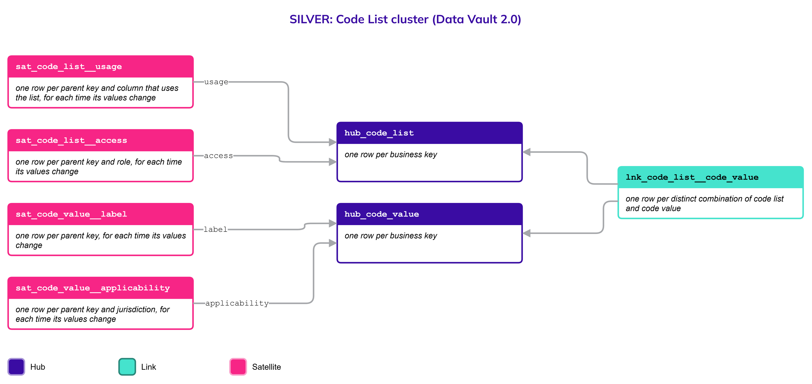
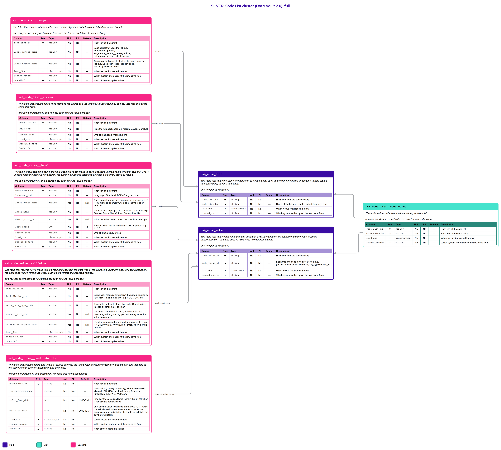

# Code List

## Header

| **Field** | **Value** |
| --- | --- |
| Object | Code List |
| Parent object | — |
| Owner domain | Platform |
| Shared with | Registries, Taxation Contributions and Licences, Finance, Benefits, Compliance, AEOI |
| Scope | Global |
| Status | Draft |
| Version | 0.1 |
| Last updated | 2026-10-21 |

## Definition

A Code List is a named set of allowed values for a column, such as gender, jurisdiction or key type, together with the label of each value in each language, how the value is read and checked, the jurisdictions where it applies, the period in which it is valid, where the list is used and who may read it.

One object holds every list. A new list is a new row, never a new table, so the model does not grow with each new need.

## Why it is its own object

- **Allowed values change; tables should not.** A jurisdiction can widen or narrow its list of gender values over time. If the list were a column constraint or a table of its own, each change would change a table. Here it is new rows with validity dates.
- **The same list is used in many places.** `jurisdiction_code` appears in several objects. One list means one definition (R6), with the places that use it recorded next to it.
- **Lists differ by jurisdiction.** The values that are allowed, and the period in which they are allowed, depend on where a person or entity is registered (R7). The difference is a scenario of the one list.
- **Some lists are sensitive.** The values of a community-affiliation list, for example, must be seen only by some roles. Access is recorded on the list.
- **One table for each list does not scale.** Every new need would add a table, a page, a definition and a mapping.

## Vault objects

| **Type** | **Name** | **Definition** | **Grain** | **Business key** |
| --- | --- | --- | --- | --- |
| Hub | `hub_code_list` | The table that holds the name of each list of allowed values, such as gender, jurisdiction or key type. A new list is a new entry here, never a new table. | one row per business key | `code_list_bk`: the name of the list, such as `gender`. It is assigned once and never changed |
| Hub | `hub_code_value` | The table that holds each value that can appear in a list, identified by the list name and the code, such as gender:female. The same code in two lists is two different values. | one row per business key | `code_value_bk`: the list name and the code joined by a colon, such as `gender:female` |
| Link | `lnk_code_list__code_value` | The table that records which values belong to which list. | one row per distinct combination of code list and code value | `hub_code_list`, `hub_code_value` |
| Satellite | `sat_code_value__label` | The table that records the name shown to people for each value in each language, a short name for small screens, what it means when the name is not enough, the order in which it is listed and whether it is a draft, active or retired. | one row per parent key and language, for each time its values change | — |
| Satellite | `sat_code_value__validation` | The table that records how a value is to be read and checked: the data type of the value, the usual unit, the limit of levels of a hierarchy kind and, for each jurisdiction, the pattern its written form must follow, such as the format of a passport number. | one row per parent key and jurisdiction, for each time its values change | — |
| Satellite | `sat_code_value__applicability` | The table that records where, when and for which kind of party a value is allowed: the jurisdiction (a country or territory), whether it applies to natural persons, to legal entities or to both, and the first and last day, so the same list can differ by jurisdiction, by kind of party and over time. | one row per parent key, jurisdiction and party type, for each time its values change | — |
| Satellite | `sat_code_list__usage` | The table that records where a list is used: which object and which column take their values from it. | one row per parent key and column that uses the list, for each time its values change | — |
| Satellite | `sat_code_list__access` | The table that records which roles may see the values of a list, and how much each may see, for lists that only some roles may read. | one row per parent key and role, for each time its values change | — |

The hash keys `code_list_hk` and `code_value_hk` are computed from the normalized business key, as for every Hub. A value's code is part of its business key, so the same code in two lists is two values.

## Fields

*Indicators in Role: ◆ own hash key · ◇ hash key of another object · ● business key · ▪ load metadata · Δ hashdiff. Default: — means no default, so the loader must supply the value; a literal is a default in the sense of Iceberg format version 3.*

### hub_code_list

| **Column** | **Role** | **Type** | **Null** | **PII** | **Default** | **Description** |
| --- | --- | --- | --- | --- | --- | --- |
| `code_list_hk` | ◆ | `string` | No | No | — | Hash key, from the business key |
| `code_list_bk` | ● | `string` | No | No | — | Name of the list: e.g. `gender`, `jurisdiction`, `key_type` |
| `load_dts` | ▪ | `timestamptz` | No | No | — | When Nexus first loaded the row |
| `record_source` | ▪ | `string` | No | No | — | Which system and endpoint the row came from |

### hub_code_value

| **Column** | **Role** | **Type** | **Null** | **PII** | **Default** | **Description** |
| --- | --- | --- | --- | --- | --- | --- |
| `code_value_hk` | ◆ | `string` | No | No | — | Hash key, from the business key |
| `code_value_bk` | ● | `string` | No | No | — | List name and code joined by a colon: e.g. `gender:female`, `jurisdiction:PNG`, `key_type:census_id` |
| `load_dts` | ▪ | `timestamptz` | No | No | — | When Nexus first loaded the row |
| `record_source` | ▪ | `string` | No | No | — | Which system and endpoint the row came from |

### lnk_code_list__code_value

| **Column** | **Role** | **Type** | **Null** | **PII** | **Default** | **Description** |
| --- | --- | --- | --- | --- | --- | --- |
| `code_list_hk` | ◇ | `string` | No | No | — | Hash key of the code list |
| `code_value_hk` | ◇ | `string` | No | No | — | Hash key of the code value |
| `load_dts` | ▪ | `timestamptz` | No | No | — | When Nexus first loaded the row |
| `record_source` | ▪ | `string` | No | No | — | Which system and endpoint the row came from |

### sat_code_value__label

One row for each value and language. A jurisdiction with more than one official language has one row for each; a reader asks for a language and, when there is no row, falls back to the default language of the jurisdiction and then to `en`.

| **Column** | **Role** | **Type** | **Null** | **PII** | **Default** | **Description** |
| --- | --- | --- | --- | --- | --- | --- |
| `code_value_hk` | ◇ | `string` | No | No | — | Hash key of the parent |
| `language_code` | | `string` | No | No | — | Language of the label, BCP 47: e.g. `en`, `fr`, `sm` |
| `label_short_name` | | `string` | Yes | No | null | Short name for small screens such as a phone: e.g. `F`, `PNG`, `Census id`; empty when `label_name` is short enough |
| `label_name` | | `string` | No | No | — | Name shown to people on a tablet or a computer: e.g. `Female`, `Papua New Guinea`, `Census identifier` |
| `description_text` | | `string` | Yes | No | null | What the value means, when the label is not enough |
| `sort_order` | | `int` | No | No | `0` | Position when the list is shown in this language: e.g. `1`, `2`, `3` |
| `status_code` | | `string` | No | No | — | One of `draft`, `active`, `retired` |
| `load_dts` | ▪ | `timestamptz` | No | No | — | When Nexus first loaded the row |
| `record_source` | ▪ | `string` | No | No | — | Which system and endpoint the row came from |
| `hashdiff` | Δ | `string` | No | No | — | Hash of the descriptive values |

### sat_code_value__validation

The data type says which value column a consumer reads (R11): a trait such as `height` is a `decimal`, so its value is read from `value_number`, and a trait such as `blood_type` is a `string`, so it is read from `value_text`. Because the type is declared once here, the load casts each value once and parks a value that does not fit (R8). The pattern is a form check, not proof that the document exists.

| **Column** | **Role** | **Type** | **Null** | **PII** | **Default** | **Description** |
| --- | --- | --- | --- | --- | --- | --- |
| `code_value_hk` | ◇ | `string` | No | No | — | Hash key of the parent |
| `jurisdiction_code` | | `string` | No | No | — | Jurisdiction (country or territory) the pattern applies to, ISO 3166-1 alpha-3, or `any`: e.g. `COL`, `CUW`, `any` |
| `value_data_type_code` | | `string` | No | No | — | Type of the values that use this code. One of `string`, `integer`, `decimal`, `date`, `boolean` |
| `measure_unit_code` | | `string` | Yes | No | null | Usual unit of a numeric value, a value of the list `measure_unit`: e.g. `cm`, `kg`, `percent`; empty when the value has no unit |
| `max_depth_count` | | `int` | Yes | No | null | Most levels a hierarchy of this kind may have, for a value that names a kind of hierarchy: e.g. `2`, `3`, `5`; empty for any other value |
| `validation_pattern_text` | | `string` | Yes | No | null | Regular expression the written form must match: e.g. `^[A-Z]{2}[0-9]{6}$`, `^[0-9]{6,10}$`; empty when there is no rule |
| `load_dts` | ▪ | `timestamptz` | No | No | — | When Nexus first loaded the row |
| `record_source` | ▪ | `string` | No | No | — | Which system and endpoint the row came from |
| `hashdiff` | Δ | `string` | No | No | — | Hash of the descriptive values |

### sat_code_value__applicability

| **Column** | **Role** | **Type** | **Null** | **PII** | **Default** | **Description** |
| --- | --- | --- | --- | --- | --- | --- |
| `code_value_hk` | ◇ | `string` | No | No | — | Hash key of the parent |
| `jurisdiction_code` | | `string` | No | No | — | Jurisdiction (country or territory) where the value is allowed, ISO 3166-1 alpha-3, or `any` for every jurisdiction: e.g. `PNG`, `WSM`, `any` |
| `party_type_code` | | `string` | No | No | `any` | Kind of party the value is allowed for. One of `natural_person`, `legal_entity`, `any`; `any` when the value does not depend on the kind of party |
| `valid_from_date` | | `date` | No | No | `1900-01-01` | First day the value is allowed there; `1900-01-01` when it has always been allowed |
| `valid_to_date` | | `date` | No | No | `9999-12-31` | Last day the value is allowed there; `9999-12-31` while it is still allowed. When a newer row starts for the same value and jurisdiction, the loader sets this to the day before it starts |
| `load_dts` | ▪ | `timestamptz` | No | No | — | When Nexus first loaded the row |
| `record_source` | ▪ | `string` | No | No | — | Which system and endpoint the row came from |
| `hashdiff` | Δ | `string` | No | No | — | Hash of the descriptive values |

### sat_code_list__usage

| **Column** | **Role** | **Type** | **Null** | **PII** | **Default** | **Description** |
| --- | --- | --- | --- | --- | --- | --- |
| `code_list_hk` | ◇ | `string` | No | No | — | Hash key of the parent |
| `usage_object_name` | | `string` | No | No | — | Vault object that uses the list: e.g. `hub_natural_person`, `sat_natural_person__demographics`, `sat_natural_person__identification` |
| `usage_column_name` | | `string` | No | No | — | Column of that object that takes its values from the list: e.g. `jurisdiction_code`, `gender_code`, `issuing_jurisdiction_code` |
| `load_dts` | ▪ | `timestamptz` | No | No | — | When Nexus first loaded the row |
| `record_source` | ▪ | `string` | No | No | — | Which system and endpoint the row came from |
| `hashdiff` | Δ | `string` | No | No | — | Hash of the descriptive values |

### sat_code_list__access

| **Column** | **Role** | **Type** | **Null** | **PII** | **Default** | **Description** |
| --- | --- | --- | --- | --- | --- | --- |
| `code_list_hk` | ◇ | `string` | No | No | — | Hash key of the parent |
| `role_code` | | `string` | No | No | — | Role the rule applies to: e.g. `registrar`, `auditor`, `analyst` |
| `access_code` | | `string` | No | No | — | One of `read`, `read_masked`, `none` |
| `load_dts` | ▪ | `timestamptz` | No | No | — | When Nexus first loaded the row |
| `record_source` | ▪ | `string` | No | No | — | Which system and endpoint the row came from |
| `hashdiff` | Δ | `string` | No | No | — | Hash of the descriptive values |

## Sources and mapping

No endpoints declared yet

## Jurisdictions map

| **Edge case** | **Where it happens** | **Approach** | **Vault effect** |
| --- | --- | --- | --- |
| A list with two values in one jurisdiction and more in another | Any jurisdiction that defines a list on its own | The values are the same rows; each jurisdiction has its own applicability rows (R7) | `sat_code_value__applicability`, one row for each jurisdiction |
| A value that only one kind of party may take, such as a place of birth for a person and a registered office for a legal entity | Any jurisdiction | The value stays one row; its applicability rows say for which kind of party it is allowed, with `any` when both may take it | `party_type_code` in `sat_code_value__applicability` |
| A jurisdiction widens its list, then narrows it | Any jurisdiction that changes a definition | The value gets an end date; a value that returns gets a new applicability row | New rows in `sat_code_value__applicability`; earlier rows stay as history |
| A value used in old records that is no longer allowed | Any jurisdiction | The value is retired, never deleted, so old rows stay readable | `status_code` changes to `retired` in `sat_code_value__label` |
| A jurisdiction with more than one official language | Any multilingual country or territory | One label row for each official language; the reader falls back to the default language of the jurisdiction, then to `en` | Rows by `language_code` in `sat_code_value__label` |
| The format of an identifier differs by country | Any jurisdiction that issues documents, for example a Colombian passport, a United States driver licence or a Curaçao national identity card | The pattern belongs to the value and the jurisdiction; a value that does not match is parked with the reason, not rejected | `validation_pattern_text` in `sat_code_value__validation` |
| A list whose values only some roles may see | Lists of sensitive attributes | The roles and what each may see are recorded on the list | Rows in `sat_code_list__access` |

## Examples

Illustrative data. The list `gender` is allowed with different values in two jurisdictions.

`hub_code_value` and `sat_code_value__label`

| **code_value_bk** | **language_code** | **label_short_name** | **label_name** | **status_code** |
| --- | --- | --- | --- | --- |
| gender:male | en | M | Male | active |
| gender:female | en | F | Female | active |
| gender:female | fr | F | Féminin | active |
| gender:non_binary | en | NB | Non-binary | active |

`sat_code_value__applicability`

| **code_value_bk** | **jurisdiction_code** | **party_type_code** | **valid_from_date** | **valid_to_date** |
| --- | --- | --- | --- | --- |
| gender:male | any | any | 1900-01-01 | 9999-12-31 |
| gender:female | any | any | 1900-01-01 | 9999-12-31 |
| gender:non_binary | WSM | any | 2024-01-01 | 9999-12-31 |
| location_role:place_of_birth | any | natural_person | 1900-01-01 | 9999-12-31 |
| location_role:registered_office | any | legal_entity | 1900-01-01 | 9999-12-31 |
| location_role:mailing_address | any | any | 1900-01-01 | 9999-12-31 |

Here a person in `PNG` can be recorded only as male or female, and a person in `WSM` as male, female or non-binary from 2024. A place of birth can be given to a natural person only, a registered office to a legal entity only, and a mailing address to either.

`sat_code_value__validation` for a passport number, a height and a kind of hierarchy

| **code_value_bk** | **jurisdiction_code** | **value_data_type_code** | **max_depth_count** | **validation_pattern_text** |
| --- | --- | --- | --- | --- |
| identification_type:passport | any | string | (empty) | (empty) |
| identification_type:passport | COL | string | (empty) | ^[A-Z]{2}[0-9]{6}$ |
| physical_trait:height | any | decimal | (empty) | (empty) |
| legal_entity_hierarchy_type:holding_group | any | string | 2 | (empty) |

A value that is later given a new rule gets a new row, and the loader closes the previous one the day before. A height is a `decimal`, so the traits Satellite reads it from `value_number`.

`sat_code_list__usage` for the list `gender`

| **usage_object_name** | **usage_column_name** |
| --- | --- |
| sat_natural_person__demographics | gender_code |
| sat_natural_person__demographics_history | gender_code |

## Modeling considerations

- **A code is a Code List value when its values can change without changing any logic.** Examples: `gender_code`, `jurisdiction_code`, `key_type_code`, `name_type_code`, `identification_type_code`, `registration_basis_code`, `script_code`. A code on which logic depends is a closed list written in the column's Description with `One of`. Examples: `status_code`, `event_status_code`, `access_code`, `value_data_type_code`.
- **A column that uses a list says so in two places.** The Description of the column points to the list, and `sat_code_list__usage` records the exact object and column. A search of either finds the other.
- **A Code List is never deleted from.** A value that is no longer allowed is retired, because records loaded earlier still carry it (R1).
- **Applicability is a scenario, not a copy.** The same value is one row; where and when it is allowed is in `sat_code_value__applicability`.
- **A value can be limited to a kind of party.** `party_type_code` in `sat_code_value__applicability` says whether a value is for natural persons, legal entities or both. The load checks the value of a column against the kind of owner of the row: the table itself says it where each kind has its own Satellite or Link, as for the places of persons and entities, so no lookup is needed. A row that does not fit is parked with the reason, not rejected. The table itself accepts any combination.
- **Access is enforced by Platform.** `sat_code_list__access` records the rule; the role-based access control of the platform applies it.
- **Which code columns are values of a Code List.** A code is a list value when it can gain, lose or change a value without any rule changing. It is a closed list, written in the Description with `One of`, when a rule branches on its values. The columns of the five pages:

| **Column** | **Where its values live** | **Why** |
| --- | --- | --- |
| `jurisdiction_code`, `issuing_jurisdiction_code`, `event_place_jurisdiction_code` | List `jurisdiction` (ISO 3166-1: a country or a territory with its own code) | One list for every column that names a country or territory |
| `key_type_code`, `name_type_code`, `identification_type_code`, `registration_basis_code`, `issued_by_code` | Lists `key_type`, `name_type`, `identification_type`, `registration_basis`, `issuer` | Each jurisdiction has its own values |
| `script_code`, `language_code` | Lists `script` (ISO 15924) and `language` (BCP 47) | External standards, loaded as lists |
| `gender_code`, `affiliation_type_code`, `affiliation_value_code` | Lists `gender`, `affiliation_type`, and one list for each affiliation type (`ethnicity`, `tribe`, `religion`) | Set by each jurisdiction and restricted by role |
| `trait_code`, `measure_unit_code` | Lists `physical_trait` and `measure_unit` | A new trait or unit is a new value, not a new column |
| `event_code` | Lists `person_event` and `legal_entity_event` | A new kind of event changes no table |
| `relationship_type_code`, `end_reason_code`, `responsibility_basis_code` | Lists with the same names without `_code` | The values differ by jurisdiction |
| `hierarchy_type_code` | List `legal_entity_hierarchy_type` | Each kind of grouping between legal entities is a value, with its own depth limit |
| `hierarchy_type_code` (zones) | List `zone_hierarchy_type` | Each kind of division of the territory is a value, with its own depth limit |
| `zone_scheme_code`, `zone_level_code`, `address_key_type`, `role_code` (place), `geometry_type_code`, `srs_code`, `accuracy_unit_code` | Lists `zone_scheme`, `zone_level`, `address_key_type`, `location_role`, `geometry_type`, `spatial_reference_system`, and the values of `measure_unit` | The Location page: each jurisdiction has its own zones and address keys, and a new kind of place or system is a value |
| `criterion_code`, `classification_code`, `community_code`, `role_code` (representation), `registration_basis_code` (legal entity) | Lists `legal_form`, `classification_criterion`, one list for each criterion, `community`, `representation_role`, `legal_entity_registration_basis` | A value changes without any rule changing |
| `sensitivity_level_code`, `reason_code` (sensitivity) | Lists `sensitivity_level`, `sensitivity_reason` | The levels are decided by Platform; `sensitivity_level_code` becomes a closed list if the access rules branch on it (open decision on the Party page) |
| `parcel_kind_code`, `land_use_code`, `tenure_type_code`, `area_basis_code`, `boundary_type_code`, `structure_type_code`, `title_type_code`, `valuation_method_code`, `currency_code`, `role_code` (immovable asset) | Lists `parcel_kind`, `land_use`, `tenure_type`, `area_basis`, `boundary_type`, `structure_type`, `immovable_title_type`, `valuation_method` (with the data each method needs, see the Base Parcel page), `currency` (ISO 4217) and `immovable_asset_location_role`; the traits of a parcel and of a structure are the lists `parcel_characteristic` and `structure_characteristic` | The Base Parcel and Built Structure pages: each jurisdiction has its own land classification, tenure, valuation methods and kinds of title, and a new one is a value |
| `asset_kind_code`, `asset_class_code`, `flag_state_code`, `registry_type_code`, `restriction_type_code`, `component_kind_code`, `position_code`, `model_kind_code`, `role_code` (movable asset), `title_type_code` (movable asset) | Lists `asset_kind`, `asset_class`, `flag_registry_type`, `asset_restriction_type`, `component_kind`, `component_position`, `component_hierarchy_type`, `model_kind`, `movable_asset_location_role` and `movable_title_type`; the traits of an asset, a part and a model are the lists `asset_characteristic`, `component_characteristic` and `model_characteristic`; `flag_state_code` takes ISO 3166-1 alpha-3 values | The Movable Assets pages: each jurisdiction has its own classes of assets, registries, restrictions and kinds of title, and a new one is a value |
| `status_code`, `event_status_code`, `relationship_status_code`, `value_data_type_code`, `party_type_code`, `access_code`, `mechanism_code`, `holding_type_code`, `liquidity_status_code`, `vesting_status_code`, `valuation_status_code` | Closed lists, written in the Description | A rule branches on each value |

- **A date range closes the one before it.** In `sat_code_value__applicability` and `sat_code_value__validation` a new row for the same value, jurisdiction and party type closes the open one: its end becomes the day before the new start (Principles, "Validity ranges").
- **A hierarchy kind has a depth.** `max_depth_count` in `sat_code_value__validation` says how many levels a kind of hierarchy may have. It is a setting of the value, so a deeper hierarchy changes a number and no table.
- **A value has a type.** `value_data_type_code` in `sat_code_value__validation` says whether the values of a code are strings, whole numbers, decimals, dates or booleans, so the load casts once and the Gold layer does not guess (R11).
- **External standards are still lists.** ISO 3166-1 for jurisdictions and ISO 15924 for scripts are loaded as lists, so every column reads the same way.

## Diagram

Two pictures of the same cluster. Read the simplified one first, then use the full one when you need the columns. Colors: Hub indigo, Link teal, Satellite magenta; a Satellite updated in place is lighter, with a dashed border. Arrows run from the child to its parent.

### Simplified version

The shape of the cluster: 2 Hubs, 1 Link and 5 Satellites, each with its name and grain. Use it to see how the objects relate. It has no columns.

### Full version

The same objects, each with its Fields table (column, role, type, null, PII, default, description). Use it to check exactly what is stored. It is wide: zoom in or open the image on its own.

## Open decisions

| **Decision** | **Owner** | **How it is decided** | **Decide by** |
| --- | --- | --- | --- |
| Where the roles of `sat_code_list__access` come from | Platform | Decided with the role-based access control design of the platform | Before the first list with restricted values |
| Whether the rule for which codes become Code List values is added to the Principles | Data Architecture Engineer | Decided in the Principles, from the examples in this page | Before the first review of this page |
| Whether `usage_object_name` and `usage_column_name` are filled by hand or read from the catalog | Data Architecture Engineer and Platform | Decided when the catalog (R5) is set up | Before the first list is loaded |
| Whether the validation pattern of a value is a regular expression only, or can name a check rule such as a check digit | Data Architecture Engineer | Decided with the first source that has a check digit | Before the first identification type is loaded |
| Whether a mapping from an old list to its replacement, such as an old gender list to a new one, is kept as data here | Data Architecture Engineer and Data Product Owner | Decided when the first jurisdiction changes a list that is used in reports | When such a change is announced |
| Whether a list can have a parent list, such as a region inside a jurisdiction | Data Architecture Engineer | Decided when the first hierarchical list is needed | When such a list is requested |
