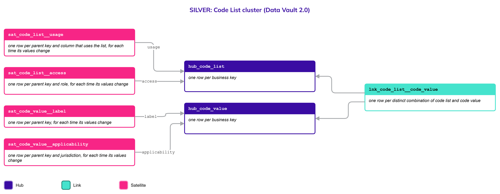
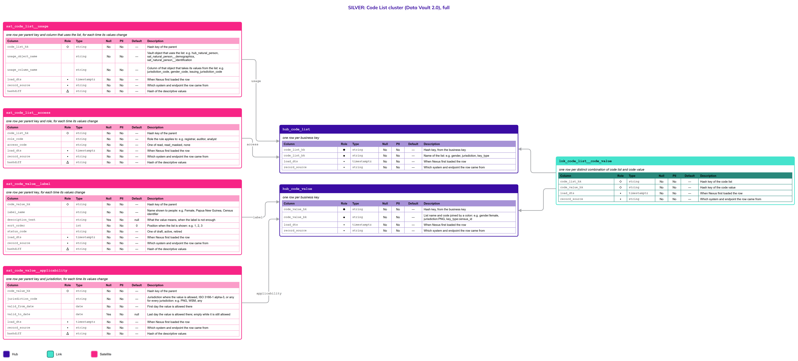

# Code List

## Header

| **Field** | **Value** |
| --- | --- |
| Object | Code List |
| Parent object | — |
| Owner domain | Platform |
| Shared with | Registries, Taxation Contributions and Licences, Finance, Benefits, Compliance, AEOI |
| Scope | Global |
| Status | Draft |
| Version | 0.1 |
| Last updated | 2026-10-19 |

## Definition

A Code List is a named set of allowed values for a column, such as gender, jurisdiction or key type, together with the label of each value, the jurisdictions where it applies, the period in which it is valid, where the list is used and who may read it.

One object holds every list. A new list is a new row, never a new table, so the model does not grow with each new need.

## Why it is its own object

- **Allowed values change; tables should not.** A jurisdiction can widen or narrow its list of gender values over time. If the list were a column constraint or a table of its own, each change would change a table. Here it is new rows with validity dates.
- **The same list is used in many places.** `jurisdiction_code` appears in several objects. One list means one definition (R6), with the places that use it recorded next to it.
- **Lists differ by jurisdiction.** The values that are allowed, and the period in which they are allowed, depend on where a person or entity is registered (R7). The difference is a scenario of the one list.
- **Some lists are sensitive.** The values of a community-affiliation list, for example, must be seen only by some roles. Access is recorded on the list.
- **One table for each list does not scale.** Every new need would add a table, a page, a definition and a mapping.

## Vault objects

| **Type** | **Name** | **Grain** | **Business key** |
| --- | --- | --- | --- |
| Hub | `hub_code_list` | one row per business key | `code_list_bk`: the name of the list, such as `gender`. It is assigned once and never changed |
| Hub | `hub_code_value` | one row per business key | `code_value_bk`: the list name and the code joined by a colon, such as `gender:female` |
| Link | `lnk_code_list__code_value` | one row per distinct combination of code list and code value | `hub_code_list`, `hub_code_value` |
| Satellite | `sat_code_value__label` | one row per parent key, for each time its values change | — |
| Satellite | `sat_code_value__applicability` | one row per parent key and jurisdiction, for each time its values change | — |
| Satellite | `sat_code_list__usage` | one row per parent key and column that uses the list, for each time its values change | — |
| Satellite | `sat_code_list__access` | one row per parent key and role, for each time its values change | — |

The hash keys `code_list_hk` and `code_value_hk` are computed from the normalized business key, as for every Hub. A value's code is part of its business key, so the same code in two lists is two values.

## Fields

*Indicators in Role: ◆ own hash key · ◇ hash key of another object · ● business key · ▪ load metadata · Δ hashdiff. Default: — means no default, so the loader must supply the value; a literal is a default in the sense of Iceberg format version 3.*

### hub_code_list

| **Column** | **Role** | **Type** | **Null** | **PII** | **Default** | **Description** |
| --- | --- | --- | --- | --- | --- | --- |
| `code_list_hk` | ◆ | `string` | No | No | — | Hash key, from the business key |
| `code_list_bk` | ● | `string` | No | No | — | Name of the list: e.g. `gender`, `jurisdiction`, `key_type` |
| `load_dts` | ▪ | `timestamptz` | No | No | — | When Nexus first loaded the row |
| `record_source` | ▪ | `string` | No | No | — | Which system and endpoint the row came from |

### hub_code_value

| **Column** | **Role** | **Type** | **Null** | **PII** | **Default** | **Description** |
| --- | --- | --- | --- | --- | --- | --- |
| `code_value_hk` | ◆ | `string` | No | No | — | Hash key, from the business key |
| `code_value_bk` | ● | `string` | No | No | — | List name and code joined by a colon: e.g. `gender:female`, `jurisdiction:PNG`, `key_type:census_id` |
| `load_dts` | ▪ | `timestamptz` | No | No | — | When Nexus first loaded the row |
| `record_source` | ▪ | `string` | No | No | — | Which system and endpoint the row came from |

### lnk_code_list__code_value

| **Column** | **Role** | **Type** | **Null** | **PII** | **Default** | **Description** |
| --- | --- | --- | --- | --- | --- | --- |
| `code_list_hk` | ◇ | `string` | No | No | — | Hash key of the code list |
| `code_value_hk` | ◇ | `string` | No | No | — | Hash key of the code value |
| `load_dts` | ▪ | `timestamptz` | No | No | — | When Nexus first loaded the row |
| `record_source` | ▪ | `string` | No | No | — | Which system and endpoint the row came from |

### sat_code_value__label

| **Column** | **Role** | **Type** | **Null** | **PII** | **Default** | **Description** |
| --- | --- | --- | --- | --- | --- | --- |
| `code_value_hk` | ◇ | `string` | No | No | — | Hash key of the parent |
| `label_name` | | `string` | No | No | — | Name shown to people: e.g. `Female`, `Papua New Guinea`, `Census identifier` |
| `description_text` | | `string` | Yes | No | null | What the value means, when the label is not enough |
| `sort_order` | | `int` | No | No | `0` | Position when the list is shown: e.g. `1`, `2`, `3` |
| `status_code` | | `string` | No | No | — | One of `draft`, `active`, `retired` |
| `load_dts` | ▪ | `timestamptz` | No | No | — | When Nexus first loaded the row |
| `record_source` | ▪ | `string` | No | No | — | Which system and endpoint the row came from |
| `hashdiff` | Δ | `string` | No | No | — | Hash of the descriptive values |

### sat_code_value__applicability

| **Column** | **Role** | **Type** | **Null** | **PII** | **Default** | **Description** |
| --- | --- | --- | --- | --- | --- | --- |
| `code_value_hk` | ◇ | `string` | No | No | — | Hash key of the parent |
| `jurisdiction_code` | | `string` | No | No | — | Jurisdiction where the value is allowed, ISO 3166-1 alpha-3, or `any` for every jurisdiction: e.g. `PNG`, `WSM`, `any` |
| `valid_from_date` | | `date` | No | No | — | First day the value is allowed there |
| `valid_to_date` | | `date` | Yes | No | null | Last day the value is allowed there; empty while it is still allowed |
| `load_dts` | ▪ | `timestamptz` | No | No | — | When Nexus first loaded the row |
| `record_source` | ▪ | `string` | No | No | — | Which system and endpoint the row came from |
| `hashdiff` | Δ | `string` | No | No | — | Hash of the descriptive values |

### sat_code_list__usage

| **Column** | **Role** | **Type** | **Null** | **PII** | **Default** | **Description** |
| --- | --- | --- | --- | --- | --- | --- |
| `code_list_hk` | ◇ | `string` | No | No | — | Hash key of the parent |
| `usage_object_name` | | `string` | No | No | — | Vault object that uses the list: e.g. `hub_natural_person`, `sat_natural_person__demographics`, `sat_natural_person__identification` |
| `usage_column_name` | | `string` | No | No | — | Column of that object that takes its values from the list: e.g. `jurisdiction_code`, `gender_code`, `issuing_jurisdiction_code` |
| `load_dts` | ▪ | `timestamptz` | No | No | — | When Nexus first loaded the row |
| `record_source` | ▪ | `string` | No | No | — | Which system and endpoint the row came from |
| `hashdiff` | Δ | `string` | No | No | — | Hash of the descriptive values |

### sat_code_list__access

| **Column** | **Role** | **Type** | **Null** | **PII** | **Default** | **Description** |
| --- | --- | --- | --- | --- | --- | --- |
| `code_list_hk` | ◇ | `string` | No | No | — | Hash key of the parent |
| `role_code` | | `string` | No | No | — | Role the rule applies to: e.g. `registrar`, `auditor`, `analyst` |
| `access_code` | | `string` | No | No | — | One of `read`, `read_masked`, `none` |
| `load_dts` | ▪ | `timestamptz` | No | No | — | When Nexus first loaded the row |
| `record_source` | ▪ | `string` | No | No | — | Which system and endpoint the row came from |
| `hashdiff` | Δ | `string` | No | No | — | Hash of the descriptive values |

## Sources and mapping

No endpoints declared yet

## Jurisdictions map

| **Edge case** | **Where it happens** | **Approach** | **Vault effect** |
| --- | --- | --- | --- |
| A list with two values in one jurisdiction and more in another | Any jurisdiction that defines a list on its own | The values are the same rows; each jurisdiction has its own applicability rows (R7) | `sat_code_value__applicability`, one row for each jurisdiction |
| A jurisdiction widens its list, then narrows it | Any jurisdiction that changes a definition | The value gets an end date; a value that returns gets a new applicability row | New rows in `sat_code_value__applicability`; earlier rows stay as history |
| A value used in old records that is no longer allowed | Any jurisdiction | The value is retired, never deleted, so old rows stay readable | `status_code` changes to `retired` in `sat_code_value__label` |
| A list whose values only some roles may see | Lists of sensitive attributes | The roles and what each may see are recorded on the list | Rows in `sat_code_list__access` |

## Examples

Illustrative data. The list `gender` is allowed with different values in two jurisdictions.

`hub_code_value` and `sat_code_value__label`

| **code_value_bk** | **label_name** | **status_code** |
| --- | --- | --- |
| gender:male | Male | active |
| gender:female | Female | active |
| gender:non_binary | Non-binary | active |

`sat_code_value__applicability`

| **code_value_bk** | **jurisdiction_code** | **valid_from_date** | **valid_to_date** |
| --- | --- | --- | --- |
| gender:male | any | 2000-01-01 | (empty) |
| gender:female | any | 2000-01-01 | (empty) |
| gender:non_binary | WSM | 2024-01-01 | (empty) |

Here a person in `PNG` can be recorded only as male or female, and a person in `WSM` as male, female or non-binary from 2024.

`sat_code_list__usage` for the list `gender`

| **usage_object_name** | **usage_column_name** |
| --- | --- |
| sat_natural_person__demographics | gender_code |
| sat_natural_person__demographics_history | gender_code |

## Modeling considerations

- **A code is a Code List value when its values can change without changing any logic.** Examples: `gender_code`, `jurisdiction_code`, `key_type_code`, `name_type_code`, `identification_type_code`, `registration_basis_code`, `script_code`. A code on which logic depends is a closed list written in the column's Description with `One of`. Examples: `status_code`, `origin_event_code`, `termination_event_code`, `blood_type_code`.
- **A column that uses a list says so in two places.** The Description of the column points to the list, and `sat_code_list__usage` records the exact object and column. A search of either finds the other.
- **A Code List is never deleted from.** A value that is no longer allowed is retired, because records loaded earlier still carry it (R1).
- **Applicability is a scenario, not a copy.** The same value is one row; where and when it is allowed is in `sat_code_value__applicability`.
- **Access is enforced by Platform.** `sat_code_list__access` records the rule; the role-based access control of the platform applies it.
- **External standards are still lists.** ISO 3166-1 for jurisdictions and ISO 15924 for scripts are loaded as lists, so every column reads the same way.
- **Labels are not translated here.** One label for each value; translations are a presentation matter.

## Diagram

## Open decisions

| **Decision** | **Owner** | **How it is decided** | **Decide by** |
| --- | --- | --- | --- |
| Where the roles of `sat_code_list__access` come from | Platform | Decided with the role-based access control design of the platform | Before the first list with restricted values |
| Whether the rule for which codes become Code List values is added to the Principles | Data Architecture Engineer | Decided in the Principles, from the examples in this page | Before the first review of this page |
| Whether `usage_object_name` and `usage_column_name` are filled by hand or read from the catalog | Data Architecture Engineer and Platform | Decided when the catalog (R5) is set up | Before the first list is loaded |
| Whether a list can have a parent list, such as a region inside a jurisdiction | Data Architecture Engineer | Decided when the first hierarchical list is needed | When such a list is requested |
