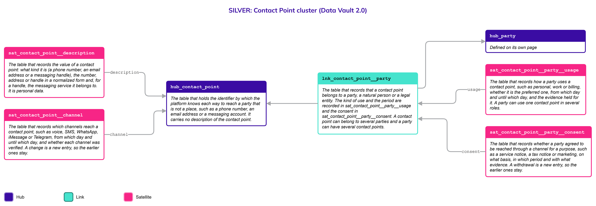
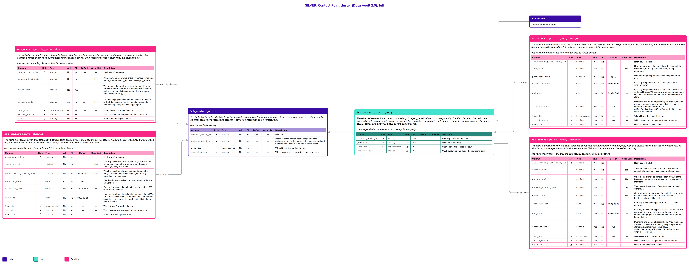

# Contact Point

## Header

| **Field** | **Value** |
| --- | --- |
| Object | Contact Point |
| Parent object | — |
| Owner domain | Registries |
| Shared with | Taxation Contributions and Licences, Finance, Benefits, Compliance, AEOI |
| Scope | Global |
| Status | Draft |
| Version | 0.1 |
| Last updated | 2026-10-28 |

## Definition

A **Contact Point** is a way to reach a party that is **not a place**: a phone number, a cellphone, an email address or an account on a messaging service. A mailing address is a place and stays in [Location](Location.md); a Contact Point is what the State uses to call, write or message.

The **identity is the address**: the number, the email or the @handle. How it can be reached is a separate fact. One cellphone can be reached by **voice, SMS and WhatsApp**, a @username exists on **one messaging service** only, and an iMessage account is a number or an email. Who a Contact Point belongs to, for what use and with which **consent** are facts of their own.

## Why it is its own object

- **Persons and entities both have contact points.** A Natural Person and a Legal Entity both need a phone or an email. One object lets each attach to it once, through Party, instead of every Hub carrying its own phone and email columns.
- **The address and its channels have different lifecycles.** A number stays the same while WhatsApp is added or dropped, and a @username exists only on its own service. The identity is the number, the email or the handle; the channels that reach it are facts about it, each with its own period.
- **The value is personal data and consent is another fact.** The number or the email lives in one Satellite that can be restricted or erased without touching the identity. The consent to be reached by a channel for a purpose has its own period and evidence.
- **A new channel is a value, not a table.** A new messaging service is a new value of the Code List list `contact_channel`; no table changes.
- **A mailing address is not a Contact Point.** A place is described by Location and attached to a party with `lnk_location__natural_person` or `lnk_legal_entity__location`. Nothing is stored twice.

If every channel were a column of the person, a new messaging service would change the Hub of every object that can be contacted, and a request to erase a number would have to rewrite the identity.

## Vault objects

| **Type** | **Name** | **Definition** | **Grain** | **Business key** |
| --- | --- | --- | --- | --- |
| Hub | `hub_contact_point` | The table that holds the **identifier** by which the platform knows each way to reach a party that is not a place, such as a phone number, an email address or a messaging account. It **carries no description** of the contact point. | one row per business key | `contact_point_bk`: an identifier assigned by the platform when a contact point is first registered, never changed and never reused. The number or the email is not the key, so the Hub holds no personal data |
| Link | `lnk_contact_point__party` | The table that records that a contact point **belongs to a party**, a natural person or a legal entity. The kind of use and the period are recorded in `sat_contact_point__party__usage` and the consent in `sat_contact_point__party__consent`. A contact point can belong to **several parties** and a party can have several contact points. | one row per distinct combination of contact point and party | `hub_contact_point`, `hub_party` |
| Satellite | `sat_contact_point__description` | The table that records the value of a contact point: what kind it is (a phone number, an email address or a messaging handle), the number, address or handle in a normalized form and, for a handle, the **messaging service** it belongs to. It is **personal data**. | one row per parent key, for each time its values change | — |
| Satellite | `sat_contact_point__channel` | The table that records which **channels** reach a contact point, such as voice, SMS, WhatsApp, iMessage or Telegram, from which day and until which day, and whether each channel was **verified**. A change is a new entry, so the **earlier ones stay**. | one row per parent key and channel, for each time its values change | — |
| Satellite | `sat_contact_point__party__usage` | The table that records how a party uses a contact point, such as personal, work or billing, whether it is the **preferred one**, from which day and until which day, and the **evidence** held for it. A party can use one contact point in several roles. | one row per parent key and role, for each time its values change | — |
| Satellite | `sat_contact_point__party__consent` | The table that records whether a party **agreed to be reached** through a channel for a **purpose**, such as a service notice, a tax notice or marketing, on what basis, in which period and with what evidence. A withdrawal is a new entry, so the **earlier ones stay**. | one row per parent key, channel and purpose, for each time its values change | — |

`contact_point_hk` is computed from the normalized `contact_point_bk`. Normalization: trimmed, case-folded, Unicode-normalized. The hash algorithm is a platform decision and is not named here. Satellites carry only the parent's hash key.

The address and the channels are two Satellites of the same Hub because they change for different reasons: the value of a contact point is written once, and the channels that reach it come and go. `lnk_contact_point__party` joins a contact point to a Party, so it serves a natural person and a legal entity with one table; the person or the entity is reached through `lnk_natural_person__party` or `lnk_legal_entity__party`. The use and the consent depend on the party and not on the contact point alone, so they hang from the Link.

**Related pages.** The details of every object below are on its own page; the diagrams on this page draw them with a note.

- [Party](Party.md): `hub_party`, joined by `lnk_contact_point__party`. A [Natural Person](Natural_Person.md) and a [Legal Entity](Legal_Entity.md) are parties through their own Links.
- [Location](Location.md): where a mailing address lives. A place is not a Contact Point.
- [Code List](Code_List.md): the values of `contact_kind`, `messaging_service`, `contact_channel`, `verification_status`, `contact_role`, `contact_purpose`, `consent_status` and `consent_basis`.

## Fields

*Indicators in Role: ◆ own hash key · ◇ hash key of another object · ● business key · ▪ load metadata · Δ hashdiff. Default: — means no default, so the loader must supply the value; a literal is a default in the sense of Iceberg format version 3. Code List: `List` — the values are a list of the Code List object and the column has a row in the table of the Code List page; `Closed` — a closed list, written in the Description as One of; `—` — the column is not a code.*

### hub_contact_point

| **Column** | **Role** | **Type** | **Null** | **PII** | **Default** | **Code List** | **Description** |
| --- | --- | --- | --- | --- | --- | --- | --- |
| `contact_point_hk` | ◆ | `string` | No | No | — | — | Hash key |
| `contact_point_bk` | ● | `string` | No | No | — | — | Identifier of the contact point, assigned by the platform when it is first registered; never changed and never reused. It is not the number or the email |
| `load_dts` | ▪ | `timestamptz` | No | No | — | — | When Nexus first loaded the row |
| `record_source` | ▪ | `string` | No | No | — | — | Which system and endpoint the row came from |

### lnk_contact_point__party

| **Column** | **Role** | **Type** | **Null** | **PII** | **Default** | **Code List** | **Description** |
| --- | --- | --- | --- | --- | --- | --- | --- |
| `contact_point_hk` | ◇ | `string` | No | No | — | — | Hash key of the contact point |
| `party_hk` | ◇ | `string` | No | No | — | — | Hash key of the party |
| `load_dts` | ▪ | `timestamptz` | No | No | — | — | When Nexus first loaded the row |
| `record_source` | ▪ | `string` | No | No | — | — | Which system and endpoint the row came from |

### sat_contact_point__description

The value is personal data, so it has its own Satellite. The identity of the contact point never carries it.

| **Column** | **Role** | **Type** | **Null** | **PII** | **Default** | **Code List** | **Description** |
| --- | --- | --- | --- | --- | --- | --- | --- |
| `contact_point_hk` | ◇ | `string` | No | No | — | — | Hash key of the parent |
| `contact_kind_code` |  | `string` | No | No | — | List | What the value is, a value of the list `contact_kind`: e.g. `phone_number`, `email_address`, `messaging_handle` |
| `value_text` |  | `string` | No | Yes | — | — | The number, the email address or the handle, in the normalized form of its kind: a number with its country calling code and digits only, an email in lower case, a handle without the @ |
| `service_code` |  | `string` | Yes | No | null | List | The messaging service a handle belongs to, a value of the list `messaging_service`; empty for a number or an email: e.g. `telegram`, `whatsapp`, `signal` |
| `load_dts` | ▪ | `timestamptz` | No | No | — | — | When Nexus first loaded the row |
| `record_source` | ▪ | `string` | No | No | — | — | Which system and endpoint the row came from |
| `hashdiff` | Δ | `string` | No | No | — | — | Hash of the descriptive values |

### sat_contact_point__channel

A number reached by voice, by SMS and by WhatsApp has three rows. The channel is part of the grain. Within one channel, a contact point has at most one open row.

| **Column** | **Role** | **Type** | **Null** | **PII** | **Default** | **Code List** | **Description** |
| --- | --- | --- | --- | --- | --- | --- | --- |
| `contact_point_hk` | ◇ | `string` | No | No | — | — | Hash key of the parent |
| `channel_code` |  | `string` | No | No | — | List | The way the contact point is reached, a value of the list `contact_channel`: e.g. `voice`, `sms`, `whatsapp`, `imessage`, `telegram`, `email` |
| `verification_status_code` |  | `string` | No | No | `unverified` | List | Whether the channel was confirmed to reach the party, a value of the list `verification_status`: e.g. `unverified`, `verified`, `failed` |
| `verified_date` |  | `date` | Yes | No | null | — | Day the channel was last confirmed; empty while it is not verified |
| `effective_date` |  | `date` | No | No | `1900-01-01` | — | First day the channel reaches the contact point; `1900-01-01` when unknown |
| `end_date` |  | `date` | No | No | `9999-12-31` | — | Last day the channel reaches the contact point; `9999-12-31` while it still does. When a new row starts for the same key and channel, the loader sets this to the day before it starts |
| `load_dts` | ▪ | `timestamptz` | No | No | — | — | When Nexus first loaded the row |
| `record_source` | ▪ | `string` | No | No | — | — | Which system and endpoint the row came from |
| `hashdiff` | Δ | `string` | No | No | — | — | Hash of the descriptive values |

### sat_contact_point__party__usage

A contact point can be used by a party in several roles, such as personal and work, and the role is part of the grain. Within one role, a party has at most one open row for the contact point.

| **Column** | **Role** | **Type** | **Null** | **PII** | **Default** | **Code List** | **Description** |
| --- | --- | --- | --- | --- | --- | --- | --- |
| `lnk_contact_point__party_hk` | ◇ | `string` | No | No | — | — | Hash key of the link |
| `role_code` |  | `string` | No | No | — | List | How the party uses the contact point, a value of the list `contact_role`: e.g. `personal`, `work`, `billing`, `emergency` |
| `preferred_flag` |  | `boolean` | No | No | `false` | — | Whether the party prefers this contact point for the role |
| `effective_date` |  | `date` | No | No | `1900-01-01` | — | First day the party uses the contact point; `1900-01-01` when unknown |
| `end_date` |  | `date` | No | No | `9999-12-31` | — | Last day the party uses the contact point; `9999-12-31` while it still does. When a new row starts for the same key and role, the loader sets this to the day before it starts |
| `artifact_uri` |  | `string` | Yes | No | null | — | Pointer to one stored object in Digital Artifact, such as a signed form or a registration; only the pointer is stored: e.g. `artifact://form/f-4410`, `artifact://registration/r-902`, `artifact://letter/l-31`; empty when there is none |
| `load_dts` | ▪ | `timestamptz` | No | No | — | — | When Nexus first loaded the row |
| `record_source` | ▪ | `string` | No | No | — | — | Which system and endpoint the row came from |
| `hashdiff` | Δ | `string` | No | No | — | — | Hash of the descriptive values |

### sat_contact_point__party__consent

Consent is a fact about a party, a channel and a purpose, so all three are in the grain. A withdrawal is a new row; the earlier ones stay.

| **Column** | **Role** | **Type** | **Null** | **PII** | **Default** | **Code List** | **Description** |
| --- | --- | --- | --- | --- | --- | --- | --- |
| `lnk_contact_point__party_hk` | ◇ | `string` | No | No | — | — | Hash key of the link |
| `channel_code` |  | `string` | No | No | — | List | The channel the consent is about, a value of the list `contact_channel`: e.g. `voice`, `sms`, `whatsapp`, `email` |
| `purpose_code` |  | `string` | No | No | — | List | What the party may be contacted for, a value of the list `contact_purpose`: e.g. `service_notice`, `tax_notice`, `marketing` |
| `consent_status_code` |  | `string` | No | No | — | Closed | The state of the consent. One of `granted`, `refused`, `withdrawn` |
| `basis_code` |  | `string` | No | No | — | List | On what basis the party may be contacted, a value of the list `consent_basis`: e.g. `explicit_consent`, `legal_obligation`, `public_task` |
| `effective_date` |  | `date` | No | No | `1900-01-01` | — | First day the consent applies; `1900-01-01` when unknown |
| `end_date` |  | `date` | No | No | `9999-12-31` | — | Last day the consent applies; `9999-12-31` while it still does. When a new row starts for the same key, channel and purpose, the loader sets this to the day before it starts |
| `artifact_uri` |  | `string` | Yes | No | null | — | Pointer to one stored object in Digital Artifact, such as a signed consent or a recording; only the pointer is stored: e.g. `artifact://consent/c-1180`, `artifact://recording/r-77`, `artifact://form/f-4410`; empty when there is none |
| `load_dts` | ▪ | `timestamptz` | No | No | — | — | When Nexus first loaded the row |
| `record_source` | ▪ | `string` | No | No | — | — | Which system and endpoint the row came from |
| `hashdiff` | Δ | `string` | No | No | — | — | Hash of the descriptive values |

## Sources and mapping

No endpoints declared yet

## Jurisdictions map

| **Edge case** | **Where it happens** | **Approach** | **Vault effect** |
| --- | --- | --- | --- |
| A cellphone reached by voice, SMS and WhatsApp | Any jurisdiction | One contact point; each way it is reached is a row of its own, so a channel can be added or dropped without touching the others | One row in `hub_contact_point` and three rows in `sat_contact_point__channel` |
| A WhatsApp or Telegram account known by its @username and not by a number | Any jurisdiction | The handle is its own contact point. The service it belongs to is recorded, because the same name can exist on two services | `contact_kind_code` `messaging_handle` and `service_code` in `sat_contact_point__description` |
| iMessage on a number or on an email | Any jurisdiction | The number or the email is the same contact point; `imessage` is one more channel | A row with `channel_code` `imessage` in `sat_contact_point__channel` |
| A phone shared by a family, or a line shared by an office | Any jurisdiction | One contact point and one row of the Link for each party; the role can differ for each | Rows of `lnk_contact_point__party` and `sat_contact_point__party__usage` |
| A number that changes hands | Any jurisdiction | The number is not rewritten. The use by the first party ends and a new use starts for the next | `end_date` in the first row of `sat_contact_point__party__usage`, a new row of `lnk_contact_point__party` |
| A switchboard of a legal entity and the direct line of a person | Any jurisdiction | Both are contact points of a party; the role says which | `role_code` in `sat_contact_point__party__usage` |
| A number that no longer reaches anyone | Any jurisdiction | The channel stays on record with the day it stopped and a failed verification | `end_date` and `verification_status_code` `failed` in `sat_contact_point__channel` |
| The party agrees to be reached by email but not by SMS, or for a tax notice but not for marketing | Jurisdictions with rules on electronic contact | Consent is a row for each channel and purpose, and a withdrawal is a new row | Rows of `sat_contact_point__party__consent` |

## Examples

Illustrative data. The first example is a natural person with a cellphone, a Telegram account and an email; the second is a legal entity with a switchboard and a billing email.

**A natural person.** The cellphone is reached by voice, SMS and WhatsApp; the Telegram account is known by its @handle.

`hub_contact_point` and `sat_contact_point__description`

| **contact_point_bk** | **contact_kind_code** | **value_text** | **service_code** |
| --- | --- | --- | --- |
| CP-0001 | phone_number | 6750000001 | (empty) |
| CP-0002 | messaging_handle | example_user | telegram |
| CP-0003 | email_address | person@example.org | (empty) |

`sat_contact_point__channel`

| **contact_point_bk** | **channel_code** | **verification_status_code** | **verified_date** | **effective_date** | **end_date** |
| --- | --- | --- | --- | --- | --- |
| CP-0001 | voice | verified | 2026-03-02 | 2026-03-02 | 9999-12-31 |
| CP-0001 | sms | verified | 2026-03-02 | 2026-03-02 | 9999-12-31 |
| CP-0001 | whatsapp | unverified | (empty) | 2026-05-10 | 9999-12-31 |
| CP-0002 | telegram | unverified | (empty) | 2026-05-10 | 9999-12-31 |
| CP-0003 | email | verified | 2026-04-18 | 2026-04-18 | 9999-12-31 |

`lnk_contact_point__party` and `sat_contact_point__party__usage` for the person `NP-1001`

| **contact_point_bk** | **role_code** | **preferred_flag** |
| --- | --- | --- |
| CP-0001 | personal | true |
| CP-0002 | personal | false |
| CP-0003 | work | false |

`sat_contact_point__party__consent` for the person `NP-1001` on the email `CP-0003`

| **channel_code** | **purpose_code** | **consent_status_code** | **basis_code** | **effective_date** | **end_date** |
| --- | --- | --- | --- | --- | --- |
| email | tax_notice | granted | legal_obligation | 1900-01-01 | 9999-12-31 |
| email | marketing | withdrawn | explicit_consent | 2026-06-01 | 9999-12-31 |

**A legal entity.** A switchboard and a billing email, both joined to the party of the entity `LE-2001`.

| **contact_point_bk** | **contact_kind_code** | **value_text** | **role_code** |
| --- | --- | --- | --- |
| CP-0101 | phone_number | 6750000101 | work |
| CP-0102 | email_address | billing@example.com | billing |

## Modeling considerations

- **The address is the identity and the channel is a fact about it.** A number is one contact point however many ways it can be reached. A channel that is added later is a new row of `sat_contact_point__channel`, and a channel that is dropped ends its row.
- **A handle belongs to one service.** The same @name can exist on two services and mean two people, so `service_code` is part of what identifies a handle. The platform matches a handle by its kind, its service and its normalized value; the key does not do it.
- **The value lives in one place.** The number, the email or the handle is only in `sat_contact_point__description`, which is personal data. The Hub and the Link carry none, so a request to restrict or erase a value touches one Satellite.
- **Duplicates are matched in the load.** `contact_point_bk` is assigned by the platform, as `location_bk` is. When two sources deliver the same number, the load matches the normalized value and reuses the contact point; the model does not forbid two rows for one value.
- **One Link serves every kind of party.** `lnk_contact_point__party` joins the Hub to Party, so a natural person, a legal entity and any later kind of party are served with one table. The kind of party is not a column here: it is read through `lnk_natural_person__party` and `lnk_legal_entity__party`.
- **Consent is not a flag of the contact point.** It is a fact about a party, a channel and a purpose, with a period and evidence, so a withdrawal is a new row and the earlier ones stay. Where a rule depends on the status, the list is closed: `granted`, `refused` and `withdrawn`.
- **What can be computed is not stored** (R13). Whether a contact point is reachable today, the age of its last verification and the preferred contact point of a party for a purpose are Gold objects over these Satellites.
- **A mailing address is not duplicated.** It stays in Location, with the role `mailing_address` in `sat_location__natural_person__usage` and `sat_legal_entity__location__usage`.

## Diagram

Two pictures of the same cluster. Read the simplified one first, then use the full one when you need the columns. Colors: Hub indigo, Link teal, Satellite magenta; a Satellite updated in place is lighter, with a dashed border. Arrows run from the child to its parent. Objects defined on another page are drawn with a note and no table.

### Simplified version

The shape of the cluster: 1 Hub, 1 Link and 4 Satellites, with the Hub of the party drawn as defined on another page. Each has its name and definition. Use it to see how the objects relate. It has no columns.

### Full version

The same objects, each with its Fields table (column, role, type, null, PII, default, description). Use it to check exactly what is stored. It is wide: zoom in or open the image on its own.

## Open decisions

| **Decision** | **Owner** | **How it is decided** | **Decide by** |
| --- | --- | --- | --- |
| The owner domain of this object: Registries is assumed, as for Location | Data Product Owner | Confirmed with the Registries domain | Before the page is Reviewed |
| The consent rules of each jurisdiction: the values of `consent_basis`, how long a consent lasts and what must be kept as evidence | Data Product Owner and Compliance | Set as values of the Code List lists `consent_basis` and `contact_purpose`, with the rule of each jurisdiction | When a jurisdiction is configured |
| Whether a request not to be contacted overrides every purpose, and where it is recorded | Data Product Owner and Compliance | Decided with the first jurisdiction that has such a rule; it may become a value of `consent_status` | Before the first consent is loaded |
| The standard for normalizing a number written in a national format, and who maintains it | Data Architecture Engineer | Set in the Nexus configuration; the E.164 form is the proposal | Before the first number is loaded |
| Whether a jurisdiction that forbids keeping a previous number needs an in-place twin of `sat_contact_point__description` | Data Architecture Engineer and Compliance | Decided with the first jurisdiction that has such a rule (the pair is described in the Principles) | When that jurisdiction is configured |
| Which kinds of party, besides a natural person and a legal entity, can have a contact point | Data Product Owner | Decided when a new kind of party is added to Party | When a new kind of party is proposed |
| Which messaging services and channels are accepted in each jurisdiction | Data Product Owner | Set as values of the Code List lists `messaging_service` and `contact_channel` | When a jurisdiction is configured |
