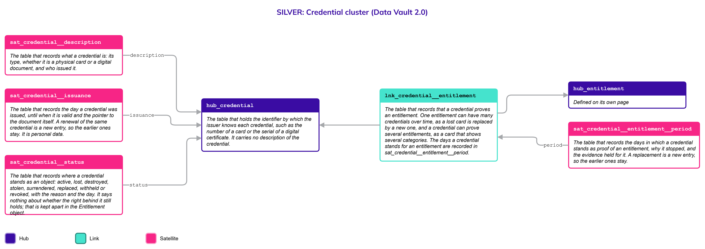
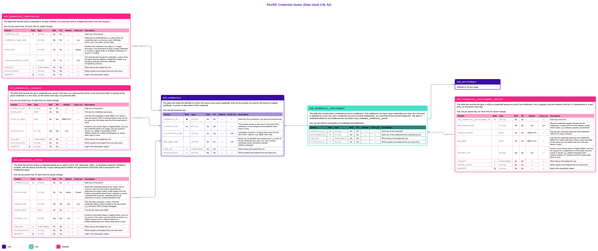

# Credential

## Header

| **Field** | **Value** |
| --- | --- |
| Object | Credential |
| Parent object | Legal |
| Owner domain | Registries |
| Shared with | Taxation Contributions and Licences, Finance, Compliance |
| Scope | Shared |
| Status | Draft |
| Version | 0.1 |
| Last updated | 2026-10-24 |

## Definition

A **Credential** is the card, certificate or **digital document** that a Party holds to prove an [Entitlement](Entitlement.md): a licence card, a permit letter, a smart card, a verifiable file in a wallet. It is **the proof** and not the right. A Credential can be lost, destroyed, stolen, replaced or withheld while the right behind it stays as it was, and a right can be suspended while the Credential still looks valid.

This is an object of its own because a proof and a right have **different lifecycles**. If a hurricane destroys a licence card, the status of the card is `destroyed` and the right to drive is still `active`. A replacement card is a new Credential joined to the same Entitlement, so the history of the original grant is never overwritten. The three kinds of object are explained on the page [Legal](Legal.md).

## Why it is its own object

- **A proof has its own life.** It is issued, renewed, lost, replaced or withheld, on dates that have nothing to do with the dates of the right.
- **It has its own key.** The number on a card or the serial of a certificate is not the number of the entitlement. A replacement has a new number for the same right.
- **One right, many proofs.** Over time several credentials can prove one entitlement, and one credential can prove more than one.
- **Right and proof can disagree.** The card can be active while the right is suspended. That is only visible when they are two objects.

## Vault objects

*Names follow the convention (R9). The Link to the entitlement is defined here, on the side that depends on the other, and drawn on the page [Entitlement](Entitlement.md).*

| **Type** | **Name** | **Definition** | **Grain** | **Business key** |
| --- | --- | --- | --- | --- |
| Hub | `hub_credential` | The table that holds the **identifier** by which the issuer knows each credential, such as the number of a card or the serial of a digital certificate. It **carries no description** of the credential. | one row per business key | `credential_bk`: the number printed on the card or the serial of the certificate, or one assigned by the platform when there is none, with the jurisdiction and the key type |
| Link | `lnk_credential__entitlement` | The table that records that a **credential proves** an entitlement. One entitlement can have **many credentials** **over time**, as a lost card is replaced by a new one, and a credential can prove several entitlements, as a card that shows several categories. The days a credential stands for an entitlement are recorded in `sat_credential__entitlement__period`. | one row per distinct combination of credential and entitlement | `hub_credential`, `hub_entitlement` |
| Satellite | `sat_credential__description` | The table that records **what a credential is**: its type, whether it is a **physical card** or a digital document, and who issued it. | one row per parent key, for each time its values change | — |
| Satellite | `sat_credential__issuance` | The table that records the day a credential was **issued**, until when it is valid and the pointer to the **document itself**. A renewal of the same credential is a new entry, so the **earlier ones stay**. It is personal data. | one row per parent key, for each time its values change | — |
| Satellite | `sat_credential__status` | The table that records **where a credential stands** as an object: active, lost, destroyed, stolen, surrendered, replaced, withheld or revoked, with the reason and the day. It **says nothing about** whether the right behind it still holds; that is kept apart in the Entitlement object. | one row per parent key, for each time its values change | — |
| Satellite | `sat_credential__entitlement__period` | The table that records the **days** in which a credential stands as proof of an entitlement, why it stopped, and the **evidence** held for it. A replacement is a new entry, so the **earlier ones stay**. | one row per parent key, for each time its values change | — |

`credential_hk` is computed from `jurisdiction_code`, `key_type_code` and the normalized `credential_bk`, joined with a fixed separator. Normalization: trimmed, case-folded, Unicode-normalized. The hash algorithm is a platform decision and is not named here. Satellites carry only the parent's hash key.

A credential has no Link to a Party of its own. Who holds it is who holds the entitlement it proves, through `lnk_entitlement__party_holder` on the page [Entitlement](Entitlement.md). The `artifact_uri` of `sat_credential__issuance` points to the document or the image itself; only the pointer is stored.

**Related pages.** The details of every object below are on its own page; the diagrams on this page draw them with a note.

- [Legal](Legal.md): the family page, with the rules the three parts share.
- [Entitlement](Entitlement.md): `hub_entitlement`, joined by `lnk_credential__entitlement`.
- [RRR](RRR.md): the bond between a Party and a thing.
- [Code List](Code_List.md): the values of every `_code` column.

## Fields

*Indicators in Role: ◆ own hash key · ◇ hash key of another object · ● business key · ▪ load metadata · Δ hashdiff. Default: — means no default, so the loader must supply the value; a literal is a default in the sense of Iceberg format version 3. Code List: `List` — the values are a list of the Code List object and the column has a row in the table of the Code List page; `Closed` — a closed list, written in the Description as One of; `—` — the column is not a code.*

### hub_credential

| **Column** | **Role** | **Type** | **Null** | **PII** | **Default** | **Code List** | **Description** |
| --- | --- | --- | --- | --- | --- | --- | --- |
| `credential_hk` | ◆ | `string` | No | No | — | — | Hash key, from jurisdiction, key type and business key |
| `credential_bk` | ● | `string` | No | No | — | — | The number printed on the card or the serial of the certificate, or one assigned by the platform when there is none |
| `jurisdiction_code` |  | `string` | No | No | — | List | Jurisdiction (country or territory) that owns the key, ISO 3166-1 alpha-3: e.g. `WSM`, `PNG`, `NZL` |
| `key_type_code` |  | `string` | No | No | — | List | Which kind of identifier the business key is, a value of the list `credential_key_type`: e.g. `card_number`, `certificate_serial`, `document_number`, `platform_assigned` |
| `load_dts` | ▪ | `timestamptz` | No | No | — | — | When Nexus first loaded the row |
| `record_source` | ▪ | `string` | No | No | — | — | Which system and endpoint the row came from |

### lnk_credential__entitlement

| **Column** | **Role** | **Type** | **Null** | **PII** | **Default** | **Code List** | **Description** |
| --- | --- | --- | --- | --- | --- | --- | --- |
| `credential_hk` | ◇ | `string` | No | No | — | — | Hash key of the credential |
| `entitlement_hk` | ◇ | `string` | No | No | — | — | Hash key of the entitlement the credential proves |
| `load_dts` | ▪ | `timestamptz` | No | No | — | — | When Nexus first loaded the row |
| `record_source` | ▪ | `string` | No | No | — | — | Which system and endpoint the row came from |

### sat_credential__description

| **Column** | **Role** | **Type** | **Null** | **PII** | **Default** | **Code List** | **Description** |
| --- | --- | --- | --- | --- | --- | --- | --- |
| `credential_hk` | ◇ | `string` | No | No | — | — | Hash key of the parent |
| `credential_type_code` |  | `string` | No | No | — | List | What kind of credential this is, a value of the list `credential_type`: e.g. `licence_card`, `certificate`, `smart_card`, `visa_label`, `permit_letter` |
| `form_code` |  | `string` | No | No | — | Closed | Whether the credential is an object or a digital document. One of `physical` (a card, a paper certificate or a sticker), `digital` (a file, a verifiable credential or a record in a wallet) |
| `issuing_authority_code` |  | `string` | No | No | — | List | The authority that issued the credential, a value of the list `issuer` that the platform configuration keeps: e.g. `transport_authority`, `fisheries_authority`, `immigration_authority` |
| `load_dts` | ▪ | `timestamptz` | No | No | — | — | When Nexus first loaded the row |
| `record_source` | ▪ | `string` | No | No | — | — | Which system and endpoint the row came from |
| `hashdiff` | Δ | `string` | No | No | — | — | Hash of the descriptive values |

### sat_credential__issuance

| **Column** | **Role** | **Type** | **Null** | **PII** | **Default** | **Code List** | **Description** |
| --- | --- | --- | --- | --- | --- | --- | --- |
| `credential_hk` | ◇ | `string` | No | No | — | — | Hash key of the parent |
| `issue_date` |  | `date` | No | Yes | — | — | The day the credential was issued |
| `valid_to_date` |  | `date` | No | Yes | `9999-12-31` | — | Last day the credential is valid; `9999-12-31` while it does not expire. When a renewal starts a new row for the same key, the loader sets this to the day before it starts |
| `artifact_uri` |  | `string` | Yes | Yes | null | — | Pointer to one stored object in Digital Artifact, such as the credential itself or its image; only the pointer is stored: e.g. `artifact://credential/c-31207`, `artifact://card/k-90`, `artifact://certificate/c-12`; empty when there is none |
| `load_dts` | ▪ | `timestamptz` | No | No | — | — | When Nexus first loaded the row |
| `record_source` | ▪ | `string` | No | No | — | — | Which system and endpoint the row came from |
| `hashdiff` | Δ | `string` | No | No | — | — | Hash of the descriptive values |

### sat_credential__status

| **Column** | **Role** | **Type** | **Null** | **PII** | **Default** | **Code List** | **Description** |
| --- | --- | --- | --- | --- | --- | --- | --- |
| `credential_hk` | ◇ | `string` | No | No | — | — | Hash key of the parent |
| `status_code` |  | `string` | No | No | `active` | Closed | Where the credential stands as an object. One of `active` (in use), `lost` (the holder cannot find it), `destroyed` (no longer exists), `stolen` (taken from the holder), `surrendered` (given back), `replaced` (a newer credential took its place), `withheld` (kept by an authority for a time), `revoked` (declared void) |
| `reason_code` |  | `string` | Yes | Yes | null | List | Why the status changed, a value of the list `credential_status_reason`; empty for the issue itself: e.g. `hurricane`, `theft`, `renewal`, `damaged` |
| `status_date` |  | `date` | No | No | — | — | The day the status took effect |
| `artifact_uri` |  | `string` | Yes | Yes | null | — | Pointer to one stored object in Digital Artifact, such as the report or the notice; only the pointer is stored: e.g. `artifact://report/r-4410`, `artifact://notice/n-77`, `artifact://declaration/d-9`; empty when there is none |
| `load_dts` | ▪ | `timestamptz` | No | No | — | — | When Nexus first loaded the row |
| `record_source` | ▪ | `string` | No | No | — | — | Which system and endpoint the row came from |
| `hashdiff` | Δ | `string` | No | No | — | — | Hash of the descriptive values |

### sat_credential__entitlement__period

| **Column** | **Role** | **Type** | **Null** | **PII** | **Default** | **Code List** | **Description** |
| --- | --- | --- | --- | --- | --- | --- | --- |
| `lnk_credential__entitlement_hk` | ◇ | `string` | No | No | — | — | Hash key of the link |
| `end_reason_code` |  | `string` | Yes | No | null | List | Why the credential stopped standing for the entitlement, a value of the list `end_reason`; empty while it does: e.g. `replaced`, `expired`, `surrendered` |
| `effective_date` |  | `date` | No | No | `1900-01-01` | — | First day the credential stands for the entitlement; `1900-01-01` when unknown |
| `end_date` |  | `date` | No | No | `9999-12-31` | — | Last day the credential stands for the entitlement; `9999-12-31` while it still does. When a new row starts for the same key, the loader sets this to the day before it starts |
| `artifact_uri` |  | `string` | Yes | No | null | — | Pointer to one stored object in Digital Artifact, such as the request for a replacement or the notice; only the pointer is stored: e.g. `artifact://request/r-2201`, `artifact://notice/n-77`, `artifact://form/f-5`; empty when there is none |
| `load_dts` | ▪ | `timestamptz` | No | No | — | — | When Nexus first loaded the row |
| `record_source` | ▪ | `string` | No | No | — | — | Which system and endpoint the row came from |
| `hashdiff` | Δ | `string` | No | No | — | — | Hash of the descriptive values |

## Sources and mapping

No endpoints declared yet

## Jurisdictions map

| **Edge case** | **Where it happens** | **Approach** | **Vault effect** |
| --- | --- | --- | --- |
| A card is lost or destroyed and the right stays | Any jurisdiction, in particular after a disaster such as a hurricane | The old credential gets the status `lost` or `destroyed`; a new credential is issued for the same entitlement | A new row in `hub_credential` and in `lnk_credential__entitlement`; a row in `sat_credential__status` for the old one |
| The card still looks valid but a judge suspended the right | Any jurisdiction | The credential is `active` and the entitlement `suspended`; Gold shows the difference | `sat_entitlement__status` and `sat_credential__status` |
| A digital credential with no object | Jurisdictions that issue verifiable credentials or wallet records | The same object, with `form_code` `digital` and the pointer to the file | `sat_credential__description` |
| One card for several rights | Jurisdictions that print several categories on one licence | One credential joined to several entitlements | Several rows of `lnk_credential__entitlement` |
| A card that an authority keeps for a time | Any jurisdiction | The status is `withheld`, with its dates, and the right is not changed | `sat_credential__status` |
| A national identity number or a residence permit | Any jurisdiction | An identity number is an identifier of the person and stays in the identification of the person; a residence permit proves a right to reside, so it is a Credential of an Entitlement (see Open decisions) | `sat_natural_person__identification` or `hub_credential` |

## Examples

Illustrative data. A driving licence card that a hurricane destroys, and its replacement.

1. **The right.** The entitlement `DL-4412` is the privilege to drive heavy goods vehicles, held by a natural person. It is described on the page [Entitlement](Entitlement.md).
2. **The first card.** The card `CARD-90011` was issued on 2024-02-01 and proves the entitlement.
3. **The hurricane.** On 2026-09-14 the card is destroyed. `CARD-90011` gets the status `destroyed`. The entitlement stays `active`.
4. **The replacement.** The card `CARD-90377` is issued on 2026-09-30 for the same entitlement. The row that joined `CARD-90011` to `DL-4412` ends with the reason `replaced`, and a new row joins `CARD-90377`.

`hub_credential`

| **credential_bk** | **jurisdiction_code** | **key_type_code** |
| --- | --- | --- |
| CARD-90011 | ATG | card_number |
| CARD-90377 | ATG | card_number |

`sat_credential__status`

| **credential** | **status_code** | **reason_code** | **status_date** |
| --- | --- | --- | --- |
| CARD-90011 | active | (empty) | 2024-02-01 |
| CARD-90011 | destroyed | hurricane | 2026-09-14 |
| CARD-90377 | active | (empty) | 2026-09-30 |

`lnk_credential__entitlement` and `sat_credential__entitlement__period`

| **credential** | **entitlement** | **end_reason_code** | **effective_date** | **end_date** |
| --- | --- | --- | --- | --- |
| CARD-90011 | DL-4412 | replaced | 2024-02-01 | 2026-09-29 |
| CARD-90377 | DL-4412 | (empty) | 2026-09-30 | 9999-12-31 |

## Modeling considerations

- **A credential is a proof and not a right.** Its status says whether the object exists and can be shown. Whether the right holds is the status of the entitlement. Gold reads both (`entitlement__credential_discrepancy`) and flags a right that is suspended while its credential is active, and a credential that was withheld or lost while the right is active.
- **Replacement is a new credential.** A new card has a new key and a new row of the Link; the old one ends. The grant is never overwritten.
- **The status is closed.** `status_code` is a closed list because the rules branch on it; the reasons are an open list.
- **Whether it is valid today is worked out in Gold.** The Vault stores the day it was issued, when it expires and each status with its day (R13).
- **Evidence is a pointer.** The card, its image or the report of a loss is one stored object in Digital Artifact, and only the pointer is kept.
- **Personal data.** A credential held by a person says something about that person, so the issue, the expiry, the reason of a change and the pointer are marked personal data.
- **An open end is `9999-12-31`.** The end of a period is `9999-12-31` while it applies, and an unknown start is `1900-01-01` (Principles, "Validity ranges").
- **Codes take their values from the Code List.** Every `_code` column holds values that change without changing logic, except `status_code` and `form_code`, which are closed.

## Diagram

Two pictures of the same cluster. Read the simplified one first, then use the full one when you need the columns. Colors: Hub indigo, Link teal, Satellite magenta; a Satellite updated in place is lighter, with a dashed border. Arrows run from the child to its parent. Objects defined on another page are drawn with a note and no table.

### Simplified version

The shape of the cluster: 1 Hub, 1 Link and 4 Satellites, with the Hub of the entitlement drawn as defined on another page. Each has its name and definition. Use it to see how the objects relate. It has no columns.

### Full version

The same objects, each with its Fields table (column, role, type, null, PII, default, description). Use it to check exactly what is stored. It is wide: zoom in or open the image on its own.

## Open decisions

| **Decision** | **Owner** | **How it is decided** | **Decide by** |
| --- | --- | --- | --- |
| Whether a document that proves who someone is and not a right (a national identity card) is a Credential of an Entitlement, or stays an identification on the person. A residence permit proves a right to reside, so it is a Credential | Data Architecture Engineer and Data Product Owner | Decided with the first jurisdiction that issues an identity card as a credential; the direction is that a document that proves a right is a Credential and a number that identifies a person stays an identifier | Before the first mapping that needs it |
| Whether a credential can be held by a Party other than the holder of the entitlement, such as a card kept by an agent | Data Product Owner | Decided with the first jurisdiction that records it | Before the first mapping that needs it |
| The values of the lists `credential_type`, `credential_status_reason` and `issuer`, and which jurisdiction uses which | Data Product Owner | Set as values of the Code List | When a jurisdiction is configured |
| How a digital credential is checked for authenticity, and whether any of that is stored | Platform | Decided with the platform's identity and signing design | Before the first digital credential is loaded |
