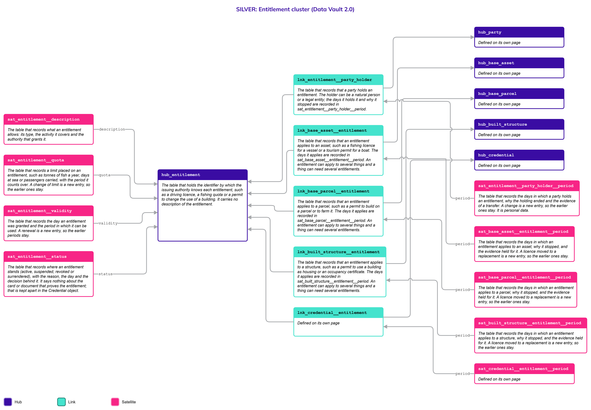
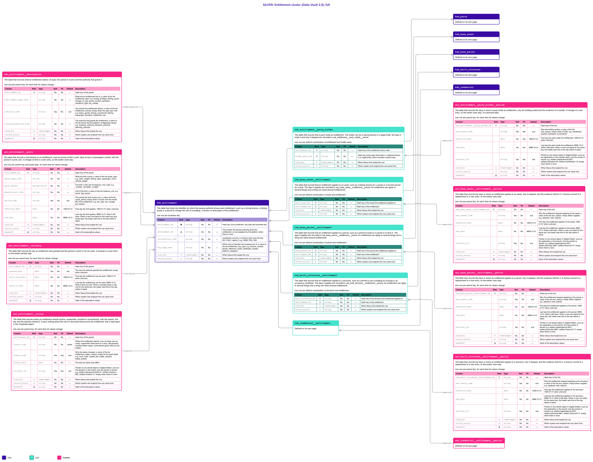

# Entitlement

## Header

| **Field** | **Value** |
| --- | --- |
| Object | Entitlement |
| Parent object | Legal |
| Owner domain | Registries |
| Shared with | Taxation Contributions and Licences, Finance, Compliance |
| Scope | Shared |
| Status | Draft |
| Version | 0.1 |
| Last updated | 2026-10-24 |

## Definition

An Entitlement is a right that the State grants to a Party to do something or to use something: to drive a truck, to fish a quota of tuna, to run a tourist boat, to use a building as housing, to pay no tax for a period. It is the legal truth of the right, and it exists whether or not a card, a certificate or a file proves it. A Party that loses the card has not lost the right.

An Entitlement governs an activity, not the ownership of a thing. Ownership, leases, mortgages and the other bonds between a Party and an asset are the object [RRR](RRR.md). The paper or the token that proves an Entitlement is a [Credential](Credential.md). The three are kept apart and explained on the page [Legal](Legal.md).

## Why it is its own object

- **The right outlives its proof.** A licence card is lost, destroyed, renewed and replaced while the right to drive stays the same. If the right and the card were one table, a replacement card would overwrite the history of the grant.
- **It has its own key and its own authority.** The number of a licence, a quota certificate or a permit is issued by an authority that decides who may hold it, and it is not the number of the card or of the asset it applies to.
- **It has its own lifecycle.** An entitlement is granted, renewed, suspended, revoked or surrendered, and a judge can suspend it while the holder still has the card. That status belongs to the right and not to the card.
- **It can apply to a thing or to a person, or to both.** A residence right has a holder and no thing. A permit to use a building as housing applies to a structure. A fishing licence has a holder and a vessel. It is not an attribute of either.

## Vault objects

*Names follow the convention (R9). The Links to the asset Hubs are defined here, on the side that depends on the other, and drawn on the asset pages.*

| **Type** | **Name** | **Definition** | **Grain** | **Business key** |
| --- | --- | --- | --- | --- |
| Hub | `hub_entitlement` | The table that holds the identifier by which the issuing authority knows each entitlement, such as a driving licence, a fishing quota or a permit to change the use of a building. It carries no description of the entitlement. | one row per business key | `entitlement_bk`: the number the issuing authority gives the entitlement, or one assigned by the platform when there is none, with the jurisdiction and the key type |
| Link | `lnk_entitlement__party_holder` | The table that records that a party holds an entitlement. The holder can be a natural person or a legal entity; the days it holds it and why it stopped are recorded in `sat_entitlement__party_holder__period`. | one row per distinct combination of entitlement and holder party | `hub_entitlement`, `hub_party` (holder) |
| Link | `lnk_base_asset__entitlement` | The table that records that an entitlement applies to an asset, such as a fishing licence for a vessel or a tourism permit for a boat. The days it applies are recorded in `sat_base_asset__entitlement__period`. An entitlement can apply to several things and a thing can need several entitlements. | one row per distinct combination of asset and entitlement | `hub_base_asset`, `hub_entitlement` |
| Link | `lnk_base_parcel__entitlement` | The table that records that an entitlement applies to a parcel, such as a permit to build on a parcel or to farm it. The days it applies are recorded in `sat_base_parcel__entitlement__period`. An entitlement can apply to several things and a thing can need several entitlements. | one row per distinct combination of parcel and entitlement | `hub_base_parcel`, `hub_entitlement` |
| Link | `lnk_built_structure__entitlement` | The table that records that an entitlement applies to a structure, such as a permit to use a building as housing or an occupancy certificate. The days it applies are recorded in `sat_built_structure__entitlement__period`. An entitlement can apply to several things and a thing can need several entitlements. | one row per distinct combination of structure and entitlement | `hub_built_structure`, `hub_entitlement` |
| Satellite | `sat_entitlement__description` | The table that records what an entitlement allows: its type, the activity it covers and the authority that grants it. | one row per parent key, for each time its values change | — |
| Satellite | `sat_entitlement__quota` | The table that records a limit placed on an entitlement, such as tonnes of fish a year, days at sea or passengers carried, with the period it counts over. A change of limit is a new entry, so the earlier ones stay. | one row per parent key and quota type, for each time its values change | — |
| Satellite | `sat_entitlement__validity` | The table that records the day an entitlement was granted and the period in which it can be used. A renewal is a new entry, so the earlier periods stay. | one row per parent key, for each time its values change | — |
| Satellite | `sat_entitlement__status` | The table that records where an entitlement stands (active, suspended, revoked or surrendered), with the reason, the day and the decision behind it. It says nothing about the card or document that proves the entitlement; that is kept apart in the Credential object. | one row per parent key, for each time its values change | — |
| Satellite | `sat_entitlement__party_holder__period` | The table that records the days in which a party holds an entitlement, why the holding ended and the evidence of a transfer. A change is a new entry, so the earlier ones stay. It is personal data. | one row per parent key, for each time its values change | — |
| Satellite | `sat_base_asset__entitlement__period` | The table that records the days in which an entitlement applies to an asset, why it stopped, and the evidence held for it. A licence moved to a replacement is a new entry, so the earlier ones stay. | one row per parent key, for each time its values change | — |
| Satellite | `sat_base_parcel__entitlement__period` | The table that records the days in which an entitlement applies to a parcel, why it stopped, and the evidence held for it. A licence moved to a replacement is a new entry, so the earlier ones stay. | one row per parent key, for each time its values change | — |
| Satellite | `sat_built_structure__entitlement__period` | The table that records the days in which an entitlement applies to a structure, why it stopped, and the evidence held for it. A licence moved to a replacement is a new entry, so the earlier ones stay. | one row per parent key, for each time its values change | — |

`entitlement_hk` is computed from `jurisdiction_code`, `key_type_code` and the normalized `entitlement_bk`, joined with a fixed separator. Normalization: trimmed, case-folded, Unicode-normalized. The hash algorithm is a platform decision and is not named here. Satellites carry only the parent's hash key.

`lnk_entitlement__party_holder` says **who** may do what the entitlement allows. `lnk_base_asset__entitlement`, `lnk_base_parcel__entitlement` and `lnk_built_structure__entitlement` say **what thing** it applies to, one Link for each kind of asset, as with the places of persons and entities. There is no Hub that stands for any kind of asset. The authority that grants an entitlement is platform configuration and not a Party, so it is a code, `issuing_authority_code`, and not a Link. Each Link has its own Satellite for the days it applies.

**Related pages.** The details of every object below are on its own page; the diagrams on this page draw them with a note.

- [Legal](Legal.md): the family page, with the rules the three parts share.
- [Credential](Credential.md): `hub_credential`, and the Link `lnk_credential__entitlement` that says which card or certificate proves an entitlement.
- [RRR](RRR.md): the bond between a Party and a thing.
- [Party](Party.md), with [Natural Person](Natural_Person.md) and [Legal Entity](Legal_Entity.md): `hub_party`, joined by `lnk_entitlement__party_holder`.
- [Base Asset](Base_Asset.md), [Base Parcel](Base_Parcel.md) and [Built Structure](Built_Structure.md): the Hubs joined by the three Links to the things.
- [Code List](Code_List.md): the values of every `_code` column.

## Fields

*Indicators in Role: ◆ own hash key · ◇ hash key of another object · ● business key · ▪ load metadata · Δ hashdiff. Default: — means no default, so the loader must supply the value; a literal is a default in the sense of Iceberg format version 3.*

### hub_entitlement

| **Column** | **Role** | **Type** | **Null** | **PII** | **Default** | **Description** |
| --- | --- | --- | --- | --- | --- | --- |
| `entitlement_hk` | ◆ | `string` | No | No | — | Hash key, from jurisdiction, key type and business key |
| `entitlement_bk` | ● | `string` | No | No | — | The number the issuing authority gives the entitlement, or one assigned by the platform when there is none |
| `jurisdiction_code` |  | `string` | No | No | — | Jurisdiction (country or territory) that owns the key, ISO 3166-1 alpha-3: e.g. `WSM`, `PNG`, `NZL` |
| `key_type_code` |  | `string` | No | No | — | Which kind of identifier the business key is, a value of the list `entitlement_key_type`: e.g. `licence_number`, `permit_reference`, `quota_certificate_number`, `platform_assigned` |
| `load_dts` | ▪ | `timestamptz` | No | No | — | When Nexus first loaded the row |
| `record_source` | ▪ | `string` | No | No | — | Which system and endpoint the row came from |

### lnk_entitlement__party_holder

| **Column** | **Role** | **Type** | **Null** | **PII** | **Default** | **Description** |
| --- | --- | --- | --- | --- | --- | --- |
| `entitlement_hk` | ◇ | `string` | No | No | — | Hash key of the entitlement that is held |
| `holder_party_hk` | ◇ | `string` | No | No | — | Hash key of the party that holds it, a Natural Person or a Legal Entity, which includes a public body |
| `load_dts` | ▪ | `timestamptz` | No | No | — | When Nexus first loaded the row |
| `record_source` | ▪ | `string` | No | No | — | Which system and endpoint the row came from |

### lnk_base_asset__entitlement

| **Column** | **Role** | **Type** | **Null** | **PII** | **Default** | **Description** |
| --- | --- | --- | --- | --- | --- | --- |
| `base_asset_hk` | ◇ | `string` | No | No | — | Hash key of the asset the entitlement applies to |
| `entitlement_hk` | ◇ | `string` | No | No | — | Hash key of the entitlement |
| `load_dts` | ▪ | `timestamptz` | No | No | — | When Nexus first loaded the row |
| `record_source` | ▪ | `string` | No | No | — | Which system and endpoint the row came from |

### lnk_base_parcel__entitlement

| **Column** | **Role** | **Type** | **Null** | **PII** | **Default** | **Description** |
| --- | --- | --- | --- | --- | --- | --- |
| `base_parcel_hk` | ◇ | `string` | No | No | — | Hash key of the parcel the entitlement applies to |
| `entitlement_hk` | ◇ | `string` | No | No | — | Hash key of the entitlement |
| `load_dts` | ▪ | `timestamptz` | No | No | — | When Nexus first loaded the row |
| `record_source` | ▪ | `string` | No | No | — | Which system and endpoint the row came from |

### lnk_built_structure__entitlement

| **Column** | **Role** | **Type** | **Null** | **PII** | **Default** | **Description** |
| --- | --- | --- | --- | --- | --- | --- |
| `built_structure_hk` | ◇ | `string` | No | No | — | Hash key of the structure the entitlement applies to |
| `entitlement_hk` | ◇ | `string` | No | No | — | Hash key of the entitlement |
| `load_dts` | ▪ | `timestamptz` | No | No | — | When Nexus first loaded the row |
| `record_source` | ▪ | `string` | No | No | — | Which system and endpoint the row came from |

### sat_entitlement__description

| **Column** | **Role** | **Type** | **Null** | **PII** | **Default** | **Description** |
| --- | --- | --- | --- | --- | --- | --- |
| `entitlement_hk` | ◇ | `string` | No | No | — | Hash key of the parent |
| `entitlement_type_code` |  | `string` | No | No | — | What kind of entitlement this is, a value of the list `entitlement_type`: e.g. `driving_privilege`, `fishing_quota`, `change_of_use_permit`, `tourism_operation`, `residence_right`, `tax_holiday` |
| `activity_code` |  | `string` | Yes | No | null | The activity the entitlement allows, a value of the list `entitlement_activity`; empty when the type says it all: e.g. `heavy_goods_driving`, `commercial_fishing`, `passenger_transport`, `residential_use` |
| `issuing_authority_code` |  | `string` | No | No | — | The authority that grants the entitlement, a value of the list `issuer` that the platform configuration keeps: e.g. `transport_authority`, `fisheries_authority`, `planning_authority` |
| `load_dts` | ▪ | `timestamptz` | No | No | — | When Nexus first loaded the row |
| `record_source` | ▪ | `string` | No | No | — | Which system and endpoint the row came from |
| `hashdiff` | Δ | `string` | No | No | — | Hash of the descriptive values |

### sat_entitlement__quota

| **Column** | **Role** | **Type** | **Null** | **PII** | **Default** | **Description** |
| --- | --- | --- | --- | --- | --- | --- |
| `entitlement_hk` | ◇ | `string` | No | No | — | Hash key of the parent |
| `quota_type_code` |  | `string` | No | No | — | What the limit counts, a value of the list `quota_type`: e.g. `catch_weight`, `fishing_days`, `passenger_count`, `vehicle_weight` |
| `quota_amount` |  | `decimal(18,4)` | No | No | — | The limit, in the unit of `measure_unit_code`: e.g. `10.0000`, `120.0000`, `12.0000` |
| `measure_unit_code` |  | `string` | No | No | — | Unit of the limit, a value of the list `measure_unit`: e.g. `tonne`, `day`, `person` |
| `period_code` |  | `string` | Yes | No | null | The period the limit counts over, a value of the list `quota_period`; empty when it counts over the whole life of the entitlement: e.g. `per_year`, `per_voyage`, `per_season` |
| `effective_date` |  | `date` | No | No | `1900-01-01` | First day the limit applies; `1900-01-01` when unknown |
| `end_date` |  | `date` | No | No | `9999-12-31` | Last day the limit applies; `9999-12-31` while it still does. When a new row starts for the same key and quota type, the loader sets this to the day before it starts |
| `load_dts` | ▪ | `timestamptz` | No | No | — | When Nexus first loaded the row |
| `record_source` | ▪ | `string` | No | No | — | Which system and endpoint the row came from |
| `hashdiff` | Δ | `string` | No | No | — | Hash of the descriptive values |

### sat_entitlement__validity

| **Column** | **Role** | **Type** | **Null** | **PII** | **Default** | **Description** |
| --- | --- | --- | --- | --- | --- | --- |
| `entitlement_hk` | ◇ | `string` | No | No | — | Hash key of the parent |
| `granted_date` |  | `date` | Yes | No | null | The day the authority granted the entitlement; empty when unknown |
| `valid_from_date` |  | `date` | No | No | `1900-01-01` | First day the entitlement can be used; `1900-01-01` when unknown |
| `valid_to_date` |  | `date` | No | No | `9999-12-31` | Last day the entitlement can be used; `9999-12-31` while it does not end. When a renewal starts a new row for the same key, the loader sets this to the day before it starts |
| `load_dts` | ▪ | `timestamptz` | No | No | — | When Nexus first loaded the row |
| `record_source` | ▪ | `string` | No | No | — | Which system and endpoint the row came from |
| `hashdiff` | Δ | `string` | No | No | — | Hash of the descriptive values |

### sat_entitlement__status

| **Column** | **Role** | **Type** | **Null** | **PII** | **Default** | **Description** |
| --- | --- | --- | --- | --- | --- | --- |
| `entitlement_hk` | ◇ | `string` | No | No | — | Hash key of the parent |
| `status_code` |  | `string` | No | No | `active` | Where the entitlement stands. One of `active` (can be used), `suspended` (held back for a time, still granted), `revoked` (taken away), `surrendered` (given back by the holder) |
| `reason_code` |  | `string` | Yes | Yes | null | Why the status changed, a value of the list `entitlement_status_reason`; empty for the grant itself: e.g. `court_order`, `unpaid_fee`, `holder_request`, `safety_breach` |
| `status_date` |  | `date` | No | No | — | The day the status took effect |
| `artifact_uri` |  | `string` | Yes | Yes | null | Pointer to one stored object in Digital Artifact, such as the decision or the notice; only the pointer is stored: e.g. `artifact://decision/d-2026-31`, `artifact://notice/n-882`, `artifact://order/o-17`; empty when there is none |
| `load_dts` | ▪ | `timestamptz` | No | No | — | When Nexus first loaded the row |
| `record_source` | ▪ | `string` | No | No | — | Which system and endpoint the row came from |
| `hashdiff` | Δ | `string` | No | No | — | Hash of the descriptive values |

### sat_entitlement__party_holder__period

| **Column** | **Role** | **Type** | **Null** | **PII** | **Default** | **Description** |
| --- | --- | --- | --- | --- | --- | --- |
| `lnk_entitlement__party_holder_hk` | ◇ | `string` | No | No | — | Hash key of the link |
| `end_reason_code` |  | `string` | Yes | Yes | null | Why the holding ended, a value of the list `end_reason`; empty while it holds: e.g. `transferred`, `expired`, `deceased`, `surrendered` |
| `effective_date` |  | `date` | No | Yes | `1900-01-01` | First day the party holds the entitlement; `1900-01-01` when unknown |
| `end_date` |  | `date` | No | Yes | `9999-12-31` | Last day the party holds the entitlement; `9999-12-31` while it still does. When a new row starts for the same key, the loader sets this to the day before it starts |
| `artifact_uri` |  | `string` | Yes | Yes | null | Pointer to one stored object in Digital Artifact, such as the application or the transfer deed; only the pointer is stored: e.g. `artifact://application/a-5521`, `artifact://transfer/t-90`, `artifact://certificate/c-12`; empty when there is none |
| `load_dts` | ▪ | `timestamptz` | No | No | — | When Nexus first loaded the row |
| `record_source` | ▪ | `string` | No | No | — | Which system and endpoint the row came from |
| `hashdiff` | Δ | `string` | No | No | — | Hash of the descriptive values |

### sat_base_asset__entitlement__period

| **Column** | **Role** | **Type** | **Null** | **PII** | **Default** | **Description** |
| --- | --- | --- | --- | --- | --- | --- |
| `lnk_base_asset__entitlement_hk` | ◇ | `string` | No | No | — | Hash key of the link |
| `end_reason_code` |  | `string` | Yes | No | null | Why the entitlement stopped applying to the asset, a value of the list `end_reason`; empty while it applies: e.g. `replaced`, `sold`, `expired` |
| `effective_date` |  | `date` | No | No | `1900-01-01` | First day the entitlement applies to the asset; `1900-01-01` when unknown |
| `end_date` |  | `date` | No | No | `9999-12-31` | Last day the entitlement applies to the asset; `9999-12-31` while it still does. When a new row starts for the same key, the loader sets this to the day before it starts |
| `artifact_uri` |  | `string` | Yes | No | null | Pointer to one stored object in Digital Artifact, such as the application or the permit; only the pointer is stored: e.g. `artifact://application/a-5521`, `artifact://permit/p-0881`, `artifact://licence/l-77`; empty when there is none |
| `load_dts` | ▪ | `timestamptz` | No | No | — | When Nexus first loaded the row |
| `record_source` | ▪ | `string` | No | No | — | Which system and endpoint the row came from |
| `hashdiff` | Δ | `string` | No | No | — | Hash of the descriptive values |

### sat_base_parcel__entitlement__period

| **Column** | **Role** | **Type** | **Null** | **PII** | **Default** | **Description** |
| --- | --- | --- | --- | --- | --- | --- |
| `lnk_base_parcel__entitlement_hk` | ◇ | `string` | No | No | — | Hash key of the link |
| `end_reason_code` |  | `string` | Yes | No | null | Why the entitlement stopped applying to the parcel, a value of the list `end_reason`; empty while it applies: e.g. `replaced`, `sold`, `expired` |
| `effective_date` |  | `date` | No | No | `1900-01-01` | First day the entitlement applies to the parcel; `1900-01-01` when unknown |
| `end_date` |  | `date` | No | No | `9999-12-31` | Last day the entitlement applies to the parcel; `9999-12-31` while it still does. When a new row starts for the same key, the loader sets this to the day before it starts |
| `artifact_uri` |  | `string` | Yes | No | null | Pointer to one stored object in Digital Artifact, such as the application or the permit; only the pointer is stored: e.g. `artifact://application/a-5521`, `artifact://permit/p-0881`, `artifact://licence/l-77`; empty when there is none |
| `load_dts` | ▪ | `timestamptz` | No | No | — | When Nexus first loaded the row |
| `record_source` | ▪ | `string` | No | No | — | Which system and endpoint the row came from |
| `hashdiff` | Δ | `string` | No | No | — | Hash of the descriptive values |

### sat_built_structure__entitlement__period

| **Column** | **Role** | **Type** | **Null** | **PII** | **Default** | **Description** |
| --- | --- | --- | --- | --- | --- | --- |
| `lnk_built_structure__entitlement_hk` | ◇ | `string` | No | No | — | Hash key of the link |
| `end_reason_code` |  | `string` | Yes | No | null | Why the entitlement stopped applying to the structure, a value of the list `end_reason`; empty while it applies: e.g. `replaced`, `sold`, `expired` |
| `effective_date` |  | `date` | No | No | `1900-01-01` | First day the entitlement applies to the structure; `1900-01-01` when unknown |
| `end_date` |  | `date` | No | No | `9999-12-31` | Last day the entitlement applies to the structure; `9999-12-31` while it still does. When a new row starts for the same key, the loader sets this to the day before it starts |
| `artifact_uri` |  | `string` | Yes | No | null | Pointer to one stored object in Digital Artifact, such as the application or the permit; only the pointer is stored: e.g. `artifact://application/a-5521`, `artifact://permit/p-0881`, `artifact://licence/l-77`; empty when there is none |
| `load_dts` | ▪ | `timestamptz` | No | No | — | When Nexus first loaded the row |
| `record_source` | ▪ | `string` | No | No | — | Which system and endpoint the row came from |
| `hashdiff` | Δ | `string` | No | No | — | Hash of the descriptive values |

## Sources and mapping

No endpoints declared yet

## Jurisdictions map

| **Edge case** | **Where it happens** | **Approach** | **Vault effect** |
| --- | --- | --- | --- |
| A licence card is lost or destroyed and the right stays | Any jurisdiction | The right is untouched and a new card is issued for it | A new row in `hub_credential` joined by `lnk_credential__entitlement`; no change to the entitlement |
| A judge suspends a right and the holder keeps the card | Any jurisdiction | The right is suspended while the card still looks valid; Gold shows the difference | `status_code` `suspended` in `sat_entitlement__status`; the card is unchanged |
| An entitlement for one vessel, such as a licence to fish or to carry tourists | Jurisdictions that license a vessel and not only the operator | The licence names a holder and a vessel, and can move to a replacement vessel | `lnk_base_asset__entitlement` with its period; the vessel is a row of `hub_base_asset` |
| Permission to change the use of a building, such as from storage to housing | Jurisdictions that require a permit to change the use | The permit applies to the structure; the use the asset is declared to have stays on the asset, and Gold lists the structures whose declared use has no active entitlement behind it | `lnk_built_structure__entitlement`; the check is a Gold view (R13) |
| A permit to build on or to farm a parcel | Jurisdictions with planning or land-use permits | The permit applies to the parcel and is separate from any restriction that the planning rules place on it | `lnk_base_parcel__entitlement` |
| A quota that is counted by a period, such as tonnes a year or days at sea | Jurisdictions that manage a fishery by quota | The limit is a row with its unit and its period; the amount already used is a transaction and is not stored here | `sat_entitlement__quota` |
| A right with no holder yet or with no thing | Any jurisdiction | A residence right has a holder and no thing; a permit for a building can be issued before the new holder is known | Either Link can have no row |
| A right granted to a company, a public body or a group | Any jurisdiction | The holder is a Party; a public body is a Legal Entity classified as public | `lnk_entitlement__party_holder` |
| A right whose issuing authority changes its name or is merged | Any jurisdiction | The authority is a code of the platform configuration, so the code keeps its value and the list says what it stands for | `issuing_authority_code`; values of the list `issuer` |

## Examples

Illustrative data. A commercial fishing licence for a vessel, followed from the grant to a suspension.

1. **The entitlement.** The fisheries authority grants the licence `FL-2026-0141` to a fishing company for the vessel with the asset key `V-77001`. It allows commercial fishing and a quota of 10 tonnes a year.
2. **The holder and the vessel.** A row of `lnk_entitlement__party_holder` joins the licence to the company, a Legal Entity. A row of `lnk_base_asset__entitlement` joins it to the vessel, which is described on the page [Base Asset](Base_Asset.md).
3. **The status.** In March 2027 the authority suspends the licence. The vessel and its ownership are unchanged, and so is the card, which is kept apart on the page [Credential](Credential.md).

`hub_entitlement`

| **entitlement_bk** | **jurisdiction_code** | **key_type_code** |
| --- | --- | --- |
| FL-2026-0141 | WSM | licence_number |

`sat_entitlement__description`

| **entitlement_type_code** | **activity_code** | **issuing_authority_code** |
| --- | --- | --- |
| fishing_quota | commercial_fishing | fisheries_authority |

`sat_entitlement__quota`

| **quota_type_code** | **quota_amount** | **measure_unit_code** | **period_code** | **effective_date** | **end_date** |
| --- | --- | --- | --- | --- | --- |
| catch_weight | 10.0000 | tonne | per_year | 2026-01-01 | 9999-12-31 |

`sat_entitlement__validity`

| **granted_date** | **valid_from_date** | **valid_to_date** |
| --- | --- | --- |
| 2025-12-15 | 2026-01-01 | 2026-12-31 |

`sat_entitlement__status`

| **status_code** | **reason_code** | **status_date** | **artifact_uri** |
| --- | --- | --- | --- |
| active | (empty) | 2025-12-15 | `artifact://decision/d-2025-902` |
| suspended | safety_breach | 2027-03-02 | `artifact://notice/n-882` |

`lnk_base_asset__entitlement` and `sat_base_asset__entitlement__period`

| **asset** | **entitlement** | **end_reason_code** | **effective_date** | **end_date** |
| --- | --- | --- | --- | --- |
| V-77001 | FL-2026-0141 | (empty) | 2026-01-01 | 9999-12-31 |

## Modeling considerations

- **An entitlement governs an activity, not a thing.** A business permit, a fishing quota and a driving privilege say what a Party may do. Ownership, leases and mortgages say how a Party is bound to a thing and are the object [RRR](RRR.md). When one document does both, such as a lease with a permitted use, each part is its own row.
- **Holder and subject are two Links.** The holder is a Party and the subject is a thing. An entitlement can have one, the other or both, so neither is a column of the Hub. The subject is one Link for each kind of asset, which is the shape used for places; there is no Hub that stands for any kind of asset.
- **The status is closed and the validity is a period.** `status_code` is `active`, `suspended`, `revoked` or `surrendered`, because the rules branch on it. Whether an entitlement can be used today is the status together with the period, and it is worked out in Gold (R13). The Vault stores each decision with its day.
- **The right and the proof can disagree, and Gold shows it.** A credential can be active while its entitlement is suspended, or lost while the entitlement is active. The Gold view `entitlement__credential_discrepancy` reads `sat_entitlement__status` and `sat_credential__status` side by side. It is not stored.
- **The declared use of a thing is not an entitlement.** What a structure is used for is a code on the asset. Whether an active entitlement for that use exists is a Gold check. A zoning rule that forbids a use restricts the thing and is an RRR of the class restriction.
- **The authority is platform configuration.** `issuing_authority_code` is a value of the list `issuer`. A public body that holds a right or pays a tax is a Legal Entity classified as public and is the holder, not the issuer.
- **A quota is a limit, not a balance.** `sat_entitlement__quota` holds the limit and the unit. The amount used is built from transactions in another domain and is computed in Gold.
- **Evidence is a pointer.** A decision, a notice or an application is one stored object in Digital Artifact and only the pointer `artifact_uri` is kept. A deed or a court order is not an object of its own.
- **Personal data.** An entitlement held by a person says something about that person, so the reason of a status change, the evidence and the holding period are marked personal data. How the rows of public holders are made readable is open (see Open decisions).
- **An open end is `9999-12-31`.** The end of a period is `9999-12-31` while it applies, and an unknown start is `1900-01-01` (Principles, "Validity ranges").
- **Codes take their values from the Code List.** Every `_code` column holds values that change without changing logic, except `status_code`, which is closed.

## Diagram

Two pictures of the same cluster. Read the simplified one first, then use the full one when you need the columns. Colors: Hub indigo, Link teal, Satellite magenta; a Satellite updated in place is lighter, with a dashed border. Arrows run from the child to its parent. Objects defined on another page are drawn with a note and no table.

### Simplified version

The shape of the cluster: 1 Hub, 4 Links and 8 Satellites, with the Hubs of the three kinds of asset and of Party drawn as defined on other pages. Each has its name and definition. Use it to see how the objects relate. It has no columns.

### Full version

The same objects, each with its Fields table (column, role, type, null, PII, default, description). Use it to check exactly what is stored. It is wide: zoom in or open the image on its own.

## Open decisions

| **Decision** | **Owner** | **How it is decided** | **Decide by** |
| --- | --- | --- | --- |
| Whether an entitlement can apply to a part (a swappable component), such as the certification of an engine, or only to an asset | Data Product Owner | Decided with the first jurisdiction that licenses a part | Before the first mapping that needs it |
| Whether a credential that proves who someone is and not a right (an identity card) is a Credential of an Entitlement, or stays an identification on the person | Data Architecture Engineer and Data Product Owner | Decided on the page [Credential](Credential.md) | Before the first mapping that needs it |
| The values of the lists `entitlement_type`, `entitlement_activity`, `quota_type` and `quota_period`, and which jurisdiction uses which | Data Product Owner | Set as values of the Code List | When a jurisdiction is configured |
| How the rows of public holders are made readable without the clearance for personal data | Platform | Decided with the access rules of the platform | Before the first public holder is loaded |
| Where the amount of a quota used is calculated and which domain owns the transactions | Data Product Owner, Taxation Contributions and Licences | Decided with the first jurisdiction that manages a quota | When a quota is configured |
