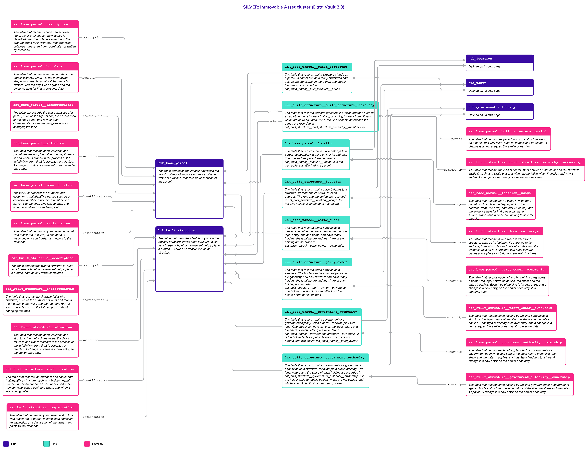
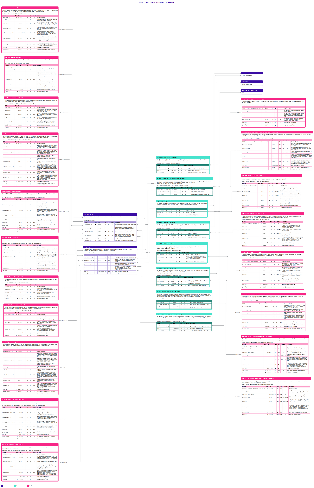

# Immovable Asset

## Header

| **Field** | **Value** |
| --- | --- |
| Object | Immovable Asset |
| Parent object | — |
| Owner domain | Registries |
| Shared with | Taxation Contributions and Licences, Finance, Compliance |
| Scope | Shared |
| Status | Draft |
| Version | 0.1 |
| Last updated | 2026-10-23 |

## Definition

An Immovable Asset is a bounded portion of land, water or airspace, together with the permanent structures on it, over which someone holds a right, a restriction or a responsibility. The State needs to identify it, register who holds it, value it for tax and place it on the map. The object has two parts that do not share a life.

- A **base parcel** is the bounded portion itself: a plot of land, a stretch of water, a volume of airspace. It may be surveyed as a polygon or three-dimensional space, or known only by words or natural features, as in customary tenure. Land may belong to the State or to a tribe.
- A **built structure** is what is built on it and stays: a house, a hotel, an apartment unit, a pier, a turbine. A structure can contain other structures, such as the apartment units of a building under strata title, each with its own holder.

The holder of a parcel or a structure is a Party (a person or an entity) or a government authority; a public body is not a Party. A parcel can hold many structures, and every structure and every parcel has its own identifiers, its own proof of registration, its own characteristics and its own value.

## Why it is its own object

- **The two parts have different lifecycles.** A parcel outlives its structures: a house is demolished and the parcel stays. A structure is built, extended and divided into units while the parcel is unchanged.
- **They have different keys.** A parcel is known by the cadastre or a customary register; a structure is known by a building permit, a unit number or an occupancy certificate. One key cannot serve both.
- **They have different holders.** The holder of a building can differ from the holder of the land under it, as in a lease. A parcel can be State land or belong to a tribe, while a hotel on it is private.
- **They are valued on their own.** Land and building are valued by different methods and on different cycles, and the value of one never includes the other.
- **Containment has no fixed depth.** A building holds wings, floors and units, and a unit can be divided again. The same containment Link is used again for each level.

If the parcel and the structure were one table, a demolished house would end the parcel, a unit in a strata building would need a parcel of its own, and the value of the land could not be revised without touching the building.

## Vault objects

| **Type** | **Name** | **Definition** | **Grain** | **Business key** |
| --- | --- | --- | --- | --- |
| Hub | `hub_base_parcel` | The table that holds the identifier by which the registry of record knows each parcel of land, water or airspace. It carries no description of the parcel. | one row per business key | `base_parcel_bk`: the identifier in the registry of record, or one assigned by the platform when there is none, with the jurisdiction and the key type |
| Hub | `hub_built_structure` | The table that holds the identifier by which the registry of record knows each structure, such as a house, a hotel, an apartment unit, a pier or a turbine. It carries no description of the structure. | one row per business key | `built_structure_bk`: the identifier in the registry of record, or one assigned by the platform when there is none, with the jurisdiction and the key type |
| Link | `lnk_base_parcel__built_structure` | The table that records that a structure stands on a parcel. A parcel can hold many structures and a structure can stand on more than one parcel; the period is recorded in `sat_base_parcel__built_structure__period`. | one row per distinct combination of parcel and structure | `hub_base_parcel`, `hub_built_structure` |
| Link | `lnk_built_structure__built_structure_hierarchy` | The table that records that one structure lies inside another, such as an apartment unit inside a building or a wing inside a hotel. It says which structure contains which; the kind of containment and the period are recorded in `sat_built_structure__built_structure_hierarchy__membership`. | one row per distinct combination of parent structure and member structure | `hub_built_structure` (parent), `hub_built_structure` (member) |
| Link | `lnk_base_parcel__location` | The table that records that a place belongs to a parcel: its boundary, a point on it or its address. The role and the period are recorded in `sat_base_parcel__location__usage`. It is the way a place is attached to a parcel. | one row per distinct combination of parcel and location | `hub_base_parcel`, `hub_location` |
| Link | `lnk_built_structure__location` | The table that records that a place belongs to a structure: its footprint, its entrance or its address. The role and the period are recorded in `sat_built_structure__location__usage`. It is the way a place is attached to a structure. | one row per distinct combination of structure and location | `hub_built_structure`, `hub_location` |
| Link | `lnk_base_parcel__party_owner` | The table that records that a party holds a parcel. The holder can be a natural person or a legal entity, and one parcel can have many holders; the legal nature and the share of each holding are recorded in `sat_base_parcel__party_owner__ownership`. | one row per distinct combination of parcel and owner party | `hub_base_parcel`, `hub_party` (owner) |
| Link | `lnk_built_structure__party_owner` | The table that records that a party holds a structure. The holder can be a natural person or a legal entity, and one structure can have many holders; the legal nature and the share of each holding are recorded in `sat_built_structure__party_owner__ownership`. The holder of a structure can differ from the holder of the parcel under it. | one row per distinct combination of structure and owner party | `hub_built_structure`, `hub_party` (owner) |
| Link | `lnk_base_parcel__government_authority` | The table that records that a government or a government agency holds a parcel, for example State land. One parcel can have several; the legal nature and the share of each holding are recorded in `sat_base_parcel__government_authority__ownership`. It is the holder table for public bodies, which are not parties, and sits beside `lnk_base_parcel__party_owner`. | one row per distinct combination of parcel and government authority | `hub_base_parcel`, `hub_government_authority` |
| Link | `lnk_built_structure__government_authority` | The table that records that a government or a government agency holds a structure, for example a public building. The legal nature and the share of each holding are recorded in `sat_built_structure__government_authority__ownership`. It is the holder table for public bodies, which are not parties, and sits beside `lnk_built_structure__party_owner`. | one row per distinct combination of structure and government authority | `hub_built_structure`, `hub_government_authority` |
| Satellite | `sat_base_parcel__description` | The table that records what a parcel covers (land, water or airspace), how its use is classified, the kind of tenure over it and the area recorded for it, with how that area was obtained: measured from coordinates or written by someone. | one row per parent key, for each time its values change | — |
| Satellite | `sat_base_parcel__boundary` | The table that records how the boundary of a parcel is known when it is not a surveyed shape: in words, by a natural feature or by custom, with the day it was agreed and the evidence held for it. It is personal data. | one row per parent key, for each time its values change | — |
| Satellite | `sat_base_parcel__characteristic` | The table that records the characteristics of a parcel, such as the type of soil, the access road or the flood zone, one row for each characteristic, so the list can grow without changing the table. | one row per parent key and characteristic, for each time its values change | — |
| Satellite | `sat_base_parcel__valuation` | The table that records each valuation of a parcel: the method, the value, the day it refers to and where it stands in the process of the jurisdiction, from draft to accepted or rejected. A change of status is a new entry, so the earlier ones stay. | one row per parent key and valuation, for each time its values change | — |
| Satellite | `sat_base_parcel__identification` | The table that records the numbers and documents that identify a parcel, such as a cadastral number, a title deed number or a survey plan number, who issued each and when, and when it stops being valid. | one row per parent key and identification document (type and number), for each time its values change | — |
| Satellite | `sat_base_parcel__registration` | The table that records why and when a parcel was registered (a survey, a title deed, a testimony or a court order) and points to the evidence. | one row per parent key, registration basis and identifier type, for each time its values change | — |
| Satellite | `sat_built_structure__description` | The table that records what a structure is, such as a house, a hotel, an apartment unit, a pier or a turbine, and the day it was completed. | one row per parent key, for each time its values change | — |
| Satellite | `sat_built_structure__characteristic` | The table that records the characteristics of a structure, such as the number of toilets and rooms, the material of the walls and the roof, one row for each characteristic, so the list can grow without changing the table. | one row per parent key and characteristic, for each time its values change | — |
| Satellite | `sat_built_structure__valuation` | The table that records each valuation of a structure: the method, the value, the day it refers to and where it stands in the process of the jurisdiction, from draft to accepted or rejected. A change of status is a new entry, so the earlier ones stay. | one row per parent key and valuation, for each time its values change | — |
| Satellite | `sat_built_structure__identification` | The table that records the numbers and documents that identify a structure, such as a building permit number, a unit number or an occupancy certificate number, who issued each and when, and when it stops being valid. | one row per parent key and identification document (type and number), for each time its values change | — |
| Satellite | `sat_built_structure__registration` | The table that records why and when a structure was registered (a permit, a completion certificate, an inspection or a declaration of the owner) and points to the evidence. | one row per parent key, registration basis and identifier type, for each time its values change | — |
| Satellite | `sat_base_parcel__built_structure__period` | The table that records the period in which a structure stands on a parcel and why it left, such as demolished or moved. A change is a new entry, so the earlier ones stay. | one row per parent key, for each time its values change | — |
| Satellite | `sat_built_structure__built_structure_hierarchy__membership` | The table that records the kind of containment between a structure and the structure inside it, such as a strata unit or a wing, the period in which it applies and why it ended. A change is a new entry, so the earlier ones stay. | one row per parent key and hierarchy type, for each time its values change | — |
| Satellite | `sat_base_parcel__location__usage` | The table that records how a place is used for a parcel, such as its boundary, a point on it or its address, from which day and until which day, and the evidence held for it. A parcel can have several places and a place can belong to several parcels. | one row per parent key and role, for each time its values change | — |
| Satellite | `sat_built_structure__location__usage` | The table that records how a place is used for a structure, such as its footprint, its entrance or its address, from which day and until which day, and the evidence held for it. A structure can have several places and a place can belong to several structures. | one row per parent key and role, for each time its values change | — |
| Satellite | `sat_base_parcel__party_owner__ownership` | The table that records each holding by which a party holds a parcel: the legal nature of the title, the share and the dates it applies. Each type of holding is its own entry, and a change is a new entry, so the earlier ones stay. It is personal data. | one row per parent key and holding type, for each time its values change | — |
| Satellite | `sat_built_structure__party_owner__ownership` | The table that records each holding by which a party holds a structure: the legal nature of the title, the share and the dates it applies. Each type of holding is its own entry, and a change is a new entry, so the earlier ones stay. It is personal data. | one row per parent key and holding type, for each time its values change | — |
| Satellite | `sat_base_parcel__government_authority__ownership` | The table that records each holding by which a government or a government agency holds a parcel: the legal nature of the title, the share and the dates it applies, such as State land lent to a tribe. A change is a new entry, so the earlier ones stay. | one row per parent key and holding type, for each time its values change | — |
| Satellite | `sat_built_structure__government_authority__ownership` | The table that records each holding by which a government or a government agency holds a structure: the legal nature of the title, the share and the dates it applies. A change is a new entry, so the earlier ones stay. | one row per parent key and holding type, for each time its values change | — |

`base_parcel_hk` is computed from `jurisdiction_code`, `key_type_code` and the normalized `base_parcel_bk`; `built_structure_hk` is computed the same way from its own key, all joined with a fixed separator. Normalization: trimmed, case-folded, Unicode-normalized. The hash algorithm is a platform decision and is not named here. Satellites carry only the parent's hash key.

`lnk_base_parcel__built_structure` says that a structure **stands on** a parcel; `lnk_built_structure__built_structure_hierarchy` says that a structure **lies inside** another, so an apartment unit is a structure inside the building and the building is a structure on the parcel. `lnk_base_parcel__location` and `lnk_built_structure__location` say where the parcel or the structure **is**, with the shape of `lnk_location__natural_person`; the surveyed boundary of a parcel is a geometry of Location, not a column here. `lnk_base_parcel__party_owner` and `lnk_built_structure__party_owner` say that a Party **holds** the parcel or the structure, with the shape of `lnk_legal_entity__party_owner`. `lnk_base_parcel__government_authority` and `lnk_built_structure__government_authority` say the same for a government or a government agency, which is a Platform object and not a Party. Each Link has its own Satellite for the details. The Links to `hub_location`, `hub_party` and `hub_government_authority` join Hubs that are defined on other pages.

## Fields

*Indicators in Role: ◆ own hash key · ◇ hash key of another object · ● business key · ▪ load metadata · Δ hashdiff. Default: — means no default, so the loader must supply the value; a literal is a default in the sense of Iceberg format version 3.*

### hub_base_parcel

| **Column** | **Role** | **Type** | **Null** | **PII** | **Default** | **Description** |
| --- | --- | --- | --- | --- | --- | --- |
| `base_parcel_hk` | ◆ | `string` | No | No | — | Hash key, from jurisdiction, key type and business key |
| `base_parcel_bk` | ● | `string` | No | No | — | Identifier of the parcel in the registry of record, or one assigned by the platform when there is no registry |
| `jurisdiction_code` |  | `string` | No | No | — | Jurisdiction (country or territory) that owns the key, ISO 3166-1 alpha-3: e.g. `WSM`, `PNG`, `NZL` |
| `key_type_code` |  | `string` | No | No | — | Which kind of identifier the business key is, a value of the list `base_parcel_key_type`: e.g. `registry_parcel_id`, `customary_tenure_id`, `platform_assigned` |
| `load_dts` | ▪ | `timestamptz` | No | No | — | When Nexus first loaded the row |
| `record_source` | ▪ | `string` | No | No | — | Which system and endpoint the row came from |

### hub_built_structure

| **Column** | **Role** | **Type** | **Null** | **PII** | **Default** | **Description** |
| --- | --- | --- | --- | --- | --- | --- |
| `built_structure_hk` | ◆ | `string` | No | No | — | Hash key, from jurisdiction, key type and business key |
| `built_structure_bk` | ● | `string` | No | No | — | Identifier of the structure in the registry of record, or one assigned by the platform when there is no registry |
| `jurisdiction_code` |  | `string` | No | No | — | Jurisdiction (country or territory) that owns the key, ISO 3166-1 alpha-3: e.g. `WSM`, `PNG`, `NZL` |
| `key_type_code` |  | `string` | No | No | — | Which kind of identifier the business key is, a value of the list `built_structure_key_type`: e.g. `registry_structure_id`, `permit_structure_id`, `platform_assigned` |
| `load_dts` | ▪ | `timestamptz` | No | No | — | When Nexus first loaded the row |
| `record_source` | ▪ | `string` | No | No | — | Which system and endpoint the row came from |

### lnk_base_parcel__built_structure

| **Column** | **Role** | **Type** | **Null** | **PII** | **Default** | **Description** |
| --- | --- | --- | --- | --- | --- | --- |
| `base_parcel_hk` | ◇ | `string` | No | No | — | Hash key of the parcel |
| `built_structure_hk` | ◇ | `string` | No | No | — | Hash key of the structure that stands on it |
| `load_dts` | ▪ | `timestamptz` | No | No | — | When Nexus first loaded the row |
| `record_source` | ▪ | `string` | No | No | — | Which system and endpoint the row came from |

### lnk_built_structure__built_structure_hierarchy

A containment between two structures. The **parent** is the structure that contains, such as a building, and the **member** is the structure inside it, such as an apartment unit or a wing. Both are rows of `hub_built_structure`. A member can itself be a parent, so the levels are not built into the tables.

| **Column** | **Role** | **Type** | **Null** | **PII** | **Default** | **Description** |
| --- | --- | --- | --- | --- | --- | --- |
| `parent_built_structure_hk` | ◇ | `string` | No | No | — | Hash key of the structure that contains |
| `member_built_structure_hk` | ◇ | `string` | No | No | — | Hash key of the structure inside it |
| `load_dts` | ▪ | `timestamptz` | No | No | — | When Nexus first loaded the row |
| `record_source` | ▪ | `string` | No | No | — | Which system and endpoint the row came from |

### lnk_base_parcel__location

| **Column** | **Role** | **Type** | **Null** | **PII** | **Default** | **Description** |
| --- | --- | --- | --- | --- | --- | --- |
| `base_parcel_hk` | ◇ | `string` | No | No | — | Hash key of the parcel |
| `location_hk` | ◇ | `string` | No | No | — | Hash key of the location |
| `load_dts` | ▪ | `timestamptz` | No | No | — | When Nexus first loaded the row |
| `record_source` | ▪ | `string` | No | No | — | Which system and endpoint the row came from |

### lnk_built_structure__location

| **Column** | **Role** | **Type** | **Null** | **PII** | **Default** | **Description** |
| --- | --- | --- | --- | --- | --- | --- |
| `built_structure_hk` | ◇ | `string` | No | No | — | Hash key of the structure |
| `location_hk` | ◇ | `string` | No | No | — | Hash key of the location |
| `load_dts` | ▪ | `timestamptz` | No | No | — | When Nexus first loaded the row |
| `record_source` | ▪ | `string` | No | No | — | Which system and endpoint the row came from |

### lnk_base_parcel__party_owner

| **Column** | **Role** | **Type** | **Null** | **PII** | **Default** | **Description** |
| --- | --- | --- | --- | --- | --- | --- |
| `base_parcel_hk` | ◇ | `string` | No | No | — | Hash key of the parcel that is owned |
| `owner_party_hk` | ◇ | `string` | No | No | — | Hash key of the party that owns it, a Natural Person or a Legal Entity; how a government or a government agency is a holder is an open decision |
| `load_dts` | ▪ | `timestamptz` | No | No | — | When Nexus first loaded the row |
| `record_source` | ▪ | `string` | No | No | — | Which system and endpoint the row came from |

### lnk_built_structure__party_owner

| **Column** | **Role** | **Type** | **Null** | **PII** | **Default** | **Description** |
| --- | --- | --- | --- | --- | --- | --- |
| `built_structure_hk` | ◇ | `string` | No | No | — | Hash key of the structure that is owned |
| `owner_party_hk` | ◇ | `string` | No | No | — | Hash key of the party that owns it, a Natural Person or a Legal Entity |
| `load_dts` | ▪ | `timestamptz` | No | No | — | When Nexus first loaded the row |
| `record_source` | ▪ | `string` | No | No | — | Which system and endpoint the row came from |

### lnk_base_parcel__government_authority

| **Column** | **Role** | **Type** | **Null** | **PII** | **Default** | **Description** |
| --- | --- | --- | --- | --- | --- | --- |
| `base_parcel_hk` | ◇ | `string` | No | No | — | Hash key of the parcel that is held |
| `government_authority_hk` | ◇ | `string` | No | No | — | Hash key of the government authority that holds it |
| `load_dts` | ▪ | `timestamptz` | No | No | — | When Nexus first loaded the row |
| `record_source` | ▪ | `string` | No | No | — | Which system and endpoint the row came from |

### lnk_built_structure__government_authority

| **Column** | **Role** | **Type** | **Null** | **PII** | **Default** | **Description** |
| --- | --- | --- | --- | --- | --- | --- |
| `built_structure_hk` | ◇ | `string` | No | No | — | Hash key of the structure that is held |
| `government_authority_hk` | ◇ | `string` | No | No | — | Hash key of the government authority that holds it |
| `load_dts` | ▪ | `timestamptz` | No | No | — | When Nexus first loaded the row |
| `record_source` | ▪ | `string` | No | No | — | Which system and endpoint the row came from |

### sat_base_parcel__description

| **Column** | **Role** | **Type** | **Null** | **PII** | **Default** | **Description** |
| --- | --- | --- | --- | --- | --- | --- |
| `base_parcel_hk` | ◇ | `string` | No | No | — | Hash key of the parent |
| `parcel_kind_code` |  | `string` | No | No | — | What the parcel covers, a value of the list `parcel_kind`: e.g. `land`, `water`, `airspace`, `subsurface` |
| `land_use_code` |  | `string` | Yes | No | null | How the jurisdiction classifies the use of the parcel, a value of the list `land_use`; empty when not classified: e.g. `residential`, `agricultural`, `forest`, `commercial` |
| `tenure_type_code` |  | `string` | No | No | — | The kind of tenure over the parcel, a value of the list `tenure_type`: e.g. `freehold`, `leasehold`, `customary`, `state_land` |
| `registered_area_number` |  | `decimal(18,4)` | Yes | No | null | The area recorded for the parcel, in the unit of `area_unit_code`; empty when none is recorded. Where the shape is known it is worked out in Gold and may differ from this value |
| `area_basis_code` |  | `string` | Yes | No | null | How the recorded area was obtained, a value of the list `area_basis`; empty when `registered_area_number` is empty: e.g. `measured_from_coordinates`, `written_in_title`, `declared_by_holder`, `estimated` |
| `area_unit_code` |  | `string` | Yes | No | null | Unit of the registered area, a value of the list `measure_unit`; empty when `registered_area_number` is empty: e.g. `square_metre`, `hectare`, `acre` |
| `load_dts` | ▪ | `timestamptz` | No | No | — | When Nexus first loaded the row |
| `record_source` | ▪ | `string` | No | No | — | Which system and endpoint the row came from |
| `hashdiff` | Δ | `string` | No | No | — | Hash of the descriptive values |

### sat_base_parcel__boundary

A parcel with no survey is known by words or by a natural feature, as in customary tenure. This Satellite is personal data because the words can name neighbours. The surveyed shape, when there is one, is not here: it is a Location (see Modeling considerations).

| **Column** | **Role** | **Type** | **Null** | **PII** | **Default** | **Description** |
| --- | --- | --- | --- | --- | --- | --- |
| `base_parcel_hk` | ◇ | `string` | No | No | — | Hash key of the parent |
| `boundary_type_code` |  | `string` | No | No | — | How the boundary is known, a value of the list `boundary_type`: e.g. `surveyed`, `textual`, `natural_feature`, `customary` |
| `boundary_text` |  | `string` | Yes | Yes | null | The boundary in words, for a parcel with no survey: e.g. `from the large banyan tree to the river bend, then along the footpath`. It can name neighbours, so it is personal data; empty when the boundary is a surveyed shape |
| `agreed_date` |  | `date` | Yes | No | null | The day the boundary was agreed, surveyed or witnessed; empty when unknown |
| `artifact_uri` |  | `string` | Yes | No | null | Pointer to one stored object in Digital Artifact, such as a survey plan, a sketch map or a record of the witnesses; only the pointer is stored: e.g. `artifact://survey/s-2210`, `artifact://sketch/k-44`, `artifact://witness/w-9`; empty when there is none |
| `load_dts` | ▪ | `timestamptz` | No | No | — | When Nexus first loaded the row |
| `record_source` | ▪ | `string` | No | No | — | Which system and endpoint the row came from |
| `hashdiff` | Δ | `string` | No | No | — | Hash of the descriptive values |

### sat_base_parcel__characteristic

The characteristics of a parcel are an open list, so each is a row and not a column (Principles, "Traits as rows"). A new characteristic is a new value of the Code List `parcel_characteristic` and changes no table. The Code List says, for each one, which value column is used (`value_data_type_code`), and the load checks the value against it. A characteristic that is not personal data has no in-place twin: history is kept.

| **Column** | **Role** | **Type** | **Null** | **PII** | **Default** | **Description** |
| --- | --- | --- | --- | --- | --- | --- |
| `base_parcel_hk` | ◇ | `string` | No | No | — | Hash key of the parent |
| `trait_code` |  | `string` | No | No | — | Which characteristic this row holds, a value of the list `parcel_characteristic`: e.g. `soil_type`, `access_road`, `slope_percent`, `flood_zone` |
| `value_text` |  | `string` | Yes | No | null | The value of a characteristic whose type is `string`, `date` or `boolean`, written as text; empty for a numeric characteristic |
| `value_number` |  | `decimal(18,6)` | Yes | No | null | The value of a characteristic whose type is `integer` or `decimal`; empty for a text characteristic |
| `measure_unit_code` |  | `string` | Yes | No | null | Unit of `value_number`, a value of the list `measure_unit`; empty for a text characteristic or a plain count: e.g. `metre`, `square_metre`, `percent` |
| `load_dts` | ▪ | `timestamptz` | No | No | — | When Nexus first loaded the row |
| `record_source` | ▪ | `string` | No | No | — | Which system and endpoint the row came from |
| `hashdiff` | Δ | `string` | No | No | — | Hash of the descriptive values |

### sat_base_parcel__valuation

One row for each valuation and each change of its status. The value, the method and the status are one fact, so they share a Satellite. The row of a status change repeats the value, and the earlier rows stay. Which method a jurisdiction uses, which status changes are allowed and who decides them are values and rules of the Code List (`valuation_method`, `valuation_status`). The definitive value is not stored: the Gold view `cur_base_parcel__valuation_definitive` returns, for each parcel, the accepted valuation with the latest `valuation_date` (R13).

| **Column** | **Role** | **Type** | **Null** | **PII** | **Default** | **Description** |
| --- | --- | --- | --- | --- | --- | --- |
| `base_parcel_hk` | ◇ | `string` | No | No | — | Hash key of the parent |
| `valuation_ref` |  | `string` | No | No | — | Identifier of the valuation in the source of record, part of the grain so that several valuations of one parcel can be open at once: e.g. `V-2026-0412`, `REVAL-2025-77`, `OBJ-12` |
| `valuation_method_code` |  | `string` | No | No | — | The method by which the value was worked out, a value of the list `valuation_method` that the jurisdiction sets: e.g. `market_comparison`, `cost_approach`, `income_approach`, `mass_appraisal` |
| `value_amount` |  | `decimal(18,2)` | No | No | — | The value, in the currency of `currency_code`: e.g. `185000.00`, `1250000.00`, `42500.00` |
| `currency_code` |  | `string` | No | No | — | Currency of the value, ISO 4217: e.g. `WST`, `PGK`, `NZD` |
| `valuation_date` |  | `date` | No | No | — | The day the value refers to, which is not the day it was entered |
| `valuation_status_code` |  | `string` | No | No | `draft` | Where the valuation stands in the process of the jurisdiction. One of `draft` (being prepared, no effect), `submitted` (sent for decision), `accepted` (approved, and may be used as the definitive value), `rejected` (refused, never used), `withdrawn` (taken back before a decision) |
| `decision_date` |  | `date` | Yes | No | null | The day the status became `accepted`, `rejected` or `withdrawn`; empty while the valuation is a draft or submitted |
| `artifact_uri` |  | `string` | Yes | No | null | Pointer to one stored object in Digital Artifact, such as the valuation report or the decision; only the pointer is stored: e.g. `artifact://valuation/v-0412`, `artifact://decision/d-2026-88`, `artifact://report/r-31`; empty when there is none |
| `load_dts` | ▪ | `timestamptz` | No | No | — | When Nexus first loaded the row |
| `record_source` | ▪ | `string` | No | No | — | Which system and endpoint the row came from |
| `hashdiff` | Δ | `string` | No | No | — | Hash of the descriptive values |

### sat_base_parcel__identification

| **Column** | **Role** | **Type** | **Null** | **PII** | **Default** | **Description** |
| --- | --- | --- | --- | --- | --- | --- |
| `base_parcel_hk` | ◇ | `string` | No | No | — | Hash key of the parent |
| `identification_type_code` |  | `string` | No | No | — | Kind of document or number, a value of the list `base_parcel_identification_type`: e.g. `cadastral_number`, `title_deed_number`, `survey_plan_number`, `customary_land_register_number` |
| `identification_id` |  | `string` | No | No | — | The identifier as issued, always text, checked against the pattern of its type and jurisdiction in the Code List: e.g. `CAD-77-0412`, `TD-2210`, `SP-1198` |
| `issuing_jurisdiction_code` |  | `string` | No | No | — | Jurisdiction (country or territory) that issued the document, ISO 3166-1 alpha-3: e.g. `WSM`, `PNG`, `NZL` |
| `issued_by_code` |  | `string` | Yes | No | null | Authority that issued the document, a value of the list `issuer`; empty when it is not recorded: e.g. `land_registry`, `survey_office`, `building_authority` |
| `issue_date` |  | `date` | Yes | No | null | When the document was issued; empty when unknown |
| `expiry_date` |  | `date` | Yes | No | null | When the document stops being valid; empty if it does not expire |
| `load_dts` | ▪ | `timestamptz` | No | No | — | When Nexus first loaded the row |
| `record_source` | ▪ | `string` | No | No | — | Which system and endpoint the row came from |
| `hashdiff` | Δ | `string` | No | No | — | Hash of the descriptive values |

### sat_base_parcel__registration

| **Column** | **Role** | **Type** | **Null** | **PII** | **Default** | **Description** |
| --- | --- | --- | --- | --- | --- | --- |
| `base_parcel_hk` | ◇ | `string` | No | No | — | Hash key of the parent |
| `registration_basis_code` |  | `string` | No | No | — | Why the base parcel was registered, a value of the list `parcel_registration_basis`: e.g. `survey`, `title_deed`, `customary_testimony`, `court_order` |
| `registration_date` |  | `date` | No | No | — | When the base parcel was registered on this basis |
| `identification_type_code` |  | `string` | Yes | No | null | Which identifier this evidence supports, a value of the list `base_parcel_identification_type`; empty when the evidence supports the registration as a whole: e.g. `cadastral_number`, `title_deed_number`, `building_permit_number` |
| `artifact_uri` |  | `string` | Yes | No | null | Pointer to one stored object in Digital Artifact, such as a survey plan, a title deed or a signed testimony of the village chief; only the pointer is stored: e.g. `artifact://survey/s-2210`, `artifact://deed/d-3301`, `artifact://testimony/t-12`; empty when there is none |
| `load_dts` | ▪ | `timestamptz` | No | No | — | When Nexus first loaded the row |
| `record_source` | ▪ | `string` | No | No | — | Which system and endpoint the row came from |
| `hashdiff` | Δ | `string` | No | No | — | Hash of the descriptive values |

### sat_built_structure__description

| **Column** | **Role** | **Type** | **Null** | **PII** | **Default** | **Description** |
| --- | --- | --- | --- | --- | --- | --- |
| `built_structure_hk` | ◇ | `string` | No | No | — | Hash key of the parent |
| `structure_type_code` |  | `string` | No | No | — | What the structure is, a value of the list `structure_type`: e.g. `house`, `hotel`, `apartment_unit`, `pier`, `wind_turbine` |
| `completion_date` |  | `date` | Yes | No | null | The day the structure was completed or first occupied; empty when unknown |
| `load_dts` | ▪ | `timestamptz` | No | No | — | When Nexus first loaded the row |
| `record_source` | ▪ | `string` | No | No | — | Which system and endpoint the row came from |
| `hashdiff` | Δ | `string` | No | No | — | Hash of the descriptive values |

### sat_built_structure__characteristic

The characteristics of a structure are an open list: the number of toilets, rooms and floors, the material of the walls and the roof, and whatever a jurisdiction adds. Each is a row and not a column (Principles, "Traits as rows"). A new characteristic is a new value of the Code List `structure_characteristic` and changes no table. The Code List says, for each one, which value column is used (`value_data_type_code`), and the load checks the value against it. A characteristic that is not personal data has no in-place twin: history is kept.

| **Column** | **Role** | **Type** | **Null** | **PII** | **Default** | **Description** |
| --- | --- | --- | --- | --- | --- | --- |
| `built_structure_hk` | ◇ | `string` | No | No | — | Hash key of the parent |
| `trait_code` |  | `string` | No | No | — | Which characteristic this row holds, a value of the list `structure_characteristic`: e.g. `toilet_count`, `room_count`, `wall_material`, `floor_count`, `roof_material` |
| `value_text` |  | `string` | Yes | No | null | The value of a characteristic whose type is `string`, `date` or `boolean`, written as text; empty for a numeric characteristic |
| `value_number` |  | `decimal(18,6)` | Yes | No | null | The value of a characteristic whose type is `integer` or `decimal`; empty for a text characteristic |
| `measure_unit_code` |  | `string` | Yes | No | null | Unit of `value_number`, a value of the list `measure_unit`; empty for a text characteristic or a plain count: e.g. `square_metre`, `metre`, `count` |
| `load_dts` | ▪ | `timestamptz` | No | No | — | When Nexus first loaded the row |
| `record_source` | ▪ | `string` | No | No | — | Which system and endpoint the row came from |
| `hashdiff` | Δ | `string` | No | No | — | Hash of the descriptive values |

### sat_built_structure__valuation

Same shape and same rules as `sat_base_parcel__valuation`. A structure is valued on its own, so the value of a parcel never includes it. The definitive value is the Gold view `cur_built_structure__valuation_definitive`.

| **Column** | **Role** | **Type** | **Null** | **PII** | **Default** | **Description** |
| --- | --- | --- | --- | --- | --- | --- |
| `built_structure_hk` | ◇ | `string` | No | No | — | Hash key of the parent |
| `valuation_ref` |  | `string` | No | No | — | Identifier of the valuation in the source of record, part of the grain so that several valuations of one structure can be open at once: e.g. `V-2026-0412`, `REVAL-2025-77`, `OBJ-12` |
| `valuation_method_code` |  | `string` | No | No | — | The method by which the value was worked out, a value of the list `valuation_method` that the jurisdiction sets: e.g. `market_comparison`, `cost_approach`, `income_approach`, `mass_appraisal` |
| `value_amount` |  | `decimal(18,2)` | No | No | — | The value, in the currency of `currency_code`: e.g. `185000.00`, `1250000.00`, `42500.00` |
| `currency_code` |  | `string` | No | No | — | Currency of the value, ISO 4217: e.g. `WST`, `PGK`, `NZD` |
| `valuation_date` |  | `date` | No | No | — | The day the value refers to, which is not the day it was entered |
| `valuation_status_code` |  | `string` | No | No | `draft` | Where the valuation stands in the process of the jurisdiction. One of `draft` (being prepared, no effect), `submitted` (sent for decision), `accepted` (approved, and may be used as the definitive value), `rejected` (refused, never used), `withdrawn` (taken back before a decision) |
| `decision_date` |  | `date` | Yes | No | null | The day the status became `accepted`, `rejected` or `withdrawn`; empty while the valuation is a draft or submitted |
| `artifact_uri` |  | `string` | Yes | No | null | Pointer to one stored object in Digital Artifact, such as the valuation report or the decision; only the pointer is stored: e.g. `artifact://valuation/v-0412`, `artifact://decision/d-2026-88`, `artifact://report/r-31`; empty when there is none |
| `load_dts` | ▪ | `timestamptz` | No | No | — | When Nexus first loaded the row |
| `record_source` | ▪ | `string` | No | No | — | Which system and endpoint the row came from |
| `hashdiff` | Δ | `string` | No | No | — | Hash of the descriptive values |

### sat_built_structure__identification

| **Column** | **Role** | **Type** | **Null** | **PII** | **Default** | **Description** |
| --- | --- | --- | --- | --- | --- | --- |
| `built_structure_hk` | ◇ | `string` | No | No | — | Hash key of the parent |
| `identification_type_code` |  | `string` | No | No | — | Kind of document or number, a value of the list `built_structure_identification_type`: e.g. `building_permit_number`, `unit_number`, `occupancy_certificate_number`, `street_number` |
| `identification_id` |  | `string` | No | No | — | The identifier as issued, always text, checked against the pattern of its type and jurisdiction in the Code List: e.g. `BP-2019-0881`, `U-402`, `OC-4410` |
| `issuing_jurisdiction_code` |  | `string` | No | No | — | Jurisdiction (country or territory) that issued the document, ISO 3166-1 alpha-3: e.g. `WSM`, `PNG`, `NZL` |
| `issued_by_code` |  | `string` | Yes | No | null | Authority that issued the document, a value of the list `issuer`; empty when it is not recorded: e.g. `land_registry`, `survey_office`, `building_authority` |
| `issue_date` |  | `date` | Yes | No | null | When the document was issued; empty when unknown |
| `expiry_date` |  | `date` | Yes | No | null | When the document stops being valid; empty if it does not expire |
| `load_dts` | ▪ | `timestamptz` | No | No | — | When Nexus first loaded the row |
| `record_source` | ▪ | `string` | No | No | — | Which system and endpoint the row came from |
| `hashdiff` | Δ | `string` | No | No | — | Hash of the descriptive values |

### sat_built_structure__registration

| **Column** | **Role** | **Type** | **Null** | **PII** | **Default** | **Description** |
| --- | --- | --- | --- | --- | --- | --- |
| `built_structure_hk` | ◇ | `string` | No | No | — | Hash key of the parent |
| `registration_basis_code` |  | `string` | No | No | — | Why the built structure was registered, a value of the list `structure_registration_basis`: e.g. `building_permit`, `completion_certificate`, `inspection`, `owner_declaration` |
| `registration_date` |  | `date` | No | No | — | When the built structure was registered on this basis |
| `identification_type_code` |  | `string` | Yes | No | null | Which identifier this evidence supports, a value of the list `built_structure_identification_type`; empty when the evidence supports the registration as a whole: e.g. `cadastral_number`, `title_deed_number`, `building_permit_number` |
| `artifact_uri` |  | `string` | Yes | No | null | Pointer to one stored object in Digital Artifact, such as a permit, a completion certificate or an inspection report; only the pointer is stored: e.g. `artifact://permit/p-0881`, `artifact://certificate/c-4410`, `artifact://inspection/i-72`; empty when there is none |
| `load_dts` | ▪ | `timestamptz` | No | No | — | When Nexus first loaded the row |
| `record_source` | ▪ | `string` | No | No | — | Which system and endpoint the row came from |
| `hashdiff` | Δ | `string` | No | No | — | Hash of the descriptive values |

### sat_base_parcel__built_structure__period

| **Column** | **Role** | **Type** | **Null** | **PII** | **Default** | **Description** |
| --- | --- | --- | --- | --- | --- | --- |
| `lnk_base_parcel__built_structure_hk` | ◇ | `string` | No | No | — | Hash key of the link |
| `effective_date` |  | `date` | No | No | `1900-01-01` | First day the structure stands on the parcel; `1900-01-01` when unknown |
| `end_date` |  | `date` | No | No | `9999-12-31` | Last day the structure stands on the parcel; `9999-12-31` while it still does. When a new row starts for the same key, the loader sets this to the day before it starts |
| `end_reason_code` |  | `string` | Yes | No | null | Why the structure left the parcel, a value of the list `end_reason`; empty while it stands there: e.g. `demolished`, `moved`, `parcel_merged` |
| `load_dts` | ▪ | `timestamptz` | No | No | — | When Nexus first loaded the row |
| `record_source` | ▪ | `string` | No | No | — | Which system and endpoint the row came from |
| `hashdiff` | Δ | `string` | No | No | — | Hash of the descriptive values |

### sat_built_structure__built_structure_hierarchy__membership

The kind of containment, its period and the reason it ended are one fact, so they share a Satellite. The kind is part of the grain: a unit can lie in a building of the strata plan and in a wing of the permit. Within one kind, a member has at most one open row.

| **Column** | **Role** | **Type** | **Null** | **PII** | **Default** | **Description** |
| --- | --- | --- | --- | --- | --- | --- |
| `lnk_built_structure__built_structure_hierarchy_hk` | ◇ | `string` | No | No | — | Hash key of the link |
| `hierarchy_type_code` |  | `string` | No | No | — | Which kind of containment this is, a value of the list `structure_hierarchy_type`: e.g. `strata_unit`, `wing`, `annex`, `floor` |
| `end_reason_code` |  | `string` | Yes | No | null | Why the member left its parent, a value of the list `end_reason`; empty while it is inside: e.g. `demolished`, `merged`, `reorganized` |
| `effective_date` |  | `date` | No | No | `1900-01-01` | First day the member is inside the parent; `1900-01-01` when unknown |
| `end_date` |  | `date` | No | No | `9999-12-31` | Last day the member is inside the parent; `9999-12-31` while it still does. When a new row starts for the same key and hierarchy type, the loader sets this to the day before it starts |
| `artifact_uri` |  | `string` | Yes | No | null | Pointer to one stored object in Digital Artifact, such as a strata plan or a permit; only the pointer is stored: e.g. `artifact://strata/s-310`, `artifact://permit/p-0881`, `artifact://plan/p-18`; empty when there is none |
| `load_dts` | ▪ | `timestamptz` | No | No | — | When Nexus first loaded the row |
| `record_source` | ▪ | `string` | No | No | — | Which system and endpoint the row came from |
| `hashdiff` | Δ | `string` | No | No | — | Hash of the descriptive values |

### sat_base_parcel__location__usage

| **Column** | **Role** | **Type** | **Null** | **PII** | **Default** | **Description** |
| --- | --- | --- | --- | --- | --- | --- |
| `lnk_base_parcel__location_hk` | ◇ | `string` | No | No | — | Hash key of the link |
| `role_code` |  | `string` | No | No | — | How the parcel is placed, a value of the list `immovable_asset_location_role`: e.g. `boundary`, `footprint`, `entrance`, `address` |
| `effective_date` |  | `date` | No | No | `1900-01-01` | First day the place applies to the parcel; `1900-01-01` when unknown |
| `end_date` |  | `date` | No | No | `9999-12-31` | Last day the place applies to the parcel; `9999-12-31` while it still does. When a new row starts for the same key and role, the loader sets this to the day before it starts |
| `artifact_uri` |  | `string` | Yes | No | null | Pointer to one stored object in Digital Artifact, such as a survey or a plan; only the pointer is stored: e.g. `artifact://survey/s-2210`, `artifact://plan/p-18`, `artifact://map/m-7`; empty when there is none |
| `load_dts` | ▪ | `timestamptz` | No | No | — | When Nexus first loaded the row |
| `record_source` | ▪ | `string` | No | No | — | Which system and endpoint the row came from |
| `hashdiff` | Δ | `string` | No | No | — | Hash of the descriptive values |

### sat_built_structure__location__usage

| **Column** | **Role** | **Type** | **Null** | **PII** | **Default** | **Description** |
| --- | --- | --- | --- | --- | --- | --- |
| `lnk_built_structure__location_hk` | ◇ | `string` | No | No | — | Hash key of the link |
| `role_code` |  | `string` | No | No | — | How the structure is placed, a value of the list `immovable_asset_location_role`: e.g. `boundary`, `footprint`, `entrance`, `address` |
| `effective_date` |  | `date` | No | No | `1900-01-01` | First day the place applies to the structure; `1900-01-01` when unknown |
| `end_date` |  | `date` | No | No | `9999-12-31` | Last day the place applies to the structure; `9999-12-31` while it still does. When a new row starts for the same key and role, the loader sets this to the day before it starts |
| `artifact_uri` |  | `string` | Yes | No | null | Pointer to one stored object in Digital Artifact, such as a survey or a plan; only the pointer is stored: e.g. `artifact://survey/s-2210`, `artifact://plan/p-18`, `artifact://map/m-7`; empty when there is none |
| `load_dts` | ▪ | `timestamptz` | No | No | — | When Nexus first loaded the row |
| `record_source` | ▪ | `string` | No | No | — | Which system and endpoint the row came from |
| `hashdiff` | Δ | `string` | No | No | — | Hash of the descriptive values |

### sat_base_parcel__party_owner__ownership

| **Column** | **Role** | **Type** | **Null** | **PII** | **Default** | **Description** |
| --- | --- | --- | --- | --- | --- | --- |
| `lnk_base_parcel__party_owner_hk` | ◇ | `string` | No | No | — | Hash key of the link |
| `holding_type_code` |  | `string` | No | Yes | — | The legal nature of the title over the parcel, a value of the list `immovable_holding_type`: e.g. `freehold`, `leasehold`, `customary_title`, `usufruct` |
| `ownership_share_percent` |  | `decimal(7,4)` | No | Yes | — | The share of the parcel this holding represents, from 0 to 100: e.g. `100.0000`, `50.0000`, `33.3333` |
| `effective_date` |  | `date` | No | Yes | `1900-01-01` | First day this holding applies; `1900-01-01` when unknown |
| `end_date` |  | `date` | No | Yes | `9999-12-31` | Last day this holding applies; `9999-12-31` while it still does. When a new row starts for the same key and holding type, the loader sets this to the day before it starts |
| `artifact_uri` |  | `string` | Yes | Yes | null | Pointer to one stored object in Digital Artifact, such as a title deed or a lease; only the pointer is stored: e.g. `artifact://deed/d-3301`, `artifact://lease/l-55`, `artifact://certificate/c-9`; empty when there is none |
| `load_dts` | ▪ | `timestamptz` | No | No | — | When Nexus first loaded the row |
| `record_source` | ▪ | `string` | No | No | — | Which system and endpoint the row came from |
| `hashdiff` | Δ | `string` | No | No | — | Hash of the descriptive values |

### sat_built_structure__party_owner__ownership

| **Column** | **Role** | **Type** | **Null** | **PII** | **Default** | **Description** |
| --- | --- | --- | --- | --- | --- | --- |
| `lnk_built_structure__party_owner_hk` | ◇ | `string` | No | No | — | Hash key of the link |
| `holding_type_code` |  | `string` | No | Yes | — | The legal nature of the title over the structure, a value of the list `immovable_holding_type`: e.g. `freehold`, `leasehold`, `customary_title`, `usufruct` |
| `ownership_share_percent` |  | `decimal(7,4)` | No | Yes | — | The share of the structure this holding represents, from 0 to 100: e.g. `100.0000`, `50.0000`, `33.3333` |
| `effective_date` |  | `date` | No | Yes | `1900-01-01` | First day this holding applies; `1900-01-01` when unknown |
| `end_date` |  | `date` | No | Yes | `9999-12-31` | Last day this holding applies; `9999-12-31` while it still does. When a new row starts for the same key and holding type, the loader sets this to the day before it starts |
| `artifact_uri` |  | `string` | Yes | Yes | null | Pointer to one stored object in Digital Artifact, such as a title deed or a lease; only the pointer is stored: e.g. `artifact://deed/d-3301`, `artifact://lease/l-55`, `artifact://certificate/c-9`; empty when there is none |
| `load_dts` | ▪ | `timestamptz` | No | No | — | When Nexus first loaded the row |
| `record_source` | ▪ | `string` | No | No | — | Which system and endpoint the row came from |
| `hashdiff` | Δ | `string` | No | No | — | Hash of the descriptive values |

### sat_base_parcel__government_authority__ownership

| **Column** | **Role** | **Type** | **Null** | **PII** | **Default** | **Description** |
| --- | --- | --- | --- | --- | --- | --- |
| `lnk_base_parcel__government_authority_hk` | ◇ | `string` | No | No | — | Hash key of the link |
| `holding_type_code` |  | `string` | No | No | — | The legal nature of the title over the parcel, a value of the list `immovable_holding_type`: e.g. `freehold`, `leasehold`, `customary_title`, `usufruct` |
| `ownership_share_percent` |  | `decimal(7,4)` | No | No | — | The share of the parcel this holding represents, from 0 to 100: e.g. `100.0000`, `50.0000`, `33.3333` |
| `effective_date` |  | `date` | No | No | `1900-01-01` | First day this holding applies; `1900-01-01` when unknown |
| `end_date` |  | `date` | No | No | `9999-12-31` | Last day this holding applies; `9999-12-31` while it still does. When a new row starts for the same key and holding type, the loader sets this to the day before it starts |
| `artifact_uri` |  | `string` | Yes | No | null | Pointer to one stored object in Digital Artifact, such as a title deed or a lease; only the pointer is stored: e.g. `artifact://deed/d-3301`, `artifact://lease/l-55`, `artifact://certificate/c-9`; empty when there is none |
| `load_dts` | ▪ | `timestamptz` | No | No | — | When Nexus first loaded the row |
| `record_source` | ▪ | `string` | No | No | — | Which system and endpoint the row came from |
| `hashdiff` | Δ | `string` | No | No | — | Hash of the descriptive values |

### sat_built_structure__government_authority__ownership

| **Column** | **Role** | **Type** | **Null** | **PII** | **Default** | **Description** |
| --- | --- | --- | --- | --- | --- | --- |
| `lnk_built_structure__government_authority_hk` | ◇ | `string` | No | No | — | Hash key of the link |
| `holding_type_code` |  | `string` | No | No | — | The legal nature of the title over the structure, a value of the list `immovable_holding_type`: e.g. `freehold`, `leasehold`, `customary_title`, `usufruct` |
| `ownership_share_percent` |  | `decimal(7,4)` | No | No | — | The share of the structure this holding represents, from 0 to 100: e.g. `100.0000`, `50.0000`, `33.3333` |
| `effective_date` |  | `date` | No | No | `1900-01-01` | First day this holding applies; `1900-01-01` when unknown |
| `end_date` |  | `date` | No | No | `9999-12-31` | Last day this holding applies; `9999-12-31` while it still does. When a new row starts for the same key and holding type, the loader sets this to the day before it starts |
| `artifact_uri` |  | `string` | Yes | No | null | Pointer to one stored object in Digital Artifact, such as a title deed or a lease; only the pointer is stored: e.g. `artifact://deed/d-3301`, `artifact://lease/l-55`, `artifact://certificate/c-9`; empty when there is none |
| `load_dts` | ▪ | `timestamptz` | No | No | — | When Nexus first loaded the row |
| `record_source` | ▪ | `string` | No | No | — | Which system and endpoint the row came from |
| `hashdiff` | Δ | `string` | No | No | — | Hash of the descriptive values |

## Sources and mapping

No endpoints declared yet

## Jurisdictions map

| **Edge case** | **Where it happens** | **Approach** | **Vault effect** |
| --- | --- | --- | --- |
| Land held by custom, with no survey and no title | Pacific jurisdictions such as Samoa, Papua New Guinea and Vanuatu | The parcel is known by words or natural features, registered on the testimony of the community, and its key is assigned by the platform when the registry has none (R7: a scenario of the same object) | `key_type_code` `platform_assigned` in `hub_base_parcel`; `sat_base_parcel__boundary` with `boundary_type_code` `customary`; a `customary_testimony` row in `sat_base_parcel__registration` |
| A parcel that is surveyed | Jurisdictions with a cadastre | The boundary is a shape of Location, attached to the parcel with the role `boundary` | `lnk_base_parcel__location` and `sat_base_parcel__location__usage`, `lnk_geometry__location` |
| A building with many apartment units, each with its own holder (strata title) | Jurisdictions with unit or strata titles | The building is a structure on the parcel; each unit is a structure inside the building, with its own identifier, value and holder | `lnk_built_structure__built_structure_hierarchy` with `hierarchy_type_code` `strata_unit`; `lnk_built_structure__party_owner` for each unit |
| A parcel with several structures | Any jurisdiction | One row in the Link for each structure; each structure is its own Hub row | Rows of `lnk_base_parcel__built_structure` |
| A structure that stands on more than one parcel | Any jurisdiction with large buildings or piers | The same structure is joined to each parcel | Rows of `lnk_base_parcel__built_structure` |
| The building is held by someone other than the holder of the land | Jurisdictions with leasehold or ground rent | Each has its own holding | `lnk_built_structure__party_owner` and `lnk_base_parcel__party_owner` with different parties and `holding_type_code` |
| A structure is demolished or moved | Any jurisdiction | The structure stays on record; the period on the parcel ends with a reason | `end_date` and `end_reason_code` in `sat_base_parcel__built_structure__period` |
| A parcel is divided or two parcels are merged, or a building is divided or joined | Any jurisdiction | The operation is a fact to track for the parcel or the building. It may be only a change on the register, or a geographic process that cuts or joins the shapes. The new parcels are new Hub rows; the old one ends. How the operation is recorded is open (see Open decisions) | New rows in `hub_base_parcel` or `hub_built_structure`; the operation itself is open |
| A characteristic that only one jurisdiction records, such as the number of toilets or the material of the walls | Any jurisdiction | A new value of the Code List `structure_characteristic`; no table changes | A new `trait_code` in `sat_built_structure__characteristic` |
| The value is revised on a fixed cycle by a method the jurisdiction sets | Jurisdictions that revalue every parcel on a cycle | Each revaluation is a valuation with its own reference and goes through the status process of the jurisdiction | Rows of `sat_base_parcel__valuation` and `sat_built_structure__valuation` with their `valuation_method_code` |
| Two accepted values for one parcel at once, from two processes | Jurisdictions that allow different values for different purposes, such as tax and insurance | Allowed or not by the jurisdiction. Both are stored. The risk is not two values but not noticing that there are two, so Gold flags an asset with more than one accepted value where the jurisdiction does not allow it | Rows with `accepted` in the valuation Satellites; the check is in Gold |
| The area is measured in one jurisdiction and written by someone in another | Jurisdictions with coordinates for every parcel, and jurisdictions where the area is copied from a document | The area keeps how it was obtained | `area_basis_code` in `sat_base_parcel__description` |
| A valuation is refused, objected to or taken back | Jurisdictions with an appeal process | The valuation stays on record with its status; it never becomes the definitive value | `valuation_status_code` `rejected` or `withdrawn` |
| Land that belongs to the State, to a tribe, or to the State and lent to a tribe | Jurisdictions with State land or tribal land: in some the tribe holds the land, in others the government holds it and lends it to the tribe | The holder can be a person, an entity, or a government or a government agency. The government holds through its own Link, the tribe through the Party Link, and the loan is the holding of the tribe, with its own dates | `lnk_base_parcel__government_authority` for the government; `lnk_base_parcel__party_owner` with a `holding_type_code` such as `customary_title` or `state_lease` for the tribe |
| A structure with no permit, as in informal housing | Any jurisdiction | The structure is registered on the declaration of the owner or an inspection | An `owner_declaration` or `inspection` row in `sat_built_structure__registration`; no row in `sat_built_structure__identification` |
| A parcel of water or airspace | Jurisdictions that register water or airspace rights | The same object, with another `parcel_kind_code` and a three-dimensional shape in Location | `parcel_kind_code` in `sat_base_parcel__description` |

## Examples

Illustrative data. The first example is a building under strata title on a surveyed parcel in New Zealand; the second is a customary parcel in Papua New Guinea; the third is a valuation that goes through its status.

**A building with units (New Zealand).** The parcel `P-5501` holds the building `S-100`, which contains the unit `S-100-402`. The unit has its own holder.

`hub_base_parcel`

| **base_parcel_bk** | **jurisdiction_code** | **key_type_code** |
| --- | --- | --- |
| P-5501 | NZL | registry_parcel_id |

`sat_base_parcel__description`

| **parcel_kind_code** | **land_use_code** | **tenure_type_code** | **registered_area_number** | **area_unit_code** |
| --- | --- | --- | --- | --- |
| land | residential | freehold | 1250.0000 | square_metre |

`hub_built_structure`, `sat_built_structure__description` and `lnk_built_structure__built_structure_hierarchy`

| **built_structure_bk** | **structure_type_code** | **Parent** | **hierarchy_type_code** |
| --- | --- | --- | --- |
| S-100 | house (a building of units) | (none) | — |
| S-100-402 | apartment_unit | `S-100` | strata_unit |

`sat_built_structure__characteristic` for the unit `S-100-402`

| **trait_code** | **value_text** | **value_number** | **measure_unit_code** |
| --- | --- | --- | --- |
| room_count | (empty) | 3 | (empty) |
| toilet_count | (empty) | 1 | (empty) |
| floor_area | (empty) | 68.5 | square_metre |
| wall_material | brick | (empty) | (empty) |

`sat_built_structure__identification` for the unit `S-100-402`

| **identification_type_code** | **identification_id** | **issuing_jurisdiction_code** | **issued_by_code** | **issue_date** |
| --- | --- | --- | --- | --- |
| unit_number | U-402 | NZL | land_registry | 2019-05-20 |

`sat_built_structure__party_owner__ownership` for the unit `S-100-402`

| **holder** | **holding_type_code** | **ownership_share_percent** | **effective_date** | **end_date** |
| --- | --- | --- | --- | --- |
| a natural person | freehold | 100.0000 | 2019-06-01 | 9999-12-31 |

**A customary parcel (Papua New Guinea).** There is no survey and no title. The parcel has a platform-assigned key and is registered on the testimony of the village chief.

`hub_base_parcel`

| **base_parcel_bk** | **jurisdiction_code** | **key_type_code** |
| --- | --- | --- |
| BP-90012 | PNG | platform_assigned |

`sat_base_parcel__boundary`

| **boundary_type_code** | **boundary_text** | **agreed_date** |
| --- | --- | --- |
| customary | from the large banyan tree to the river bend, then along the footpath | 2024-03-12 |

`sat_base_parcel__registration`

| **registration_basis_code** | **registration_date** | **artifact_uri** |
| --- | --- | --- |
| customary_testimony | 2024-03-12 | `artifact://testimony/t-12` |

**A valuation that goes through its status.** The parcel `P-5501` is revalued in 2026. The first draft is refused and a second is accepted.

`sat_base_parcel__valuation`

| **valuation_ref** | **valuation_method_code** | **value_amount** | **currency_code** | **valuation_date** | **valuation_status_code** | **decision_date** |
| --- | --- | --- | --- | --- | --- | --- |
| REVAL-2026-01 | mass_appraisal | 410000.00 | NZD | 2026-09-01 | draft | (empty) |
| REVAL-2026-01 | mass_appraisal | 410000.00 | NZD | 2026-09-01 | submitted | (empty) |
| REVAL-2026-01 | mass_appraisal | 410000.00 | NZD | 2026-09-01 | rejected | 2026-10-05 |
| REVAL-2026-02 | market_comparison | 435000.00 | NZD | 2026-09-01 | accepted | 2026-10-20 |

The definitive value in Gold is `435000.00` from `REVAL-2026-02`. The refused valuation stays on record.

## Modeling considerations

- **Two Hubs, no umbrella.** The parcel and the structure each have their own key, lifecycle and holders, so each is its own Hub and its own Links go to Location, to Party and to Government Authority. An umbrella Hub like `hub_party` would need a key that Nexus assigns before any source row can load, and every Link would have to look it up. A Gold view reads both together, as `party__location` does for persons and entities.
- **The shape of a parcel is a Location.** Whether a parcel is a polygon, a point or a three-dimensional volume is a geometry of Location, joined by `lnk_base_parcel__location`. The Satellite `sat_base_parcel__boundary` holds only what a shape cannot: the boundary in words, by a natural feature or by custom. A parcel can have both.
- **Containment has no fixed depth.** `lnk_built_structure__built_structure_hierarchy` joins the Hub to itself, as the hierarchy of Legal Entities does. How many levels a kind of containment may have is `max_depth_count` of the hierarchy type in the Code List (`sat_code_value__validation`). The level of a structure and its path to the parcel are computed in Gold (R13).
- **A structure has at most one open parent for each kind of containment.** At most one row with `end_date` `9999-12-31` for each member and `hierarchy_type_code`. A structure cannot be its own ancestor; a row that would close a loop is parked by the load.
- **The characteristics are an open list.** The number of toilets, the number of rooms, the material of the walls and the like are rows of `sat_built_structure__characteristic`, not columns. The Code List says for each characteristic which value column it uses and in which unit, and the load checks the value (Principles, "Traits as rows"). A characteristic that is a fact about a parcel or a structure and not about a person is not personal data, so there is no in-place twin.
- **Valuation is a fact with a process.** A value changes with time, and a value is not used until the jurisdiction has accepted it. The Vault stores every valuation with its method, its value, the day it refers to and its status, and a change of status is a new row, so the process stays visible. The rules (which method, which status can follow which, who decides) are values and rules of the Code List, not tables. Every fact is kept, so the current state of the process can be worked out at any date. The definitive value is the Gold view `cur_..._valuation_definitive`: the accepted valuation with the latest `valuation_date`. It is a responsibility of the Gold layer and is not stored (R13).
- **Two accepted values are allowed or not by the jurisdiction.** Two processes can each produce a value, for example one for tax and one for insurance, and both are stored. The danger is to believe there is only one and not detect the inconsistency. A Gold check lists the parcels and structures with more than one accepted valuation, and the jurisdiction says whether that is allowed.
- **The status list is closed.** `valuation_status_code` is `draft`, `submitted`, `accepted`, `rejected` or `withdrawn`, because logic depends on `accepted`. A jurisdiction that needs another step maps it to one of these or asks to extend the list. Whether a value is superseded is worked out in Gold from the dates.
- **Identification and registration are as for a person.** Every parcel and every structure can have documents that identify it and proof of why it was registered. Identifiers are facts, not keys: the business key is the registry's own identifier, so a new permit or a new title number never changes a key. `sat_..._registration` keeps a pointer to the evidence (Principles, "Evidence is a pointer to one stored object").
- **Ownership is a Link to Party, with its own details.** The holder is a Party, so a person and a company are handled the same way. A government or a government agency is a holder through its own Link to Government Authority, which is a Platform object and not a Party; the Satellites of that Link are not personal data. When the State holds land and lends it to a tribe, there are two holdings of the same parcel: the government's and the tribe's. A holding by a party is personal data, because the holder can be a person; the ownership Satellites of the Party Links are marked PII, those of the government Links are not. The legal nature of the title is the Code List `immovable_holding_type`, not the list of Legal Entity, because the rights over land differ from the rights over shares; it includes a loan of State land to a tribe.
- **Where Location roles come from.** The roles of a place for a parcel or a structure (`boundary`, `footprint`, `entrance`, `address`) are the Code List `immovable_asset_location_role`. They are a list of their own, because the list `location_role` is limited to persons and entities by `party_type_code`.
- **An open end is `9999-12-31`.** The end of a period is `9999-12-31` while it applies, and an unknown start is `1900-01-01`. When a new row for the same key and role arrives, the loader sets the end of the previous row to the day before the new start (Principles, "Validity ranges").
- **Codes take their values from the Code List.** Every `_code` column on this page holds values that change without changing logic, except `valuation_status_code`, which is closed.
- **Area, distance and containment in space are not stored.** The area of a shape, the distance between two parcels and whether a structure lies inside a parcel are computed in Gold (R13). The area that someone wrote, in a title or a declaration, is a fact and is stored as such with `area_basis_code`; where the jurisdiction has coordinates, the area measured from them is a Gold value.

## Diagram

Two pictures of the same cluster. Read the simplified one first, then use the full one when you need the columns. Colors: Hub indigo, Link teal, Satellite magenta; a Satellite updated in place is lighter, with a dashed border. Arrows run from the child to its parent.

### Simplified version

The shape of the cluster: 2 Hubs, 8 Links and 19 Satellites, each with its name and definition. Use it to see how the objects relate. It has no columns.

### Full version

The same objects, each with its Fields table (column, role, type, null, PII, default, description). Use it to check exactly what is stored. It is wide: zoom in or open the image on its own.

## Open decisions

| **Decision** | **Owner** | **How it is decided** | **Decide by** |
| --- | --- | --- | --- |
| The Government Authority page: its Hub (assumed `hub_government_authority`), its key and who maintains it. The Links on this page join it | Data Architecture Engineer and Platform | Drafted as a Platform object with its own outline; until then the Hub is drawn as defined elsewhere | Before the first State parcel is loaded |
| Mortgages, easements, caveats and liens: they change the status of an asset, so each needs to be identified with its evidence. The recommended design is a Legal Instrument object: a Hub of the legal documents, one Link to each kind of subject (parcel, structure, movable asset, natural person, legal entity) with its own Satellite, a Link to the parties involved, and a Satellite for the status of the instrument. It is the most efficient because one mortgage over three parcels is one row, the status is tracked once, and the evidence is asked for once | Data Architecture Engineer and Data Product Owner | Drafted as its own page with an outline approved first; the status of an asset under it is a Gold view (R13) | Before the first mapping that needs them |
| How the operations on a parcel or a building are tracked: divide, merge, join. An operation can be a change on the register, or a geographic process that physically cuts or joins the shapes | Data Architecture Engineer and Data Product Owner | Decided with the first jurisdiction that loads a subdivision or a merger; the direction is to record the operation and link the assets before and after it | Before the first subdivision is loaded |
| How a jurisdiction sets up the valuation process: the methods, the allowed changes of status, who decides each, and the data each method needs so that a calculation process can run. A Code List that holds the process and its data requirements, not only the names of the methods | Data Product Owner, Taxation Contributions and Licences and Platform | Designed with the Code List page, from the first jurisdiction that configures a valuation process | When a jurisdiction is configured |
| Which jurisdictions allow more than one accepted value of one asset at a time, so that the Gold check does not flag it | Data Product Owner and Taxation Contributions and Licences | Set for each jurisdiction in the Code List | When a jurisdiction is configured |
| Which characteristics are required for each kind of structure, and their units | Data Product Owner | Set as values of the Code List lists `structure_characteristic` and `parcel_characteristic` | When a jurisdiction is configured |
| Which source of record supplies `base_parcel_bk` and `built_structure_bk` in each jurisdiction, and who assigns the key where none exists | Platform configuration | Set in the Nexus configuration for each jurisdiction | When a jurisdiction is configured |
| The roles of a place for a parcel or a structure and the kinds of holding of immovable property | Data Product Owner | Set as values of the Code List lists `immovable_asset_location_role` and `immovable_holding_type` | When a jurisdiction is configured |
