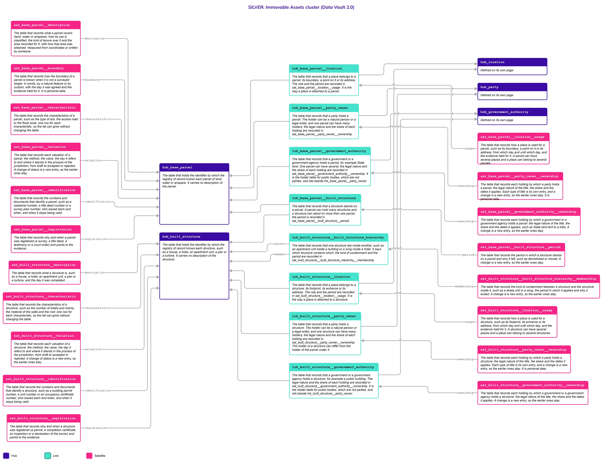
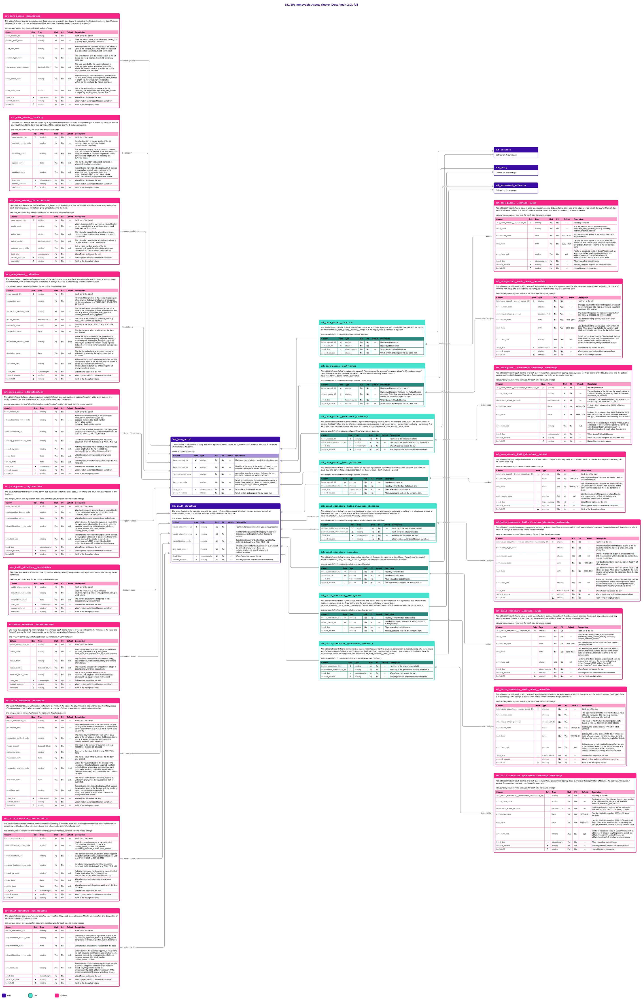

# Immovable Assets

## Header

| **Field** | **Value** |
| --- | --- |
| Object | Immovable Assets |
| Parent object | — |
| Owner domain | Registries |
| Shared with | Taxation Contributions and Licences, Finance, Compliance |
| Scope | Shared |
| Status | Draft |
| Version | 0.1 |
| Last updated | 2026-10-23 |

## Definition

An Immovable Asset is a bounded portion of land, water or airspace, together with the permanent structures on it, over which someone holds a right, a restriction or a responsibility. The State needs to identify it, register who holds it, value it for tax and place it on the map. It groups, without mixing them, the two parts that do not share a life: the [Base Parcel](Base_Parcel.md), which is the bounded portion itself, and the [Built Structure](Built_Structure.md), which is what is built on it and stays.

Immovable Assets is a family, not a place to store attributes. All identification, description, holders and values live in the two specific objects. This page holds what the two share: the rules they follow, the decisions that are open for both, and the one picture of the family.

## Why it is its own object

Tax, Finance and Compliance ask about "an immovable asset" without caring whether the answer is a plot of land or a building on it: a property tax bill, a lien, a valuation roll, an inspection. They should not need to know which part they are looking at, and the rules that apply to both must be written once.

The family is a page and not a Hub. A shared Hub would need a key that Nexus assigns before any source row can load, and every Link would have to look it up. The two parts also have different keys (the cadastre or a customary register for the parcel; a building permit, a unit number or an occupancy certificate for the structure), different lifecycles (a parcel outlives its structures), different holders (the holder of a building can differ from the holder of the land, as in a lease) and different valuations (land and building are valued by different methods and the value of one never includes the other). A Gold view reads both together, as `party__location` does for persons and entities.

## Vault objects

No Vault objects of its own: the objects of this family are defined once, on the pages of its two parts.

| **Page** | **Objects** | **What it holds** |
| --- | --- | --- |
| [Base Parcel](Base_Parcel.md) | 13: the Hub `hub_base_parcel`, 3 Links and 9 Satellites | The parcel of land, water or airspace: its description and area, its boundary in words, its characteristics, its valuations, its identification and registration, and its Links to Location, to Party (holder) and to Government Authority |
| [Built Structure](Built_Structure.md) | 16: the Hub `hub_built_structure`, 5 Links and 10 Satellites | The house, hotel, apartment unit, pier or turbine: its description, characteristics, valuations, identification and registration, its Links to Location, to Party and to Government Authority, the containment of structures inside structures, and the Link that places a structure on a parcel |

`lnk_base_parcel__built_structure` and its Satellite `sat_base_parcel__built_structure__period` say that a structure **stands on** a parcel. They are defined on [Built Structure](Built_Structure.md) and drawn on [Base Parcel](Base_Parcel.md). A parcel can hold many structures and a structure can stand on more than one parcel. `lnk_built_structure__built_structure_hierarchy` says that a structure **lies inside** another: an apartment unit is a structure inside the building, and the building is a structure on the parcel.

**Related pages.** Each part has its own Links to other objects, listed on its page:

- [Location](Location.md): where a parcel or a structure is.
- [Party](Party.md), with [Natural Person](Natural_Person.md) and [Legal Entity](Legal_Entity.md): who holds it.
- Government Authority: a government or a government agency that holds it. It is a Platform object and not a Party; its page is not written yet.
- [Code List](Code_List.md): the values of every `_code` column of the family.

## Fields

*Each part defines its own tables, in the Fields section of its page. These columns follow the same rule on both pages, so a Gold view can read them together.*

| **Column** | **Where it appears** | **What it means** |
| --- | --- | --- |
| `valuation_ref`, `valuation_method_code`, `value_amount`, `currency_code`, `valuation_date`, `valuation_status_code`, `decision_date` | `sat_base_parcel__valuation`, `sat_built_structure__valuation` | One valuation and where it stands in the process of the jurisdiction. `valuation_status_code` is the closed list `draft`, `submitted`, `accepted`, `rejected`, `withdrawn` |
| `trait_code`, `value_text`, `value_number`, `measure_unit_code` | `sat_base_parcel__characteristic`, `sat_built_structure__characteristic` | One characteristic, such as the number of rooms or the material of the walls. The list is open and the Code List says which value column each trait uses |
| `identification_type_code`, `identification_id`, `issuing_jurisdiction_code`, `issued_by_code`, `issue_date` | `sat_base_parcel__identification`, `sat_built_structure__identification` | A number or a document that identifies the asset, such as a cadastral number or a building permit |
| `registration_basis_code`, `registration_date`, `artifact_uri` | `sat_base_parcel__registration`, `sat_built_structure__registration` | Why and when the asset was registered, and the pointer to the evidence |
| `title_type_code`, `ownership_share_percent`, `effective_date`, `end_date` | the four ownership Satellites | The legal nature of a holding, its share and the dates it applies. The list is `immovable_title_type` |
| `role_code` | `sat_base_parcel__location__usage`, `sat_built_structure__location__usage` | How a place is used for the asset. The list is `immovable_asset_location_role` |

## Sources and mapping

No endpoints declared yet

## Jurisdictions map

The cases that cross the two parts. The detail of each is on the page named in the last column.

| **Edge case** | **Where it happens** | **Approach** | **Vault effect** |
| --- | --- | --- | --- |
| Land held by custom, with no survey and no title, with a modern building on it | Pacific jurisdictions such as Samoa, Papua New Guinea and Vanuatu | The parcel is registered on the testimony of the community with a platform-assigned key; the building is registered on its own evidence | `platform_assigned` key and `customary` boundary on [Base Parcel](Base_Parcel.md); `owner_declaration` or `inspection` registration on [Built Structure](Built_Structure.md) |
| A building with many apartment units, each with its own holder (strata title) | Jurisdictions with unit or strata titles | The building is a structure on the parcel and each unit is a structure inside the building, with its own identifier, value and holder | `lnk_built_structure__built_structure_hierarchy` on [Built Structure](Built_Structure.md) |
| A parcel with several structures, or a structure on several parcels | Any jurisdiction | One row in the Link for each combination | `lnk_base_parcel__built_structure` on [Built Structure](Built_Structure.md) |
| The building is held by someone other than the holder of the land | Jurisdictions with leasehold or ground rent | Each has its own holding, through its own Link | `lnk_base_parcel__party_owner` and `lnk_built_structure__party_owner` |
| Land that belongs to the State, to a tribe, or to the State and lent to a tribe | Jurisdictions with State land or tribal land | The government holds through its own Link, the tribe through the Party Link, and the loan is the holding of the tribe, with its own dates | `lnk_base_parcel__government_authority` and `lnk_base_parcel__party_owner` on [Base Parcel](Base_Parcel.md) |
| A parcel is divided or two parcels are merged, or a building is divided or joined | Any jurisdiction | The operation is a fact to track. The new parcels are new Hub rows and the old one ends. How the operation is recorded is open (see Open decisions) | New rows in `hub_base_parcel` or `hub_built_structure` |
| The value is revised on a cycle by a method the jurisdiction sets | Jurisdictions that revalue on a cycle | Each revaluation is a valuation with its own reference and goes through the status process | Rows of the two valuation Satellites |
| Two accepted values for one asset at once | Jurisdictions that allow different values for different purposes, such as tax and insurance | Allowed or not by the jurisdiction. Both are stored; Gold flags an asset with more than one accepted value where it is not allowed | Rows with `accepted` in the valuation Satellites; the check is in Gold |
| A valuation is refused, objected to or taken back | Jurisdictions with an appeal process | The valuation stays on record with its status and never becomes the definitive value | `valuation_status_code` `rejected` or `withdrawn` |
| The area is measured in one jurisdiction and written by someone in another | Jurisdictions with coordinates for every parcel, and jurisdictions where the area is copied from a document | The area keeps how it was obtained | `area_basis_code` on [Base Parcel](Base_Parcel.md) |

## Examples

Illustrative data. One building under strata title on a surveyed parcel in New Zealand, followed from the register to the value.

1. **The parcel.** `P-5501` is a residential parcel of 1250 square metres held in freehold. It is a row of `hub_base_parcel` with a row of `sat_base_parcel__description` (see [Base Parcel](Base_Parcel.md)).
2. **The building and its unit.** `S-100` is a structure on the parcel and `S-100-402` is an apartment unit inside it, with its own unit number and holder (see [Built Structure](Built_Structure.md)). The row of `lnk_base_parcel__built_structure` joins `P-5501` and `S-100`.
3. **The holders.** The parcel is held by a legal entity that manages the building and the unit by a natural person, each through its own Party Link and with its own `title_type_code`.
4. **The values.** The parcel is revalued in 2026: the first draft is refused and a second one is accepted. The unit has its own valuations. The definitive value of the parcel is `435000.00`, from the accepted valuation `REVAL-2026-02`. It is computed in Gold from the valuation rows; the refused valuation stays on record.
5. **The family view.** A Gold view reads the parcel and the building together, so that a property tax bill asks for "the immovable asset `P-5501`" and gets both values and both holders.

## Modeling considerations

- **Two Hubs, no umbrella.** The parcel and the structure each have their own key, lifecycle and holders, so each is its own Hub with its own Links to Location, to Party and to Government Authority. The family has no Hub: a shared key would have to be assigned by Nexus before any source row could load, and every Link would have to look it up.
- **The family is read in Gold.** Views such as `immovable_asset__valuation_definitive` and `immovable_asset__holder` read the two parts together. They are Gold objects (R13) and are not stored.
- **Valuation is a fact with a process.** A value changes with time, and a value is not used until the jurisdiction has accepted it. The Vault stores every valuation with its method, its value, the day it refers to and its status, and a change of status is a new row, so the process stays visible. The rules (which method, which status can follow which, who decides) are values and rules of the Code List, not tables. The definitive value is the Gold view `cur_<part>__valuation_definitive`: the accepted valuation with the latest `valuation_date`. It is a responsibility of the Gold layer and is not stored (R13).
- **Two accepted values are allowed or not by the jurisdiction.** Two processes can each produce a value, for example one for tax and one for insurance, and both are stored. The danger is to believe there is only one and not detect the inconsistency. A Gold check lists the assets with more than one accepted valuation, and the jurisdiction says whether that is allowed.
- **The status list is closed.** `valuation_status_code` is `draft`, `submitted`, `accepted`, `rejected` or `withdrawn`, because logic depends on `accepted`. A jurisdiction that needs another step maps it to one of these or asks to extend the list.
- **The characteristics are an open list.** The number of toilets, the number of rooms, the material of the walls, the type of soil and the like are rows of the characteristic Satellites, not columns. The Code List says for each trait which value column it uses and in which unit, and the load checks the value (Principles, "Traits as rows"). A characteristic that is a fact about an asset and not about a person is not personal data, so there is no in-place twin.
- **Identification and registration are as for a person.** Every parcel and every structure can have documents that identify it and proof of why it was registered. Identifiers are facts, not keys: the business key is the registry's own identifier, so a new title number or permit never changes a key. The registration Satellites keep a pointer to the evidence (Principles, "Evidence is a pointer to one stored object").
- **Ownership is a Link to Party, with its own details.** The holder is a Party, so a person and a company are handled the same way. A government or a government agency is a holder through its own Link to Government Authority, which is a Platform object and not a Party; its Satellites are not personal data. When the State holds land and lends it to a tribe, there are two holdings of the same parcel. A holding by a party is personal data, because the holder can be a person. The legal nature of the title is the Code List `immovable_title_type`, not the list of Legal Entity, because the rights over land differ from the rights over shares.
- **Where Location roles come from.** The roles of a place for an asset (`boundary`, `footprint`, `entrance`, `address`) are the Code List `immovable_asset_location_role`, a list of its own, because the list `location_role` is limited to persons and entities by `party_type_code`.
- **An open end is `9999-12-31`.** The end of a period is `9999-12-31` while it applies, and an unknown start is `1900-01-01` (Principles, "Validity ranges").
- **Codes take their values from the Code List.** Every `_code` column of the family holds values that change without changing logic, except `valuation_status_code`, which is closed.
- **Area, distance and containment in space are not stored.** The area of a shape, the distance between two parcels and whether a structure lies inside a parcel are computed in Gold (R13). The area that someone wrote, in a title or a declaration, is a fact and is stored with `area_basis_code`.
- **Each part says what is only its own.** The shape of a parcel, the boundary by custom and the area are on [Base Parcel](Base_Parcel.md); the containment of structures and the link to the parcel are on [Built Structure](Built_Structure.md).

## Diagram

Two pictures of the family: the two clusters together. Read the simplified one first, then use the full one when you need the columns. Colors: Hub indigo, Link teal, Satellite magenta; a Satellite updated in place is lighter, with a dashed border. Arrows run from the child to its parent. Objects defined on another page are drawn with a note and no table.

### Simplified version

The shape of the family: 2 Hubs, 8 Links and 19 Satellites, each with its name and definition, and the Hubs of Location, Party and Government Authority drawn as defined on other pages. Use it to see how the two parts relate. It has no columns.

### Full version

The same objects, each with its Fields table (column, role, type, null, PII, default, description). Use it to check exactly what is stored. It is wide: zoom in or open the image on its own.

## Open decisions

| **Decision** | **Owner** | **How it is decided** | **Decide by** |
| --- | --- | --- | --- |
| The Government Authority page: its Hub (assumed `hub_government_authority`), its key and who maintains it. The Links of both parts join it | Data Architecture Engineer and Platform | Drafted as a Platform object with its own outline; until then the Hub is drawn as defined elsewhere | Before the first State parcel is loaded |
| Mortgages, easements, caveats and liens: they change the status of an asset, so each needs to be identified with its evidence. The recommended design is a Legal Instrument object: a Hub of the legal documents, one Link to each kind of subject (parcel, structure, movable asset, natural person, legal entity) with its own Satellite, a Link to the parties involved, and a Satellite for the status of the instrument. It is the most efficient because one mortgage over three parcels is one row, the status is tracked once, and the evidence is asked for once | Data Architecture Engineer and Data Product Owner | Drafted as its own page with an outline approved first; the status of an asset under it is a Gold view (R13) | Before the first mapping that needs them |
| How the operations on a parcel or a building are tracked: divide, merge, join. An operation can be a change on the register, or a geographic process that physically cuts or joins the shapes | Data Architecture Engineer and Data Product Owner | Decided with the first jurisdiction that loads a subdivision or a merger; the direction is to record the operation and link the assets before and after it | Before the first subdivision is loaded |
| How a jurisdiction sets up the valuation process: the methods, the allowed changes of status, who decides each, and the data each method needs so that a calculation process can run. A Code List that holds the process and its data requirements, not only the names of the methods | Data Product Owner, Taxation Contributions and Licences and Platform | Designed with the Code List page, from the first jurisdiction that configures a valuation process | When a jurisdiction is configured |
| Which jurisdictions allow more than one accepted value of one asset at a time, so that the Gold check does not flag it | Data Product Owner and Taxation Contributions and Licences | Set for each jurisdiction in the Code List | When a jurisdiction is configured |
