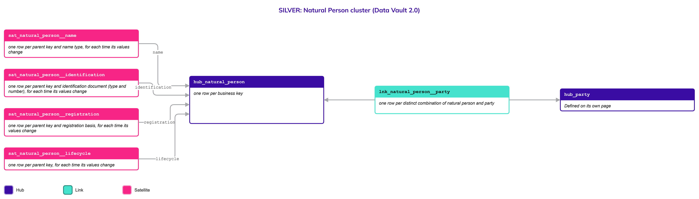
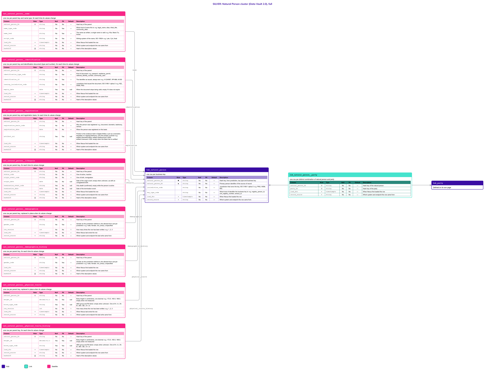

# Business Objects

Every business object of the Public Services Suite (PSS 3.0), one page each. Each page follows the same format, described below, so you know what to expect before you open it.

An object shared by several domains is one page, listed once with every domain it is shared with. Start with [Natural Person](Natural_Person.md): it is the reference page for the format.

| **Object** | **Owner domain** | **Shared with** | **Scope** | **Status** | **Page** |
| --- | --- | --- | --- | --- | --- |
| Party | Registries | Taxation Contributions and Licences, Finance, Benefits, Compliance, AEOI, Platform | Global | Draft | [Party](Party.md) |
| Natural Person | Registries | Taxation Contributions and Licences, Finance, Benefits, Compliance, AEOI | Global | Draft | [Natural Person](Natural_Person.md) |
| Legal Entity | Registries | Taxation Contributions and Licences, Finance, Benefits, Compliance, AEOI | Global | Draft | [Legal Entity](Legal_Entity.md) |

### Platform objects

What the platform owns and every domain uses, such as configuration, has its own place: see [Platform](Platform.md).

| **Object** | **Owner domain** | **Shared with** | **Scope** | **Status** | **Page** |
| --- | --- | --- | --- | --- | --- |
| Code List | Platform | Registries, Taxation Contributions and Licences, Finance, Benefits, Compliance, AEOI | Global | Draft | [Code List](Code_List.md) |
| Load Configuration | Platform | Registries, Taxation Contributions and Licences, Finance, Benefits, Compliance, AEOI | Global | Draft | [Load Configuration](Load_Configuration.md) |

## What every page contains

Eleven sections, always in this order.

| **Section** | **What you will find** | **Read it to** |
| --- | --- | --- |
| **Header** | Object, parent object, owner domain, shared-with domains, scope, status, version, date | Know who owns the object and how settled it is |
| **Definition** | What the object is, in business words, and where its scope ends | Agree on the meaning |
| **Why it is its own object** | The reasons it is not an attribute of another object | Understand the design choice |
| **Vault objects** | The Hubs, Links and Satellites of the object, with the grain and the business key of each | See the whole cluster at a glance |
| **Fields** | One table per vault object: every column with role, type, null, PII, default and description | Know exactly what is stored |
| **Sources and mapping** | The source endpoints declared for the object, or the statement that none are declared yet | Trace where the data comes from |
| **Jurisdictions map** | Edge cases that need a different approach, the jurisdictions where they happen, and the vault effect | See why the model bends for some countries |
| **Examples** | Realistic scenarios shown as sample rows | Follow the model with real-looking data |
| **Modeling considerations** | Rules and traps a modeler must know | Avoid common mistakes |
| **Diagram** | The cluster in two versions: simple and full | See the shape first, then the detail |
| **Open decisions** | What is still undecided, who decides and by when | Know what may still change |

## How to read the header

- **Owner domain** is the one domain that maintains the object. **Shared with** lists the domains that use it.
- **Scope** is **Domain** (used by its owner only), **Shared** (used by several domains) or **Global** (used by every domain).
- **Status** is **Draft** (being written), **Reviewed** (read and commented by the owners) or **Agreed** (approved).

## How to read the Fields tables

Columns: **Column**, **Role**, **Type**, **Null**, **PII**, **Default**, **Description**.

| **Role** | **Meaning** |
| --- | --- |
| ◆ | The object's own hash key |
| ◇ | The hash key of another object (a parent, or a Hub joined by a Link) |
| ● | The business key |
| ▪ | Load metadata: `load_dts` and `record_source` |
| Δ | `hashdiff`, the hash of the descriptive values |
| (empty) | A descriptive column |

- **PII** says whether the column holds personal data. Personal data lives in its own Satellite.
- **Default**: `—` means there is no default and the loader must supply the value; `null` means the column may be empty.
- **Description** of a `_code` column always shows example values (`e.g.` three or more) or the full closed list (`One of`).

## How to read the diagrams

Each page has two pictures: the **simple** one shows each object with its name and grain; the **full** one adds the Fields table of each object.

| **Color** | **Object** |
| --- | --- |
| Indigo `#3A0CA3` | Hub |
| Teal `#45E3CD` | Link |
| Magenta `#F72586` | Satellite |

Arrows run from the child to its parent: a Satellite points to its Hub or Link, and a Link points to the Hubs it joins. The italic line in each box is the grain. Objects defined on another page appear in the picture with a short note and no table.

### Example: Natural Person

The simple version, to see the shape:

The full version, with the Fields table of every object:

## Vault object types and grain

Every vault object states its grain, the meaning of one row, in a fixed form.

| **Type** | **One row means** | **Use it for** |
| --- | --- | --- |
| **Hub** | one row per business key | The identity of a business object |
| **Link** | one row per distinct combination of the Hubs it joins | A relationship between objects |
| **Non-historized Link** | one row per occurrence of an event or transaction | Facts that never change once recorded |
| **Satellite** | one row per parent key, for each time its values change | The descriptive history of a Hub or Link |
| **Satellite with row versioning** | one row per parent key, replaced in place when its values change | Attributes that need no history. Each is delivered with a history twin (`_history`) |

Naming, allowed data types and the rules for changing a grain are in the Principles.
