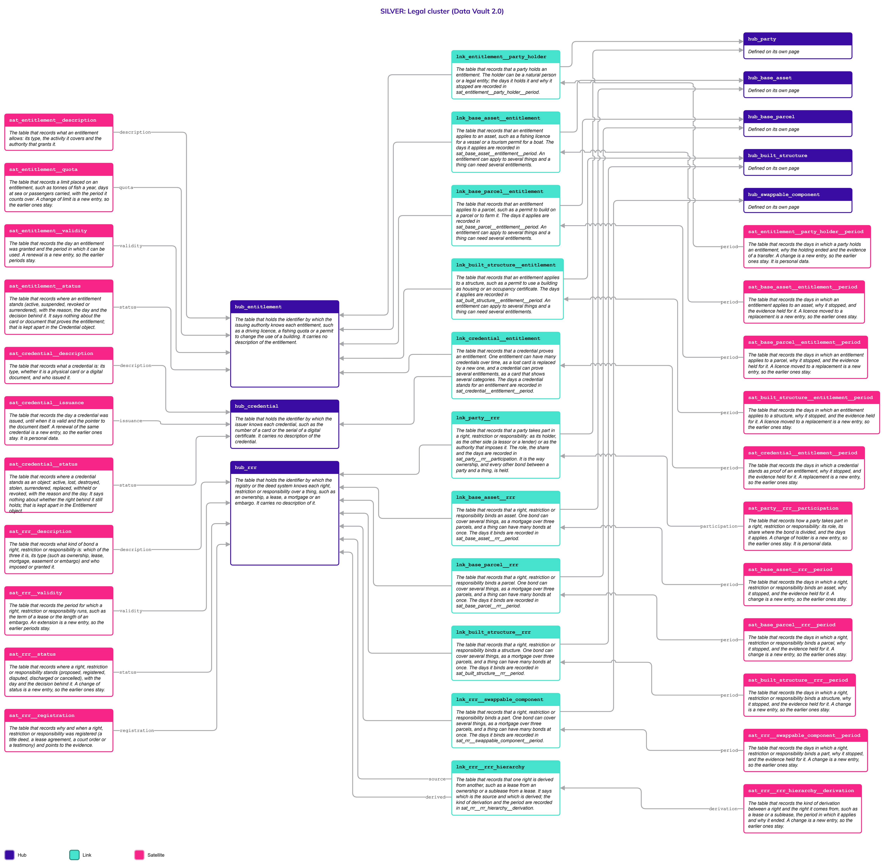
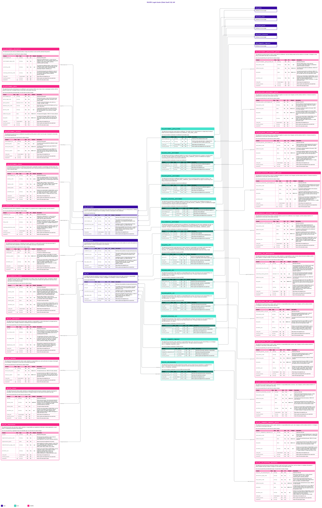

# Legal

## Header

| **Field** | **Value** |
| --- | --- |
| Object | Legal |
| Parent object | — |
| Owner domain | Registries |
| Shared with | Taxation Contributions and Licences, Finance, Compliance |
| Scope | Shared |
| Status | Draft |
| Version | 0.1 |
| Last updated | 2026-10-24 |

## Definition

**Legal** is the **family of objects** that record the legal bond between a Party and the State, or between a Party and a thing. It holds what the government permits, what a person or a company holds over a parcel, a building, a ship or a part, what is forbidden, and what must be done. It groups, without mixing them, **three objects** that older systems keep in **one table** (for example a Licences table): the [Entitlement](Entitlement.md), which is the right to do something; the [Credential](Credential.md), which is the card or document that proves it; and the [RRR](RRR.md), which is the Right, Restriction or Responsibility that binds a Party to a thing.

Legal is a family, not a place to store attributes. The three objects have different lifecycles, keys and owners, and putting them in one table is the mistake this family avoids. This page holds what the three share: the reason they are kept apart, the rules they follow, the decisions that are open for all of them, and the one picture of the family.

## Why it is its own object

Tax, Finance and Compliance ask about "what is this party allowed to do, and what does it hold" without caring which of the three they are looking at. A licence check, a lien search, a property tax bill and a sanctions screening all read across them. The rules that apply to the three must be written once.

The family is a page and not a Hub. The three have different keys, different lifecycles and different holders, so a shared Hub would have to be assigned by Nexus before any source row could load, and every Link would have to look it up. A Gold view reads the three together.

The three are kept apart for reasons that are easy to see in real cases:

| **Object** | **What it is** | **What it governs** | **Example** |
| --- | --- | --- | --- |
| [Entitlement](Entitlement.md) | The right, quota or permission that the State grants to a Party. It is the legal truth, and it exists without any paper | An activity | The right to drive a truck, a quota to fish 10 tonnes of tuna, a permit to use a building as housing, a tax holiday |
| [Credential](Credential.md) | The card, certificate or digital document that proves an Entitlement | The proof | A driving licence card, a PDF permit, a smart card |
| [RRR](RRR.md) | The Right, Restriction or Responsibility that binds a Party to a thing | A thing | Ownership of a parcel, a lease, a mortgage, an embargo on a ship, a duty to clean a river |

- **A proof outlives itself.** If a hurricane destroys a driver's licence card, the Credential is `destroyed` and the Entitlement is still `active`. A replacement card is a new Credential for the same Entitlement, and the history of the original grant is never overwritten.
- **A right and its proof can disagree.** A judge suspends the right to drive and the holder has not yet surrendered the card: the Entitlement is `suspended` and the Credential is `active`. The model must show the real-world difference.
- **An activity and a thing are different subjects.** An Entitlement governs what a Party may do (a business permit); an RRR governs what a Party holds or owes over a thing (ownership, a lien, a mortgage). A single thing has many RRRs at the same time.

## Vault objects

No Vault objects of its own: the objects of this family are defined once, on the pages of its three parts.

| **Page** | **Objects** | **What it holds** |
| --- | --- | --- |
| [Entitlement](Entitlement.md) | 13: the Hub `hub_entitlement`, 4 Links and 8 Satellites | The right to an activity: its type and quota, its validity, its status, its holder, and the Links to the asset, the parcel or the structure it applies to |
| [Credential](Credential.md) | 6: the Hub `hub_credential`, 1 Link and 4 Satellites | The card or document that proves an entitlement: what it is, when it was issued, where it stands as an object, and the Link to the entitlement it proves |
| [RRR](RRR.md) | 17: the Hub `hub_rrr`, 6 Links and 10 Satellites | The right, restriction or responsibility over a thing: its class and type, its validity, its status, its registration, the parties that take part with their roles and shares, the things it binds, and the rights it is derived from |

`lnk_credential__entitlement` and `sat_credential__entitlement__period` say that a credential **proves** an entitlement. They are defined on [Credential](Credential.md) and drawn on [Entitlement](Entitlement.md). `lnk_entitlement__party_holder` says **who may**, and `lnk_party__rrr` says **who takes part** in a bond. The Links to the things (`lnk_base_parcel__entitlement`, `lnk_base_parcel__rrr` and their equivalents for structures, assets and parts) are defined on the page of the Legal object, which is the side that depends on the other, and drawn on the asset pages.

**Related pages.** Each part has its own Links to other objects, listed on its page:

- [Party](Party.md), with [Natural Person](Natural_Person.md) and [Legal Entity](Legal_Entity.md): who holds the bond or the right. A government, a ministry, an agency and a foreign government agency are Legal Entities classified as public.
- [Base Parcel](Base_Parcel.md), [Built Structure](Built_Structure.md), [Base Asset](Base_Asset.md) and [Swappable Component](Swappable_Component.md): the things an RRR binds, and the things an Entitlement applies to.
- [Immovable Assets](Immovable_Assets.md) and [Movable Assets](Movable_Assets.md): the families of those things.
- [Code List](Code_List.md): the values of every `_code` column of the family.

## Fields

*Each part defines its own tables, in the Fields section of its page. These columns follow the same rule on all three pages, so a Gold view can read them together.*

| **Column** | **Where it appears** | **What it means** |
| --- | --- | --- |
| `status_code`, `status_date`, `reason_code`, `artifact_uri` | `sat_entitlement__status`, `sat_credential__status`, `sat_rrr__status` | Where the right, the proof or the bond stands, the day, the reason and the pointer to the decision. Each has its own closed list of statuses, because rules branch on them |
| `valid_from_date`, `valid_to_date` | `sat_entitlement__validity`, `sat_rrr__validity`, `sat_credential__issuance` | The period in which the right, the bond or the credential runs. `valid_to_date` is `9999-12-31` while it has no end |
| `issuing_authority_code`, `imposed_by_code` | `sat_entitlement__description`, `sat_credential__description`, `sat_rrr__description` | The authority that grants or imposes, a value of the list `issuer` that the platform configuration keeps. It is a code and not a Party |
| `participation_role_code`, `ownership_share_percent` | `sat_party__rrr__participation` | How a party takes part in a bond (`holder`, `counterparty`, `authority`) and its share when the bond is divided |
| `rrr_class_code`, `rrr_type_code` | `sat_rrr__description` | Which of right, restriction or responsibility a bond is, and its type. The Code List says which types are ownership |
| `effective_date`, `end_date`, `end_reason_code`, `artifact_uri` | The `__period` Satellites of the Links | The days a Link applies, why it stopped, and the pointer to the evidence |

## Sources and mapping

No endpoints declared yet

## Jurisdictions map

The cases that cross the three parts. The detail of each is on the page named in the last column.

| **Edge case** | **Where it happens** | **Approach** | **Vault effect** |
| --- | --- | --- | --- |
| A card is destroyed and the right stays | Any jurisdiction, in particular after a disaster such as a hurricane | The old Credential is `destroyed`, a new Credential is issued for the same Entitlement, and the Entitlement is not touched | New rows in `hub_credential` and `lnk_credential__entitlement` on [Credential](Credential.md) |
| The right is suspended and the card is still held | Any jurisdiction | The Entitlement is `suspended`, the Credential is `active`, and Gold shows the difference | `sat_entitlement__status` and `sat_credential__status` |
| A vessel needs a licence to fish or to carry tourists | Jurisdictions that license the vessel and not only the operator, including open registries such as the Marshall Islands and Vanuatu | The Entitlement has a holder and a vessel, and it can move to a replacement vessel | `lnk_base_asset__entitlement` on [Entitlement](Entitlement.md) |
| A building changes use, such as from storage to housing | Jurisdictions that require a permit to change the use | The permit is an Entitlement for the structure; the declared use stays on the structure and Gold lists the structures whose use has no active Entitlement | `lnk_built_structure__entitlement`; a Gold view |
| A zoning rule forbids a use | Jurisdictions with land-use planning | The rule restricts the thing, so it is an RRR of the class restriction; a permit that allows the use despite it is an Entitlement | `rrr_class_code` `restriction`; `lnk_base_parcel__rrr` |
| The State owns land, a company leases it, a tribe has a right of way, a bank holds a mortgage, and a company must clean the river | Any jurisdiction | Five RRRs over one parcel, each with its own participation and period; the lease is derived from the State's ownership | Five rows of `hub_rrr` and of `lnk_base_parcel__rrr`; `lnk_rrr__rrr_hierarchy` on [RRR](RRR.md) |
| Land held by custom, with no title | Pacific jurisdictions such as Samoa, Papua New Guinea and Vanuatu | The right is registered on the testimony of the community; the holder is a tribe or community classified as collective | `platform_assigned` key and `customary_testimony` on [RRR](RRR.md) |
| A shared holding: the State and a company, two agencies, or an agency and a foreign agency | Any jurisdiction | Each holder is a participation in an RRR, with its own share; the shares of the ownership RRRs of a thing add up to 100, checked in Gold | `sat_party__rrr__participation` |
| An embargo, a detention or a seizure on a ship | Any jurisdiction | A restriction that binds the asset whoever owns it, imposed by an authority | `lnk_base_asset__rrr`; `rrr_class_code` `restriction` |
| A mortgage or a lien | Any jurisdiction | A restriction with the bank as holder and the borrower as counterparty; the deed is a pointer on the RRR and there is no object for it | `sat_rrr__registration` with `artifact_uri` |

## Examples

Illustrative data. The family followed through four situations. The details and sample rows are on the pages named.

1. **A fishing licence for a vessel.** The authority grants the Entitlement `FL-2026-0141` to a fishing company for the vessel `V-77001`, with a quota of 10 tonnes a year (see [Entitlement](Entitlement.md)).
2. **The card is lost in a hurricane.** `CARD-90011` is `destroyed` and `CARD-90377` is issued for the same Entitlement. The right never changed (see [Credential](Credential.md)).
3. **Five bonds over one parcel.** The State, a mining company, a tribe, a bank and the company again, as a Right, a Right, a Right, a Restriction and a Responsibility (see [RRR](RRR.md)).
4. **A building moves from storage to housing.** The structure is declared as housing. The planning authority grants an Entitlement for it. The Gold view that compares the declared use with the active Entitlements stops flagging it.

## Modeling considerations

- **Three objects, no umbrella.** The right, the proof and the bond each have their own key, lifecycle and holders, so each is its own Hub. The family has no Hub, because a shared key would have to be assigned by Nexus before any source row could load.
- **Activity or thing.** An Entitlement governs an activity and an RRR governs a thing. A document that does both, such as a lease with a permitted use, is two rows, one in each.
- **The family is read in Gold.** Views such as `entitlement__credential_discrepancy`, `rrr__ownership_share_check`, `immovable_asset__holder` and `asset__use_without_entitlement` read the parts together. They are Gold objects (R13) and are not stored.
- **Ownership is an RRR.** The ownership Links and Satellites of the asset pages are gone. An owner takes part in an RRR through `lnk_party__rrr`, with the role `holder`, and the Code List says which RRR types are ownership.
- **An authority is configuration, not a Party.** The public body that grants an Entitlement or imposes a restriction is a code of the platform configuration. A public body that holds a right or pays a tax is a Legal Entity classified as public and takes part like any Party.
- **Documents are pointers.** A deed, a lease, a mortgage, a court order, a licence document or a decision is one stored object in Digital Artifact. Only the pointer `artifact_uri` is kept. There is no Legal Instrument object.
- **Time is explicit.** The status of each object is a closed list and each change is a new row. Whether a right, a bond or a credential is valid today is worked out in Gold from the status and the period (R13).
- **Personal data follows the holder.** A bond or a right held by a person says something about that person. The rows of holders are marked personal data, and how the rows of public bodies are made readable is open (see Open decisions).
- **Codes take their values from the Code List.** Every `_code` column of the family holds values that change without changing logic, except the closed lists written in the Descriptions.
- **Each part says what is only its own.** The quota and the holder are on [Entitlement](Entitlement.md); the card and its status on [Credential](Credential.md); the roles, shares and derived rights on [RRR](RRR.md).

## Diagram

Two pictures of the family: the three clusters together. Read the simplified one first, then use the full one when you need the columns. Colors: Hub indigo, Link teal, Satellite magenta; a Satellite updated in place is lighter, with a dashed border. Arrows run from the child to its parent. Objects defined on another page are drawn with a note and no table.

### Simplified version

The shape of the family: 3 Hubs, 11 Links and 22 Satellites, each with its name and definition, and the Hubs of Party and of the things drawn as defined on other pages. Use it to see how the three parts relate. It has no columns.

### Full version

The same objects, each with its Fields table (column, role, type, null, PII, default, description). Use it to check exactly what is stored. It is wide: zoom in or open the image on its own.

## Open decisions

| **Decision** | **Owner** | **How it is decided** | **Decide by** |
| --- | --- | --- | --- |
| Whether the Legal family is the home of a restriction placed on a Party (a guardianship, a pledge of shares), or those stay on the Natural Person and Legal Entity pages | Data Architecture Engineer and Data Product Owner | Decided when the first such restriction is mapped | Before the first mapping that needs it |
| How the rows of public holders are made readable without the clearance for personal data: row-level access on the class `public` of the criterion `sector`, or a Gold view of the public holdings | Platform | Decided with the access rules of the platform | Before the first public holding is loaded |
| Which RRR types are ownership, which are rights over another's property, and which jurisdiction uses which; the same for the types of Entitlement | Data Product Owner and Taxation Contributions and Licences | Set as values of the Code List, by jurisdiction | When a jurisdiction is configured |
| How customary and communal holders (a tribe, a clan, a family, a community) are classified when the law does not treat them as a legal person. The research on the Caribbean, Oceania, Africa and the wider Americas will feed this | Data Product Owner and Data Architecture Engineer | Decided from the country research, with local experts | Before the first customary jurisdiction is configured |
| The order and rules by which an RRR derived from another ends when its source ends, such as a lease when the ownership is divided | Data Architecture Engineer and Data Product Owner | Decided with the first jurisdiction that loads a chain of rights | Before the first chain is loaded |
