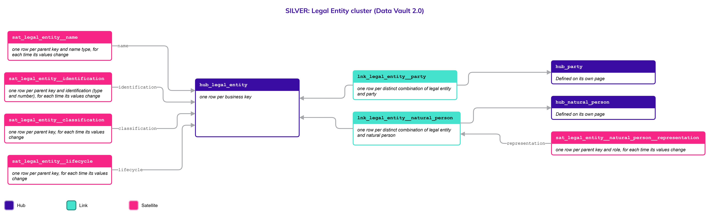
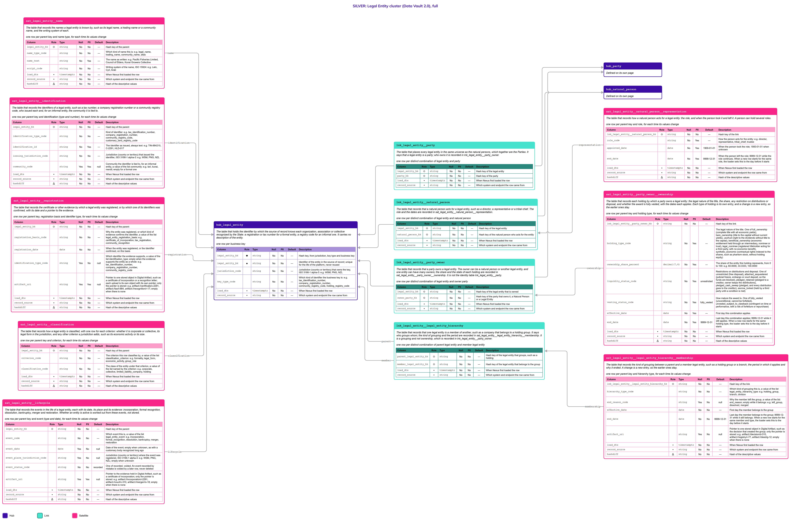

# Legal Entity

## Header

| **Field** | **Value** |
| --- | --- |
| Object | Legal Entity |
| Parent object | Party |
| Owner domain | Registries |
| Shared with | Taxation Contributions and Licences, Finance, Benefits, Compliance, AEOI |
| Scope | Global |
| Status | Draft |
| Version | 0.1 |
| Last updated | 2026-10-22 |

## Definition

A **Legal Entity** is a **non-human organization**, association or collective recognized by the State that holds rights, assumes legal responsibilities, conducts economic activities or interacts with government services.

It supports two variations of the same object. A **corporate (formal)** entity is a legally incorporated body such as a limited liability company, a multinational corporation, a state-owned enterprise or a formally registered NGO, with an official charter, a governance structure and a Tax Identification Number or Company Registration Number. A **collective (informal)** entity is a group recognized by social, cultural or customary law rather than corporate law, such as a tribal authority, an indigenous council, a family farming collective or an informal market vendor association. The State registers it to allocate resources, such as agricultural subsidies, or to grant land rights, such as customary tenure, even when it has no formal corporate paperwork.

A Legal Entity can also be a **public body**: the State itself, a ministry, an agency, a local authority, or the government agency of a foreign State. It is classified as `public` in the criterion `sector`, a company is `private`, and both are the same object with the same identifiers, registration, hierarchy, holdings and tax obligations. What differs is the rules that apply and who may read the rows, which are classification rules in the Code List and access rules of the platform, not tables. The body that acts on the platform (issues credentials, approves, restricts) is platform configuration and is not this object.

A Legal Entity can also be a **holding**: an entity that groups other Legal Entities. Today the grouping is administrative, a decision or a registration that puts entities in one group, and not a statement about who owns whom. A holding has an identifier of its own, like any other Legal Entity, and a group can sit inside another group, to a depth that is set as a rule and not built into the tables.

## Why it is its own object

- **It is identified differently from a Natural Person.** A formal entity has a tax or company registration number. An informal one may have only a government-issued registry code tied to a village or to a community leader. Both are valid business keys of the one Hub. A Natural Person can exist with no identifier at all, so the two cannot share an identification structure.
- **Its lifecycle is administrative.** A Legal Entity is created by an act (incorporation, formal recognition) and can exist indefinitely. It ends by legal dissolution, bankruptcy or merger, never by a biological event.
- **It nests without limit.** A Legal Entity can own other Legal Entities, and it is linked to the Natural Persons who act for it: representatives, directors or tribal chiefs.
- **A holding is a Legal Entity, not a new object.** It has a name, identifiers, a lifecycle and a classification like any entity. A second Hub for groups would copy all of that and would still need a way to nest.
- **Two variations are one object.** A tribal authority and a limited company both hold rights and responsibilities toward the State. The difference is a scenario of the same object (R7), not a second object.

If a Legal Entity were a Satellite of Party, every Satellite of Party would have to carry two identification structures, and the entity's own hierarchy would have nowhere to attach.

## Vault objects

| **Type** | **Name** | **Definition** | **Grain** | **Business key** |
| --- | --- | --- | --- | --- |
| Hub | `hub_legal_entity` | The table that holds the **identifier** by which the source of record knows each organization, association or collective recognized by the State: a registration or tax number for a formal entity, a registry code for an informal one. It **carries no description** of the entity. | one row per business key | `legal_entity_bk`: the identifier of the entity in the source of record, set in the platform configuration. It is usually a registration or tax number for a formal entity and a registry code for an informal one. It is assigned once, never changed and never reused, so it stays unique for the life of the platform, and it is sized for every entity the State will ever register. It cannot collide with a Natural Person, which has its own Hub and its own keys |
| Link | `lnk_legal_entity__party` | The table that places every **legal entity** in the same universe as the natural persons, which together are the **Parties**. It says that a legal entity is a party; who owns it is recorded in `lnk_legal_entity__party_owner`. | one row per distinct combination of legal entity and party | `hub_legal_entity`, `hub_party` |
| Link | `lnk_legal_entity__natural_person` | The table that records that a natural person **acts for** a legal entity, such as a director, a representative or a tribal chief. The **role and the dates** are recorded in `sat_legal_entity__natural_person__representation`. | one row per distinct combination of legal entity and natural person | `hub_legal_entity`, `hub_natural_person` |
| Link | `lnk_legal_entity__party_owner` | The table that records that a party **owns a legal entity**. The owner can be a natural person or another legal entity, and one entity can have many owners; the share and the state of each holding are recorded in `sat_legal_entity__party_owner__ownership`. It is **not the identity table** `lnk_legal_entity__party`. | one row per distinct combination of legal entity and owner party | `hub_legal_entity`, `hub_party` (owner) |
| Link | `lnk_legal_entity__legal_entity_hierarchy` | The table that records that one legal entity is a **member of another**, such as a company that belongs to a holding group. It says who groups whom; the kind of grouping and the period are recorded in `sat_legal_entity__legal_entity_hierarchy__membership`. It is a grouping and **not ownership**, which is recorded in `lnk_legal_entity__party_owner`. | one row per distinct combination of parent legal entity and member legal entity | `hub_legal_entity` (parent), `hub_legal_entity` (member) |
| Satellite | `sat_legal_entity__name` | The table that records the **names** a legal entity is known by, such as its legal name, a trading name or a community name, and the **writing system** of each. | one row per parent key and name type, for each time its values change | — |
| Satellite | `sat_legal_entity__identification` | The table that records the **identifiers** of a legal entity, such as a tax number, a company registration number or a community registry code, **who issued each** and, for an informal entity, the community it is tied to. | one row per parent key and identification (type and number), for each time its values change | — |
| Satellite | `sat_legal_entity__registration` | The table that records the **certificate or other evidence** by which a legal entity was registered, or by which one of its identifiers was confirmed, with its date and a **pointer to the evidence**. | one row per parent key, registration basis and identifier type, for each time its values change | — |
| Satellite | `sat_legal_entity__classification` | The table that records how a legal entity is **classified**, with one row for **each criterion**: whether it is corporate or collective, whether it is private or public, its legal form in the jurisdiction, and any other criterion a jurisdiction adds, such as its economic activity or its size. | one row per parent key and criterion, for each time its values change | — |
| Satellite | `sat_legal_entity__lifecycle` | The table that records the **events in the life** of a legal entity, each with its date, its place and its evidence: incorporation, formal recognition, dissolution, bankruptcy, merger and restoration. Whether an entity is active is worked out from these events, **not stored**. | one row per parent key and event (type and date), for each time its values change | — |
| Satellite | `sat_legal_entity__natural_person__representation` | The table that records how a natural person **acts for** a legal entity: the role, and when the person took it and left it. A person can hold **several roles**. | one row per parent key and role, for each time its values change | — |
| Satellite | `sat_legal_entity__legal_entity_hierarchy__membership` | The table that records the **kind of grouping** between a parent and a member legal entity, such as a holding group or a branch, the period in which it applies and why it ended. A change is a new entry, so the **earlier ones stay**. | one row per parent key and hierarchy type, for each time its values change | — |
| Satellite | `sat_legal_entity__party_owner__ownership` | The table that records **each holding** by which a party owns a legal entity: the legal nature of the title, the share, any restriction on distributions or disposal, and whether the award is fully vested, with the dates each applies. Each type of holding is its own entry, and a change is a new entry, so the **earlier ones stay**. | one row per parent key and holding type, for each time its values change | — |

The hash key `legal_entity_hk` is computed from `jurisdiction_code`, `key_type_code` and the normalized `legal_entity_bk`, joined with a fixed separator. Normalization: trimmed, case-folded, Unicode-normalized. The hash algorithm is a platform decision and is not named here. Satellites carry only the parent's hash key.

`lnk_legal_entity__legal_entity_hierarchy` says that a Legal Entity **belongs to** another: it joins the Hub to itself, the **parent** (the holding) and the **member**. It is a grouping, not ownership. See Modeling considerations for what changes if the grouping comes to mean control.

`lnk_legal_entity__party` says that a Legal Entity **is** a Party: each Legal Entity has exactly one. `lnk_legal_entity__party_owner` says that a Party **owns** a Legal Entity: it is a different relationship, with its own rows, and one Legal Entity can have many owners. The owner is any Party, so it can be a Natural Person or another Legal Entity.

## Fields

*Indicators in Role: ◆ own hash key · ◇ hash key of another object · ● business key · ▪ load metadata · Δ hashdiff. Default: — means no default, so the loader must supply the value; a literal is a default in the sense of Iceberg format version 3. Code List: `List` — the values are a list of the Code List object and the column has a row in the table of the Code List page; `Closed` — a closed list, written in the Description as One of; `—` — the column is not a code.*

### hub_legal_entity

| **Column** | **Role** | **Type** | **Null** | **PII** | **Default** | **Code List** | **Description** |
| --- | --- | --- | --- | --- | --- | --- | --- |
| `legal_entity_hk` | ◆ | `string` | No | No | — | — | Hash key, from jurisdiction, key type and business key |
| `legal_entity_bk` | ● | `string` | No | No | — | — | Identifier of the entity in the source of record; unique for the life of the platform, never reused |
| `jurisdiction_code` |  | `string` | No | No | — | List | Jurisdiction (country or territory) that owns the key, ISO 3166-1 alpha-3: e.g. `WSM`, `PNG`, `NZL` |
| `key_type_code` |  | `string` | No | No | — | List | Which kind of identifier the business key is: e.g. `tax_identification_number`, `company_registration_number`, `community_registry_code`, `holding_registry_code` |
| `load_dts` | ▪ | `timestamptz` | No | No | — | — | When Nexus first loaded the row |
| `record_source` | ▪ | `string` | No | No | — | — | Which system and endpoint the row came from |

### lnk_legal_entity__party

| **Column** | **Role** | **Type** | **Null** | **PII** | **Default** | **Code List** | **Description** |
| --- | --- | --- | --- | --- | --- | --- | --- |
| `legal_entity_hk` | ◇ | `string` | No | No | — | — | Hash key of the legal entity |
| `party_hk` | ◇ | `string` | No | No | — | — | Hash key of the party |
| `load_dts` | ▪ | `timestamptz` | No | No | — | — | When Nexus first loaded the row |
| `record_source` | ▪ | `string` | No | No | — | — | Which system and endpoint the row came from |

### lnk_legal_entity__natural_person

| **Column** | **Role** | **Type** | **Null** | **PII** | **Default** | **Code List** | **Description** |
| --- | --- | --- | --- | --- | --- | --- | --- |
| `legal_entity_hk` | ◇ | `string` | No | No | — | — | Hash key of the legal entity |
| `natural_person_hk` | ◇ | `string` | No | No | — | — | Hash key of the natural person who acts for the entity |
| `load_dts` | ▪ | `timestamptz` | No | No | — | — | When Nexus first loaded the row |
| `record_source` | ▪ | `string` | No | No | — | — | Which system and endpoint the row came from |

### sat_legal_entity__name

| **Column** | **Role** | **Type** | **Null** | **PII** | **Default** | **Code List** | **Description** |
| --- | --- | --- | --- | --- | --- | --- | --- |
| `legal_entity_hk` | ◇ | `string` | No | No | — | — | Hash key of the parent |
| `name_type_code` |  | `string` | No | No | — | List | Which kind of name this is: e.g. `legal_name`, `trading_name`, `community_name`, `alias` |
| `name_text` |  | `string` | No | Yes | — | — | The name as written: e.g. `Pacific Fisheries Limited`, `Council of Elders`, `Kunai Growers Collective` |
| `script_code` |  | `string` | No | No | — | List | Writing system of the name, ISO 15924: e.g. `Latn`, `Cyrl`, `Arab` |
| `load_dts` | ▪ | `timestamptz` | No | No | — | — | When Nexus first loaded the row |
| `record_source` | ▪ | `string` | No | No | — | — | Which system and endpoint the row came from |
| `hashdiff` | Δ | `string` | No | No | — | — | Hash of the descriptive values |

### sat_legal_entity__identification

| **Column** | **Role** | **Type** | **Null** | **PII** | **Default** | **Code List** | **Description** |
| --- | --- | --- | --- | --- | --- | --- | --- |
| `legal_entity_hk` | ◇ | `string` | No | No | — | — | Hash key of the parent |
| `identification_type_code` |  | `string` | No | No | — | List | Kind of identifier: e.g. `tax_identification_number`, `company_registration_number`, `community_registry_code`, `customary_land_registry_code` |
| `identification_id` |  | `string` | No | Yes | — | — | The identifier as issued, always text: e.g. `TIN-884210`, `C-2291`, `HLD-017` |
| `issuing_jurisdiction_code` |  | `string` | No | No | — | List | Jurisdiction (country or territory) that issued the identifier, ISO 3166-1 alpha-3: e.g. `WSM`, `PNG`, `NZL` |
| `community_code` |  | `string` | Yes | Yes | null | List | Community the identifier is tied to, for an informal entity, a value of the list `community`: e.g. `tari`, `kunai`, `mendi`; empty for a formal one |
| `load_dts` | ▪ | `timestamptz` | No | No | — | — | When Nexus first loaded the row |
| `record_source` | ▪ | `string` | No | No | — | — | Which system and endpoint the row came from |
| `hashdiff` | Δ | `string` | No | No | — | — | Hash of the descriptive values |

### sat_legal_entity__registration

| **Column** | **Role** | **Type** | **Null** | **PII** | **Default** | **Code List** | **Description** |
| --- | --- | --- | --- | --- | --- | --- | --- |
| `legal_entity_hk` | ◇ | `string` | No | No | — | — | Hash key of the parent |
| `registration_basis_code` |  | `string` | No | No | — | List | Why the entity was registered, or which kind of evidence confirms the identifier, a value of the list `legal_entity_registration_basis`: e.g. `certificate_of_incorporation`, `tax_registration`, `community_recognition` |
| `registration_date` |  | `date` | No | No | — | — | When the entity was registered, or the identifier confirmed, on this basis |
| `identification_type_code` |  | `string` | Yes | No | null | List | Which identifier the evidence supports, a value of the list `identification_type`; empty when the evidence supports the entity as a whole: e.g. `tax_identification_number`, `company_registration_number`, `community_registry_code` |
| `artifact_uri` |  | `string` | Yes | Yes | null | — | Pointer to one stored object in Digital Artifact, such as a certificate of incorporation or a recognition letter; each upload is its own object with its own pointer; only the pointer is stored: e.g. `artifact://certificate/c-2291`, `artifact://tax/t-884`, `artifact://recognition/r-17`; empty when there is none |
| `load_dts` | ▪ | `timestamptz` | No | No | — | — | When Nexus first loaded the row |
| `record_source` | ▪ | `string` | No | No | — | — | Which system and endpoint the row came from |
| `hashdiff` | Δ | `string` | No | No | — | — | Hash of the descriptive values |

### sat_legal_entity__classification

A legal entity can be classified by several criteria at once, and each criterion is its own row: the entity is `corporate` by formality and a `limited_liability_company` by legal form, and a jurisdiction can add `economic_activity` or `size` with no change of table. A new criterion is a new value of the list `classification_criterion`, and the classes of each criterion are the values of a list of their own (Principles, "Traits as rows").

| **Column** | **Role** | **Type** | **Null** | **PII** | **Default** | **Code List** | **Description** |
| --- | --- | --- | --- | --- | --- | --- | --- |
| `legal_entity_hk` | ◇ | `string` | No | No | — | — | Hash key of the parent |
| `criterion_code` |  | `string` | No | No | — | List | The criterion this row classifies by, a value of the list `classification_criterion`: e.g. `formality`, `legal_form`, `sector`, `economic_activity` |
| `classification_code` |  | `string` | No | No | — | List | The class of the entity under that criterion, a value of the list named by the criterion: e.g. `corporate`, `public`, `limited_liability_company`, `holding` |
| `load_dts` | ▪ | `timestamptz` | No | No | — | — | When Nexus first loaded the row |
| `record_source` | ▪ | `string` | No | No | — | — | Which system and endpoint the row came from |
| `hashdiff` | Δ | `string` | No | No | — | — | Hash of the descriptive values |

### sat_legal_entity__lifecycle

One row for each event in the life of a legal entity, built as `sat_natural_person__lifecycle` is (Principles, "Events as rows"). A new kind of event is a new value of the Code List `legal_entity_event`. Whether an entity is active is not stored: the Gold view `cur_legal_entity__status` works it out from the events in date order.

| **Column** | **Role** | **Type** | **Null** | **PII** | **Default** | **Code List** | **Description** |
| --- | --- | --- | --- | --- | --- | --- | --- |
| `legal_entity_hk` | ◇ | `string` | No | No | — | — | Hash key of the parent |
| `event_code` |  | `string` | No | No | — | List | Which event this is, a value of the list `legal_entity_event`: e.g. `incorporation`, `formal_recognition`, `dissolution`, `bankruptcy`, `merger`, `restoration` |
| `event_date` |  | `date` | Yes | No | null | — | Date of the event; empty when unknown, as with a customary body recognized long ago |
| `event_place_jurisdiction_code` |  | `string` | Yes | No | null | List | Jurisdiction (country or territory) where the event was registered, ISO 3166-1 alpha-3: e.g. `WSM`, `PNG`, `NZL`; empty when unknown |
| `event_status_code` |  | `string` | No | No | `recorded` | Closed | One of `recorded`, `voided`. An event recorded by mistake is voided by a later row, never deleted |
| `artifact_uri` |  | `string` | Yes | Yes | null | — | Pointer to the evidence held in Digital Artifact, such as a certificate of incorporation; only the pointer is stored: e.g. `artifact://incorporation/i-2291`, `artifact://court/c-310`, `artifact://merger/m-18`; empty when there is none |
| `load_dts` | ▪ | `timestamptz` | No | No | — | — | When Nexus first loaded the row |
| `record_source` | ▪ | `string` | No | No | — | — | Which system and endpoint the row came from |
| `hashdiff` | Δ | `string` | No | No | — | — | Hash of the descriptive values |

### sat_legal_entity__natural_person__representation

| **Column** | **Role** | **Type** | **Null** | **PII** | **Default** | **Code List** | **Description** |
| --- | --- | --- | --- | --- | --- | --- | --- |
| `lnk_legal_entity__natural_person_hk` | ◇ | `string` | No | No | — | — | Hash key of the link |
| `role_code` |  | `string` | No | Yes | — | List | How the person acts for the entity: e.g. `director`, `representative`, `tribal_chief`, `trustee` |
| `appointed_date` |  | `date` | No | Yes | `1900-01-01` | — | When the person took the role; `1900-01-01` when unknown |
| `end_date` |  | `date` | No | Yes | `9999-12-31` | — | When the person left the role; `9999-12-31` while the role continues. When a new row starts for the same role, the loader sets this to the day before it starts |
| `load_dts` | ▪ | `timestamptz` | No | No | — | — | When Nexus first loaded the row |
| `record_source` | ▪ | `string` | No | No | — | — | Which system and endpoint the row came from |
| `hashdiff` | Δ | `string` | No | No | — | — | Hash of the descriptive values |

### lnk_legal_entity__party_owner

| **Column** | **Role** | **Type** | **Null** | **PII** | **Default** | **Code List** | **Description** |
| --- | --- | --- | --- | --- | --- | --- | --- |
| `legal_entity_hk` | ◇ | `string` | No | No | — | — | Hash key of the legal entity that is owned |
| `owner_party_hk` | ◇ | `string` | No | No | — | — | Hash key of the party that owns it, a Natural Person or a Legal Entity |
| `load_dts` | ▪ | `timestamptz` | No | No | — | — | When Nexus first loaded the row |
| `record_source` | ▪ | `string` | No | No | — | — | Which system and endpoint the row came from |

### sat_legal_entity__party_owner__ownership

One Satellite holds the three dimensions of an ownership, so a change in any of them is one new row. Each holding type is its own row: an owner can hold the bare ownership of one share and the usufruct of another over the same entity.

| **Column** | **Role** | **Type** | **Null** | **PII** | **Default** | **Code List** | **Description** |
| --- | --- | --- | --- | --- | --- | --- | --- |
| `lnk_legal_entity__party_owner_hk` | ◇ | `string` | No | No | — | — | Hash key of the link |
| `holding_type_code` |  | `string` | No | Yes | — | Closed | The legal nature of the title. One of `full_ownership` (complete title with all economic yields), `bare_ownership` (title to the capital without current yields), `usufruct` (right to the dividends without title to the capital), `beneficial_ownership` (economic entitlement held through an intermediary, nominee or trust), `legal_nominee` (registered titleholder acting for a third party, with no economic benefit), `synthetic_economic` (contractual rights indexed to the shares, such as phantom stock, without holding equity) |
| `ownership_share_percent` |  | `decimal(7,4)` | No | Yes | — | — | The share of the entity this holding represents, from 0 to 100: e.g. `60.0000`, `33.3333`, `100.0000` |
| `liquidity_status_code` |  | `string` | No | Yes | `unrestricted` | Closed | Restrictions on distributions and disposal. One of `unrestricted` (free disposal), `attached_sequestered` (judicial freeze, embargo or court deposit, so the funds are blocked), `pledged_retained` (pledged to a creditor, owner keeps the distributions), `pledged_cash_sweep` (pledged, and every distribution goes to the creditor), `escrow_locked` (held by a third party until a condition is met) |
| `vesting_status_code` |  | `string` | No | Yes | `fully_vested` | Closed | How mature the award is. One of `fully_vested` (unconditional, cannot be forfeited), `unvested_subject_to_clawback` (contingent on time or performance, with a risk of forfeiture or repurchase) |
| `effective_date` |  | `date` | No | Yes | — | — | First day this combination applies |
| `end_date` |  | `date` | No | Yes | `9999-12-31` | — | Last day this combination applies; `9999-12-31` while it still applies. When a new row starts for the same holding type, the loader sets this to the day before it starts |
| `load_dts` | ▪ | `timestamptz` | No | No | — | — | When Nexus first loaded the row |
| `record_source` | ▪ | `string` | No | No | — | — | Which system and endpoint the row came from |
| `hashdiff` | Δ | `string` | No | No | — | — | Hash of the descriptive values |

### lnk_legal_entity__legal_entity_hierarchy

A grouping between two Legal Entities. The **parent** is the entity that groups, such as a holding, and the **member** is the entity that belongs to it. Both are rows of `hub_legal_entity`. A member can itself be a parent, so a group can sit inside another group.

| **Column** | **Role** | **Type** | **Null** | **PII** | **Default** | **Code List** | **Description** |
| --- | --- | --- | --- | --- | --- | --- | --- |
| `parent_legal_entity_hk` | ◇ | `string` | No | No | — | — | Hash key of the legal entity that groups, such as a holding |
| `member_legal_entity_hk` | ◇ | `string` | No | No | — | — | Hash key of the legal entity that belongs to the group |
| `load_dts` | ▪ | `timestamptz` | No | No | — | — | When Nexus first loaded the row |
| `record_source` | ▪ | `string` | No | No | — | — | Which system and endpoint the row came from |

### sat_legal_entity__legal_entity_hierarchy__membership

The kind of grouping, its period and the reason it ended are one fact, so they share a Satellite. The kind of grouping is part of the grain: a member can belong to a holding group and, at the same time, be a branch in another hierarchy. Within one kind, a member has at most one open row (see Modeling considerations).

| **Column** | **Role** | **Type** | **Null** | **PII** | **Default** | **Code List** | **Description** |
| --- | --- | --- | --- | --- | --- | --- | --- |
| `lnk_legal_entity__legal_entity_hierarchy_hk` | ◇ | `string` | No | No | — | — | Hash key of the link |
| `hierarchy_type_code` |  | `string` | No | No | — | List | Which kind of grouping this is, a value of the list `legal_entity_hierarchy_type`: e.g. `holding_group`, `branch`, `division`, `government_department` |
| `end_reason_code` |  | `string` | Yes | No | null | List | Why the member left the group, a value of the list `end_reason`; empty while it belongs: e.g. `left_group`, `dissolved`, `merged` |
| `effective_date` |  | `date` | No | No | — | — | First day the member belongs to the group |
| `end_date` |  | `date` | No | No | `9999-12-31` | — | Last day the member belongs to the group; `9999-12-31` while it still belongs. When a new row starts for the same member and type, the loader sets this to the day before it starts |
| `artifact_uri` |  | `string` | Yes | No | null | — | Pointer to one stored object in Digital Artifact, such as the decision that created the group; only the pointer is stored: e.g. `artifact://decision/d-310`, `artifact://registry/r-77`, `artifact://deed/g-12`; empty when there is none |
| `load_dts` | ▪ | `timestamptz` | No | No | — | — | When Nexus first loaded the row |
| `record_source` | ▪ | `string` | No | No | — | — | Which system and endpoint the row came from |
| `hashdiff` | Δ | `string` | No | No | — | — | Hash of the descriptive values |

## Sources and mapping

No endpoints declared yet

## Jurisdictions map

| **Edge case** | **Where it happens** | **Approach** | **Vault effect** |
| --- | --- | --- | --- |
| Formal company with a tax or company registration number | Any jurisdiction with company law | The number is the business key; the key type says which number it is | `hub_legal_entity` with `key_type_code` `tax_identification_number` or `company_registration_number`; `criterion_code` `formality` with `classification_code` `corporate` in `sat_legal_entity__classification` |
| Tribal authority, indigenous council or family farming collective with no corporate paperwork | Papua New Guinea and other customary-law communities | The entity is registered under a government-issued registry code tied to a village or a leader (R7: a scenario of the same object) | `hub_legal_entity` with `key_type_code` `community_registry_code`; `formality` is `collective`; `community_code` in `sat_legal_entity__identification` |
| An entity whose existence or identifier is confirmed by a certificate, a tax registration or a recognition letter | Any jurisdiction | Each piece of evidence is a row with its basis, its date and a pointer to the stored document; a renewed certificate is a new row | `sat_legal_entity__registration` |
| Informal market vendor association | Emerging-economy jurisdictions | Registered so the State can allocate resources such as subsidies | Same as a collective |
| Customary land tenure held by a community | Papua New Guinea | The holder is a Legal Entity; the land right itself is a Legal object | `hub_legal_entity`; nothing on this object for the right |
| A holding that groups entities for administration, such as reporting or supervision, with no ownership between them | Any jurisdiction with groups of entities under one administrative decision | The holding is a Legal Entity with its own identifier; each member is a row of the grouping, with the dates it applies (R7: a scenario of the same object) | `lnk_legal_entity__legal_entity_hierarchy` and `sat_legal_entity__legal_entity_hierarchy__membership` with `hierarchy_type_code` `holding_group`; the holding is classified with `criterion_code` `group_role` and `classification_code` `holding` |
| A group inside a group, and later a third level | Any jurisdiction whose groups grow | The same Link is used again; the depth is a rule of the hierarchy type, so a new level changes a setting and no table | Rows of `lnk_legal_entity__legal_entity_hierarchy`; `max_depth_count` of the hierarchy type in `sat_code_value__validation` |
| A member that belongs to a holding group and is also a branch of another entity | Any jurisdiction with branches or divisions | Each kind of grouping is its own hierarchy, so a member has one open row for each kind | Rows with different `hierarchy_type_code` in `sat_legal_entity__legal_entity_hierarchy__membership` |
| Entity that owns other entities, or is owned by persons | Any jurisdiction with corporate groups | Each entity is its own Hub row; the owner is a Party, so a person and a company are handled the same way | `lnk_legal_entity__party_owner` and `sat_legal_entity__party_owner__ownership` |
| Title split between two holders (bare ownership and usufruct) | Any jurisdiction | Each title is its own holding, with its own share | Two rows in `sat_legal_entity__party_owner__ownership`, one for each holding type |
| Shares held through a nominee, a trust or an intermediary | Any jurisdiction with fiscal transparency rules | The registered holder and the beneficiary are two owners with different holding types | Rows with `legal_nominee` and `beneficial_ownership` |
| Shares pledged, frozen by a court or held in escrow | Any jurisdiction | The restriction is a status of the holding, not a second object; when it ends, a new row is added | `liquidity_status_code` in `sat_legal_entity__party_owner__ownership` |
| Award that is not yet vested | Any jurisdiction | The vesting stage is a status of the holding; consolidation is a new row | `vesting_status_code` in `sat_legal_entity__party_owner__ownership` |
| Tribal chief, director or representative of an entity | Any jurisdiction | A person acts for an entity in a role, for a period | `lnk_legal_entity__natural_person` and `sat_legal_entity__natural_person__representation` |
| Dissolution, bankruptcy or merger | Any jurisdiction | The event is a row with its date, and the entity is inactivated and never deleted; a merger is also recorded as a relationship between the two entities | `sat_legal_entity__lifecycle`; the merger relationship is a same-as Link not yet named |
| An entity dissolved and later restored | Any jurisdiction that allows a company to be restored | Each fact is an event; nothing is overwritten, so the period of the dissolution stays on record | Rows `dissolution` and `restoration` in `sat_legal_entity__lifecycle` |
| A public body: the State, a ministry, an agency, a local authority or the government agency of a foreign State | Any jurisdiction | It is a Legal Entity like any other, classified as public; its jurisdiction is part of its key, so a foreign agency is the same kind of row | `criterion_code` `sector` with `classification_code` `public` in `sat_legal_entity__classification`; `lnk_legal_entity__legal_entity_hierarchy` with `hierarchy_type_code` `government_department` for a ministry and its agencies |
| An entity classified by more than one criterion | Any jurisdiction that classifies entities by activity or size | Each criterion is a row | Rows by `criterion_code` in `sat_legal_entity__classification` |

## Examples

Illustrative data. The first example is a formal company; the second is an informal council identified only by a community registry code.

**A formal company (Samoa).**

`hub_legal_entity`

| **legal_entity_bk** | **jurisdiction_code** | **key_type_code** |
| --- | --- | --- |
| C-2291 | WSM | company_registration_number |

`sat_legal_entity__name`

| **name_type_code** | **name_text** | **script_code** |
| --- | --- | --- |
| legal_name | Pacific Fisheries Limited | Latn |

`sat_legal_entity__registration`

| **registration_basis_code** | **registration_date** | **identification_type_code** |
| --- | --- | --- |
| certificate_of_incorporation | 2019-04-02 | company_registration_number |
| community_recognition | 2021-06-15 | community_registry_code |

`sat_legal_entity__classification`

| **criterion_code** | **classification_code** |
| --- | --- |
| formality | corporate |
| legal_form | limited_liability_company |
| economic_activity | fishing |

`sat_legal_entity__lifecycle`

| **event_code** | **event_date** | **event_place_jurisdiction_code** | **event_status_code** |
| --- | --- | --- | --- |
| incorporation | 2019-04-02 | WSM | recorded |

**An informal council (Papua New Guinea).** It has no tax number and is known only by a registry code tied to a village.

`hub_legal_entity`

| **legal_entity_bk** | **jurisdiction_code** | **key_type_code** |
| --- | --- | --- |
| HLD-017 | PNG | community_registry_code |

`sat_legal_entity__identification`

| **identification_type_code** | **identification_id** | **issuing_jurisdiction_code** | **community_code** |
| --- | --- | --- | --- |
| community_registry_code | HLD-017 | PNG | tari |

`sat_legal_entity__classification`

| **criterion_code** | **classification_code** |
| --- | --- |
| formality | collective |
| legal_form | indigenous_council |

`sat_legal_entity__natural_person__representation` for the village chief, a Natural Person with key `P-7`

| **role_code** | **appointed_date** | **end_date** |
| --- | --- | --- |
| tribal_chief | 1900-01-01 | 9999-12-31 |

**Ownership of a company (Samoa).** Pacific Fisheries Limited (`C-2291`) is owned 60% by a person and 40% by another company. Both owners are Parties.

`sat_legal_entity__party_owner__ownership`

| **Owner** | **holding_type_code** | **ownership_share_percent** | **liquidity_status_code** | **vesting_status_code** | **effective_date** |
| --- | --- | --- | --- | --- | --- |
| Natural Person `P-1` | full_ownership | 60.0000 | unrestricted | fully_vested | 2019-04-02 |
| Legal Entity `C-3310` | full_ownership | 40.0000 | unrestricted | fully_vested | 2019-04-02 |

**A share that changes its state.** The person pledges the shares to a bank, and later the pledge turns into a cash sweep. `sat_legal_entity__party_owner__ownership` keeps each state as a row and does not overwrite the earlier one.

| **Owner** | **holding_type_code** | **ownership_share_percent** | **liquidity_status_code** | **effective_date** | **end_date** |
| --- | --- | --- | --- | --- | --- |
| Natural Person `P-1` | full_ownership | 60.0000 | unrestricted | 2019-04-02 | 2024-06-30 |
| Natural Person `P-1` | full_ownership | 60.0000 | pledged_retained | 2024-07-01 | 2025-02-28 |
| Natural Person `P-1` | full_ownership | 60.0000 | pledged_cash_sweep | 2025-03-01 | 9999-12-31 |

Each row ends the day before the next one starts; the loader closes the earlier row when the new one arrives.

**A company dissolved and later restored.** The entity is inactive from the dissolution and active again from the restoration. Both events stay on record.

| **event_code** | **event_date** | **event_place_jurisdiction_code** | **event_status_code** |
| --- | --- | --- | --- |
| incorporation | 2019-04-02 | WSM | recorded |
| dissolution | 2023-06-30 | WSM | recorded |
| restoration | 2024-02-12 | WSM | recorded |

**A title split in two.** A parent holds the bare ownership of 30% and a child holds the usufruct of the same 30%; there is one row for each holding type.

| **Owner** | **holding_type_code** | **ownership_share_percent** |
| --- | --- | --- |
| Natural Person `P-1` | bare_ownership | 30.0000 |
| Natural Person `P-9` | usufruct | 30.0000 |

**A holding group (Samoa).** The holding `H-100` has its own identifier, with the key type `holding_registry_code`. It groups Pacific Fisheries Limited (`C-2291`) and another company (`C-3310`). No ownership is implied: the members are grouped for administration.

`hub_legal_entity`

| **legal_entity_bk** | **jurisdiction_code** | **key_type_code** |
| --- | --- | --- |
| H-100 | WSM | holding_registry_code |

`sat_legal_entity__legal_entity_hierarchy__membership`, with the parent on the left of each row

| **Parent** | **Member** | **hierarchy_type_code** | **end_reason_code** | **effective_date** | **end_date** |
| --- | --- | --- | --- | --- | --- |
| `H-100` | `C-2291` | holding_group | (empty) | 2020-01-01 | 9999-12-31 |
| `H-100` | `C-3310` | holding_group | left_group | 2020-01-01 | 2023-12-31 |

**A third level, with no change of table.** In 2024 a sub-holding `H-110` joins `H-100`, and the company `C-4410` joins `H-110`. The path of `C-4410` is now two steps long, so the holding group has three levels. Only the setting `max_depth_count` of the hierarchy type changes, from 2 to 3. Until it does, the load parks the rows that go deeper than the limit, with the reason (R8).

| **Parent** | **Member** | **hierarchy_type_code** | **effective_date** | **end_date** |
| --- | --- | --- | --- | --- |
| `H-100` | `H-110` | holding_group | 2024-06-01 | 9999-12-31 |
| `H-110` | `C-4410` | holding_group | 2024-06-01 | 9999-12-31 |

## Modeling considerations

- **One Hub, two kinds of key.** A tax or company number and a community registry code are both business keys of the same Hub. The key type is part of the hash, so two keys with the same text but different types never collide.
- **The entity key is internal and has to last.** `legal_entity_bk` is set in the platform configuration for each jurisdiction. It is unique for the life of the platform, never changed and never reused, and it is sized for every entity the State will ever register, because a key has to outlive the entity, its numbers and its owners. The key type is part of the hash, and a Natural Person has its own Hub, so an entity and a person cannot collide even if their keys look alike; the Party Link is the only place where the two meet.
- **Names follow the same rules as a person's.** A row of `sat_legal_entity__name` is identified by the parent key, `name_type_code`, `name_text` and `script_code`; `record_source` is not part of it. `script_code` is a writing system (ISO 15924), not an encoding, and Gold builds one normalized name for each name type. See the Natural Person page.
- **Evidence is kept apart from the identifier.** `sat_legal_entity__registration` records the certificate or letter that confirms the entity or one of its identifiers, with its date and a pointer to the stored document, as `sat_natural_person__registration` does for a person. `identification_type_code` says which identifier it supports. `registration_basis_code` takes its values from the list `legal_entity_registration_basis`.
- **The Vault keeps the two kinds apart; Gold reads them together.** Names, identifiers, events and places of persons and entities are separate Satellites because their personal data, their volumes and their load keys differ. The Gold views `party__name`, `party__identification`, `party__lifecycle` and `party__location` are the union of the two, computed and never stored (R13).
- **Identifiers are facts, not keys.** Additional identifiers, such as a tax number added after incorporation, live in `sat_legal_entity__identification`. The business key is the source's own identifier, so adding one never changes a key.
- **A holding is a Legal Entity that groups other Legal Entities.** It has its own identifier (its own business key and key type), a name, a lifecycle and a classification, like any entity. It is marked with the classification row `group_role` `holding`, so a holding exists before its first member does. A parent in a grouping must be classified as a holding; the load checks it.
- **The grouping is administrative today.** `lnk_legal_entity__legal_entity_hierarchy` records that an entity belongs to a group by decision or registration. It does not say who owns whom, and it carries no share. Ownership stays in `lnk_legal_entity__party_owner`, so a holding with no ownership of its members is valid.
- **The depth is a rule, not a structure.** The Link joins the Hub to itself, so a group can sit inside a group to any depth. How many levels are allowed is `max_depth_count` of the hierarchy type in the Code List (`sat_code_value__validation`), and it is 2 for `holding_group` today. The load parks a row that goes deeper than the limit, with the reason. A third level changes that value and no table, no Link and no page. The level of an entity and its path to the top are computed in the Gold layer, never stored (R13).
- **A member has one open grouping for each kind.** An entity belongs to at most one holding group at a time. The Satellite grain does not say so, because it is one row for each Link row and kind; the quality rule does: at most one open row (`end_date` `9999-12-31`) for each member and `hierarchy_type_code`. A member that leaves a holding group and joins another has its first row closed the day before the second starts, and the earlier rows stay.
- **A member cannot be its own ancestor.** A grouping that would close a loop is parked by the load.
- **One Link, several kinds of hierarchy.** `hierarchy_type_code` is a value of the Code List `legal_entity_hierarchy_type`. Each kind is a hierarchy of its own, with its own depth rule and its own open row for each member. Kinds that this design can carry with no new table are: `holding_group` (an administrative group of entities), `branch` (an entity that is a branch of another), `division` (a unit inside an entity) and `tax_group` (entities treated as one for tax). A new kind is a new Code List value. The decision on which kinds are used belongs to the owners of each rule, and it is an open decision.
- **If the meaning of the grouping changes.** The model was designed for the first row of this table. The other rows say what would change:

| **If the grouping becomes** | **What changes** | **What does not change** |
| --- | --- | --- |
| Administrative grouping (today) | Nothing: the grouping is the fact | Ownership is recorded apart, in `lnk_legal_entity__party_owner` |
| Control: the holding owns its members | The source of truth moves to ownership. A parent must also appear as an owner of the member, with a share above a threshold set by the rule. The grouping is derived in Gold from the ownership tree, or kept here and compared with it. An entity could then have several owners, so the rule of one open grouping for each kind would be reconsidered | The tables, the Link, the Satellite and the way depth is set |
| Both at once | Both Links are loaded. A Gold view compares them and flags a member that is grouped but not owned, or owned above the threshold but not grouped | The tables |
| A third level or more | Only `max_depth_count` | The tables and the Link |
| A second kind of hierarchy (branches, divisions, tax groups) | A new value of `legal_entity_hierarchy_type`, and its own depth rule | The tables |

- **Hierarchy has no depth in the model.** Ownership is a Link between a Legal Entity and its owner Party, and a Legal Entity is a Party too, so nesting is unlimited. How deep an entity sits in a group, the total share of an owner through several levels and the ultimate owner are computed in the Gold layer, never stored (R13).
- **Ownership is a different relationship from identity.** `lnk_legal_entity__party` has one row for each Legal Entity; `lnk_legal_entity__party_owner` has one row for each owner of an entity. The owner can be a Natural Person or a Legal Entity because the Link points to the Party.
- **One Satellite, three dimensions.** `holding_type_code`, `liquidity_status_code` and `vesting_status_code` are states of the same holding, so they share a Satellite; any change of one is a new row. The holding type is part of the grain: an owner with several titles over one entity has several rows, each with its own share and status.
- **A new state is a new row.** A pledge, a judicial freeze, an escrow or a vesting date is added with its dates; the earlier row stays, so the position on any past day can be rebuilt (R1). This Satellite keeps its history by default and has no in-place twin, because no jurisdiction asks to forget previous values.
- **The checks are rules, not constraints.** That the shares of one holding type add up to 100, that an entity does not own itself, and the treatment of cross-holdings are quality rules on the data, run in the Silver or Gold layer.
- **Representation is a relationship with a period.** The person is a Natural Person with their own page. The role and the dates live on the Link's Satellite, so a person can hold several roles and a role can pass to someone else without changing either Hub.
- **A Legal Entity is never deleted.** Dissolution, bankruptcy or merger inactivates the record through an event in `sat_legal_entity__lifecycle`. After a merger, both Hub rows stay and are joined by a same-as relationship. An entity that is restored gets a `restoration` event and is active again.
- **The lifecycle is a list of events, as for a person.** The questions asked of the lifecycle of a Natural Person apply here and have the same answer: a new kind of event is a new Code List value, nothing is overwritten, and a mistaken event is voided, not deleted.
- **Whether an entity is active today is not stored.** The Gold view `cur_legal_entity__status` works it out from the events in date order (R13):

| **Event** | **Effect on the status** |
| --- | --- |
| `incorporation`, `formal_recognition`, `restoration` | The entity is active |
| `dissolution`, `bankruptcy`, `merger` | The entity is inactive |

- **A classification is a criterion and a class.** An entity can be classified by many criteria at the same time, each one a row of `sat_legal_entity__classification`. Formality, sector (`private` or `public`) and legal form are the first criteria; a jurisdiction can add more without changing the table.
- **A community is a list, not free text.** `community_code` takes its values from the Code List `community`, so the same community is always written the same way and a search by community finds every entity.
- **An open end is `9999-12-31`.** The end of a role or of a holding is `9999-12-31` while it still applies. When a new row for the same role or holding type arrives, the loader sets the end of the previous row to the day before the new start. `end_date` is not before `effective_date` or `appointed_date`, and two rows of one key and type do not overlap (Principles, "Validity ranges").
- **Codes take their values from the Code List.** `key_type_code`, `name_type_code`, `identification_type_code`, `role_code` and the jurisdiction codes hold values that change without changing any logic. `criterion_code`, `classification_code`, `event_code` and `community_code` are Code List values too. `event_status_code`, `holding_type_code`, `liquidity_status_code` and `vesting_status_code` are closed lists, because logic depends on them.
- **A public body is a Legal Entity.** The State, a ministry, an agency, a local authority and a foreign government agency are Legal Entities with the class `public` in the criterion `sector`. They hold rights, pay taxes and appear in registers like any other entity, so they are Parties and use the same Links, including the holding of an asset. Their key includes `jurisdiction_code`, and that an entity is foreign is worked out in Gold by comparing its jurisdiction with the base one (R13). Tax exemption, immunity and the treatment of a foreign government agency under an inter-governmental agreement are classification rules in the Code List, by sector and jurisdiction. Government Authority, the body that acts on the platform, is platform configuration: the same body can appear in both places, as a person is a Natural Person and also a user of the platform, with very different requirements.

## Diagram

Two pictures of the same cluster. Read the simplified one first, then use the full one when you need the columns. Colors: Hub indigo, Link teal, Satellite magenta; a Satellite updated in place is lighter, with a dashed border. Arrows run from the child to its parent.

### Simplified version

The shape of the cluster: 1 Hub, 4 Links and 8 Satellites, each with its name and grain. Use it to see how the objects relate. It has no columns.

### Full version

The same objects, each with its Fields table (column, role, type, null, PII, default, description). Use it to check exactly what is stored. It is wide: zoom in or open the image on its own.

## Open decisions

| **Decision** | **Owner** | **How it is decided** | **Decide by** |
| --- | --- | --- | --- |
| Whether the shares of one holding type must add up to 100 for each entity, and where the check runs | Data Architecture Engineer and Data Product Owner | Decided with Taxation, Contributions and Licences | Before the first mapping that needs it |
| Whether the stake columns are personal data only when the owner is a Natural Person | Data Architecture Engineer and Platform | Decided with the access rules of the platform; today every column of the holding is marked PII, because the owner can be a person | Before the first review of this page |
| Whether `effective_date` and `end_date` are the dates the ownership applies in law, or only `load_dts` records when Nexus learned of it | Data Product Owner | Decided with the source owners | Before the first mapping that needs it |
| The name of the same-as Link between two Legal Entity records, for a merger or a re-key | Data Architecture Engineer and Data Product Owner | They decide the name, following the Link rules in the Principles | Before the first mapping that needs it |
| Whether a legal form is a value of one Code List for all jurisdictions or one list for each jurisdiction | Data Architecture Engineer and Platform | Decided with the Code List object, from the applicability of each value | Before the Code List page is reviewed |
| Whether a family-owned collective that is also a taxpayer is one Legal Entity or two | Data Product Owner | Decided with Taxation, Contributions and Licences | Before the first mapping that needs it |
| Whether a holding group means ownership or control in the future, and with what share threshold | Data Product Owner | Decided with Taxation, Contributions and Licences, from the first rule that depends on the group; the table in Modeling considerations says what changes | Before the first mapping that needs it |
| Which kinds of hierarchy are used, and the maximum depth of each (2 for `holding_group` today) | Data Product Owner and Data Architecture Engineer | Set as values of the Code List `legal_entity_hierarchy_type`, with the rule of each kind | Before the first hierarchy is loaded |
| Who issues and maintains the identifier of a holding (`holding_registry_code`) | Platform configuration and Data Product Owner | Decided for each jurisdiction with the registry that creates the groups | When a jurisdiction is configured |
| Which key type and jurisdiction each source uses | Platform configuration | Set in the Nexus configuration for each jurisdiction | When a jurisdiction is configured |
| The minimum size and format of `legal_entity_bk`, from the number of entities the State must serve and its growth | Platform configuration and Data Architecture Engineer | Set for each jurisdiction from the entities it registers and the years of operation it plans for | When a jurisdiction is configured |
| Which communities are values of the list `community`, and who maintains the list | Data Product Owner and Platform | Decided with the Code List object, from the first jurisdiction that has informal entities | Before the first mapping that needs it |
| How the rows of public Legal Entities are made readable without the clearance for personal data: row-level access on the class `public` of the criterion `sector`, or a Gold view of the public rows | Platform | Decided with the access rules of the platform | Before the first public entity is loaded |
| Which rules apply to a public Legal Entity, such as tax exemption, immunity and the treatment of a foreign government agency under an inter-governmental agreement | Data Product Owner and Taxation Contributions and Licences | Set as classification rules in the Code List, by sector and jurisdiction | When a jurisdiction is configured |
| Whether the body that acts on the platform (Government Authority, configuration) points to its Legal Entity when it is also a subject, and how | Data Architecture Engineer and Platform | Decided with the platform configuration page | Before that page is reviewed |
