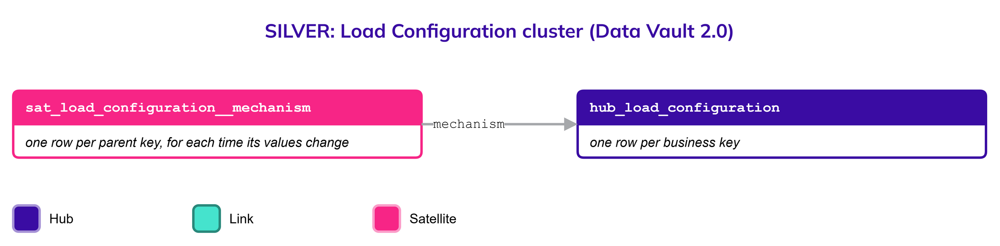
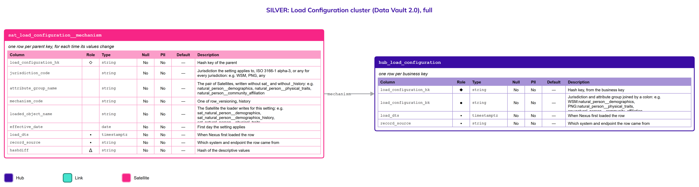

# Load Configuration

## Header

| **Field** | **Value** |
| --- | --- |
| Object | Load Configuration |
| Parent object | — |
| Owner domain | Platform |
| Shared with | Registries, Taxation Contributions and Licences, Finance, Benefits, Compliance, AEOI |
| Scope | Global |
| Status | Draft |
| Version | 0.1 |
| Last updated | 2026-10-20 |

## Definition

A Load Configuration says, for one jurisdiction and one attribute group, which Satellite of a twin pair the loader writes: the one updated in place (row versioning) or the one that keeps history.

An attribute group that may need history is delivered as a pair of Satellites with the same attributes, such as `sat_natural_person__demographics` and `sat_natural_person__demographics_history`. The pair serves one purpose with two mechanisms. This object holds the choice, so the choice is data and not code.

## Why it is its own object

- **The choice differs by jurisdiction.** One jurisdiction needs the history of gender values; another needs only the current value (R7). A jurisdiction is onboarded by adding rows, not by changing a loader.
- **The choice changes over time.** A jurisdiction that starts with the current value may later need history. The change is recorded with its date, so it can be audited (R1).
- **It is not a list of allowed values.** [Code List](Code_List.md) holds the values a column accepts. A Load Configuration holds which table is written. It has no labels and no values.
- **Every domain depends on it.** Each attribute group of each object has an entry, and Platform decides it.

## Vault objects

| **Type** | **Name** | **Grain** | **Business key** |
| --- | --- | --- | --- |
| Hub | `hub_load_configuration` | one row per business key | `load_configuration_bk`: the jurisdiction and the attribute group joined by a colon, such as `WSM:natural_person__demographics`. The jurisdiction is `any` for the default of every jurisdiction |
| Satellite | `sat_load_configuration__mechanism` | one row per parent key, for each time its values change | — |

The hash key `load_configuration_hk` is computed from the normalized business key, as for every Hub.

## Fields

*Indicators in Role: ◆ own hash key · ◇ hash key of another object · ● business key · ▪ load metadata · Δ hashdiff. Default: — means no default, so the loader must supply the value; a literal is a default in the sense of Iceberg format version 3.*

### hub_load_configuration

| **Column** | **Role** | **Type** | **Null** | **PII** | **Default** | **Description** |
| --- | --- | --- | --- | --- | --- | --- |
| `load_configuration_hk` | ◆ | `string` | No | No | — | Hash key, from the business key |
| `load_configuration_bk` | ● | `string` | No | No | — | Jurisdiction and attribute group joined by a colon: e.g. `WSM:natural_person__demographics`, `PNG:natural_person__physical_traits`, `any:natural_person__community_affiliation` |
| `load_dts` | ▪ | `timestamptz` | No | No | — | When Nexus first loaded the row |
| `record_source` | ▪ | `string` | No | No | — | Which system and endpoint the row came from |

### sat_load_configuration__mechanism

| **Column** | **Role** | **Type** | **Null** | **PII** | **Default** | **Description** |
| --- | --- | --- | --- | --- | --- | --- |
| `load_configuration_hk` | ◇ | `string` | No | No | — | Hash key of the parent |
| `jurisdiction_code` | | `string` | No | No | — | Jurisdiction the setting applies to, ISO 3166-1 alpha-3, or `any` for every jurisdiction: e.g. `WSM`, `PNG`, `any` |
| `attribute_group_name` | | `string` | No | No | — | The pair of Satellites, written without `sat_` and without `_history`: e.g. `natural_person__demographics`, `natural_person__physical_traits`, `natural_person__community_affiliation` |
| `mechanism_code` | | `string` | No | No | — | One of `row_versioning`, `history` |
| `loaded_object_name` | | `string` | No | No | — | The Satellite the loader writes for this setting: e.g. `sat_natural_person__demographics`, `sat_natural_person__demographics_history`, `sat_natural_person__physical_traits` |
| `effective_date` | | `date` | No | No | — | First day the setting applies |
| `load_dts` | ▪ | `timestamptz` | No | No | — | When Nexus first loaded the row |
| `record_source` | ▪ | `string` | No | No | — | Which system and endpoint the row came from |
| `hashdiff` | Δ | `string` | No | No | — | Hash of the descriptive values |

## Sources and mapping

No endpoints declared yet

## Jurisdictions map

| **Edge case** | **Where it happens** | **Approach** | **Vault effect** |
| --- | --- | --- | --- |
| A jurisdiction that needs the history of an attribute | Any jurisdiction whose rules or audits ask for it | Its setting for that group is `history` | A row in `sat_load_configuration__mechanism` with `mechanism_code` `history` |
| A jurisdiction that needs only the current value | Any jurisdiction | Its setting is `row_versioning`, or no setting, so the default applies | A row with `row_versioning`, or the row of `any` |
| A jurisdiction with no setting | Any newly onboarded jurisdiction | The default row of `any` applies; by default there is no history | The row of `any` for the group |
| A jurisdiction that changes its mechanism | Any jurisdiction whose rules change | A new row with a new effective date; the earlier row stays as history | New rows in `sat_load_configuration__mechanism` |

## Examples

Illustrative data. Three jurisdictions choose different mechanisms for the same groups.

`hub_load_configuration` and `sat_load_configuration__mechanism`

| **load_configuration_bk** | **mechanism_code** | **loaded_object_name** | **effective_date** |
| --- | --- | --- | --- |
| any:natural_person__demographics | row_versioning | sat_natural_person__demographics | 2026-10-20 |
| any:natural_person__physical_traits | row_versioning | sat_natural_person__physical_traits | 2026-10-20 |
| WSM:natural_person__demographics | history | sat_natural_person__demographics_history | 2026-10-20 |
| WSM:natural_person__physical_traits | history | sat_natural_person__physical_traits_history | 2026-10-20 |
| NZL:natural_person__demographics | history | sat_natural_person__demographics_history | 2026-10-20 |

`PNG` has no row, so the default of `any` applies to it: the in-place Satellites. `NZL` has history for demographics only, so its physical traits fall back to the default.

## Modeling considerations

- **The default is no history.** A group without a row for its jurisdiction uses the row of `any`, which is `row_versioning` (Principles, "A Satellite with row versioning").
- **A setting names the Satellite that is written.** `loaded_object_name` is read by the loader, so the pair can never be loaded twice for one jurisdiction.
- **Every setting points to the exact objects.** `attribute_group_name` and `loaded_object_name` use the names of the vault objects, so a search from either side finds the other. `jurisdiction_code` takes its values from the [Code List](Code_List.md).
- **A change is a new row.** A setting is never edited in place. The earlier row stays, so it can be shown when a table was written by which mechanism (R1).
- **Moving from in place to history is not retroactive.** History starts at the effective date, and the row in the in-place Satellite becomes the first row of the history Satellite. Moving the other way stops loading the history Satellite and keeps what it holds.
- **Platform decides who may change it.** A change of mechanism changes what is kept, so it follows the access rules of the platform.

## Diagram

## Open decisions

| **Decision** | **Owner** | **How it is decided** | **Decide by** |
| --- | --- | --- | --- |
| Which roles may change a setting | Platform | Decided with the role-based access control design of the platform | Before the first jurisdiction is configured |
| Whether a change of mechanism needs a review before it takes effect | Data Architecture Engineer and Platform | Decided from the first change requested | When such a change is requested |
| Whether moving from history back to in place keeps or archives the history Satellite | Data Architecture Engineer | Decided with the retention rules of the platform | Before the first jurisdiction moves back |
| Whether the settings are loaded from a file under version control or entered in a tool | Platform | Decided when the Nexus configuration is built | Before the first jurisdiction is configured |
