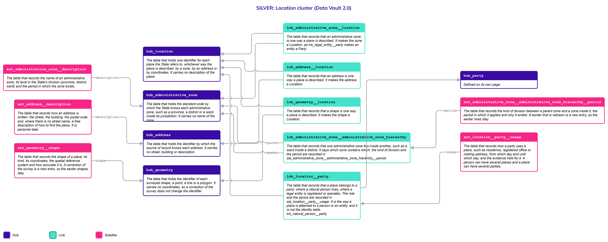
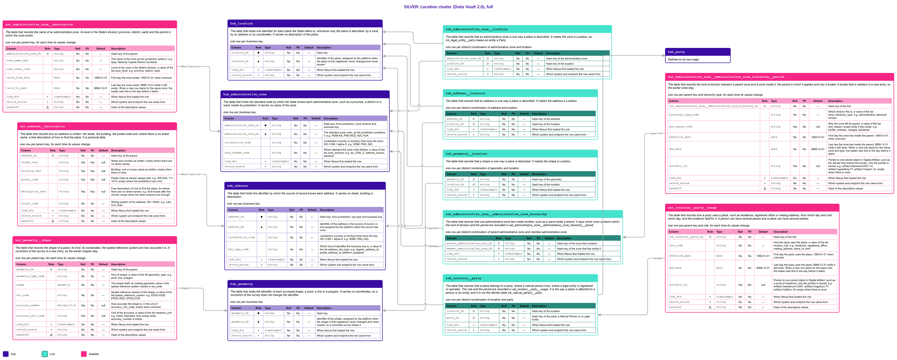

# Location

## Header

| **Field** | **Value** |
| --- | --- |
| Object | Location |
| Parent object | — |
| Owner domain | Registries |
| Shared with | Taxation Contributions and Licences, Finance, Benefits, Compliance, AEOI |
| Scope | Global |
| Status | Draft |
| Version | 0.1 |
| Last updated | 2026-10-22 |

## Definition

A Location is a place on the earth that the State needs to refer to: where a person lives, where an entity is registered, where a parcel lies, where a vessel is registered. A place can be described in three ways, and the three do not depend on one another.

- An **administrative zone** is a place named by the State's own division of its territory: a province, a district, a parish, a ward. It is identified by a standard code, and its borders can be redrawn by decree.
- An **address** is a place described in words: a street and a number, or, where there are no street names, a description such as "the third house after the church". It is volatile and often personal.
- A **geometry** is a place described by coordinates: a point, a line or a polygon in a declared spatial reference system. It is the anchor that does not move when the names around it change.

A **Location** is the single place where all three are gathered. It says nothing about the place itself; it is the handle by which a person, an entity or an asset is attached to a place, whichever of the three descriptions the source has.

## Why it is its own object

- **The three descriptions have different keys and lifecycles.** A zone code is set by law and changes when a border is redrawn. An address is a source record that changes when a street is renamed or a house is renumbered. A geometry is surveyed and corrected. A single Hub for the three would force one key to serve all of them.
- **Not every jurisdiction has all three.** A jurisdiction can have zone codes and surveyed polygons but no street addresses; another can have addresses and no survey. The three Hubs are therefore independent of one another: none requires the others, and nothing links them directly in this version.
- **One handle for everything that has a place.** Natural Persons, Legal Entities, Immovable Assets and Movable Assets all need a place. If each Hub had its own links to three kinds of description, the combinations would multiply. A thin Hub, as Party is for persons and entities, lets every object attach to a place once, and lets a place be described in more ways later without touching any of them.
- **A zone is not a jurisdiction.** The jurisdiction (country or territory) stays a value of the Code List. A zone hangs below a jurisdiction and is keyed by the jurisdiction code and the zone code. A separate Jurisdiction object comes later only if treaties or currencies need attributes of their own.

If the three were Satellites of one Hub, a place known only by a zone would carry empty address and geometry columns, and a border change would rewrite the description of every place inside it.

## Vault objects

| **Type** | **Name** | **Definition** | **Grain** | **Business key** |
| --- | --- | --- | --- | --- |
| Hub | `hub_location` | The table that holds one identifier for each place the State refers to, whichever way the place is described: by a zone, by an address or by coordinates. It carries no description of the place. | one row per business key | `location_bk`: an identifier assigned by the platform when a place is first registered, never changed and never reused |
| Hub | `hub_administrative_zone` | The table that holds the standard code by which the State knows each administrative zone, such as a province, a district or a ward, inside its jurisdiction. It carries no name of the zone. | one row per business key | `administrative_zone_bk`: the standard zone code, with the jurisdiction (country or territory) that owns it and the zone scheme |
| Hub | `hub_address` | The table that holds the identifier by which the source of record knows each address. It carries no street, building or description. | one row per business key | `address_bk`: the identifier of the address in the source of record, or one assigned by the platform when the source has none |
| Hub | `hub_geometry` | The table that holds the identifier of each surveyed shape, a point, a line or a polygon. It carries no coordinates, so a correction of the survey does not change the identifier. | one row per business key | `geometry_bk`: an identifier assigned by the platform when a shape is first registered, never changed and never reused |
| Link | `lnk_administrative_zone__location` | The table that records that an administrative zone is one way a place is described. It makes the zone a Location, as `lnk_legal_entity__party` makes an entity a Party. | one row per distinct combination of administrative zone and location | `hub_administrative_zone`, `hub_location` |
| Link | `lnk_address__location` | The table that records that an address is one way a place is described. It makes the address a Location. | one row per distinct combination of address and location | `hub_address`, `hub_location` |
| Link | `lnk_geometry__location` | The table that records that a shape is one way a place is described. It makes the shape a Location. | one row per distinct combination of geometry and location | `hub_geometry`, `hub_location` |
| Link | `lnk_administrative_zone__administrative_zone_hierarchy` | The table that records that one administrative zone lies inside another, such as a ward inside a district. It says which zone contains which; the kind of division and the period are recorded in `sat_administrative_zone__administrative_zone_hierarchy__period`. | one row per distinct combination of parent administrative zone and member administrative zone | `hub_administrative_zone` (parent), `hub_administrative_zone` (member) |
| Link | `lnk_location__party` | The table that records that a place belongs to a party: where a natural person lives, where a legal entity is registered or operates. The role and the period are recorded in `sat_location__party__usage`. It is the way a place is attached to a person or an entity, and it is not the identity table `lnk_natural_person__party`. | one row per distinct combination of location and party | `hub_location`, `hub_party` |
| Satellite | `sat_administrative_zone__description` | The table that records the name of an administrative zone, its level in the State's division (province, district, ward) and the period in which the zone exists. | one row per parent key, for each time its values change | — |
| Satellite | `sat_address__description` | The table that records how an address is written: the street, the building, the postal code and, where there is no street name, a free description of how to find the place. It is personal data. | one row per parent key, for each time its values change | — |
| Satellite | `sat_geometry__shape` | The table that records the shape of a place: its kind, its coordinates, the spatial reference system and how accurate it is. A correction of the survey is a new entry, so the earlier shapes stay. | one row per parent key, for each time its values change | — |
| Satellite | `sat_administrative_zone__administrative_zone_hierarchy__period` | The table that records the kind of division between a parent zone and a zone inside it, the period in which it applies and why it ended. A border that is redrawn is a new entry, so the earlier ones stay. | one row per parent key and hierarchy type, for each time its values change | — |
| Satellite | `sat_location__party__usage` | The table that records how a party uses a place, such as residence, registered office or mailing address, from which day and until which day, and the evidence held for it. A person can have several places and a place can have several parties. | one row per parent key and role, for each time its values change | — |

The hash key `location_hk` is computed from the normalized `location_bk`. `administrative_zone_hk` is computed from `jurisdiction_code`, `zone_scheme_code` and the normalized `administrative_zone_bk`; `address_hk` from `jurisdiction_code`, `key_type_code` and the normalized `address_bk`; and `geometry_hk` from the normalized `geometry_bk`, all joined with a fixed separator. Normalization: trimmed, case-folded, Unicode-normalized. The hash algorithm is a platform decision and is not named here. Satellites carry only the parent's hash key.

`lnk_administrative_zone__location`, `lnk_address__location` and `lnk_geometry__location` say that a description **is** a place: each description has exactly one row. `lnk_location__party` says that a place **belongs to** a party. A Link from `hub_location` to an asset (`lnk_immovable_asset__location`, `lnk_movable_asset__location`) is added with the page of each asset and has the same shape as `lnk_location__party`.

## Fields

*Indicators in Role: ◆ own hash key · ◇ hash key of another object · ● business key · ▪ load metadata · Δ hashdiff. Default: — means no default, so the loader must supply the value; a literal is a default in the sense of Iceberg format version 3.*

### hub_location

| **Column** | **Role** | **Type** | **Null** | **PII** | **Default** | **Description** |
| --- | --- | --- | --- | --- | --- | --- |
| `location_hk` | ◆ | `string` | No | No | — | Hash key |
| `location_bk` | ● | `string` | No | No | — | Identifier of the place, assigned by the platform when the place is first registered; never changed and never reused |
| `load_dts` | ▪ | `timestamptz` | No | No | — | When Nexus first loaded the row |
| `record_source` | ▪ | `string` | No | No | — | Which system and endpoint the row came from |

### hub_administrative_zone

| **Column** | **Role** | **Type** | **Null** | **PII** | **Default** | **Description** |
| --- | --- | --- | --- | --- | --- | --- |
| `administrative_zone_hk` | ◆ | `string` | No | No | — | Hash key, from jurisdiction, zone scheme and business key |
| `administrative_zone_bk` | ● | `string` | No | No | — | The standard zone code, as the jurisdiction publishes it: e.g. `WSM-AA`, `PNG-NCD`, `NZL-AUK` |
| `jurisdiction_code` | | `string` | No | No | — | Jurisdiction (country or territory) that owns the zone, ISO 3166-1 alpha-3: e.g. `WSM`, `PNG`, `NZL` |
| `zone_scheme_code` | | `string` | No | No | — | Which standard the zone code follows, a value of the list `zone_scheme`: e.g. `iso_3166_2`, `national_census`, `electoral` |
| `load_dts` | ▪ | `timestamptz` | No | No | — | When Nexus first loaded the row |
| `record_source` | ▪ | `string` | No | No | — | Which system and endpoint the row came from |

### hub_address

| **Column** | **Role** | **Type** | **Null** | **PII** | **Default** | **Description** |
| --- | --- | --- | --- | --- | --- | --- |
| `address_hk` | ◆ | `string` | No | No | — | Hash key, from jurisdiction, key type and business key |
| `address_bk` | ● | `string` | No | No | — | Identifier of the address in the source of record, or one assigned by the platform when the source has none |
| `jurisdiction_code` | | `string` | No | No | — | Jurisdiction (country or territory) that owns the key, ISO 3166-1 alpha-3: e.g. `WSM`, `PNG`, `NZL` |
| `key_type_code` | | `string` | No | No | — | Which kind of identifier the business key is, a value of the list `address_key_type`: e.g. `registry_address_id`, `postal_address_id`, `platform_assigned` |
| `load_dts` | ▪ | `timestamptz` | No | No | — | When Nexus first loaded the row |
| `record_source` | ▪ | `string` | No | No | — | Which system and endpoint the row came from |

### hub_geometry

| **Column** | **Role** | **Type** | **Null** | **PII** | **Default** | **Description** |
| --- | --- | --- | --- | --- | --- | --- |
| `geometry_hk` | ◆ | `string` | No | No | — | Hash key |
| `geometry_bk` | ● | `string` | No | No | — | Identifier of the shape, assigned by the platform when the shape is first registered; never changed and never reused, so a corrected survey keeps it |
| `load_dts` | ▪ | `timestamptz` | No | No | — | When Nexus first loaded the row |
| `record_source` | ▪ | `string` | No | No | — | Which system and endpoint the row came from |

### lnk_administrative_zone__location

| **Column** | **Role** | **Type** | **Null** | **PII** | **Default** | **Description** |
| --- | --- | --- | --- | --- | --- | --- |
| `administrative_zone_hk` | ◇ | `string` | No | No | — | Hash key of the administrative zone |
| `location_hk` | ◇ | `string` | No | No | — | Hash key of the location |
| `load_dts` | ▪ | `timestamptz` | No | No | — | When Nexus first loaded the row |
| `record_source` | ▪ | `string` | No | No | — | Which system and endpoint the row came from |

### lnk_address__location

| **Column** | **Role** | **Type** | **Null** | **PII** | **Default** | **Description** |
| --- | --- | --- | --- | --- | --- | --- |
| `address_hk` | ◇ | `string` | No | No | — | Hash key of the address |
| `location_hk` | ◇ | `string` | No | No | — | Hash key of the location |
| `load_dts` | ▪ | `timestamptz` | No | No | — | When Nexus first loaded the row |
| `record_source` | ▪ | `string` | No | No | — | Which system and endpoint the row came from |

### lnk_geometry__location

| **Column** | **Role** | **Type** | **Null** | **PII** | **Default** | **Description** |
| --- | --- | --- | --- | --- | --- | --- |
| `geometry_hk` | ◇ | `string` | No | No | — | Hash key of the geometry |
| `location_hk` | ◇ | `string` | No | No | — | Hash key of the location |
| `load_dts` | ▪ | `timestamptz` | No | No | — | When Nexus first loaded the row |
| `record_source` | ▪ | `string` | No | No | — | Which system and endpoint the row came from |

### lnk_administrative_zone__administrative_zone_hierarchy

A division between two zones. The **parent** is the zone that contains, such as a district, and the **member** is the zone inside it, such as a ward. Both are rows of `hub_administrative_zone`. A member can itself be a parent, so the levels of the State's division are not built into the tables.

| **Column** | **Role** | **Type** | **Null** | **PII** | **Default** | **Description** |
| --- | --- | --- | --- | --- | --- | --- |
| `parent_administrative_zone_hk` | ◇ | `string` | No | No | — | Hash key of the zone that contains |
| `member_administrative_zone_hk` | ◇ | `string` | No | No | — | Hash key of the zone that lies inside it |
| `load_dts` | ▪ | `timestamptz` | No | No | — | When Nexus first loaded the row |
| `record_source` | ▪ | `string` | No | No | — | Which system and endpoint the row came from |

### lnk_location__party

| **Column** | **Role** | **Type** | **Null** | **PII** | **Default** | **Description** |
| --- | --- | --- | --- | --- | --- | --- |
| `location_hk` | ◇ | `string` | No | No | — | Hash key of the location |
| `party_hk` | ◇ | `string` | No | No | — | Hash key of the party, a Natural Person or a Legal Entity |
| `load_dts` | ▪ | `timestamptz` | No | No | — | When Nexus first loaded the row |
| `record_source` | ▪ | `string` | No | No | — | Which system and endpoint the row came from |

### sat_administrative_zone__description

| **Column** | **Role** | **Type** | **Null** | **PII** | **Default** | **Description** |
| --- | --- | --- | --- | --- | --- | --- |
| `administrative_zone_hk` | ◇ | `string` | No | No | — | Hash key of the parent |
| `zone_name_text` | | `string` | No | No | — | The name of the zone as the jurisdiction writes it: e.g. `Apia`, `National Capital District`, `Auckland` |
| `zone_level_code` | | `string` | No | No | — | Level of the zone in the State's division, a value of the list `zone_level`: e.g. `province`, `district`, `ward` |
| `valid_from_date` | | `date` | No | No | `1900-01-01` | First day the zone exists; `1900-01-01` when unknown |
| `valid_to_date` | | `date` | No | No | `9999-12-31` | Last day the zone exists; `9999-12-31` while it still exists. When a new row starts for the same zone, the loader sets this to the day before it starts |
| `load_dts` | ▪ | `timestamptz` | No | No | — | When Nexus first loaded the row |
| `record_source` | ▪ | `string` | No | No | — | Which system and endpoint the row came from |
| `hashdiff` | Δ | `string` | No | No | — | Hash of the descriptive values |

### sat_address__description

This Satellite is personal data. It is its own Satellite so that its access rules and its erasure apply to the address alone.

| **Column** | **Role** | **Type** | **Null** | **PII** | **Default** | **Description** |
| --- | --- | --- | --- | --- | --- | --- |
| `address_hk` | ◇ | `string` | No | No | — | Hash key of the parent |
| `street_text` | | `string` | Yes | Yes | null | Street and number as written; empty where there are no street names |
| `building_text` | | `string` | Yes | Yes | null | Building, unit or house name as written; empty when there is none |
| `postal_code` | | `string` | Yes | Yes | null | Postal code as issued, always text: e.g. `WS1234`, `111`, `1010`; empty where the jurisdiction has none |
| `description_text` | | `string` | Yes | Yes | null | Free description of how to find the place, for where there are no street names: e.g. `third house after the church`; empty when the other columns are enough |
| `script_code` | | `string` | No | No | — | Writing system of the address, ISO 15924: e.g. `Latn`, `Cyrl`, `Arab` |
| `load_dts` | ▪ | `timestamptz` | No | No | — | When Nexus first loaded the row |
| `record_source` | ▪ | `string` | No | No | — | Which system and endpoint the row came from |
| `hashdiff` | Δ | `string` | No | No | — | Hash of the descriptive values |

### sat_geometry__shape

| **Column** | **Role** | **Type** | **Null** | **PII** | **Default** | **Description** |
| --- | --- | --- | --- | --- | --- | --- |
| `geometry_hk` | ◇ | `string` | No | No | — | Hash key of the parent |
| `geometry_type_code` | | `string` | No | No | — | Kind of shape, a value of the list `geometry_type`: e.g. `point`, `line`, `polygon` |
| `shape` | | `geometry` | No | No | — | The shape itself, an Iceberg `geometry` value in the spatial reference system named in `srs_code` |
| `srs_code` | | `string` | No | No | — | Spatial reference system of the shape, a value of the list `spatial_reference_system`: e.g. `EPSG:4326`, `EPSG:3832`, `EPSG:2193` |
| `accuracy_number` | | `decimal(9,2)` | Yes | No | null | How accurate the shape is, in the unit of `accuracy_unit_code`; empty when unknown |
| `accuracy_unit_code` | | `string` | Yes | No | null | Unit of the accuracy, a value of the list `measure_unit`: e.g. `metre`, `kilometre`, `foot`; empty when `accuracy_number` is empty |
| `load_dts` | ▪ | `timestamptz` | No | No | — | When Nexus first loaded the row |
| `record_source` | ▪ | `string` | No | No | — | Which system and endpoint the row came from |
| `hashdiff` | Δ | `string` | No | No | — | Hash of the descriptive values |

### sat_administrative_zone__administrative_zone_hierarchy__period

The kind of division, its period and the reason it ended are one fact, so they share a Satellite. The kind of division is part of the grain: a ward can lie in a district of the electoral division and in another district of the census division. Within one kind, a zone has at most one open row.

| **Column** | **Role** | **Type** | **Null** | **PII** | **Default** | **Description** |
| --- | --- | --- | --- | --- | --- | --- |
| `lnk_administrative_zone__administrative_zone_hierarchy_hk` | ◇ | `string` | No | No | — | Hash key of the link |
| `hierarchy_type_code` | | `string` | No | No | — | Which division this is, a value of the list `zone_hierarchy_type`: e.g. `administrative`, `electoral`, `census` |
| `end_reason_code` | | `string` | Yes | No | null | Why the zone left its parent, a value of the list `end_reason`; empty while it lies inside: e.g. `border_redrawn`, `merged`, `abolished` |
| `effective_date` | | `date` | No | No | `1900-01-01` | First day the zone lies inside the parent; `1900-01-01` when unknown |
| `end_date` | | `date` | No | No | `9999-12-31` | Last day the zone lies inside the parent; `9999-12-31` while it still does. When a new row starts for the same zone and type, the loader sets this to the day before it starts |
| `artifact_uri` | | `string` | Yes | No | null | Pointer to one stored object in Digital Artifact, such as the decree that redrew the border; only the pointer is stored: e.g. `artifact://decree/d-2021-14`, `artifact://gazette/g-77`, `artifact://map/m-12`; empty when there is none |
| `load_dts` | ▪ | `timestamptz` | No | No | — | When Nexus first loaded the row |
| `record_source` | ▪ | `string` | No | No | — | Which system and endpoint the row came from |
| `hashdiff` | Δ | `string` | No | No | — | Hash of the descriptive values |

### sat_location__party__usage

| **Column** | **Role** | **Type** | **Null** | **PII** | **Default** | **Description** |
| --- | --- | --- | --- | --- | --- | --- |
| `lnk_location__party_hk` | ◇ | `string` | No | No | — | Hash key of the link |
| `role_code` | | `string` | No | No | — | How the party uses the place, a value of the list `location_role`: e.g. `residence`, `registered_office`, `mailing_address`, `place_of_birth` |
| `effective_date` | | `date` | No | No | `1900-01-01` | First day the party uses the place; `1900-01-01` when unknown |
| `end_date` | | `date` | No | No | `9999-12-31` | Last day the party uses the place; `9999-12-31` while it still does. When a new row starts for the same role, the loader sets this to the day before it starts |
| `artifact_uri` | | `string` | Yes | No | null | Pointer to one stored object in Digital Artifact, such as a proof of residence; only the pointer is stored: e.g. `artifact://residence/r-2291`, `artifact://registry/r-77`, `artifact://utility/u-18`; empty when there is none |
| `load_dts` | ▪ | `timestamptz` | No | No | — | When Nexus first loaded the row |
| `record_source` | ▪ | `string` | No | No | — | Which system and endpoint the row came from |
| `hashdiff` | Δ | `string` | No | No | — | Hash of the descriptive values |

## Sources and mapping

No endpoints declared yet

## Jurisdictions map

| **Edge case** | **Where it happens** | **Approach** | **Vault effect** |
| --- | --- | --- | --- |
| A jurisdiction with zone codes but no street addresses | Pacific and other island jurisdictions | Places are described by a zone and, where surveyed, by a shape; no address is loaded (R7: a scenario of the same object) | `hub_administrative_zone` and `hub_geometry`, each joined to `hub_location`; no row in `hub_address` |
| A rural place with no street names | Papua New Guinea and other jurisdictions with customary settlement | The address is a free description of how to find the place | `description_text` in `sat_address__description`; `street_text` empty |
| A place surveyed but with no postal address | Jurisdictions with a land survey but no address system | The place is a shape, attached to its party like any other | `hub_geometry` and `lnk_geometry__location` |
| The three descriptions of one place are all known | Jurisdictions with a full address and survey system | Each description is loaded on its own and joined to the same Location; later a multi-step ETL derives one from another or checks that they agree | Three Links to one `hub_location` row; the comparison is a Gold check, not a table |
| A border is redrawn by decree | Any jurisdiction | The zone keeps its code; only the division changes, with the date and the decree | New row in `sat_administrative_zone__administrative_zone_hierarchy__period`; the earlier row is closed |
| A zone is split in two or merged with another | Any jurisdiction | The new zones are new Hub rows, and the old zone ends with a reason; nothing is rewritten | `valid_to_date` in `sat_administrative_zone__description`; `end_reason_code` `merged` |
| A zone that belongs to two divisions at once, such as an electoral and a census division | Jurisdictions with more than one division | Each kind of division is its own hierarchy | Rows with different `hierarchy_type_code` |
| A survey is corrected | Any jurisdiction | The identifier of the shape does not change; the new shape is a new row and the earlier one stays | New row in `sat_geometry__shape` |
| A street is renamed or a house renumbered | Any jurisdiction | The address identifier stays; the description changes | New row in `sat_address__description` |
| A person with a home, a postal address and a place of birth | Any jurisdiction | One Location for each place, each attached with its role | Rows in `lnk_location__party` and `sat_location__party__usage` with different `role_code` |
| A person who moves | Any jurisdiction | The old residence ends the day before the new one starts; the earlier row stays | `end_date` in `sat_location__party__usage` |
| A legal entity with a registered office and branches | Any jurisdiction | Each place is attached to the entity with its role | Rows with `registered_office` and `branch_office` |
| A country that is also a territory of another, such as Curaçao | Any jurisdiction with territories | The territory has its own jurisdiction code, and its zones hang below it | `jurisdiction_code` in `hub_administrative_zone` |
| A place that belongs to an asset, such as a parcel or a port of registry | Any jurisdiction | The asset is attached to the Location with the same shape of Link | `lnk_immovable_asset__location` and `lnk_movable_asset__location`, added with the asset pages |

## Examples

Illustrative data. The first example is a place known by a zone and an address; the second is a rural place in Papua New Guinea known by a zone and a shape only.

**A residence in Apia (Samoa).** The Location `L-1001` is described by a zone and an address, and it is the residence of Natural Person `P-1`.

`hub_location`

| **location_bk** |
| --- |
| L-1001 |

`hub_administrative_zone`

| **administrative_zone_bk** | **jurisdiction_code** | **zone_scheme_code** |
| --- | --- | --- |
| WSM-AA | WSM | iso_3166_2 |

`sat_administrative_zone__description`

| **zone_name_text** | **zone_level_code** | **valid_from_date** | **valid_to_date** |
| --- | --- | --- | --- |
| Aiga-i-le-Tai | district | 1900-01-01 | 9999-12-31 |

`hub_address` and `sat_address__description`

| **address_bk** | **jurisdiction_code** | **key_type_code** | **street_text** | **postal_code** | **script_code** |
| --- | --- | --- | --- | --- | --- |
| A-5521 | WSM | registry_address_id | 12 Beach Road | (empty) | Latn |

`sat_location__party__usage` for the party `P-1`

| **role_code** | **effective_date** | **end_date** |
| --- | --- | --- |
| residence | 2018-03-01 | 9999-12-31 |

**A rural place (Papua New Guinea).** There is no street name and no postal code. The place is known by a zone, a free description and a point.

`hub_address` and `sat_address__description`

| **address_bk** | **description_text** | **street_text** |
| --- | --- | --- |
| A-9004 | third house after the church, Tari village | (empty) |

`sat_geometry__shape`

| **geometry_type_code** | **srs_code** | **accuracy_number** | **accuracy_unit_code** |
| --- | --- | --- | --- |
| point | EPSG:4326 | 15.00 | metre |

**A person who moves.** The first residence is closed the day before the second starts; both stay on record.

`sat_location__party__usage`

| **Location** | **role_code** | **effective_date** | **end_date** |
| --- | --- | --- | --- |
| `L-1001` | residence | 2018-03-01 | 2024-08-31 |
| `L-2040` | residence | 2024-09-01 | 9999-12-31 |

**A border redrawn.** The ward `WSM-AA-07` lay in the district `WSM-AA` and was moved to `WSM-AT` by a decree.

`sat_administrative_zone__administrative_zone_hierarchy__period`

| **Parent** | **hierarchy_type_code** | **end_reason_code** | **effective_date** | **end_date** | **artifact_uri** |
| --- | --- | --- | --- | --- | --- |
| `WSM-AA` | administrative | border_redrawn | 1900-01-01 | 2021-06-30 | (empty) |
| `WSM-AT` | administrative | (empty) | 2021-07-01 | 9999-12-31 | `artifact://decree/d-2021-14` |

## Modeling considerations

- **The three descriptions are independent.** No Link joins an address, a zone and a shape directly. Each is joined to the Location, so a Location can have one, two or three descriptions, and a jurisdiction without addresses loads none. Relations between the descriptions are derived later by a multi-step ETL, or checked for inconsistencies between them; they are a Gold concern, not a table of this version.
- **A Location is a handle, not a description.** `hub_location` is thin, as `hub_party` is. It holds only the identifier assigned by the platform. What a place looks like lives in the three description Hubs.
- **One handle for everything that has a place.** `lnk_location__party` serves Natural Persons and Legal Entities, because both are Parties. Each asset Hub gets its own Link of the same shape, with the same usage Satellite, when its page is written. A Link per target Hub keeps a foreign key to each Hub and its own Satellite, and a new target adds one Link and changes nothing else.
- **The identifier of a shape does not depend on the shape.** `geometry_bk` is assigned once. If it were a hash of the coordinates, a corrected survey would be a new identifier and every Link to the old one would have to move. The same holds for `location_bk`.
- **The address key is the source's own.** `address_bk` is the identifier in the source of record, or one the platform assigns. It is not a hash of the text, because a street renamed or a house renumbered would change the key.
- **An address is personal data.** `sat_address__description` is marked PII and has its own Satellite, so the access rules and the erasure apply to the address and not to the zone or the shape.
- **A shape is declared in its coordinate system.** `srs_code` is part of the shape. Two shapes in different systems are not compared until Gold converts them. The shape uses the Iceberg v3 `geometry` type; where an engine does not yet support it, the loader stores it as well-known text and the type is changed with no change of meaning.
- **Zones nest through their own Link.** `lnk_administrative_zone__administrative_zone_hierarchy` joins the Hub to itself, as the hierarchy of Legal Entities does. How many levels a division may have is `max_depth_count` of the hierarchy type in the Code List (`sat_code_value__validation`); a deeper division changes a number and no table. The level of a zone and its path to the top are computed in the Gold layer, never stored (R13).
- **A zone has one open parent for each kind of division.** At most one row with `end_date` `9999-12-31` for each member and `hierarchy_type_code`. A zone cannot be its own ancestor; a row that would close a loop is parked by the load.
- **Borders change, zones do not.** A border redrawn by decree changes the division and not the zone code. Only the Link and its Satellite change, with the date, and the earlier rows stay.
- **An open end is `9999-12-31`.** The end of a zone, a division or a use of a place is `9999-12-31` while it applies, and an unknown start is `1900-01-01`. When a new row for the same key and role arrives, the loader sets the end of the previous row to the day before the new start (Principles, "Validity ranges").
- **The jurisdiction is a Code List value.** `jurisdiction_code` is a country or territory, ISO 3166-1 alpha-3. Zones hang below it. A Jurisdiction object comes only if treaties or currencies need attributes of their own.
- **Codes take their values from the Code List.** `zone_scheme_code`, `zone_level_code`, `hierarchy_type_code`, `key_type_code`, `role_code`, `geometry_type_code`, `srs_code`, `accuracy_unit_code`, `end_reason_code` and `script_code` hold values that change without changing any logic, so they are Code List values.
- **Distance, area and containment are not stored.** Whether a point lies inside a zone, the area of a polygon and the distance between two places are computed in the Gold layer (R13).

## Diagram

Two pictures of the same cluster. Read the simplified one first, then use the full one when you need the columns. Colors: Hub indigo, Link teal, Satellite magenta; a Satellite updated in place is lighter, with a dashed border. Arrows run from the child to its parent.

### Simplified version

The shape of the cluster: 4 Hubs, 5 Links and 5 Satellites, each with its name and definition. Use it to see how the objects relate. It has no columns.

### Full version

The same objects, each with its Fields table (column, role, type, null, PII, default, description). Use it to check exactly what is stored. It is wide: zoom in or open the image on its own.

## Open decisions

| **Decision** | **Owner** | **How it is decided** | **Decide by** |
| --- | --- | --- | --- |
| How the three descriptions of one place are derived from one another, or checked for inconsistencies, and in which layer | Data Architecture Engineer and Data Product Owner | Decided with the first jurisdiction that loads more than one description | Before the first mapping that needs it |
| Which zone schemes and levels are used in each jurisdiction, and who maintains the zone codes | Data Product Owner and Platform | Set as values of the Code List lists `zone_scheme` and `zone_level` | When a jurisdiction is configured |
| Which kinds of division are used, and the maximum depth of each | Data Product Owner and Data Architecture Engineer | Set as values of the Code List `zone_hierarchy_type`, with the rule of each kind | Before the first hierarchy is loaded |
| Who assigns `location_bk` and `geometry_bk`, and in what format | Platform configuration and Data Architecture Engineer | Set for each jurisdiction from the number of places the State will register | When a jurisdiction is configured |
| Which source of record supplies `address_bk` in each jurisdiction, and what happens where none exists | Platform configuration | Set in the Nexus configuration for each jurisdiction | When a jurisdiction is configured |
| Whether the accuracy of a shape is required, and the spatial reference systems accepted | Data Product Owner | Decided with the surveying authority of each jurisdiction | Before the first shape is loaded |
| Whether a Jurisdiction object is needed, from treaties or currencies that need attributes of a jurisdiction | Data Product Owner | Decided with Finance and Compliance, from the first rule that depends on it | Before the first mapping that needs it |
| The Links from a Location to Immovable Assets and Movable Assets, and the roles they use | Data Architecture Engineer and Data Product Owner | Decided with the pages of each asset, using the shape of `lnk_location__party` | When the asset pages are drafted |
