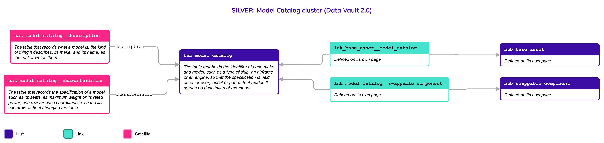
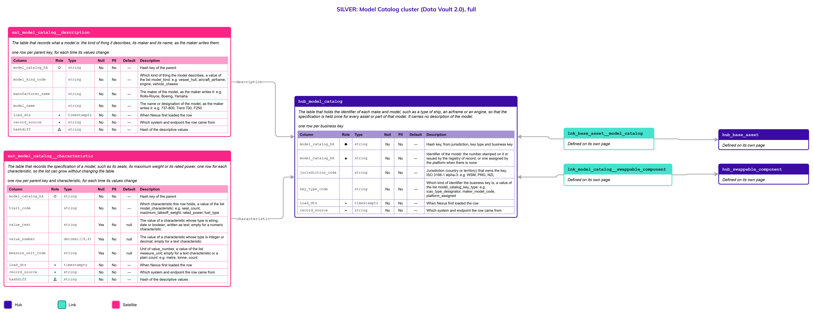

# Model Catalog

## Header

| **Field** | **Value** |
| --- | --- |
| Object | Model Catalog |
| Parent object | Movable Assets |
| Owner domain | Registries |
| Shared with | Taxation Contributions and Licences, Finance, Compliance |
| Scope | Shared |
| Status | Draft |
| Version | 0.1 |
| Last updated | 2026-10-23 |

## Definition

A **Model Catalog** entry is a **make and model**, such as a type of ship, an airframe or an engine, whose specification is the same for every asset or part of that model. It is **held once**, so that the thousand aircraft of one type do not each repeat the same seats, weight and engines. **One list** holds the models of assets and of parts, and says which kind each is.

The assets of a model are on the page [Base Asset](Base_Asset.md) and the parts on the page [Swappable Component](Swappable_Component.md); each joins its model by a Link defined on its own page.

## Why it is its own object

- **The specification belongs to the model and not to the unit.** The maximum weight of an airframe type is a fact about the type. Held on every aircraft it would be repeated and could disagree.
- **It has its own key and lifecycle.** A maker or a standard, such as an aircraft type designator, identifies a model. A model is added when a maker publishes it and corrected when the maker corrects it, independently of any asset.
- **One list for assets and parts.** A hull model and an engine model have the same shape: a kind, a maker, a name and a specification. `model_kind_code` says which one it is, so there is no Hub for each kind. A Hub per kind is added only if the keys or the lifecycles of a kind turn out to differ.

## Vault objects

| **Type** | **Name** | **Definition** | **Grain** | **Business key** |
| --- | --- | --- | --- | --- |
| Hub | `hub_model_catalog` | The table that holds the **identifier** of each make and model, such as a type of ship, an airframe or an engine, so that the specification is held once for every asset or part of that model. It **carries no description** of the model. | one row per business key | `model_catalog_bk`: the maker's or the standard designation of the model, or one assigned by the platform when there is none, with the jurisdiction and the key type |
| Satellite | `sat_model_catalog__description` | The table that records **what a model is**: the kind of thing it describes, its **maker** and its name, as the maker writes them. | one row per parent key, for each time its values change | — |
| Satellite | `sat_model_catalog__characteristic` | The table that records the **specification** of a model, such as its seats, its maximum weight or its rated power, one row for each characteristic, so the **list can grow** without changing the table. | one row per parent key and characteristic, for each time its values change | — |

`model_catalog_hk` is computed from `jurisdiction_code`, `key_type_code` and the normalized `model_catalog_bk`, joined with a fixed separator. Normalization: trimmed, case-folded, Unicode-normalized. The hash algorithm is a platform decision and is not named here. Satellites carry only the parent's hash key.

The Links to the model are defined on the pages of the assets and the parts: `lnk_base_asset__model_catalog` on [Base Asset](Base_Asset.md) and `lnk_model_catalog__swappable_component` on [Swappable Component](Swappable_Component.md). They say which model a unit is, and have no Satellite.

**Related pages.** The diagrams on this page draw the objects defined elsewhere with a note.

- [Movable Assets](Movable_Assets.md): the family page, with the rules that the three parts share and the decisions that are open for all.
- [Base Asset](Base_Asset.md): `hub_base_asset`, joined by `lnk_base_asset__model_catalog`.
- [Swappable Component](Swappable_Component.md): `hub_swappable_component`, joined by `lnk_model_catalog__swappable_component`.

## Fields

*Indicators in Role: ◆ own hash key · ◇ hash key of another object · ● business key · ▪ load metadata · Δ hashdiff. Default: — means no default, so the loader must supply the value; a literal is a default in the sense of Iceberg format version 3. Code List: `List` — the values are a list of the Code List object and the column has a row in the table of the Code List page; `Closed` — a closed list, written in the Description as One of; `—` — the column is not a code.*

### hub_model_catalog

| **Column** | **Role** | **Type** | **Null** | **PII** | **Default** | **Code List** | **Description** |
| --- | --- | --- | --- | --- | --- | --- | --- |
| `model_catalog_hk` | ◆ | `string` | No | No | — | — | Hash key, from jurisdiction, key type and business key |
| `model_catalog_bk` | ● | `string` | No | No | — | — | Identifier of the model: the number stamped on it or issued by the registry of record, or one assigned by the platform when there is none |
| `jurisdiction_code` |  | `string` | No | No | — | List | Jurisdiction (country or territory) that owns the key, ISO 3166-1 alpha-3: e.g. `WSM`, `PNG`, `NZL` |
| `key_type_code` |  | `string` | No | No | — | List | Which kind of identifier the business key is, a value of the list `model_catalog_key_type`: e.g. `icao_type_designator`, `maker_model_code`, `platform_assigned` |
| `load_dts` | ▪ | `timestamptz` | No | No | — | — | When Nexus first loaded the row |
| `record_source` | ▪ | `string` | No | No | — | — | Which system and endpoint the row came from |

### sat_model_catalog__description

| **Column** | **Role** | **Type** | **Null** | **PII** | **Default** | **Code List** | **Description** |
| --- | --- | --- | --- | --- | --- | --- | --- |
| `model_catalog_hk` | ◇ | `string` | No | No | — | — | Hash key of the parent |
| `model_kind_code` |  | `string` | No | No | — | List | Which kind of thing the model describes, a value of the list `model_kind`: e.g. `vessel_hull`, `aircraft_airframe`, `engine`, `vehicle_chassis` |
| `manufacturer_name` |  | `string` | No | No | — | — | The maker of the model, as the maker writes it: e.g. `Rolls-Royce`, `Boeing`, `Yamaha` |
| `model_name` |  | `string` | No | No | — | — | The name or designation of the model, as the maker writes it: e.g. `737-800`, `Trent 700`, `F250` |
| `load_dts` | ▪ | `timestamptz` | No | No | — | — | When Nexus first loaded the row |
| `record_source` | ▪ | `string` | No | No | — | — | Which system and endpoint the row came from |
| `hashdiff` | Δ | `string` | No | No | — | — | Hash of the descriptive values |

### sat_model_catalog__characteristic

The characteristics of a model are an open list, such as its seats, its maximum weight, its rated power, and whatever a jurisdiction adds. Each is a row and not a column (Principles, "Traits as rows"). A new characteristic is a new value of the Code List `model_characteristic` and changes no table. The Code List says, for each one, which value column is used (`value_data_type_code`), and the load checks the value against it. A characteristic that is not personal data has no in-place twin: history is kept.

| **Column** | **Role** | **Type** | **Null** | **PII** | **Default** | **Code List** | **Description** |
| --- | --- | --- | --- | --- | --- | --- | --- |
| `model_catalog_hk` | ◇ | `string` | No | No | — | — | Hash key of the parent |
| `trait_code` |  | `string` | No | No | — | List | Which characteristic this row holds, a value of the list `model_characteristic`: e.g. `seat_count`, `maximum_takeoff_weight`, `rated_power`, `fuel_type` |
| `value_text` |  | `string` | Yes | No | null | — | The value of a characteristic whose type is `string`, `date` or `boolean`, written as text; empty for a numeric characteristic |
| `value_number` |  | `decimal(18,6)` | Yes | No | null | — | The value of a characteristic whose type is `integer` or `decimal`; empty for a text characteristic |
| `measure_unit_code` |  | `string` | Yes | No | null | List | Unit of `value_number`, a value of the list `measure_unit`; empty for a text characteristic or a plain count: e.g. `metre`, `tonne`, `count` |
| `load_dts` | ▪ | `timestamptz` | No | No | — | — | When Nexus first loaded the row |
| `record_source` | ▪ | `string` | No | No | — | — | Which system and endpoint the row came from |
| `hashdiff` | Δ | `string` | No | No | — | — | Hash of the descriptive values |

## Sources and mapping

No endpoints declared yet

## Jurisdictions map

| **Edge case** | **Where it happens** | **Approach** | **Vault effect** |
| --- | --- | --- | --- |
| A model known by the code of the maker and by a standard designation | Any jurisdiction | The designation that the source delivers is the key; the other is an identifier of the same model | `key_type_code` `icao_type_designator` or `maker_model_code` in `hub_model_catalog` |
| A locally built craft with no model | Pacific jurisdictions | There is no entry in the catalog and no Link; its specification is the characteristics of the asset | No row in `lnk_base_asset__model_catalog`; rows in `sat_base_asset__characteristic` |
| A maker corrects the specification of a model | Any jurisdiction | The correction is a new row and the earlier ones stay | A new row in `sat_model_catalog__characteristic` |

## Examples

Illustrative data. The model of the engine `ENG-77` described on the page [Swappable Component](Swappable_Component.md).

`hub_model_catalog` and `sat_model_catalog__description`

| **model_catalog_bk** | **jurisdiction_code** | **key_type_code** | **model_kind_code** | **manufacturer_name** | **model_name** |
| --- | --- | --- | --- | --- | --- |
| MAN-L7 | DEU | maker_model_code | engine | MAN | L7 |

`sat_model_catalog__characteristic`

| **trait_code** | **value_text** | **value_number** | **measure_unit_code** |
| --- | --- | --- | --- |
| rated_power | (empty) | 7200 | kilowatt |
| cylinder_count | (empty) | 7 | count |

## Modeling considerations

- **One Hub for every kind of model.** `model_kind_code`, a value of the list `model_kind`, says what a model describes. A rule that an engine model joins parts and a hull model joins assets is checked in Gold (R13), not by the tables.
- **The specification is an open list.** The seats, the weight and the power are rows of `sat_model_catalog__characteristic`, not columns (Principles, "Traits as rows").
- **The catalog holds no unit.** A model has no owner, no registration and no value. Those belong to the assets and the parts.
- **Codes take their values from the Code List.** Every `_code` column on this page holds values that change without changing logic.

## Diagram

Two pictures of the same cluster. Read the simplified one first, then use the full one when you need the columns. Colors: Hub indigo, Link teal, Satellite magenta; a Satellite updated in place is lighter, with a dashed border. Arrows run from the child to its parent. Objects defined on another page are drawn with a note and no table.

### Simplified version

The shape of the cluster: 1 Hub and 2 Satellites, with the Hubs of the asset and of the part, and the Links to the model, drawn as defined on another page. Each has its name and definition. Use it to see how the objects relate. It has no columns.

### Full version

The same objects, each with its Fields table (column, role, type, null, PII, default, description). Use it to check exactly what is stored. It is wide: zoom in or open the image on its own.

## Open decisions

| **Decision** | **Owner** | **How it is decided** | **Decide by** |
| --- | --- | --- | --- |
| Where the catalog comes from: a maker's publication, a standard such as the aircraft type designators, or entry by the registry | Data Product Owner and Platform | Set in the Nexus configuration for each source of models | When a jurisdiction is configured |
| Which characteristics are required for each kind of model, and their units | Data Product Owner | Set as values of the Code List list `model_characteristic` | When a jurisdiction is configured |
| Whether a Hub for each kind of model is needed, if the keys or lifecycles of the kinds differ | Data Architecture Engineer | Decided only if a jurisdiction shows that one list cannot serve both | When a jurisdiction asks for it |
