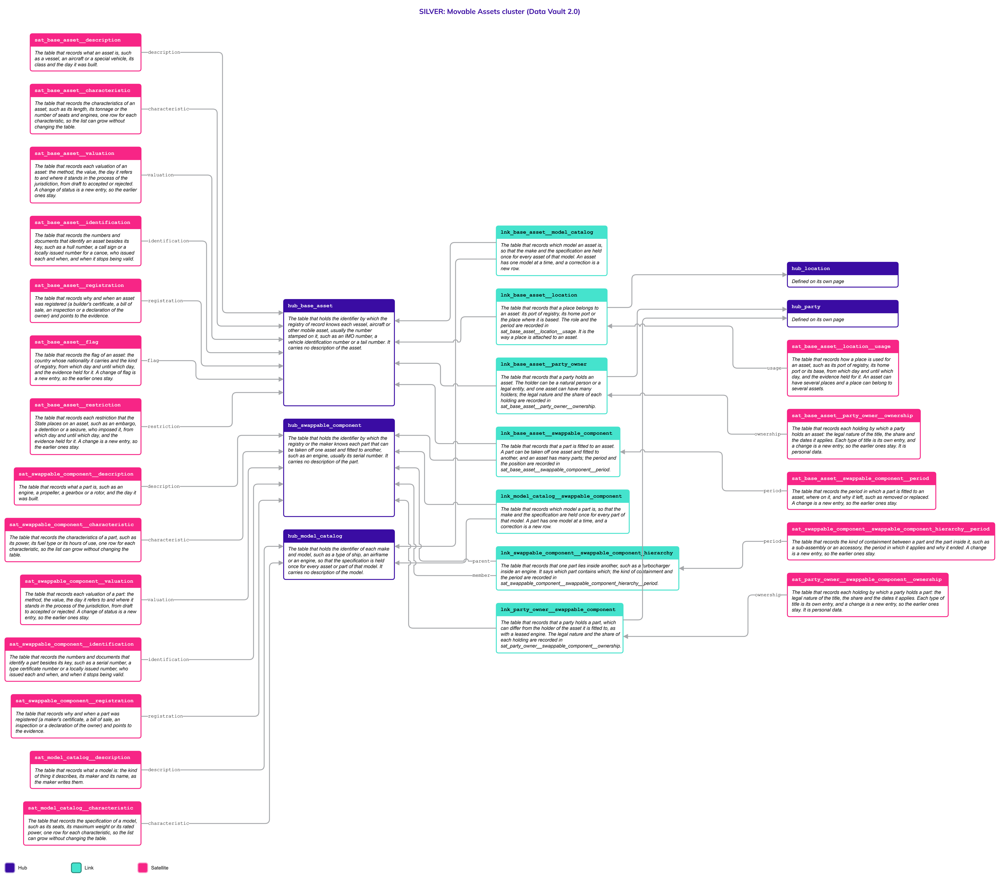
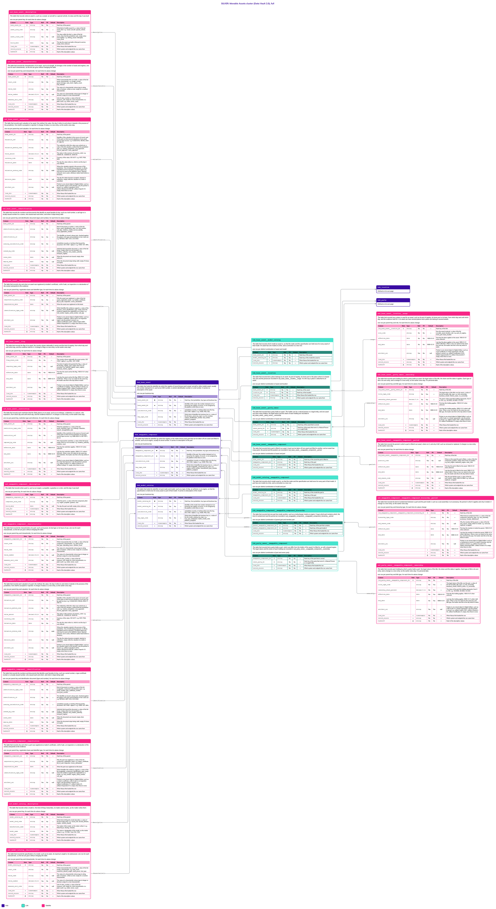

# Movable Assets

## Header

| **Field** | **Value** |
| --- | --- |
| Object | Movable Assets |
| Parent object | — |
| Owner domain | Registries |
| Shared with | Taxation Contributions and Licences, Finance, Compliance |
| Scope | Shared |
| Status | Draft |
| Version | 0.1 |
| Last updated | 2026-10-23 |

## Definition

A Movable Asset is a high-value mobile item that the State identifies, registers, taxes or regulates: mainly vessels and aircraft, and special vehicles. It groups, without mixing them, the three things that do not share a life: the [Base Asset](Base_Asset.md), which is the hull, the fuselage or the frame and keeps the identity of the asset; the [Swappable Component](Swappable_Component.md), which is a part such as an engine that is taken off one asset and fitted to another; and the [Model Catalog](Model_Catalog.md), which holds the make and the specification once for every unit of a model.

Movable Assets is a family, not a place to store attributes. All identification, description, holders and values live in the three specific objects. This page holds what the three share: the rules they follow, the decisions that are open for all, and the one picture of the family. The rules that movable and immovable assets have in common are written once, on the page [Immovable Assets](Immovable_Assets.md).

## Why it is its own object

Tax, Finance and Compliance ask about "a movable asset" without caring whether the answer is a ship, an engine fitted to it or the model of both: a registration fee, a tonnage tax, a valuation roll, an embargo. They should not need to know which part they are looking at, and the rules that apply to all must be written once.

The family is a page and not a Hub. A shared Hub would need a key that Nexus assigns before any source row can load. The three parts also have different keys (the number stamped on the asset, the serial number of the part, the designation of the maker), different lifecycles (an engine outlives its fitting; a model outlives every unit) and different holders (a leased engine on a ship belongs to someone else). One table for the three would lose the history of each. A Gold view reads them together.

## Vault objects

No Vault objects of its own: the objects of this family are defined once, on the pages of its three parts.

| **Page** | **Objects** | **What it holds** |
| --- | --- | --- |
| [Base Asset](Base_Asset.md) | 13: the Hub `hub_base_asset`, 3 Links and 9 Satellites | The hull, fuselage or frame: its description, characteristics, valuations, identification and registration, its flag and its restrictions, its Links to Location (port of registry or base), and to Party (holder, which includes public bodies), and the Link to its model |
| [Swappable Component](Swappable_Component.md) | 13: the Hub `hub_swappable_component`, 4 Links and 8 Satellites | The engine or other part: its description, characteristics, valuations, identification and registration, its Link to Party, the containment of parts inside parts, the Link to its model and the Link that fits it to an asset |
| [Model Catalog](Model_Catalog.md) | 3: the Hub `hub_model_catalog` and 2 Satellites | The make and model, held once: its kind, maker and name, and its specification as characteristics |

`lnk_base_asset__swappable_component` and its Satellite `sat_base_asset__swappable_component__period` say that a part is **fitted to** an asset, and are defined on [Swappable Component](Swappable_Component.md), the side that moves. `lnk_base_asset__model_catalog` says which model an asset is, and is defined on [Base Asset](Base_Asset.md). `lnk_model_catalog__swappable_component` says which model a part is, and is defined on [Swappable Component](Swappable_Component.md). Every Link is defined on the page of the side that depends on the other, and drawn on both.

**Related pages.** Each part has its own Links to other objects, listed on its page:

- [Location](Location.md): where an asset is based. A part has no place of its own.
- [Party](Party.md), with [Natural Person](Natural_Person.md) and [Legal Entity](Legal_Entity.md): who holds an asset or a part.
- [Legal Entity](Legal_Entity.md): a government, a government agency or a foreign government agency that holds an asset is a Legal Entity classified as public.
- [Immovable Assets](Immovable_Assets.md): the family whose rules for valuation and holdings these assets follow.
- [Code List](Code_List.md): the values of every `_code` column of the family.

## Fields

*Each part defines its own tables, in the Fields section of its page. These columns follow the same rule on all pages, so a Gold view can read them together.*

| **Column** | **Where it appears** | **What it means** |
| --- | --- | --- |
| `valuation_ref`, `valuation_method_code`, `value_amount`, `currency_code`, `valuation_date`, `valuation_status_code`, `decision_date` | `sat_base_asset__valuation`, `sat_swappable_component__valuation` | One valuation and where it stands in the process of the jurisdiction. The closed status list is the one of [Immovable Assets](Immovable_Assets.md) |
| `trait_code`, `value_text`, `value_number`, `measure_unit_code` | the three characteristic Satellites | One characteristic, such as the length of a ship or the power of an engine. The list is open and the Code List says which value column each trait uses |
| `identification_type_code`, `identification_id`, `issuing_jurisdiction_code`, `issued_by_code`, `issue_date` | `sat_base_asset__identification`, `sat_swappable_component__identification` | A number or a document that identifies the asset or the part besides its key, such as a hull number, a call sign or a serial number |
| `registration_basis_code`, `registration_date`, `artifact_uri` | `sat_base_asset__registration`, `sat_swappable_component__registration` | Why and when the asset or the part was registered, and the pointer to the evidence |
| `title_type_code`, `ownership_share_percent`, `effective_date`, `end_date` | the two ownership Satellites | The legal nature of a holding, its share and the dates it applies. The list is `movable_title_type` |
| `model_kind_code`, `manufacturer_name`, `model_name` | `sat_model_catalog__description` | What a model describes and who makes it |

## Sources and mapping

No endpoints declared yet

## Jurisdictions map

The cases that cross the parts. The detail of each is on the page named in the last column.

| **Edge case** | **Where it happens** | **Approach** | **Vault effect** |
| --- | --- | --- | --- |
| A ship flagged in an open registry whose owner is in another country | Open registries such as the Marshall Islands and Vanuatu | The flag and the holder are separate facts; the flag is the nationality of the asset and changes on its own | `sat_base_asset__flag` and `lnk_base_asset__party_owner` on [Base Asset](Base_Asset.md) |
| A small craft with no stamped identifier, such as a canoe | Pacific jurisdictions | The platform assigns the key, and the number that the local authority issues is an identifier of its own | `platform_assigned` key in `hub_base_asset`; `sat_base_asset__identification` |
| An engine moved from one ship to another | Any jurisdiction | The part keeps its key; the first fitting ends and a second one starts | Two rows of `sat_base_asset__swappable_component__period` on [Swappable Component](Swappable_Component.md) |
| A leased engine on a ship that belongs to another company | Jurisdictions that record the holders of parts | Each holder has its own holding, through its own Link | `lnk_party_owner__swappable_component` and `lnk_base_asset__party_owner` |
| A part inside another part, such as a turbocharger in an engine | Any jurisdiction | The containment is a Link of its own, with its kind and period | `lnk_swappable_component__swappable_component_hierarchy` |
| An asset under an embargo, a detention or a seizure | Any jurisdiction | The restriction is a fact with its period and its evidence, and it does not change the holder | `sat_base_asset__restriction` on [Base Asset](Base_Asset.md) |
| A mortgage or a lien over a ship or an aircraft | Any jurisdiction | It is a legal instrument and not a restriction by the State; it is stored with the Legal Instrument object when that is written | Open (see Open decisions) |
| The same specification repeated on a thousand aircraft of one type | Any jurisdiction | The specification is held once for the model, and each asset joins it | `lnk_base_asset__model_catalog` and `sat_model_catalog__characteristic` |
| A model known by the code of the maker and by a standard designation | Any jurisdiction | The designation that the source delivers is the key; the other is an identifier of the same model | `key_type_code` in `hub_model_catalog` |
| The value of an asset and the value of its parts | Jurisdictions that value parts | Each is valued on its own and the values are not added in the Vault | Rows of both valuation Satellites; the total is a Gold value |
| An asset held by the government and by a party, or by a government agency and a foreign government agency | Any jurisdiction | The same rules as for immovable assets: a public body is a Legal Entity classified as public, each holder has a row of the same Link, and the shares are added up in Gold | See the shared holdings on [Immovable Assets](Immovable_Assets.md) |

## Examples

Illustrative data. A cargo ship followed from its registration to the swap of its engine.

1. **The model.** The engine model `MAN-L7` and the hull model of the ship are rows of `hub_model_catalog`, each with its specification as characteristics (see [Model Catalog](Model_Catalog.md)).
2. **The ship.** `9876543` is the IMO number of the ship, so it is the key of a row of `hub_base_asset`. It was flagged in the Marshall Islands until 2021 and in Vanuatu since then: two rows of `sat_base_asset__flag` (see [Base Asset](Base_Asset.md)). A row of `lnk_base_asset__model_catalog` joins it to its model.
3. **The engine.** `ENG-77` is a row of `hub_swappable_component`. It is fitted to the ship from 2012 to 2024, and then to another ship: two rows of the period Satellite (see [Swappable Component](Swappable_Component.md)).
4. **The holders.** The shipping company holds the ship through `lnk_base_asset__party_owner`. A leasing company holds the engine through `lnk_party_owner__swappable_component` with the title `finance_lease`.
5. **The restriction and the values.** The ship was held in port for two weeks in 2025: a row of `sat_base_asset__restriction` with its dates. The ship and the engine each have their own valuations that go through draft, submitted and accepted; the definitive value of each is computed in Gold.
6. **The family view.** A Gold view reads the ship, its parts and its model together, so that a tonnage tax bill asks for "the movable asset `9876543`" and gets the ship, its engine and their values.

## Modeling considerations

- **Three Hubs, no umbrella.** The asset, the part and the model each have their own key, lifecycle and holders, so each is its own Hub. The family has no Hub: a shared key would have to be assigned by Nexus before any source row could load.
- **The identity is the stamped number.** The business key of an asset is the number stamped on it, such as an IMO number, a vehicle identification number or a tail number, and where there is none the platform assigns one. International standards and locally generated numbers share one key shape: `jurisdiction_code`, `key_type_code` and the normalized key. A number that is issued later is an identifier and not a key.
- **A part is joined to an asset by a Link with a period.** A part can be taken off one asset and fitted to another, so the fitting is a Link and a Satellite and not a column. A part is fitted to at most one asset at a time.
- **Parts contain parts from the first version.** The hierarchy Link of parts exists now, as for structures. How many levels a kind of containment may have is `max_depth_count` in the Code List, so the depth is a rule and not a table.
- **The model is held once.** One Hub holds the models of assets and of parts, with a `model_kind_code`. A Hub for each kind is added only if the keys or lifecycles of a kind differ. The check that an engine model joins parts and a hull model joins assets is in Gold (R13).
- **The flag is a history, and it is not the owner's country.** The flag is the nationality of the asset and changes on its own; it is a Satellite of the asset.
- **A restriction by the State is not a legal instrument.** An embargo, a detention or a seizure is a Satellite of the asset. A mortgage or a lien needs its evidence, its parties and its status, and is the Legal Instrument object, which also serves immovable assets, persons and entities (see Open decisions).
- **Valuation, holdings and shared holdings follow the rules of immovable assets.** The valuation is a Satellite for each Hub that is valued, with every fact kept and the definitive value in Gold; the status list is closed; two accepted values are allowed or not by the jurisdiction; a holder is a Party, and a public body, domestic or foreign, is a Legal Entity classified as public; the shares of the holders are added up in Gold. These rules are written on the page [Immovable Assets](Immovable_Assets.md) and are not repeated.
- **The characteristics are an open list.** The length of a ship, the seats of an aircraft and the power of an engine are rows of the characteristic Satellites, not columns (Principles, "Traits as rows").
- **Where the asset is based is a Location; where it is now is not stored.** `lnk_base_asset__location` attaches a place with a role, such as the port of registry. The position of a ship or an aircraft at this moment is operational data, outside this model.
- **The holders of parts depend on the configuration of the platform.** The Link to Party exists for every part. A jurisdiction that records only the holder of the asset leaves it empty; the case where every part has its own holder needs no other table.
- **An open end is `9999-12-31`.** The end of a period is `9999-12-31` while it applies, and an unknown start is `1900-01-01` (Principles, "Validity ranges").
- **Codes take their values from the Code List.** Every `_code` column of the family holds values that change without changing logic, except `valuation_status_code`, which is closed.

## Diagram

Two pictures of the family: the three clusters together. Read the simplified one first, then use the full one when you need the columns. Colors: Hub indigo, Link teal, Satellite magenta; a Satellite updated in place is lighter, with a dashed border. Arrows run from the child to its parent. Objects defined on another page are drawn with a note and no table.

### Simplified version

The shape of the family: 3 Hubs, 7 Links and 19 Satellites, each with its name and definition, and the Hubs of Location and Party drawn as defined on other pages. Use it to see how the three parts relate. It has no columns.

### Full version

The same objects, each with its Fields table (column, role, type, null, PII, default, description). Use it to check exactly what is stored. It is wide: zoom in or open the image on its own.

## Open decisions

| **Decision** | **Owner** | **How it is decided** | **Decide by** |
| --- | --- | --- | --- |
| Mortgages, liens and other legal instruments over a ship, an aircraft or a part. The recommended design is the Legal Instrument object described on [Immovable Assets](Immovable_Assets.md): a Hub of the legal documents, one Link to each kind of subject, a Link to the parties involved and a Satellite for the status | Data Architecture Engineer and Data Product Owner | Drafted as its own page with an outline approved first | Before the first mapping that needs them |
| How a jurisdiction sets up the valuation process for assets and parts. It is the same Code List design as for immovable assets, with the methods and the data each method needs | Data Product Owner, Taxation Contributions and Licences and Platform | Designed with the Code List page | When a jurisdiction is configured |
| How many levels of containment of parts a jurisdiction allows, and the kinds of containment | Data Product Owner | Set as `max_depth_count` of each value of the Code List `component_hierarchy_type` | When a jurisdiction is configured |
| Whether a jurisdiction records the holders of parts separately from the holder of the asset | Platform configuration | Set in the Nexus configuration for each jurisdiction; the tables exist in any case | When a jurisdiction is configured |
| How an asset known by a local number and later by an international one is joined to the same row, and who vouches for the match | Data Architecture Engineer and Data Product Owner | Decided with the first jurisdiction that registers an asset under two numbers; the direction is an enrichment layer, as for the places of a Location | Before the first such asset is loaded |
