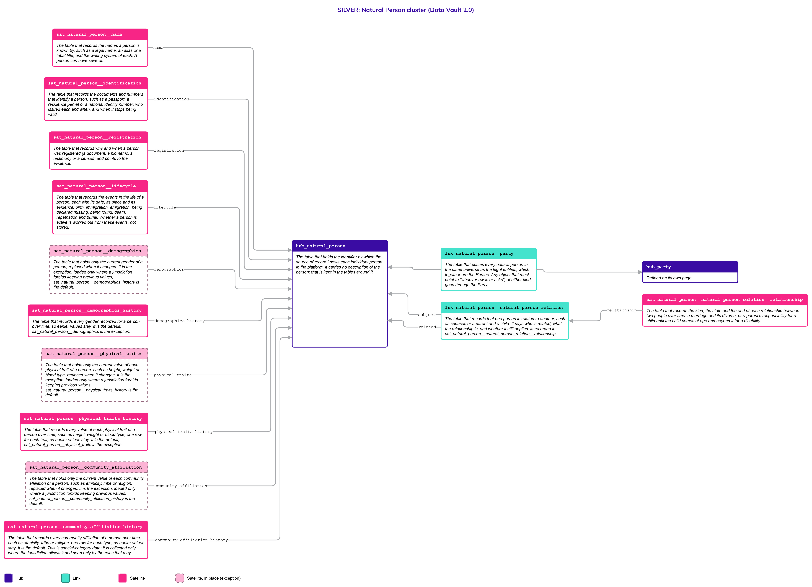
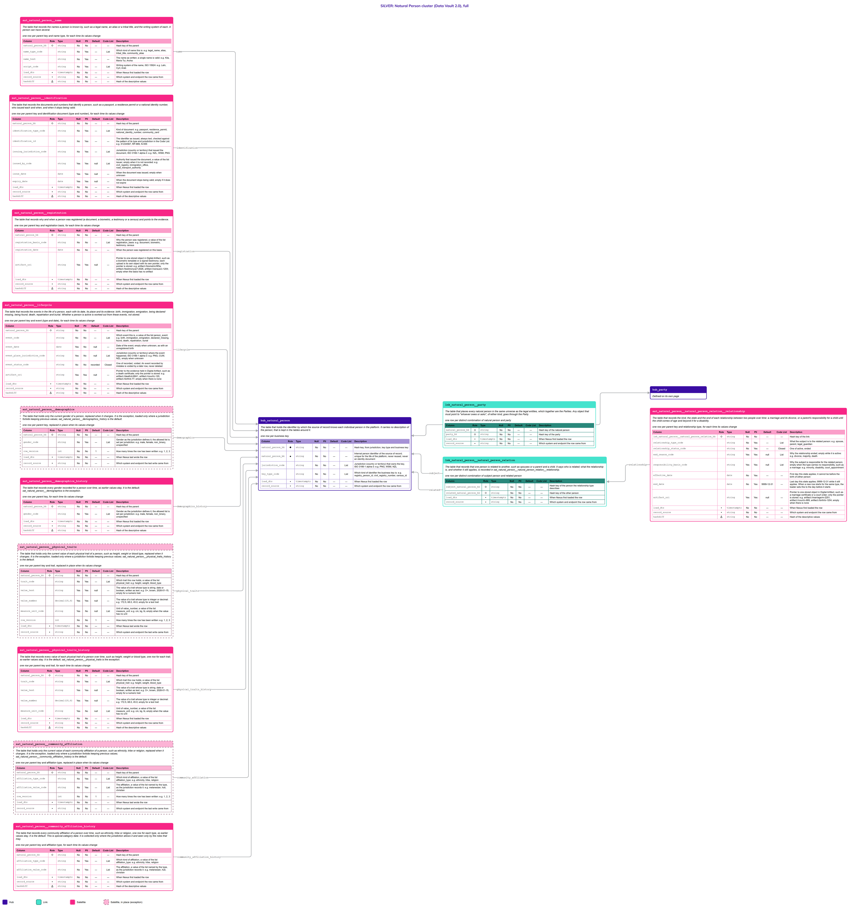

# Natural Person

## Header

| **Field** | **Value** |
| --- | --- |
| Object | Natural Person |
| Parent object | Party |
| Owner domain | Registries |
| Shared with | Taxation Contributions and Licences, Finance, Benefits, Compliance, AEOI |
| Scope | Global |
| Status | Draft |
| Version | 0.1 |
| Last updated | 2026-10-21 |

## Definition

A Natural Person is an individual human being recognized by the State as a subject of rights, obligations and service provision, regardless of civic, legal or migratory status.

The scope is inclusive: full citizens, temporary residents, cross-border workers, long-term tourists, refugees and stateless persons. Citizenship and visa type do not define the person. They are Credentials or Entitlements attached to the person (see the Legal objects).

## Why it is its own object

- **It is identified differently from a Legal Entity.** A Natural Person can exist with no national identity number and no passport, created from biometrics, a testimony from a local authority such as a village chief, or a census record. A Legal Entity is identified by a registration or tax number, or, if it is informal, by a registry code tied to a community. One shared identification structure would force one of them into the shape of the other.
- **It is the only object tied to a biological lifecycle.** It becomes active with an origin event (birth or immigration) and is inactivated, never deleted, by a termination event (confirmed death). A Legal Entity is created and ended by administrative acts.
- **Its identifiers change; the person does not.** A foreign resident may be known first by a passport, then by a residence permit, then by a national identity number. The person is the same throughout.
- **Name structures differ.** The model cannot force First Name, Middle Name and Last Name: single names (mononyms), tribal titles, community aliases and local character sets are all valid.

If a Natural Person were merged into a single Party table, every registry would have to invent a document number for people who have none, and every change of identifier would look like a new person.

## Vault objects

| **Type** | **Name** | **Definition** | **Grain** | **Business key** |
| --- | --- | --- | --- | --- |
| Hub | `hub_natural_person` | The table that holds the identifier by which the source of record knows each individual person in the platform. It carries no description of the person; that is kept in the tables around it. | one row per business key | `natural_person_bk`: the internal person identifier of the source of record, set in the platform configuration. It is assigned once, never changed and never reused, so it stays unique for the life of the platform, and it is sized for everyone the State will ever register, not only today's population. It is not an identity document, and it cannot collide with a Legal Entity, which has its own Hub and its own keys |
| Link | `lnk_natural_person__party` | The table that places every natural person in the same universe as the legal entities, which together are the Parties. Any object that must point to "whoever owes or asks", of either kind, goes through the Party. | one row per distinct combination of natural person and party | `hub_natural_person`, `hub_party` |
| Link | `lnk_natural_person__natural_person_relation` | The table that records that one person is related to another, such as spouses or a parent and a child. It says who is related; what the relationship is, and whether it still applies, is recorded in `sat_natural_person__natural_person_relation__relationship`. | one row per distinct combination of subject person and related person | `hub_natural_person` (subject), `hub_natural_person` (related) |
| Satellite | `sat_natural_person__name` | The table that records the names a person is known by, such as a legal name, an alias or a tribal title, and the writing system of each. A person can have several. | one row per parent key and name type, for each time its values change | — |
| Satellite | `sat_natural_person__identification` | The table that records the documents and numbers that identify a person, such as a passport, a residence permit or a national identity number, who issued each and when, and when it stops being valid. | one row per parent key and identification document (type and number), for each time its values change | — |
| Satellite | `sat_natural_person__registration` | The table that records why and when a person was registered (a document, a biometric, a testimony or a census) and points to the evidence. | one row per parent key and registration basis, for each time its values change | — |
| Satellite | `sat_natural_person__lifecycle` | The table that records the events in the life of a person, each with its date, its place and its evidence: birth, immigration, emigration, being declared missing, being found, death, repatriation and burial. Whether a person is active is worked out from these events, not stored. | one row per parent key and event (type and date), for each time its values change | — |
| Satellite | `sat_natural_person__demographics` | The table that holds only the current gender of a person, replaced when it changes. It is the exception, loaded only where a jurisdiction forbids keeping previous values; `sat_natural_person__demographics_history` is the default. | one row per parent key, replaced in place when its values change | — |
| Satellite | `sat_natural_person__demographics_history` | The table that records every gender recorded for a person over time, so earlier values stay. It is the default; `sat_natural_person__demographics` is the exception. | one row per parent key, for each time its values change | — |
| Satellite | `sat_natural_person__physical_traits` | The table that holds only the current value of each physical trait of a person, such as height, weight or blood type, replaced when it changes. It is the exception, loaded only where a jurisdiction forbids keeping previous values; `sat_natural_person__physical_traits_history` is the default. | one row per parent key and trait, replaced in place when its values change | — |
| Satellite | `sat_natural_person__physical_traits_history` | The table that records every value of each physical trait of a person over time, such as height, weight or blood type, one row for each trait, so earlier values stay. It is the default; `sat_natural_person__physical_traits` is the exception. | one row per parent key and trait, for each time its values change | — |
| Satellite | `sat_natural_person__community_affiliation` | The table that holds only the current value of each community affiliation of a person, such as ethnicity, tribe or religion, replaced when it changes. It is the exception, loaded only where a jurisdiction forbids keeping previous values; `sat_natural_person__community_affiliation_history` is the default. | one row per parent key and affiliation type, replaced in place when its values change | — |
| Satellite | `sat_natural_person__community_affiliation_history` | The table that records every community affiliation of a person over time, such as ethnicity, tribe or religion, one row for each type, so earlier values stay. It is the default. This is special-category data: it is collected only where the jurisdiction allows it and seen only by the roles that may. | one row per parent key and affiliation type, for each time its values change | — |
| Satellite | `sat_natural_person__natural_person_relation__relationship` | The table that records the kind, the state and the end of each relationship between two people over time: a marriage and its divorce, or a parent's responsibility for a child until the child comes of age and beyond it for a disability. | one row per parent key and relationship type, for each time its values change | — |

The hash key `natural_person_hk` is computed from `jurisdiction_code`, `key_type_code` and the normalized `natural_person_bk`, joined with a fixed separator. Normalization: trimmed, case-folded, Unicode-normalized. The hash algorithm is a platform decision and is not named here. Satellites carry only the parent's hash key.

## Fields

*Indicators in Role: ◆ own hash key · ◇ hash key of another object · ● business key · ▪ load metadata · Δ hashdiff. Default: — means no default, so the loader must supply the value; a literal is a default in the sense of Iceberg format version 3. Code List: `List` — the values are a list of the Code List object and the column has a row in the table of the Code List page; `Closed` — a closed list, written in the Description as One of; `—` — the column is not a code.*

### hub_natural_person

| **Column** | **Role** | **Type** | **Null** | **PII** | **Default** | **Code List** | **Description** |
| --- | --- | --- | --- | --- | --- | --- | --- |
| `natural_person_hk` | ◆ | `string` | No | No | — | — | Hash key, from jurisdiction, key type and business key |
| `natural_person_bk` | ● | `string` | No | No | — | — | Internal person identifier of the source of record; unique for the life of the platform, never reused, never an identity document |
| `jurisdiction_code` |  | `string` | No | No | — | List | Jurisdiction (country or territory) that owns the key, ISO 3166-1 alpha-3: e.g. `PNG`, `WSM`, `NZL` |
| `key_type_code` |  | `string` | No | No | — | List | Which kind of identifier the business key is: e.g. `registry_person_id`, `civil_registry_number`, `census_id` |
| `load_dts` | ▪ | `timestamptz` | No | No | — | — | When Nexus first loaded the row |
| `record_source` | ▪ | `string` | No | No | — | — | Which system and endpoint the row came from |

### lnk_natural_person__party

| **Column** | **Role** | **Type** | **Null** | **PII** | **Default** | **Code List** | **Description** |
| --- | --- | --- | --- | --- | --- | --- | --- |
| `natural_person_hk` | ◇ | `string` | No | No | — | — | Hash key of the natural person |
| `party_hk` | ◇ | `string` | No | No | — | — | Hash key of the party |
| `load_dts` | ▪ | `timestamptz` | No | No | — | — | When Nexus first loaded the row |
| `record_source` | ▪ | `string` | No | No | — | — | Which system and endpoint the row came from |

### sat_natural_person__name

| **Column** | **Role** | **Type** | **Null** | **PII** | **Default** | **Code List** | **Description** |
| --- | --- | --- | --- | --- | --- | --- | --- |
| `natural_person_hk` | ◇ | `string` | No | No | — | — | Hash key of the parent |
| `name_type_code` |  | `string` | No | Yes | — | List | Which kind of name this is: e.g. `legal_name`, `alias`, `tribal_title`, `community_alias` |
| `name_text` |  | `string` | No | Yes | — | — | The name as written; a single name is valid: e.g. `Kila`, `Maria Tui`, `Aroha` |
| `script_code` |  | `string` | No | Yes | — | List | Writing system of the name, ISO 15924: e.g. `Latn`, `Cyrl`, `Arab` |
| `load_dts` | ▪ | `timestamptz` | No | No | — | — | When Nexus first loaded the row |
| `record_source` | ▪ | `string` | No | No | — | — | Which system and endpoint the row came from |
| `hashdiff` | Δ | `string` | No | No | — | — | Hash of the descriptive values |

### sat_natural_person__identification

| **Column** | **Role** | **Type** | **Null** | **PII** | **Default** | **Code List** | **Description** |
| --- | --- | --- | --- | --- | --- | --- | --- |
| `natural_person_hk` | ◇ | `string` | No | No | — | — | Hash key of the parent |
| `identification_type_code` |  | `string` | No | Yes | — | List | Kind of document: e.g. `passport`, `residence_permit`, `national_identity_number`, `community_card` |
| `identification_id` |  | `string` | No | Yes | — | — | The identifier as issued, always text, checked against the pattern of its type and jurisdiction in the Code List: e.g. `X1234567`, `RP-889`, `N-555` |
| `issuing_jurisdiction_code` |  | `string` | No | Yes | — | List | Jurisdiction (country or territory) that issued the document, ISO 3166-1 alpha-3: e.g. `NZL`, `WSM`, `PNG` |
| `issued_by_code` |  | `string` | Yes | Yes | null | List | Authority that issued the document, a value of the list `issuer`; empty when it is not recorded: e.g. `civil_registry`, `immigration_office`, `road_transport_authority` |
| `issue_date` |  | `date` | Yes | Yes | null | — | When the document was issued; empty when unknown |
| `expiry_date` |  | `date` | Yes | Yes | null | — | When the document stops being valid; empty if it does not expire |
| `load_dts` | ▪ | `timestamptz` | No | No | — | — | When Nexus first loaded the row |
| `record_source` | ▪ | `string` | No | No | — | — | Which system and endpoint the row came from |
| `hashdiff` | Δ | `string` | No | No | — | — | Hash of the descriptive values |

### sat_natural_person__registration

| **Column** | **Role** | **Type** | **Null** | **PII** | **Default** | **Code List** | **Description** |
| --- | --- | --- | --- | --- | --- | --- | --- |
| `natural_person_hk` | ◇ | `string` | No | No | — | — | Hash key of the parent |
| `registration_basis_code` |  | `string` | No | No | — | List | Why the person was registered, a value of the list `registration_basis`: e.g. `document`, `biometric`, `testimony`, `census` |
| `registration_date` |  | `date` | No | No | — | — | When the person was registered on this basis |
| `artifact_uri` |  | `string` | Yes | Yes | null | — | Pointer to one stored object in Digital Artifact, such as a biometric template or a signed testimony; each upload is its own object with its own pointer; only the pointer is stored: e.g. `artifact://biometric/9f3a`, `artifact://testimony/p7-2026`, `artifact://census/c-1204`; empty when the basis has no artifact |
| `load_dts` | ▪ | `timestamptz` | No | No | — | — | When Nexus first loaded the row |
| `record_source` | ▪ | `string` | No | No | — | — | Which system and endpoint the row came from |
| `hashdiff` | Δ | `string` | No | No | — | — | Hash of the descriptive values |

### sat_natural_person__lifecycle

One row for each event in the life of a person. A new kind of event is a new value of the Code List `person_event` and changes no table (Principles, "Events as rows"). Whether a person is active is not stored: the Gold view `cur_natural_person__status` works it out from the events in date order and the effect each event has on the status (see Modeling considerations).

| **Column** | **Role** | **Type** | **Null** | **PII** | **Default** | **Code List** | **Description** |
| --- | --- | --- | --- | --- | --- | --- | --- |
| `natural_person_hk` | ◇ | `string` | No | No | — | — | Hash key of the parent |
| `event_code` |  | `string` | No | No | — | List | Which event this is, a value of the list `person_event`: e.g. `birth`, `immigration`, `emigration`, `declared_missing`, `found`, `death`, `repatriation`, `burial` |
| `event_date` |  | `date` | Yes | No | null | — | Date of the event; empty when unknown, as with an unregistered birth |
| `event_place_jurisdiction_code` |  | `string` | Yes | No | null | List | Jurisdiction (country or territory) where the event happened, ISO 3166-1 alpha-3: e.g. `PNG`, `CUW`, `NZL`; empty when unknown |
| `event_status_code` |  | `string` | No | No | `recorded` | Closed | One of `recorded`, `voided`. An event recorded by mistake is voided by a later row, never deleted |
| `artifact_uri` |  | `string` | Yes | Yes | null | — | Pointer to the evidence held in Digital Artifact, such as a death certificate; only the pointer is stored: e.g. `artifact://death/d-8841`, `artifact://court/c-120`, `artifact://birth/b-77`; empty when there is none |
| `load_dts` | ▪ | `timestamptz` | No | No | — | — | When Nexus first loaded the row |
| `record_source` | ▪ | `string` | No | No | — | — | Which system and endpoint the row came from |
| `hashdiff` | Δ | `string` | No | No | — | — | Hash of the descriptive values |

### sat_natural_person__demographics

The exception: the row is updated in place (row versioning), and it is loaded only for a jurisdiction that forbids keeping previous values. `row_version` starts at 1 and goes up by one with each update. The only row of a parent key is the current one: `row_version` counts the writes and is never used to choose between rows. A previous value is gone only after snapshots are expired and files are rewritten (Principles). It serves the same purpose as `sat_natural_person__demographics_history`, the default; the [Load Configuration](Load_Configuration.md) says which one a jurisdiction loads.

| **Column** | **Role** | **Type** | **Null** | **PII** | **Default** | **Code List** | **Description** |
| --- | --- | --- | --- | --- | --- | --- | --- |
| `natural_person_hk` | ◇ | `string` | No | No | — | — | Hash key of the parent |
| `gender_code` |  | `string` | No | Yes | — | List | Gender as the jurisdiction defines it; the allowed list is set per jurisdiction: e.g. `male`, `female`, `non_binary`, `unspecified` |
| `row_version` |  | `int` | No | No | `1` | — | How many times the row has been written: e.g. `1`, `2`, `3` |
| `load_dts` | ▪ | `timestamptz` | No | No | — | — | When Nexus last wrote the row |
| `record_source` | ▪ | `string` | No | No | — | — | Which system and endpoint the last write came from |

### sat_natural_person__demographics_history

The default: keeps its history, and every change adds a row (SCD Type 2). The current row is the one with the latest `load_dts` for each parent key. The allowed `gender_code` values depend on the jurisdiction and can change over time; an old row keeps the code it was recorded with. It carries the same attributes as `sat_natural_person__demographics`.

| **Column** | **Role** | **Type** | **Null** | **PII** | **Default** | **Code List** | **Description** |
| --- | --- | --- | --- | --- | --- | --- | --- |
| `natural_person_hk` | ◇ | `string` | No | No | — | — | Hash key of the parent |
| `gender_code` |  | `string` | No | Yes | — | List | Gender as the jurisdiction defines it; the allowed list is set per jurisdiction: e.g. `male`, `female`, `non_binary`, `unspecified` |
| `load_dts` | ▪ | `timestamptz` | No | No | — | — | When Nexus first loaded the row |
| `record_source` | ▪ | `string` | No | No | — | — | Which system and endpoint the row came from |
| `hashdiff` | Δ | `string` | No | No | — | — | Hash of the descriptive values |

### sat_natural_person__physical_traits

The exception: the row is updated in place (row versioning), and it is loaded only for a jurisdiction that forbids keeping previous values. `row_version` starts at 1 and goes up by one with each update. The only row of a parent key and trait is the current one. A previous value is gone only after snapshots are expired and files are rewritten (Principles). It serves the same purpose as `sat_natural_person__physical_traits_history`, the default; the [Load Configuration](Load_Configuration.md) says which one a jurisdiction loads. One row holds one trait (Principles, "Traits as rows").

| **Column** | **Role** | **Type** | **Null** | **PII** | **Default** | **Code List** | **Description** |
| --- | --- | --- | --- | --- | --- | --- | --- |
| `natural_person_hk` | ◇ | `string` | No | No | — | — | Hash key of the parent |
| `trait_code` |  | `string` | No | Yes | — | List | Which trait this row holds, a value of the list `physical_trait`: e.g. `height`, `weight`, `blood_type` |
| `value_text` |  | `string` | Yes | Yes | null | — | The value of a trait whose type is `string`, `date` or `boolean`, written as text: e.g. `O+`, `brown`, `2026-01-15`; empty for a numeric trait |
| `value_number` |  | `decimal(18,6)` | Yes | Yes | null | — | The value of a trait whose type is `integer` or `decimal`: e.g. `172.5`, `68.0`, `45.0`; empty for a text trait |
| `measure_unit_code` |  | `string` | Yes | No | null | List | Unit of `value_number`, a value of the list `measure_unit`: e.g. `cm`, `kg`, `lb`; empty when the value has no unit |
| `row_version` |  | `int` | No | No | `1` | — | How many times the row has been written: e.g. `1`, `2`, `3` |
| `load_dts` | ▪ | `timestamptz` | No | No | — | — | When Nexus last wrote the row |
| `record_source` | ▪ | `string` | No | No | — | — | Which system and endpoint the last write came from |

### sat_natural_person__physical_traits_history

The default: keeps its history, and every change adds a row (SCD Type 2). The data type of each trait is declared in the Code List (`sat_code_value__validation`), and the load checks the value against it. It carries the same attributes as `sat_natural_person__physical_traits`.

| **Column** | **Role** | **Type** | **Null** | **PII** | **Default** | **Code List** | **Description** |
| --- | --- | --- | --- | --- | --- | --- | --- |
| `natural_person_hk` | ◇ | `string` | No | No | — | — | Hash key of the parent |
| `trait_code` |  | `string` | No | Yes | — | List | Which trait this row holds, a value of the list `physical_trait`: e.g. `height`, `weight`, `blood_type` |
| `value_text` |  | `string` | Yes | Yes | null | — | The value of a trait whose type is `string`, `date` or `boolean`, written as text: e.g. `O+`, `brown`, `2026-01-15`; empty for a numeric trait |
| `value_number` |  | `decimal(18,6)` | Yes | Yes | null | — | The value of a trait whose type is `integer` or `decimal`: e.g. `172.5`, `68.0`, `45.0`; empty for a text trait |
| `measure_unit_code` |  | `string` | Yes | No | null | List | Unit of `value_number`, a value of the list `measure_unit`: e.g. `cm`, `kg`, `lb`; empty when the value has no unit |
| `load_dts` | ▪ | `timestamptz` | No | No | — | — | When Nexus first loaded the row |
| `record_source` | ▪ | `string` | No | No | — | — | Which system and endpoint the row came from |
| `hashdiff` | Δ | `string` | No | No | — | — | Hash of the descriptive values |

### sat_natural_person__community_affiliation

The exception: the row is updated in place (row versioning), and it is loaded only for a jurisdiction that forbids keeping previous values. `row_version` starts at 1 and goes up by one with each update. The only row of a parent key and affiliation type is the current one. A previous value is gone only after snapshots are expired and files are rewritten (Principles). Special-category personal data, collected only where the jurisdiction allows it and only for roles that may see it. Where a jurisdiction does not collect it, no row exists. It serves the same purpose as `sat_natural_person__community_affiliation_history`, the default; the [Load Configuration](Load_Configuration.md) says which one a jurisdiction loads. One row holds one affiliation (Principles, "Traits as rows").

| **Column** | **Role** | **Type** | **Null** | **PII** | **Default** | **Code List** | **Description** |
| --- | --- | --- | --- | --- | --- | --- | --- |
| `natural_person_hk` | ◇ | `string` | No | No | — | — | Hash key of the parent |
| `affiliation_type_code` |  | `string` | No | Yes | — | List | Which kind of affiliation, a value of the list `affiliation_type`: e.g. `ethnicity`, `tribe`, `religion` |
| `affiliation_value_code` |  | `string` | No | Yes | — | List | The affiliation, a value of the list named by the type, as the jurisdiction records it: e.g. `melanesian`, `huli`, `christian` |
| `row_version` |  | `int` | No | No | `1` | — | How many times the row has been written: e.g. `1`, `2`, `3` |
| `load_dts` | ▪ | `timestamptz` | No | No | — | — | When Nexus last wrote the row |
| `record_source` | ▪ | `string` | No | No | — | — | Which system and endpoint the last write came from |

### sat_natural_person__community_affiliation_history

The default: keeps its history, and every change adds a row (SCD Type 2). Special-category personal data, collected only where the jurisdiction allows it and only for roles that may see it. Where a jurisdiction does not collect it, no row exists. A new kind of affiliation is a new value of the list `affiliation_type`. It carries the same attributes as `sat_natural_person__community_affiliation`.

| **Column** | **Role** | **Type** | **Null** | **PII** | **Default** | **Code List** | **Description** |
| --- | --- | --- | --- | --- | --- | --- | --- |
| `natural_person_hk` | ◇ | `string` | No | No | — | — | Hash key of the parent |
| `affiliation_type_code` |  | `string` | No | Yes | — | List | Which kind of affiliation, a value of the list `affiliation_type`: e.g. `ethnicity`, `tribe`, `religion` |
| `affiliation_value_code` |  | `string` | No | Yes | — | List | The affiliation, a value of the list named by the type, as the jurisdiction records it: e.g. `melanesian`, `huli`, `christian` |
| `load_dts` | ▪ | `timestamptz` | No | No | — | — | When Nexus first loaded the row |
| `record_source` | ▪ | `string` | No | No | — | — | Which system and endpoint the row came from |
| `hashdiff` | Δ | `string` | No | No | — | — | Hash of the descriptive values |

### lnk_natural_person__natural_person_relation

A relationship between two people. The **subject** is the person the relationship type describes, and the **related** person is the other side: for the type `parent`, the subject is the parent and the related person is the child. A relationship that is the same from both sides, such as a marriage, is stored once, with the lower hash key as the subject.

| **Column** | **Role** | **Type** | **Null** | **PII** | **Default** | **Code List** | **Description** |
| --- | --- | --- | --- | --- | --- | --- | --- |
| `subject_natural_person_hk` | ◇ | `string` | No | No | — | — | Hash key of the person the relationship type describes |
| `related_natural_person_hk` | ◇ | `string` | No | No | — | — | Hash key of the other person |
| `load_dts` | ▪ | `timestamptz` | No | No | — | — | When Nexus first loaded the row |
| `record_source` | ▪ | `string` | No | No | — | — | Which system and endpoint the row came from |

### sat_natural_person__natural_person_relation__relationship

The kind of relationship, its state and the reason it started or ended are dimensions of one fact, so they share a Satellite. Each relationship type is its own row: two people can be spouses and, at the same time, one can be the legal guardian of the other.

| **Column** | **Role** | **Type** | **Null** | **PII** | **Default** | **Code List** | **Description** |
| --- | --- | --- | --- | --- | --- | --- | --- |
| `lnk_natural_person__natural_person_relation_hk` | ◇ | `string` | No | No | — | — | Hash key of the link |
| `relationship_type_code` |  | `string` | No | Yes | — | List | What the subject is to the related person: e.g. `spouse`, `parent`, `legal_guardian` |
| `relationship_status_code` |  | `string` | No | Yes | — | Closed | One of `active`, `ended` |
| `end_reason_code` |  | `string` | Yes | Yes | null | List | Why the relationship ended; empty while it is active: e.g. `divorce`, `majority`, `death` |
| `responsibility_basis_code` |  | `string` | Yes | Yes | null | List | Why the subject is responsible for the related person; empty when the type carries no responsibility, such as a marriage: e.g. `minority`, `disability`, `court_appointment` |
| `effective_date` |  | `date` | No | Yes | — | — | First day this state applies; it cannot be before the birth of either person |
| `end_date` |  | `date` | No | Yes | `9999-12-31` | — | Last day this state applies; `9999-12-31` while it still applies. When a new row starts for the same type, the loader sets this to the day before it starts |
| `artifact_uri` |  | `string` | Yes | Yes | null | — | Pointer to one stored object in Digital Artifact, such as a marriage certificate or a court order; only the pointer is stored: e.g. `artifact://marriage/m-2201`, `artifact://court/c-889`, `artifact://birth/b-1204`; empty when there is none |
| `load_dts` | ▪ | `timestamptz` | No | No | — | — | When Nexus first loaded the row |
| `record_source` | ▪ | `string` | No | No | — | — | Which system and endpoint the row came from |
| `hashdiff` | Δ | `string` | No | No | — | — | Hash of the descriptive values |

## Sources and mapping

No endpoints declared yet

## Jurisdictions map

| **Edge case** | **Where it happens** | **Approach** | **Vault effect** |
| --- | --- | --- | --- |
| Single names (mononyms) and tribal titles | Papua New Guinea and other island and customary-law communities | The name is stored as written in `name_text`; no first, middle or last name is required (R7: a scenario of the same object) | `sat_natural_person__name`, with the kind of name in `name_type_code` |
| No identity document: refugees, stateless persons, unregistered births | Refugee-hosting and emerging-economy jurisdictions | The person exists without an identification row; the key is assigned by the registry | No row in `sat_natural_person__identification`; basis recorded in `sat_natural_person__registration` |
| Record created from a local authority's testimony | Customary-law communities, for example a village chief in Papua New Guinea | Registration basis is testimony; the person is later linked to documents when they exist | A `testimony` row in `sat_natural_person__registration` |
| Local character sets | Any jurisdiction with a non-Latin script | The name keeps its original script; `script_code` says which | `sat_natural_person__name` |
| Temporary residents, cross-border workers, long-term tourists | Any jurisdiction with a migration route | They are the same kind of person; their status is a Credential or Entitlement | Nothing on this object; see the Legal objects |
| Gender recorded with two values, then three or more | A jurisdiction that widens its definition | The code list in force is set for the jurisdiction; each change in a person's value is a new row | New rows in `sat_natural_person__demographics_history`; earlier rows stay as history |
| Gender recorded with three or more values, then two | A jurisdiction that narrows its definition | Same as above; a value no longer in the list stays readable in the earlier rows | New rows in `sat_natural_person__demographics_history` |
| Gender recorded with two values only | A jurisdiction that never widens its definition | Either satellite, with a shorter list | `sat_natural_person__demographics` or `sat_natural_person__demographics_history`, as configured |
| Race, ethnicity, tribe or religion | Jurisdictions differ: some forbid collecting it, others rely on it, for example customary-law communities | Collected only where the jurisdiction allows it; one row for each affiliation type; the values come from a Code List with restricted access | `sat_natural_person__community_affiliation` or `sat_natural_person__community_affiliation_history`, as configured; no row where it is not collected |
| Two people who marry, and later divorce | Any jurisdiction | The relationship is never deleted: the marriage is a row, and the divorce is a new row that ends it | Two rows in `sat_natural_person__natural_person_relation__relationship`, `relationship_status_code` `active` and then `ended` with `end_reason_code` `divorce` |
| A parent responsible for a child until the child comes of age | Any jurisdiction; the age is a rule of the jurisdiction | The responsibility has a basis; when the child comes of age a row ends it | `responsibility_basis_code` `minority`, then a row with `end_reason_code` `majority` |
| Responsibility that continues because of a disability | Any jurisdiction | A new row with the basis `disability` replaces the ending of the earlier one, with no end date | A row with `responsibility_basis_code` `disability`; earlier rows stay as history |
| A person declared missing and found years later | Any jurisdiction with a legal presumption of death | Each fact is an event with its date; nothing is overwritten, so the period of the declaration stays on record | Rows `declared_missing` and `found` in `sat_natural_person__lifecycle` |
| A person who emigrates, dies abroad and is repatriated to the country of birth | Any jurisdiction with a diaspora | Each step is an event with its own place; only death changes the status | Rows `emigration`, `death`, `repatriation` and `burial` in `sat_natural_person__lifecycle`, each with `event_place_jurisdiction_code` |
| Partners who live together and never marry | Any jurisdiction that recognizes a de facto union, or none | A partnership is a relationship type, like a marriage, and not a life event | Rows with `relationship_type_code` `partner` in `sat_natural_person__natural_person_relation__relationship` |
| Passport first, then residence permit, then national identity number | Any jurisdiction with a naturalization route | Each document is a new identification row; the person's key never changes | New rows in `sat_natural_person__identification` |

## Examples

Illustrative data. The first example is a person with no document; the second is a resident whose identifiers change over time.

**A village chief registered from a testimony (Papua New Guinea).**

`hub_natural_person`

| **natural_person_bk** | **jurisdiction_code** | **key_type_code** |
| --- | --- | --- |
| P-7 | PNG | registry_person_id |

`sat_natural_person__name`

| **name_type_code** | **name_text** | **script_code** |
| --- | --- | --- |
| tribal_title | Kila | Latn |

`sat_natural_person__registration`

| **registration_basis_code** | **registration_date** |
| --- | --- |
| testimony | 2026-03-12 |

`sat_natural_person__lifecycle`

| **event_code** | **event_date** | **event_status_code** |
| --- | --- | --- |
| birth | (empty) | recorded |

`sat_natural_person__identification` has no row for this person.

**A foreign resident whose identifiers change (Samoa).** The key `P-1` stays the same throughout.

`sat_natural_person__identification`

| **identification_type_code** | **identification_id** | **issuing_jurisdiction_code** | **issue_date** | **expiry_date** | **Loaded** |
| --- | --- | --- | --- | --- | --- |
| passport | X1234567 | NZL | 2017-05-02 | 2027-05-01 | on arrival |
| passport | X7654321 | NZL | 2027-04-20 | 2037-04-19 | on renewal; the first row stays as history, and the new scan is a new object in Digital Artifact |
| residence_permit | RP-889 | WSM | 2025-01-16 | 2030-01-15 | when the permit was issued |
| national_identity_number | N-555 | WSM | 2030-02-01 | (empty) | after naturalization |

**A person whose jurisdiction widens its gender list.** `sat_natural_person__demographics_history` keeps both rows.

| **gender_code** | **Loaded** |
| --- | --- |
| female | before the change of list |
| non_binary | after the change of list; the first row stays as history |

`sat_natural_person__physical_traits_history` holds a row for each trait and each change, and `cur_natural_person__physical_traits` returns the latest row of each trait. Only in a jurisdiction that forbids keeping previous values is `sat_natural_person__physical_traits` loaded instead, with one row for each trait updated in place.

| **trait_code** | **value_text** | **value_number** | **measure_unit_code** | **Loaded** |
| --- | --- | --- | --- | --- |
| height | (empty) | 170.0 | cm | first measurement |
| height | (empty) | 172.5 | cm | after a new measurement; the first row stays as history |
| blood_type | O+ | (empty) | (empty) | first recorded |

**A person registered in a customary-law community.** `sat_natural_person__community_affiliation_history` keeps each recorded value; the tribe is a value of the Code List `tribe`.

| **affiliation_type_code** | **affiliation_value_code** | **Loaded** |
| --- | --- | --- |
| ethnicity | melanesian | first recorded |
| tribe | huli | first recorded |
| tribe | enga | after a correction; the first tribe row stays as history |

In a jurisdiction that forbids keeping the corrected value, `sat_natural_person__community_affiliation` holds one row for the type `tribe` (`enga`, `row_version` 2) and the earlier value is removed by maintenance.

**Two people who marry and later divorce.** The relationship type `spouse` is stored once for the pair, so there is one Link row and two rows in the Satellite.

`sat_natural_person__natural_person_relation__relationship`

| **relationship_type_code** | **relationship_status_code** | **end_reason_code** | **effective_date** | **end_date** |
| --- | --- | --- | --- | --- |
| spouse | active | (empty) | 2012-05-20 | 2021-09-30 |
| spouse | ended | divorce | 2021-10-01 | 9999-12-31 |

**A parent responsible for a child, extended by a disability.** The child `P-5` is the related person; the parent `P-1` is the subject.

| **relationship_type_code** | **relationship_status_code** | **responsibility_basis_code** | **end_reason_code** | **effective_date** | **end_date** |
| --- | --- | --- | --- | --- | --- |
| parent | active | minority | (empty) | 2008-03-14 | 2026-03-13 |
| parent | active | disability | (empty) | 2026-03-14 | 9999-12-31 |

Each row ends the day before the next one starts. The loader closes the earlier row when the new one arrives, so at most one row of a type is open (`end_date` is `9999-12-31`).

**Three life stories.** Each fact is one row of `sat_natural_person__lifecycle`, shown with `event_code`, `event_date`, `event_place_jurisdiction_code` and `event_status_code`. Whether the person is active is worked out in Gold from the events in date order.

*Declared missing, found two years later.* The person is inactive from 2018-03-15 and active again from 2020-04-02. Nothing was overwritten, so the period in which the State treated the person as dead is still on record. If the declaration was wrong from the start, a later row for `declared_missing` is `voided`; it is not deleted.

| **event_code** | **event_date** | **event_place_jurisdiction_code** | **event_status_code** |
| --- | --- | --- | --- |
| birth | 1980-06-02 | PNG | recorded |
| declared_missing | 2018-03-15 | PNG | recorded |
| found | 2020-04-02 | PNG | recorded |

*Emigrates, dies abroad and is repatriated.* Only the death changes the status; the repatriation and the burial are facts about a person who is already inactive.

| **event_code** | **event_date** | **event_place_jurisdiction_code** | **event_status_code** |
| --- | --- | --- | --- |
| birth | 1950-01-10 | PNG | recorded |
| emigration | 1990-08-01 | PNG | recorded |
| death | 2024-11-05 | CUW | recorded |
| repatriation | 2024-11-20 | PNG | recorded |
| burial | 2024-11-25 | PNG | recorded |

*Marries, divorces, lives with a partner and dies.* A marriage, a divorce and a partnership involve another person, so they are rows of `sat_natural_person__natural_person_relation__relationship`, not life events. The lifecycle holds only `birth` and `death`.

| **relationship_type_code** | **relationship_status_code** | **end_reason_code** | **effective_date** | **end_date** |
| --- | --- | --- | --- | --- |
| spouse | active | (empty) | 2012-05-20 | 2021-09-30 |
| spouse | ended | divorce | 2021-10-01 | 9999-12-31 |
| partner | active | (empty) | 2022-02-01 | 2024-12-10 |
| partner | ended | death | 2024-12-11 | 9999-12-31 |

| **Story** | **This design: events** | **A design with one origin date and one termination date** |
| --- | --- | --- |
| Declared missing, then found | Three rows; nothing is lost | The termination columns hold the declaration. When the person is found they are emptied, and the declaration is lost, or a column for the reversal is added, and a second declaration needs another |
| Emigrates, dies abroad, is repatriated | Five rows, each with its own place | One origin and one termination: emigration, repatriation, burial and the place of death have no column, and each needs a new one |
| Marries, divorces, lives with a partner, dies | Two life events and four relationship rows | The same relationship rows; the lifecycle is only birth and death in both designs, so civil status never belonged in it |

## Modeling considerations

- **Identifiers are facts, not keys.** Passports, permits and national numbers live in `sat_natural_person__identification` and are used to find and match a person. The business key is the source's own person identifier, so adding or replacing a document never changes a key.
- **Validity is never stored.** Whether a document is valid today is worked out when asked, from `expiry_date`. A scheduled check may publish an event when a date passes.
- **A person known under two source keys stays two Hub rows.** They are joined by a same-as relationship recorded when the source reports a merge. Keys are never rewritten and nothing is deleted.
- **Citizenship and visa type are not attributes.** They are Credentials and Entitlements. A residence permit or national identity number is also a Credential in the Legal objects, which carries the right and the issuing Authority; here it is only an identifier.
- **Personal data is kept in its own Satellites.** Name and identification hold personal data. Lifecycle holds events and dates, with no name or document, so it can be read by roles that must not see identity; only its evidence pointer is personal data and is masked for them. Demographics and physical traits hold sensitive personal data and are also kept apart. The registration Satellite holds only a pointer (`artifact_uri`) to evidence in Digital Artifact, which is personal data in itself, so it is marked PII.
- **Community affiliation is special-category data.** Race or ethnicity, tribe and religion are kept in their own Satellites, so that access can be limited to named roles and so that a jurisdiction that does not collect them simply has no row. The access rule is recorded on the Code List (`sat_code_list__access`).
- **History is the default.** Each group is delivered as a pair: the `_history` Satellite, loaded by default, and the in-place Satellite, loaded only where a jurisdiction forbids keeping previous values. The Load Configuration says which one a jurisdiction loads. The current value is read from `cur_<parent>__<descriptor>`, a view over the history Satellite. The reasons, including what Iceberg time travel does and does not give, are in the Principles, "History by default, row versioning by exception".
- **The allowed values of a code belong to a Code List, not to the column.** Codes such as `gender_code`, `jurisdiction_code` and `key_type_code` take their values from the Code List object, which holds them per jurisdiction with validity dates. The column stays a string, so a change of list never changes the table. `trait_code`, `affiliation_type_code`, `event_code`, `issued_by_code` and `measure_unit_code` are Code List values too, so a new trait, event or authority is a new row and no change of table. `event_status_code` and `relationship_status_code` are closed lists written in the Description, because logic depends on them.
- **Derived values are not stored (R13).** Age, age group, the date a person comes of age and whether a person is active are computed in the Gold layer from the events; this page keeps only the dates.
- **A person is never deleted.** A death or a declaration of absence inactivates the record through an event in `sat_natural_person__lifecycle`; a later event, such as `found`, can make the person active again.
- **The person key is internal and has to last.** `natural_person_bk` is not a document number. It is generated or assigned by the source of record and set in the platform configuration for each jurisdiction. It is unique for the life of the platform, never changed and never reused, and it is sized for every person the State will ever register, with room to grow, because the key has to outlive every document and every generation. The key type is part of the hash, and a Legal Entity has its own Hub, so a person and a Legal Entity cannot collide even if their keys look alike; the Party Link is the only place where the two meet.
- **What identifies a name.** A row of `sat_natural_person__name` is identified by the parent key, `name_type_code`, `name_text` and `script_code`. `record_source` is not part of the identity: the same name sent by two sources is one name. Silver keeps the text as written, and no special load is needed for each type of name. Gold builds one normalized name for each `name_type_code` in a view. Where a jurisdiction records the parts of a name, each part is a row whose type is the part (`given_name`, `family_name`) beside the full name, and Gold assembles them; a jurisdiction that does not record parts needs nothing.
- **A script is a writing system, not an encoding.** `script_code` says whether a name is written in Latin, Cyrillic or Arabic letters (ISO 15924). Every text is stored as Unicode; the character encoding is a storage matter of the platform and is not recorded.
- **The form of an identifier is checked, not trusted.** The pattern of each identification type and jurisdiction is kept in the Code List (`sat_code_value__validation`), so a Colombian passport, a United States driver licence and a Curaçao national identity card each have their own rule. A form that does not match is parked with the reason, not rejected (R8). A pattern shows that the form is right, not that the document exists.
- **A document has an issuer and a date.** `issuing_jurisdiction_code` names the country or territory and `issued_by_code` names the authority, a value of the list `issuer`. The authorities are Code List values; a public body that is also a subject, such as a ministry, is a Legal Entity.
- **A renewed document is a new row and a new stored object.** When an identification expires and the citizen uploads a new one, the new document is a new row of `sat_natural_person__identification` and a new object in Digital Artifact, and the old row keeps its own. A person who uploads two passports on two dates has two objects, never one file replaced (R1, Principles, "Evidence is a pointer to one stored object"). Digital Artifact keeps a digest of each object, so duplicates can be found later without any change here.
- **The Vault keeps the two kinds apart; Gold reads them together.** Names, identifiers, events and places of persons and entities are separate Satellites because their personal data, their volumes and their load keys differ. The Gold views `party__name`, `party__identification`, `party__lifecycle` and `party__location` are the union of the two, computed and never stored (R13).
- **Registration bases are Code List values.** `registration_basis_code` takes its values from the list `registration_basis`.
- **Gender lists change; rows do not.** When a jurisdiction changes its classification, the old rows keep the code they were recorded with, and the old value is retired, not deleted (Code List). A mapping from the old list to the new one is needed only to report across the change; it is not part of the load, and it is an open decision.
- **The current gender is a single row.** In `sat_natural_person__demographics` the only row of a person is the current one; in `sat_natural_person__demographics_history` it is the row with the latest `load_dts`. `row_version` is never used to pick a row.
- **A trait is a row.** Height, weight, blood type, and any trait added later, are rows of one Satellite. The Code List declares the data type of each trait (`value_data_type_code`) and its usual unit, so the load knows whether to read `value_text` or `value_number`, and a new trait is a new Code List value. The affiliations are built the same way. The Silver load checks each value against its declared type and parks a value that does not fit (R11).
- **The status of a person is derived from events.** The Gold view `cur_natural_person__status` reads the events in date order, skips the voided ones and applies the effect of each event on the status:

| **Event** | **Effect on the status** |
| --- | --- |
| `birth`, `immigration`, `found` | The person is active |
| `death`, `declared_missing` | The person is inactive |
| `emigration`, `repatriation`, `burial` | No effect; open decision for `emigration` |

- **Quality rules on dates.** The load from Bronze to Silver checks the dates of a person and parks a row that fails with the reason (R8):

| **Rule** | **Applies to** |
| --- | --- |
| Birth date is not after death date | `birth` and `death` in `sat_natural_person__lifecycle` |
| Birth date is not after any other event date of the person | Every event after `birth` |
| `declared_missing` comes before `found`, and `death` before `repatriation` and `burial` | Order of events of one person |
| No event date is later than the date of the load | Every event |
| Birth date is before the date the person comes of age in the jurisdiction | Gold rule used to end a `minority` responsibility |
| Registration date is not before the birth date, when both are known | `sat_natural_person__registration` and the `birth` event |
| Issue date is not after expiry date, and not before the birth date | `sat_natural_person__identification` |
| `effective_date` is not before the birth date of the subject or of the related person; `end_date` is not before `effective_date` | `sat_natural_person__natural_person_relation__relationship` |
| Two rows of one key and type do not overlap, and at most one is open | Every validity range (Principles, "Validity ranges") |

- **An open end is `9999-12-31`.** `end_date` of a relationship is `9999-12-31` while the state still applies. When a new row for the same type arrives, the loader sets the end of the previous row to the day before the new start, so the last row of a type is the only one that carries `9999-12-31`.
- **A relationship between people has its own Link.** A marriage or a custody can only exist between two people, so the Link joins the Natural Person Hub to itself. It is not the Party Link: a generic Party-to-Party Link would let a marriage join two companies and would leave the whole meaning to a type code.
- **Direction.** The relationship type says what the subject is to the related person (`parent`, `legal_guardian`). A type that is the same from both sides (`spouse`) is stored once, with the lower hash key as the subject. The opposite reading (`child`) is derived in the Gold layer, never stored.
- **One Satellite, several dimensions.** The type, the state, the end reason and the basis of the responsibility are one fact, so a change of any of them is one new row. The relationship type is part of the grain: the same two people can have several relationships at once.
- **Responsibility is not stored as a flag.** Whether someone is responsible today, and when a child comes of age, are worked out in the Gold layer from the birth date, the rule of the jurisdiction and these rows (R13). An extension for a disability is a new row, never an edit.
- **Family data is personal data.** Every descriptive column is marked PII, the Satellite is kept apart from the Hub, and the evidence is only a pointer (`artifact_uri`).
- **Government Authority is not a Party.** It is platform configuration, the body that acts on the platform. A public body that holds rights or pays taxes is a Legal Entity, and so a Party.

## Diagram

Two pictures of the same cluster. Read the simplified one first, then use the full one when you need the columns. Colors: Hub indigo, Link teal, Satellite magenta; a Satellite updated in place is lighter, with a dashed border. Arrows run from the child to its parent.

### Simplified version

The shape of the cluster: 1 Hub, 2 Links and 11 Satellites, each with its name and grain. Use it to see how the objects relate. It has no columns.

### Full version

The same objects, each with its Fields table (column, role, type, null, PII, default, description). Use it to check exactly what is stored. It is wide: zoom in or open the image on its own.

## Open decisions

| **Decision** | **Owner** | **How it is decided** | **Decide by** |
| --- | --- | --- | --- |
| How biometric templates attach to a person | Data Architecture Engineer and Data Product Owner | Only a pointer is stored here (`artifact_uri` in `sat_natural_person__registration`); the Digital Artifact page defines the artifact and its link | Before the Digital Artifact page is reviewed |
| Whether the attesting authority of a testimony is a Code List value or points to its Legal Entity | Data Architecture Engineer and Data Product Owner | Decided with the platform configuration page | Before the first mapping that needs it |
| Whether the direction rule (the type names what the subject is to the related person, symmetric types stored once) is the one the benefits rules need | Data Architecture Engineer and Data Product Owner | Decided with Benefits, from the first benefit that depends on a family relationship | Before the first mapping that needs it |
| Which relationship types and end reasons become Code List values | Data Architecture Engineer | The Code List object holds them; the rule for which codes qualify is decided with that page | Before the Code List page is reviewed |
| Whether a Legal Entity can be responsible for a person, such as a guardian that is an institution | Data Product Owner | Decided with Benefits; it would be a different Link, because this one joins two people | Before the first mapping that needs it |
| The name of the same-as Link between two Natural Person records | Data Architecture Engineer and Data Product Owner | They decide the name, following the Link rules in the Principles | Before the first mapping that needs it |
| Configuration for a source whose primary key is a document number | Data Architecture Engineer | A key change is treated as a re-key event and recorded with a same-as link | When such a source is onboarded |
| Which Natural Person codes become Code List values | Data Architecture Engineer | The Code List object holds them; the rule for which codes qualify is decided with that page | Before the Code List page is reviewed |
| Which key type and jurisdiction each source uses | Platform configuration | Set in the Nexus configuration for each jurisdiction | When a jurisdiction is configured |
| The minimum size and format of `natural_person_bk`, from the population the State must serve for government operations and its growth | Platform configuration and Data Architecture Engineer | Set for each jurisdiction from its population and the years of operation it plans for | When a jurisdiction is configured |
| Whether `emigration` makes a person inactive for the jurisdiction | Data Product Owner | Decided with Benefits and Taxation, from the first rule that depends on residence | Before the first mapping that needs it |
| Whether the parts of a name (`given_name`, `family_name`) are recorded as rows, and for which jurisdictions | Data Architecture Engineer and Data Product Owner | Decided with the first jurisdiction that records them | When such a jurisdiction is onboarded |
| Whether the authorities that issue documents stay Code List values (`issuer`) or point to their Legal Entity | Data Architecture Engineer and Data Product Owner | Decided with the platform configuration page | Before that page is reviewed |
| How a duplicate image is detected when a citizen uploads a document again | Data Architecture Engineer | Decided with the Digital Artifact page, which keeps the digest of each object | Before the Digital Artifact page is reviewed |
| Whether a mapping from an old gender list to its replacement is kept as data | Data Architecture Engineer and Data Product Owner | Decided with the Code List object, when a jurisdiction first changes a list | When such a change is announced |
