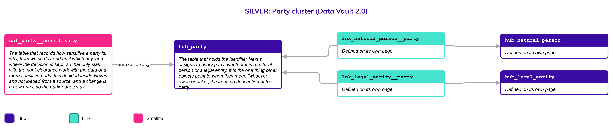
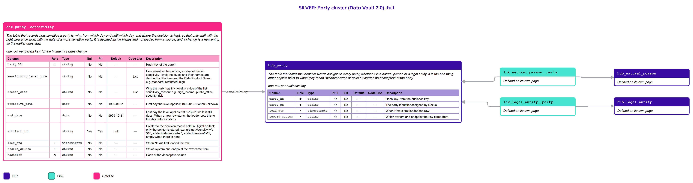

# Party

## Header

| **Field** | **Value** |
| --- | --- |
| Object | Party |
| Parent object | — |
| Owner domain | Registries |
| Shared with | Taxation Contributions and Licences, Finance, Benefits, Compliance, AEOI, Platform |
| Scope | Global |
| Status | Draft |
| Version | 0.1 |
| Last updated | 2026-10-19 |

## Definition

A Party is any actor that interacts with the State through the system, is subject to governance, or holds legal rights and obligations. It groups, without mixing them, the two kinds of actor that use the system to pay taxes or ask for a benefit: Natural Persons and Legal Entities.

A Party is a family, not a place to store attributes. All identification and description live in the two specific objects, [Natural Person](Natural_Person.md) and [Legal Entity](Legal_Entity.md). The one fact a Party holds is how sensitive it is: some parties, such as those with a very high income or a public office, may be worked on only by staff with the right clearance.

## Why it is its own object

Many objects must point to "whoever owes or asks" without caring which kind of actor it is: a tax account, a payment, a benefit claim, a representation. Without a shared Hub, each of those relationships would have to be defined twice, once for Natural Persons and once for Legal Entities, and every new kind of relationship would double again.

A thin Hub gives them one thing to point to. It is thin on purpose: a Natural Person and a Legal Entity identify themselves to the State in different ways and have different lifecycles, so none of that can sit on the Party. The sensitivity is different: Nexus decides it for the whole party, no source delivers it, and everything that points to a party has to respect it, so it has one home.

## Vault objects

| **Type** | **Name** | **Definition** | **Grain** | **Business key** |
| --- | --- | --- | --- | --- |
| Hub | `hub_party` | The table that holds the identifier Nexus assigns to every party, whether it is a natural person or a legal entity. It is the one thing other objects point to when they mean "whoever owes or asks"; it carries no description of the party. | one row per business key | `party_bk`: a party identifier assigned by Nexus when a Natural Person or Legal Entity first becomes a party |
| Satellite | `sat_party__sensitivity` | The table that records how sensitive a party is, why, from which day and until which day, and where the decision is kept, so that only staff with the right clearance work with the data of a more sensitive party. It is decided inside Nexus and not loaded from a source, and a change is a new entry, so the earlier ones stay. | one row per parent key, for each time its values change | — |

The links from the two specific objects to `hub_party` are defined on their own pages: `lnk_natural_person__party` on Natural Person and `lnk_legal_entity__party` on Legal Entity.

## Fields

*Indicators in Role: ◆ own hash key · ◇ hash key of another object · ● business key · ▪ load metadata · Δ hashdiff. Default: — means no default, so the loader must supply the value; a literal is a default in the sense of Iceberg format version 3.*

### hub_party

| **Column** | **Role** | **Type** | **Null** | **PII** | **Default** | **Description** |
| --- | --- | --- | --- | --- | --- | --- |
| `party_hk` | ◆ | `string` | No | No | — | Hash key, from the business key |
| `party_bk` | ● | `string` | No | No | — | The party identifier assigned by Nexus |
| `load_dts` | ▪ | `timestamptz` | No | No | — | When Nexus first loaded the row |
| `record_source` | ▪ | `string` | No | No | — | Which system and endpoint the row came from |

### sat_party__sensitivity

| **Column** | **Role** | **Type** | **Null** | **PII** | **Default** | **Description** |
| --- | --- | --- | --- | --- | --- | --- |
| `party_hk` | ◇ | `string` | No | No | — | Hash key of the parent |
| `sensitivity_level_code` | | `string` | No | No | — | How sensitive the party is, a value of the list `sensitivity_level`; the levels and their names are decided by Platform and the Data Product Owner: e.g. `standard`, `restricted`, `high` |
| `reason_code` | | `string` | No | No | — | Why the party has this level, a value of the list `sensitivity_reason`: e.g. `high_income`, `public_office`, `security_risk` |
| `effective_date` | | `date` | No | No | `1900-01-01` | First day the level applies; `1900-01-01` when unknown |
| `end_date` | | `date` | No | No | `9999-12-31` | Last day the level applies; `9999-12-31` while it still does. When a new row starts, the loader sets this to the day before it starts |
| `artifact_uri` | | `string` | Yes | Yes | null | Pointer to the decision record held in Digital Artifact; only the pointer is stored: e.g. `artifact://sensitivity/s-310`, `artifact://decision/d-77`, `artifact://review/r-12`; empty when there is none |
| `load_dts` | ▪ | `timestamptz` | No | No | — | When Nexus first loaded the row |
| `record_source` | ▪ | `string` | No | No | — | Which system and endpoint the row came from |
| `hashdiff` | Δ | `string` | No | No | — | Hash of the descriptive values |

## Sources and mapping

No endpoints declared yet

## Jurisdictions map

No jurisdiction differences known

## Examples

Illustrative data. A tax account in any jurisdiction points to `hub_party` through a Link, so the same account structure serves a citizen and a company.

`hub_party`

| **party_bk** | **Joined to** |
| --- | --- |
| PTY-0001 | `hub_natural_person` key P-7 (Papua New Guinea) |
| PTY-0002 | `hub_legal_entity`, a family farming collective |

`sat_party__sensitivity` for the party `PTY-0001`

| **sensitivity_level_code** | **reason_code** | **effective_date** | **end_date** |
| --- | --- | --- | --- |
| high | public_office | 2026-01-01 | 9999-12-31 |

## Modeling considerations

- **The Party holds no description of its own.** If a fact describes a person or a company, it belongs on that object. The one exception is `sat_party__sensitivity`, because Nexus assigns it (no source key, so the load needs no lookup), it applies to the whole party, and one place filters everything that points to a party: ownership, and the places of its person or entity.
- **The sensitivity is itself restricted.** Knowing that someone is flagged is sensitive, so the Satellite is readable only by the roles that Platform allows, as `sat_code_list__access` does for a list. Which roles see which level, and how the platform filters every object by it, is enforced by Platform.
- **The criteria are computed, the decision is stored.** A very high income or a public office can propose a level in the Gold layer (R13); the level that is decided, by whom and why, is what the Satellite stores.
- **A public body is a Party, as a Legal Entity.** The State, a ministry, an agency and a foreign government agency hold rights and pay taxes, so each is a Legal Entity classified as public, and a Party. The Government Authority that acts on the platform (issues credentials, grants entitlements) is platform configuration and not a Party, as a user account of the platform is not a Natural Person: the same body or person can be both, with very different requirements.
- **Every party is exactly one Natural Person or one Legal Entity.** The links to the two Hubs carry that rule.
- **Objects that point to "whoever owes or asks" point to `hub_party`,** never directly to the two specific Hubs.

## Diagram

Two pictures of the same cluster. Read the simplified one first, then use the full one when you need the columns. Colors: Hub indigo, Link teal, Satellite magenta; a Satellite updated in place is lighter, with a dashed border. Arrows run from the child to its parent.

### Simplified version

The shape of the cluster: the Hub and its Satellite with their name and grain, and the two Links that join it to Natural Person and Legal Entity, drawn as context because their pages define them. Use it to see how the objects relate. It has no columns.

### Full version

The same objects, each with its Fields table (column, role, type, null, PII, default, description). Use it to check exactly what is stored. It is wide: zoom in or open the image on its own.

## Open decisions

| **Decision** | **Owner** | **How it is decided** | **Decide by** |
| --- | --- | --- | --- |
| How many sensitivity levels there are, what they are called, and which criteria propose them | Platform and Data Product Owner | Set as values of the Code List `sensitivity_level` and `sensitivity_reason`, or `sensitivity_level_code` becomes a closed list if the access rules branch on it; the examples on this page are illustrative | Before the first party is classified |
| Which roles may see each level, and how the platform filters every object by the level of its party | Platform | Decided with the role-based access control design of the platform | Before the first party is classified |
| Whether a level needs an in-place twin where a jurisdiction forbids keeping previous values | Data Architecture Engineer | Decided with the first such jurisdiction | When a jurisdiction asks for it |
