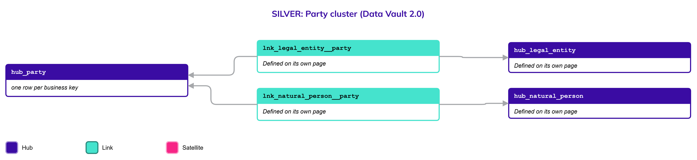

# Party

## Header

| Field | Value |
| --- | --- |
| Object | Party |
| Parent object | — |
| Owner domain | Registries |
| Shared with | Taxation Contributions and Licences, Finance, Benefits, Compliance, AEOI, Platform |
| Scope | Global |
| Status | Draft |
| Version | 0.1 |
| Last updated | 2026-10-19 |

## Definition

A Party is any actor that interacts with the State through the system, is subject to governance, or holds legal rights and obligations. It groups, without mixing them, the two kinds of actor that use the system to pay taxes or ask for a benefit: Natural Persons and Legal Entities.

A Party is a family, not a place to store attributes. All identification and description live in the two specific objects, [Natural Person](Natural_Person.md) and Legal Entity.

## Why it is its own object

Many objects must point to "whoever owes or asks" without caring which kind of actor it is: a tax account, a payment, a benefit claim, a representation. Without a shared Hub, each of those relationships would have to be defined twice, once for Natural Persons and once for Legal Entities, and every new kind of relationship would double again.

A thin Hub gives them one thing to point to. It is thin on purpose: a Natural Person and a Legal Entity identify themselves to the State in different ways and have different lifecycles, so none of that can sit on the Party.

## Vault objects

| Type | Name | Grain | Business key |
| --- | --- | --- | --- |
| Hub | `hub_party` | one row per business key | `party_bk`: a party identifier assigned by Nexus when a Natural Person or Legal Entity first becomes a party |

The links from the two specific objects to `hub_party` are defined on their own pages: `lnk_natural_person__party` on Natural Person and `lnk_legal_entity__party` on Legal Entity.

## Fields

### hub_party

| Column | Type | Null | Personal data | Description |
| --- | --- | --- | --- | --- |
| `party_hk` | `string` | No | No | Hash key, from the business key |
| `party_bk` | `string` | No | No | The party identifier assigned by Nexus |
| `load_dts` | `timestamptz` | No | No | When Nexus first loaded the row |
| `record_source` | `string` | No | No | Which system and endpoint the row came from |

## Sources and mapping

No endpoints declared yet

## Jurisdictions map

No jurisdiction differences known

## Examples

Illustrative data. A tax account in any jurisdiction points to `hub_party` through a Link, so the same account structure serves a citizen and a company.

`hub_party`

| party_bk | Joined to |
| --- | --- |
| PTY-0001 | `hub_natural_person` key P-7 (Papua New Guinea) |
| PTY-0002 | `hub_legal_entity`, a family farming collective |

## Modeling considerations

- **The Party has no attributes of its own.** If a fact describes a person or a company, it belongs on that object.
- **Government Authority is not a Party.** Nexus is deployed into the government's system. The authority that issues credentials and grants entitlements is a Platform object. The only parties are the citizens and the legal entities that use the system to pay taxes or ask for a benefit.
- **Every party is exactly one Natural Person or one Legal Entity.** The links to the two Hubs carry that rule.
- **Objects that point to "whoever owes or asks" point to `hub_party`,** never directly to the two specific Hubs.

## Diagram

## Open decisions

None open
