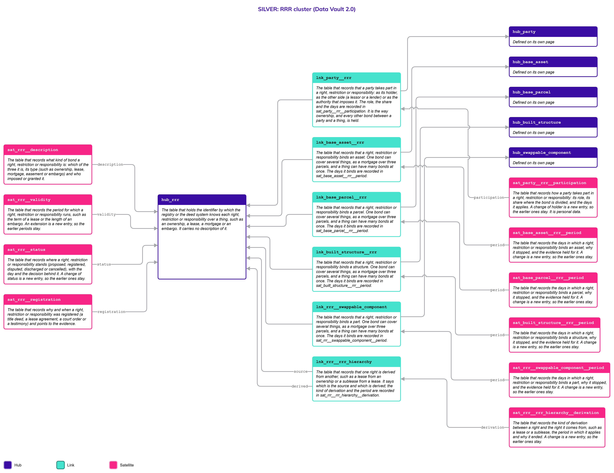
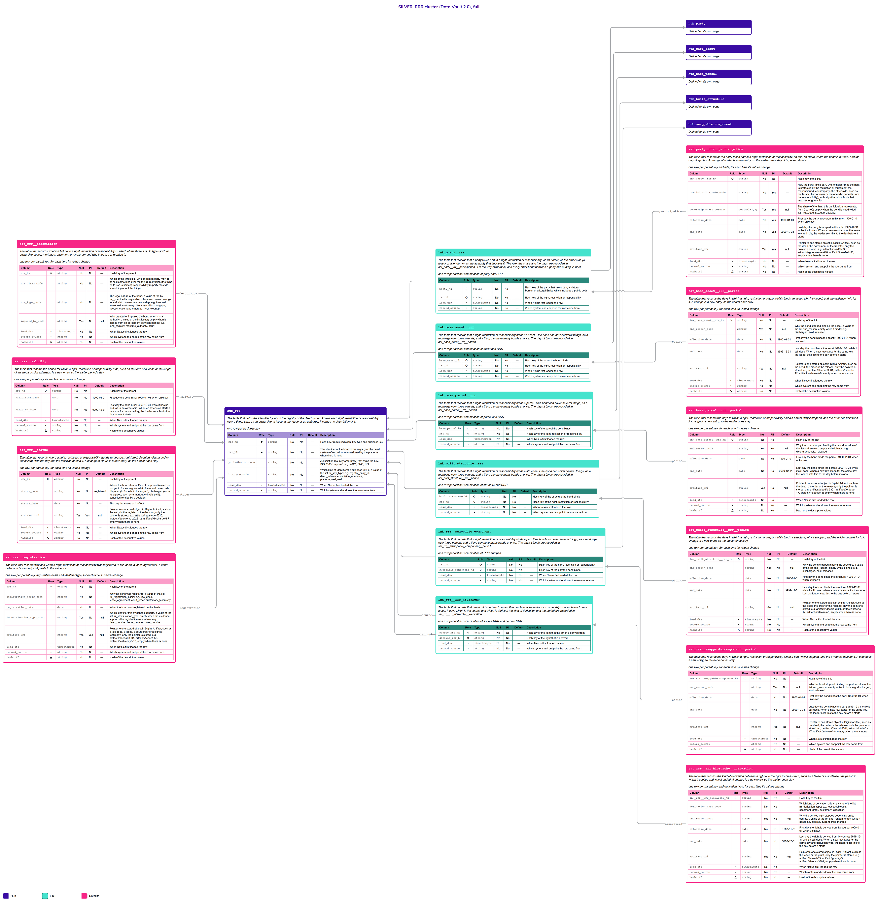

# RRR

## Header

| **Field** | **Value** |
| --- | --- |
| Object | RRR |
| Parent object | Legal |
| Owner domain | Registries |
| Shared with | Taxation Contributions and Licences, Finance, Compliance |
| Scope | Shared |
| Status | Draft |
| Version | 0.1 |
| Last updated | 2026-10-24 |

## Definition

An RRR is a Right, a Restriction or a Responsibility: the specific legal bond between a Party and a thing, a parcel, a structure, an asset or a part. Ownership is a Right. A lease, a right of way and a licence to extract minerals are Rights. A mortgage, an embargo and a ban on building are Restrictions. A duty to clean a river or to maintain a road is a Responsibility. One thing has many of them at the same time.

An RRR governs a thing, and an [Entitlement](Entitlement.md) governs an activity. A business permit is an Entitlement; the ownership of the building where the business runs is an RRR. The proof of an Entitlement is a [Credential](Credential.md), and the document behind an RRR, such as a deed, a lease or a court order, is a pointer on the RRR. The three are explained on the page [Legal](Legal.md).

Ownership is not a special case. The ownership Links that each asset page used to have are gone: an owner is a Party that takes part in an RRR of the class right and of a type that the Code List marks as ownership.

## Why it is its own object

- **One thing, many bonds at once.** The State owns a parcel, a mining company leases it, a tribe has a right of way, a bank holds a mortgage and a company must clean the river. Five bonds, five parties, one parcel. Putting each as a column or a Satellite of the parcel would need a new table for each kind of bond.
- **A bond has its own life.** A mortgage is registered, disputed and discharged; a lease runs for a term; an embargo is lifted. None of that is a change of the parcel, the structure or the asset.
- **A bond can cover several things and involve several parties.** One mortgage can be over three parcels. A lease has a lessor and a lessee. A bond therefore cannot be a column of any of the things or of any of the parties.
- **A bond can come from another.** A lease comes from an ownership and a sublease from a lease. The chain is a fact to keep.
- **It has its own key.** The register entry, the deed or the decision identifies the bond, and it is not the key of the thing.

## Vault objects

*Names follow the convention (R9). The Links to the things are defined here, on the side that depends on the other, and drawn on the pages of the assets.*

| **Type** | **Name** | **Definition** | **Grain** | **Business key** |
| --- | --- | --- | --- | --- |
| Hub | `hub_rrr` | The table that holds the identifier by which the registry or the deed system knows each right, restriction or responsibility over a thing, such as an ownership, a lease, a mortgage or an embargo. It carries no description of it. | one row per business key | `rrr_bk`: the identifier in the registry or the deed system of record, or one assigned by the platform when there is none, with the jurisdiction and the key type |
| Link | `lnk_party__rrr` | The table that records that a party takes part in a right, restriction or responsibility: as its holder, as the other side (a lessor or a lender) or as the authority that imposes it. The role, the share and the days are recorded in `sat_party__rrr__participation`. It is the way ownership, and every other bond between a party and a thing, is held. | one row per distinct combination of party and RRR | `hub_party`, `hub_rrr` |
| Link | `lnk_base_asset__rrr` | The table that records that a right, restriction or responsibility binds an asset. One bond can cover several things, as a mortgage over three parcels, and a thing can have many bonds at once. The days it binds are recorded in `sat_base_asset__rrr__period`. | one row per distinct combination of asset and RRR | `hub_base_asset`, `hub_rrr` |
| Link | `lnk_base_parcel__rrr` | The table that records that a right, restriction or responsibility binds a parcel. One bond can cover several things, as a mortgage over three parcels, and a thing can have many bonds at once. The days it binds are recorded in `sat_base_parcel__rrr__period`. | one row per distinct combination of parcel and RRR | `hub_base_parcel`, `hub_rrr` |
| Link | `lnk_built_structure__rrr` | The table that records that a right, restriction or responsibility binds a structure. One bond can cover several things, as a mortgage over three parcels, and a thing can have many bonds at once. The days it binds are recorded in `sat_built_structure__rrr__period`. | one row per distinct combination of structure and RRR | `hub_built_structure`, `hub_rrr` |
| Link | `lnk_rrr__swappable_component` | The table that records that a right, restriction or responsibility binds a part. One bond can cover several things, as a mortgage over three parcels, and a thing can have many bonds at once. The days it binds are recorded in `sat_rrr__swappable_component__period`. | one row per distinct combination of RRR and part | `hub_rrr`, `hub_swappable_component` |
| Link | `lnk_rrr__rrr_hierarchy` | The table that records that one right is derived from another, such as a lease from an ownership or a sublease from a lease. It says which is the source and which is derived; the kind of derivation and the period are recorded in `sat_rrr__rrr_hierarchy__derivation`. | one row per distinct combination of source RRR and derived RRR | `hub_rrr` (source), `hub_rrr` (derived) |
| Satellite | `sat_rrr__description` | The table that records what kind of bond a right, restriction or responsibility is: which of the three it is, its type (such as ownership, lease, mortgage, easement or embargo) and who imposed or granted it. | one row per parent key, for each time its values change | — |
| Satellite | `sat_rrr__validity` | The table that records the period for which a right, restriction or responsibility runs, such as the term of a lease or the length of an embargo. An extension is a new entry, so the earlier periods stay. | one row per parent key, for each time its values change | — |
| Satellite | `sat_rrr__status` | The table that records where a right, restriction or responsibility stands (proposed, registered, disputed, discharged or cancelled), with the day and the decision behind it. A change of status is a new entry, so the earlier ones stay. | one row per parent key, for each time its values change | — |
| Satellite | `sat_rrr__registration` | The table that records why and when a right, restriction or responsibility was registered (a title deed, a lease agreement, a court order or a testimony) and points to the evidence. | one row per parent key, registration basis and identifier type, for each time its values change | — |
| Satellite | `sat_party__rrr__participation` | The table that records how a party takes part in a right, restriction or responsibility: its role, its share where the bond is divided, and the days it applies. A change of holder is a new entry, so the earlier ones stay. It is personal data. | one row per parent key and role, for each time its values change | — |
| Satellite | `sat_base_asset__rrr__period` | The table that records the days in which a right, restriction or responsibility binds an asset, why it stopped, and the evidence held for it. A change is a new entry, so the earlier ones stay. | one row per parent key, for each time its values change | — |
| Satellite | `sat_base_parcel__rrr__period` | The table that records the days in which a right, restriction or responsibility binds a parcel, why it stopped, and the evidence held for it. A change is a new entry, so the earlier ones stay. | one row per parent key, for each time its values change | — |
| Satellite | `sat_built_structure__rrr__period` | The table that records the days in which a right, restriction or responsibility binds a structure, why it stopped, and the evidence held for it. A change is a new entry, so the earlier ones stay. | one row per parent key, for each time its values change | — |
| Satellite | `sat_rrr__swappable_component__period` | The table that records the days in which a right, restriction or responsibility binds a part, why it stopped, and the evidence held for it. A change is a new entry, so the earlier ones stay. | one row per parent key, for each time its values change | — |
| Satellite | `sat_rrr__rrr_hierarchy__derivation` | The table that records the kind of derivation between a right and the right it comes from, such as a lease or a sublease, the period in which it applies and why it ended. A change is a new entry, so the earlier ones stay. | one row per parent key and derivation type, for each time its values change | — |

`rrr_hk` is computed from `jurisdiction_code`, `key_type_code` and the normalized `rrr_bk`, joined with a fixed separator. Normalization: trimmed, case-folded, Unicode-normalized. The hash algorithm is a platform decision and is not named here. Satellites carry only the parent's hash key.

`lnk_party__rrr` says **who** takes part and in which role. `lnk_base_parcel__rrr`, `lnk_built_structure__rrr`, `lnk_base_asset__rrr` and `lnk_rrr__swappable_component` say **what** it binds, one Link for each kind of thing. There is no Hub that stands for any kind of thing, and no Link to the authority that acts on the platform: a public body that imposes or holds a bond is a Legal Entity classified as public, and takes part through `lnk_party__rrr` with the role `authority` or `holder`. `lnk_rrr__rrr_hierarchy` says that one bond is derived from another.

**Related pages.** The details of every object below are on its own page; the diagrams on this page draw them with a note.

- [Legal](Legal.md): the family page, with the rules the three parts share.
- [Entitlement](Entitlement.md) and [Credential](Credential.md): the right to an activity and its proof.
- [Party](Party.md), with [Natural Person](Natural_Person.md) and [Legal Entity](Legal_Entity.md): `hub_party`, joined by `lnk_party__rrr`.
- [Base Parcel](Base_Parcel.md), [Built Structure](Built_Structure.md), [Base Asset](Base_Asset.md) and [Swappable Component](Swappable_Component.md): the Hubs joined by the four Links to the things.
- [Code List](Code_List.md): the values of every `_code` column.

## Fields

*Indicators in Role: ◆ own hash key · ◇ hash key of another object · ● business key · ▪ load metadata · Δ hashdiff. Default: — means no default, so the loader must supply the value; a literal is a default in the sense of Iceberg format version 3.*

### hub_rrr

| **Column** | **Role** | **Type** | **Null** | **PII** | **Default** | **Description** |
| --- | --- | --- | --- | --- | --- | --- |
| `rrr_hk` | ◆ | `string` | No | No | — | Hash key, from jurisdiction, key type and business key |
| `rrr_bk` | ● | `string` | No | No | — | The identifier of the bond in the registry or the deed system of record, or one assigned by the platform when there is none |
| `jurisdiction_code` |  | `string` | No | No | — | Jurisdiction (country or territory) that owns the key, ISO 3166-1 alpha-3: e.g. `WSM`, `PNG`, `NZL` |
| `key_type_code` |  | `string` | No | No | — | Which kind of identifier the business key is, a value of the list `rrr_key_type`: e.g. `registry_entry_id`, `deed_reference`, `decision_reference`, `platform_assigned` |
| `load_dts` | ▪ | `timestamptz` | No | No | — | When Nexus first loaded the row |
| `record_source` | ▪ | `string` | No | No | — | Which system and endpoint the row came from |

### lnk_party__rrr

| **Column** | **Role** | **Type** | **Null** | **PII** | **Default** | **Description** |
| --- | --- | --- | --- | --- | --- | --- |
| `party_hk` | ◇ | `string` | No | No | — | Hash key of the party that takes part, a Natural Person or a Legal Entity, which includes a public body |
| `rrr_hk` | ◇ | `string` | No | No | — | Hash key of the right, restriction or responsibility |
| `load_dts` | ▪ | `timestamptz` | No | No | — | When Nexus first loaded the row |
| `record_source` | ▪ | `string` | No | No | — | Which system and endpoint the row came from |

### lnk_base_asset__rrr

| **Column** | **Role** | **Type** | **Null** | **PII** | **Default** | **Description** |
| --- | --- | --- | --- | --- | --- | --- |
| `base_asset_hk` | ◇ | `string` | No | No | — | Hash key of the asset the bond binds |
| `rrr_hk` | ◇ | `string` | No | No | — | Hash key of the right, restriction or responsibility |
| `load_dts` | ▪ | `timestamptz` | No | No | — | When Nexus first loaded the row |
| `record_source` | ▪ | `string` | No | No | — | Which system and endpoint the row came from |

### lnk_base_parcel__rrr

| **Column** | **Role** | **Type** | **Null** | **PII** | **Default** | **Description** |
| --- | --- | --- | --- | --- | --- | --- |
| `base_parcel_hk` | ◇ | `string` | No | No | — | Hash key of the parcel the bond binds |
| `rrr_hk` | ◇ | `string` | No | No | — | Hash key of the right, restriction or responsibility |
| `load_dts` | ▪ | `timestamptz` | No | No | — | When Nexus first loaded the row |
| `record_source` | ▪ | `string` | No | No | — | Which system and endpoint the row came from |

### lnk_built_structure__rrr

| **Column** | **Role** | **Type** | **Null** | **PII** | **Default** | **Description** |
| --- | --- | --- | --- | --- | --- | --- |
| `built_structure_hk` | ◇ | `string` | No | No | — | Hash key of the structure the bond binds |
| `rrr_hk` | ◇ | `string` | No | No | — | Hash key of the right, restriction or responsibility |
| `load_dts` | ▪ | `timestamptz` | No | No | — | When Nexus first loaded the row |
| `record_source` | ▪ | `string` | No | No | — | Which system and endpoint the row came from |

### lnk_rrr__swappable_component

| **Column** | **Role** | **Type** | **Null** | **PII** | **Default** | **Description** |
| --- | --- | --- | --- | --- | --- | --- |
| `rrr_hk` | ◇ | `string` | No | No | — | Hash key of the right, restriction or responsibility |
| `swappable_component_hk` | ◇ | `string` | No | No | — | Hash key of the part the bond binds |
| `load_dts` | ▪ | `timestamptz` | No | No | — | When Nexus first loaded the row |
| `record_source` | ▪ | `string` | No | No | — | Which system and endpoint the row came from |

### lnk_rrr__rrr_hierarchy

| **Column** | **Role** | **Type** | **Null** | **PII** | **Default** | **Description** |
| --- | --- | --- | --- | --- | --- | --- |
| `source_rrr_hk` | ◇ | `string` | No | No | — | Hash key of the right that the other is derived from |
| `derived_rrr_hk` | ◇ | `string` | No | No | — | Hash key of the right that is derived |
| `load_dts` | ▪ | `timestamptz` | No | No | — | When Nexus first loaded the row |
| `record_source` | ▪ | `string` | No | No | — | Which system and endpoint the row came from |

### sat_rrr__description

| **Column** | **Role** | **Type** | **Null** | **PII** | **Default** | **Description** |
| --- | --- | --- | --- | --- | --- | --- |
| `rrr_hk` | ◇ | `string` | No | No | — | Hash key of the parent |
| `rrr_class_code` |  | `string` | No | No | — | Which of the three it is. One of `right` (a party may do or hold something over the thing), `restriction` (the thing or its use is limited), `responsibility` (a party must do something about the thing) |
| `rrr_type_code` |  | `string` | No | No | — | The legal nature of the bond, a value of the list `rrr_type`; the list says which class each value belongs to and which values are ownership: e.g. `freehold`, `leasehold`, `customary_title`, `state_title`, `mortgage`, `access_easement`, `embargo`, `river_cleanup` |
| `imposed_by_code` |  | `string` | Yes | No | null | Who granted or imposed the bond when it is an authority, a value of the list `issuer`; empty when it comes from an agreement between parties: e.g. `land_registry`, `maritime_authority`, `court` |
| `load_dts` | ▪ | `timestamptz` | No | No | — | When Nexus first loaded the row |
| `record_source` | ▪ | `string` | No | No | — | Which system and endpoint the row came from |
| `hashdiff` | Δ | `string` | No | No | — | Hash of the descriptive values |

### sat_rrr__validity

| **Column** | **Role** | **Type** | **Null** | **PII** | **Default** | **Description** |
| --- | --- | --- | --- | --- | --- | --- |
| `rrr_hk` | ◇ | `string` | No | No | — | Hash key of the parent |
| `valid_from_date` |  | `date` | No | No | `1900-01-01` | First day the bond runs; `1900-01-01` when unknown |
| `valid_to_date` |  | `date` | No | No | `9999-12-31` | Last day the bond runs; `9999-12-31` while it has no end, as in an ownership. When an extension starts a new row for the same key, the loader sets this to the day before it starts |
| `load_dts` | ▪ | `timestamptz` | No | No | — | When Nexus first loaded the row |
| `record_source` | ▪ | `string` | No | No | — | Which system and endpoint the row came from |
| `hashdiff` | Δ | `string` | No | No | — | Hash of the descriptive values |

### sat_rrr__status

| **Column** | **Role** | **Type** | **Null** | **PII** | **Default** | **Description** |
| --- | --- | --- | --- | --- | --- | --- |
| `rrr_hk` | ◇ | `string` | No | No | — | Hash key of the parent |
| `status_code` |  | `string` | No | No | `registered` | Where the bond stands. One of `proposed` (asked for, not yet in force), `registered` (in force and on record), `disputed` (in force but challenged), `discharged` (ended as agreed, such as a mortgage that is paid), `cancelled` (ended by a decision) |
| `status_date` |  | `date` | No | No | — | The day the status took effect |
| `artifact_uri` |  | `string` | Yes | Yes | null | Pointer to one stored object in Digital Artifact, such as the entry in the register or the decision; only the pointer is stored: e.g. `artifact://register/e-5510`, `artifact://decision/d-2026-12`, `artifact://discharge/d-71`; empty when there is none |
| `load_dts` | ▪ | `timestamptz` | No | No | — | When Nexus first loaded the row |
| `record_source` | ▪ | `string` | No | No | — | Which system and endpoint the row came from |
| `hashdiff` | Δ | `string` | No | No | — | Hash of the descriptive values |

### sat_rrr__registration

| **Column** | **Role** | **Type** | **Null** | **PII** | **Default** | **Description** |
| --- | --- | --- | --- | --- | --- | --- |
| `rrr_hk` | ◇ | `string` | No | No | — | Hash key of the parent |
| `registration_basis_code` |  | `string` | No | No | — | Why the bond was registered, a value of the list `rrr_registration_basis`: e.g. `title_deed`, `lease_agreement`, `court_order`, `customary_testimony` |
| `registration_date` |  | `date` | No | No | — | When the bond was registered on this basis |
| `identification_type_code` |  | `string` | Yes | No | null | Which identifier this evidence supports, a value of the list `rrr_identification_type`; empty when the evidence supports the registration as a whole: e.g. `deed_number`, `lease_number`, `case_number` |
| `artifact_uri` |  | `string` | Yes | Yes | null | Pointer to one stored object in Digital Artifact, such as a title deed, a lease, a court order or a signed testimony; only the pointer is stored: e.g. `artifact://deed/d-3301`, `artifact://lease/l-55`, `artifact://testimony/t-12`; empty when there is none |
| `load_dts` | ▪ | `timestamptz` | No | No | — | When Nexus first loaded the row |
| `record_source` | ▪ | `string` | No | No | — | Which system and endpoint the row came from |
| `hashdiff` | Δ | `string` | No | No | — | Hash of the descriptive values |

### sat_party__rrr__participation

| **Column** | **Role** | **Type** | **Null** | **PII** | **Default** | **Description** |
| --- | --- | --- | --- | --- | --- | --- |
| `lnk_party__rrr_hk` | ◇ | `string` | No | No | — | Hash key of the link |
| `participation_role_code` |  | `string` | No | Yes | — | How the party takes part. One of `holder` (has the right, is protected by the restriction or must meet the responsibility), `counterparty` (the other side, such as the lessor, the borrower or the one who benefits from the responsibility), `authority` (the public body that imposes or grants it) |
| `ownership_share_percent` |  | `decimal(7,4)` | Yes | Yes | null | The share of the thing this participation represents, from 0 to 100; empty when the bond is not divided: e.g. `100.0000`, `50.0000`, `33.3333` |
| `effective_date` |  | `date` | No | Yes | `1900-01-01` | First day the party takes part in this role; `1900-01-01` when unknown |
| `end_date` |  | `date` | No | Yes | `9999-12-31` | Last day the party takes part in this role; `9999-12-31` while it still does. When a new row starts for the same key and role, the loader sets this to the day before it starts |
| `artifact_uri` |  | `string` | Yes | Yes | null | Pointer to one stored object in Digital Artifact, such as the deed, the agreement or the transfer; only the pointer is stored: e.g. `artifact://deed/d-3301`, `artifact://agreement/a-410`, `artifact://transfer/t-90`; empty when there is none |
| `load_dts` | ▪ | `timestamptz` | No | No | — | When Nexus first loaded the row |
| `record_source` | ▪ | `string` | No | No | — | Which system and endpoint the row came from |
| `hashdiff` | Δ | `string` | No | No | — | Hash of the descriptive values |

### sat_base_asset__rrr__period

| **Column** | **Role** | **Type** | **Null** | **PII** | **Default** | **Description** |
| --- | --- | --- | --- | --- | --- | --- |
| `lnk_base_asset__rrr_hk` | ◇ | `string` | No | No | — | Hash key of the link |
| `end_reason_code` |  | `string` | Yes | No | null | Why the bond stopped binding the asset, a value of the list `end_reason`; empty while it binds: e.g. `discharged`, `sold`, `released` |
| `effective_date` |  | `date` | No | No | `1900-01-01` | First day the bond binds the asset; `1900-01-01` when unknown |
| `end_date` |  | `date` | No | No | `9999-12-31` | Last day the bond binds the asset; `9999-12-31` while it still does. When a new row starts for the same key, the loader sets this to the day before it starts |
| `artifact_uri` |  | `string` | Yes | No | null | Pointer to one stored object in Digital Artifact, such as the deed, the order or the release; only the pointer is stored: e.g. `artifact://deed/d-3301`, `artifact://order/o-17`, `artifact://release/r-8`; empty when there is none |
| `load_dts` | ▪ | `timestamptz` | No | No | — | When Nexus first loaded the row |
| `record_source` | ▪ | `string` | No | No | — | Which system and endpoint the row came from |
| `hashdiff` | Δ | `string` | No | No | — | Hash of the descriptive values |

### sat_base_parcel__rrr__period

| **Column** | **Role** | **Type** | **Null** | **PII** | **Default** | **Description** |
| --- | --- | --- | --- | --- | --- | --- |
| `lnk_base_parcel__rrr_hk` | ◇ | `string` | No | No | — | Hash key of the link |
| `end_reason_code` |  | `string` | Yes | No | null | Why the bond stopped binding the parcel, a value of the list `end_reason`; empty while it binds: e.g. `discharged`, `sold`, `released` |
| `effective_date` |  | `date` | No | No | `1900-01-01` | First day the bond binds the parcel; `1900-01-01` when unknown |
| `end_date` |  | `date` | No | No | `9999-12-31` | Last day the bond binds the parcel; `9999-12-31` while it still does. When a new row starts for the same key, the loader sets this to the day before it starts |
| `artifact_uri` |  | `string` | Yes | No | null | Pointer to one stored object in Digital Artifact, such as the deed, the order or the release; only the pointer is stored: e.g. `artifact://deed/d-3301`, `artifact://order/o-17`, `artifact://release/r-8`; empty when there is none |
| `load_dts` | ▪ | `timestamptz` | No | No | — | When Nexus first loaded the row |
| `record_source` | ▪ | `string` | No | No | — | Which system and endpoint the row came from |
| `hashdiff` | Δ | `string` | No | No | — | Hash of the descriptive values |

### sat_built_structure__rrr__period

| **Column** | **Role** | **Type** | **Null** | **PII** | **Default** | **Description** |
| --- | --- | --- | --- | --- | --- | --- |
| `lnk_built_structure__rrr_hk` | ◇ | `string` | No | No | — | Hash key of the link |
| `end_reason_code` |  | `string` | Yes | No | null | Why the bond stopped binding the structure, a value of the list `end_reason`; empty while it binds: e.g. `discharged`, `sold`, `released` |
| `effective_date` |  | `date` | No | No | `1900-01-01` | First day the bond binds the structure; `1900-01-01` when unknown |
| `end_date` |  | `date` | No | No | `9999-12-31` | Last day the bond binds the structure; `9999-12-31` while it still does. When a new row starts for the same key, the loader sets this to the day before it starts |
| `artifact_uri` |  | `string` | Yes | No | null | Pointer to one stored object in Digital Artifact, such as the deed, the order or the release; only the pointer is stored: e.g. `artifact://deed/d-3301`, `artifact://order/o-17`, `artifact://release/r-8`; empty when there is none |
| `load_dts` | ▪ | `timestamptz` | No | No | — | When Nexus first loaded the row |
| `record_source` | ▪ | `string` | No | No | — | Which system and endpoint the row came from |
| `hashdiff` | Δ | `string` | No | No | — | Hash of the descriptive values |

### sat_rrr__swappable_component__period

| **Column** | **Role** | **Type** | **Null** | **PII** | **Default** | **Description** |
| --- | --- | --- | --- | --- | --- | --- |
| `lnk_rrr__swappable_component_hk` | ◇ | `string` | No | No | — | Hash key of the link |
| `end_reason_code` |  | `string` | Yes | No | null | Why the bond stopped binding the part, a value of the list `end_reason`; empty while it binds: e.g. `discharged`, `sold`, `released` |
| `effective_date` |  | `date` | No | No | `1900-01-01` | First day the bond binds the part; `1900-01-01` when unknown |
| `end_date` |  | `date` | No | No | `9999-12-31` | Last day the bond binds the part; `9999-12-31` while it still does. When a new row starts for the same key, the loader sets this to the day before it starts |
| `artifact_uri` |  | `string` | Yes | No | null | Pointer to one stored object in Digital Artifact, such as the deed, the order or the release; only the pointer is stored: e.g. `artifact://deed/d-3301`, `artifact://order/o-17`, `artifact://release/r-8`; empty when there is none |
| `load_dts` | ▪ | `timestamptz` | No | No | — | When Nexus first loaded the row |
| `record_source` | ▪ | `string` | No | No | — | Which system and endpoint the row came from |
| `hashdiff` | Δ | `string` | No | No | — | Hash of the descriptive values |

### sat_rrr__rrr_hierarchy__derivation

| **Column** | **Role** | **Type** | **Null** | **PII** | **Default** | **Description** |
| --- | --- | --- | --- | --- | --- | --- |
| `lnk_rrr__rrr_hierarchy_hk` | ◇ | `string` | No | No | — | Hash key of the link |
| `derivation_type_code` |  | `string` | No | No | — | Which kind of derivation this is, a value of the list `rrr_derivation_type`: e.g. `lease`, `sublease`, `easement_grant`, `customary_allocation` |
| `end_reason_code` |  | `string` | Yes | No | null | Why the derived right stopped depending on its source, a value of the list `end_reason`; empty while it does: e.g. `expired`, `surrendered`, `merged` |
| `effective_date` |  | `date` | No | No | `1900-01-01` | First day the right is derived from its source; `1900-01-01` when unknown |
| `end_date` |  | `date` | No | No | `9999-12-31` | Last day the right is derived from its source; `9999-12-31` while it still does. When a new row starts for the same key and derivation type, the loader sets this to the day before it starts |
| `artifact_uri` |  | `string` | Yes | No | null | Pointer to one stored object in Digital Artifact, such as the lease or the grant; only the pointer is stored: e.g. `artifact://lease/l-55`, `artifact://grant/g-3`, `artifact://deed/d-3301`; empty when there is none |
| `load_dts` | ▪ | `timestamptz` | No | No | — | When Nexus first loaded the row |
| `record_source` | ▪ | `string` | No | No | — | Which system and endpoint the row came from |
| `hashdiff` | Δ | `string` | No | No | — | Hash of the descriptive values |

## Sources and mapping

No endpoints declared yet

## Jurisdictions map

| **Edge case** | **Where it happens** | **Approach** | **Vault effect** |
| --- | --- | --- | --- |
| Ownership of land with no title, held by custom | Pacific jurisdictions such as Samoa, Papua New Guinea and Vanuatu | The right is registered on the testimony of the community, with a platform-assigned key; the holder is the tribe or community as a Legal Entity classified as collective | `key_type_code` `platform_assigned` in `hub_rrr`; `customary_testimony` in `sat_rrr__registration`; `rrr_type_code` `customary_title` |
| Land that belongs to the State and is lent to a tribe | Jurisdictions with State land or tribal land | Two rights: the State's ownership and the tribe's right, with the second derived from the first | Two rows of `hub_rrr`, joined by `lnk_rrr__rrr_hierarchy` with `derivation_type_code` `customary_allocation` |
| A parcel held by several parties at once | Any jurisdiction | One right with one participation for each holder, each with its share; or one right for each kind of title | Rows of `sat_party__rrr__participation`; the check on the shares is in Gold |
| A lease, a sublease and the ownership behind them | Jurisdictions with leasehold or ground rent | Each is its own right; the lease is derived from the ownership and the sublease from the lease | `lnk_rrr__rrr_hierarchy` |
| One mortgage over three parcels | Any jurisdiction | One restriction with three rows of the Link to the thing; the bank takes part as holder and the borrower as counterparty | Three rows of `lnk_base_parcel__rrr`; two rows of `lnk_party__rrr` |
| A ship or an aircraft under a mortgage, a detention or a seizure | Any jurisdiction, in particular open registries such as the Marshall Islands and Vanuatu | The restriction binds the asset, whoever owns it, and the authority that imposes it takes part with the role `authority` | `lnk_base_asset__rrr`; `rrr_class_code` `restriction` |
| A leased engine on a ship that belongs to another company | Jurisdictions that record the holders of parts | The part has its own right, separate from the right over the ship | `lnk_rrr__swappable_component` |
| A duty with no beneficiary party, such as cleaning a river | Any jurisdiction | A responsibility with a holder (the one who must act) and, if the law names it, an authority; the river is a parcel of water | `rrr_class_code` `responsibility`; `parcel_kind_code` `water` on [Base Parcel](Base_Parcel.md) |
| A foreign State or government agency holds land | Jurisdictions with foreign State holdings, such as an embassy | The holder is a Legal Entity classified as public, with the jurisdiction that owns its key; that it is foreign is worked out in Gold | `lnk_party__rrr` |
| A right that covers only part of a parcel, such as a right of way | Any jurisdiction | The part is a place; how to join a bond to a place is open (see Open decisions) | Open |

## Examples

Illustrative data. One parcel, `P-8800`, with the five concurrent bonds of the definition, followed by the same parcel with a divided ownership.

**Five bonds over one parcel.** The State owns the land, a mining company leases it, a tribe has a right of way, a bank holds a mortgage over the lease and the company must clean the river. Each bond is a row of `hub_rrr`, joined to the parcel by a row of `lnk_base_parcel__rrr`.

`sat_rrr__description`

| **rrr_bk** | **rrr_class_code** | **rrr_type_code** | **imposed_by_code** |
| --- | --- | --- | --- |
| R-1001 | right | state_title | land_registry |
| R-1002 | right | lease | (empty) |
| R-1003 | right | access_easement | (empty) |
| R-1004 | restriction | mortgage | (empty) |
| R-1005 | responsibility | river_cleanup | environment_authority |

`sat_party__rrr__participation`. The party is shown by name; in the table it is the hash key.

| **rrr** | **party** | **participation_role_code** | **ownership_share_percent** |
| --- | --- | --- | --- |
| R-1001 | a legal entity classified as public (the State, Ministry of Lands) | holder | 100.0000 |
| R-1002 | a legal entity (the mining company) | holder | (empty) |
| R-1002 | a legal entity classified as public (the State, Ministry of Lands) | counterparty | (empty) |
| R-1003 | a legal entity classified as collective (the tribe) | holder | (empty) |
| R-1004 | a legal entity (the bank) | holder | (empty) |
| R-1004 | a legal entity (the mining company) | counterparty | (empty) |
| R-1005 | a legal entity (the mining company) | holder | (empty) |
| R-1005 | a legal entity classified as public (the environment authority) | authority | (empty) |

`lnk_rrr__rrr_hierarchy` and `sat_rrr__rrr_hierarchy__derivation`

| **source** | **derived** | **derivation_type_code** |
| --- | --- | --- |
| R-1001 | R-1002 | lease |

**A divided ownership.** The parcel `P-7020` is held by the State for 60 and by a company for 40. There are two rights, one for each title, and each has its own holder row and share. In both cases the shares of the ownership rights of one parcel add up to 100; the check is in Gold.

`sat_rrr__description` and `sat_party__rrr__participation`

| **rrr_bk** | **rrr_type_code** | **party** | **role** | **ownership_share_percent** |
| --- | --- | --- | --- | --- |
| R-2001 | state_title | a legal entity classified as public (Ministry of Lands) | holder | 60.0000 |
| R-2002 | leasehold | a legal entity (a company) | holder | 40.0000 |

## Modeling considerations

- **Ownership is an RRR.** There are no ownership Links on the asset pages. An owner is a Party in the role `holder` of an RRR of the class `right` whose type the Code List marks as ownership (`freehold`, `state_title`, `customary_title`, `full_ownership`, `co_ownership` and the like). Co-ownership is one participation for each holder, each with its share.
- **The RRR is a Hub.** Because a bond has its own key, its own life and several parties and things, it cannot be only a Link. The Hub carries only the key. The Links join it to the Party and to the things, and the Satellites say what it is, how long it runs, where it stands and why it was registered.
- **The three classes are closed.** `rrr_class_code` is `right`, `restriction` or `responsibility`, because the rules branch on it. The types are an open list.
- **One Link for each kind of thing.** The bond binds a parcel, a structure, an asset or a part through its own Link, as the places of persons and entities do. A mortgage over three parcels is one row of `hub_rrr` and three rows of `lnk_base_parcel__rrr`.
- **Roles are three.** A bond has a `holder`, which is the party it is about (the owner, the lessee, the bank that is protected by a mortgage, the company that must act), a `counterparty`, which is the other side, and an `authority` that grants or imposes. The names such as lessee or mortgagee are worked out from the type and the role.
- **The check on the shares is a Gold responsibility.** The shares of the ownership bonds of a thing are in rows of one Satellite and no table can check that they add up to 100. A Gold view (`rrr__ownership_share_check`) adds them over the open participations of ownership types and lists the things where the sum is not 100 (R13).
- **A derived right is a Link between bonds.** A lease from an ownership, a sublease from a lease and a customary allocation from State land are rows of `lnk_rrr__rrr_hierarchy`. A bond cannot derive from itself and the load parks a row that would close a loop.
- **Open means in force.** Whether a bond is in force today is the status `registered` together with the period, and is worked out in Gold (R13).
- **A public body is a Legal Entity.** A government, a ministry, an agency and a foreign government agency are Legal Entities classified as public, and take part through `lnk_party__rrr` like any other party. The authority that acts on the platform is configuration and not a Party.
- **Documents are pointers.** A deed, a lease, a court order, a testimony or a discharge is one stored object in Digital Artifact. Only the pointer `artifact_uri` is kept; there is no Legal Instrument object.
- **Personal data.** A person who holds a bond is identified through the Link, so the participation, with its role, share and dates, is marked personal data. How the rows of public holders are made readable without the clearance is open (see Open decisions).
- **An open end is `9999-12-31`.** The end of a period is `9999-12-31` while it applies, and an unknown start is `1900-01-01` (Principles, "Validity ranges").
- **Codes take their values from the Code List.** Every `_code` column holds values that change without changing logic, except `rrr_class_code`, `participation_role_code` and `status_code`, which are closed.

## Diagram

Two pictures of the same cluster. Read the simplified one first, then use the full one when you need the columns. Colors: Hub indigo, Link teal, Satellite magenta; a Satellite updated in place is lighter, with a dashed border. Arrows run from the child to its parent. Objects defined on another page are drawn with a note and no table.

### Simplified version

The shape of the cluster: 1 Hub, 6 Links and 10 Satellites, with the Hubs of Party and of the four kinds of thing drawn as defined on other pages. Each has its name and definition. Use it to see how the objects relate. It has no columns.

### Full version

The same objects, each with its Fields table (column, role, type, null, PII, default, description). Use it to check exactly what is stored. It is wide: zoom in or open the image on its own.

## Open decisions

| **Decision** | **Owner** | **How it is decided** | **Decide by** |
| --- | --- | --- | --- |
| How a bond that covers only part of a parcel (a right of way, an easement over a strip) is joined to the place it covers: a Link from the RRR to a Location, or a Satellite on the Link to the thing | Data Architecture Engineer and Data Product Owner | Decided with the first jurisdiction that registers a partial bond | Before the first mapping that needs it |
| Which `rrr_type` values are ownership, so that the Gold share check and the holder views read the same set in every jurisdiction | Data Product Owner | Set as an attribute of the value in the Code List, by jurisdiction | When a jurisdiction is configured |
| How the rows of public holders are made readable without the clearance for personal data: row-level access on the class `public`, or a Gold view of the public holdings | Platform | Decided with the access rules of the platform | Before the first public holding is loaded |
| Whether a bond over a Party (a guardianship, a pledge of shares) belongs to this object or stays on the Legal Entity and the Natural Person pages. Today the ownership of a Legal Entity stays on [Legal Entity](Legal_Entity.md) | Data Architecture Engineer | Decided when the first such bond is mapped | Before the first mapping that needs it |
| How collective holders (a tribe, a clan, a family or a community whose members hold in common) are classified when the law does not treat them as a legal person. Today they are Legal Entities classified as collective | Data Product Owner and Data Architecture Engineer | Decided with the research on customary tenure | Before the first customary jurisdiction is configured |
| The values of the lists `rrr_type`, `rrr_derivation_type`, `rrr_registration_basis` and `issuer`, and which jurisdiction uses which | Data Product Owner | Set as values of the Code List | When a jurisdiction is configured |
