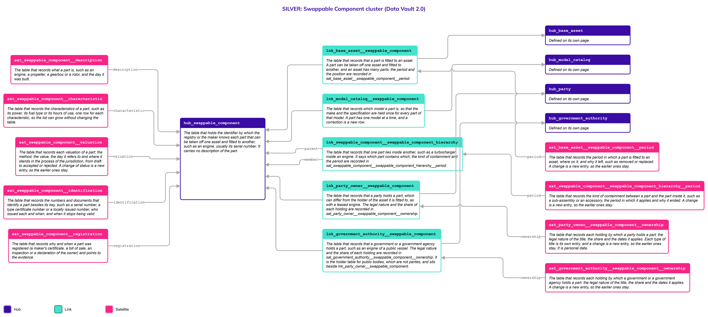
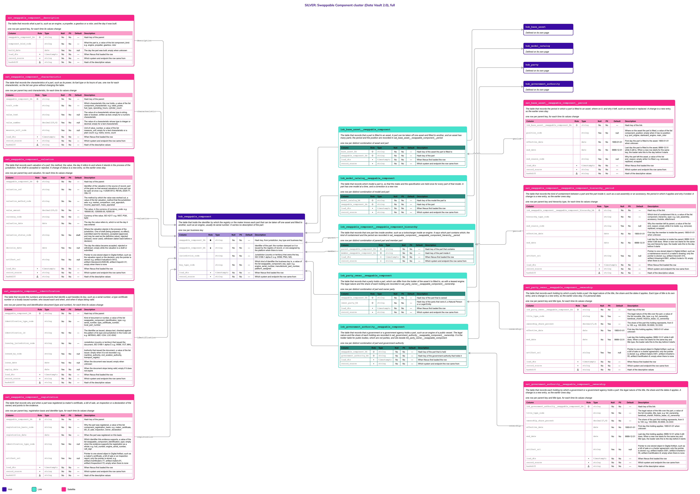

# Swappable Component

## Header

| **Field** | **Value** |
| --- | --- |
| Object | Swappable Component |
| Parent object | Movable Assets |
| Owner domain | Registries |
| Shared with | Taxation Contributions and Licences, Finance, Compliance |
| Scope | Shared |
| Status | Draft |
| Version | 0.1 |
| Last updated | 2026-10-23 |

## Definition

A Swappable Component is a part that can be taken off one mobile asset and fitted to another, such as an engine, a propeller, a gearbox or a rotor, and that the State identifies on its own, usually by its serial number. It is fitted to a base asset for a period and can later be fitted to another one. A part can contain other parts, such as a turbocharger inside an engine.

The holder of a part is a Party (a person or an entity) or a government authority, and can differ from the holder of the asset it is fitted to, as with a leased engine. A part has its own identifiers, its own proof of registration, its own characteristics and its own value. The asset it is fitted to is on the page [Base Asset](Base_Asset.md), and its make and specification are on the page [Model Catalog](Model_Catalog.md).

## Why it is its own object

- **It outlives its fitting.** An engine is moved from one ship to another and keeps its serial number, its history and its value. If it were a column of the asset, the move would rewrite two histories.
- **It has its own key.** The serial number of the part is not the stamped number of the asset.
- **It can have its own holder.** A part can be leased or owned by a company other than the holder of the asset. Whether a jurisdiction records the holders of parts separately is a configuration of the platform; the tables exist in any case.
- **It is valued on its own.** The value of a part is not part of the value of the asset.
- **Parts contain parts.** The same containment Link is used again for each level, as for structures.

## Vault objects

| **Type** | **Name** | **Definition** | **Grain** | **Business key** |
| --- | --- | --- | --- | --- |
| Hub | `hub_swappable_component` | The table that holds the identifier by which the registry or the maker knows each part that can be taken off one asset and fitted to another, such as an engine, usually its serial number. It carries no description of the part. | one row per business key | `swappable_component_bk`: the serial number or the identifier of the registry, or one assigned by the platform when there is none, with the jurisdiction and the key type |
| Link | `lnk_base_asset__swappable_component` | The table that records that a part is fitted to an asset. A part can be taken off one asset and fitted to another, and an asset has many parts; the period and the position are recorded in `sat_base_asset__swappable_component__period`. | one row per distinct combination of asset and part | `hub_base_asset`, `hub_swappable_component` |
| Link | `lnk_model_catalog__swappable_component` | The table that records which model a part is, so that the make and the specification are held once for every part of that model. A part has one model at a time, and a correction is a new row. | one row per distinct combination of model and part | `hub_model_catalog`, `hub_swappable_component` |
| Link | `lnk_swappable_component__swappable_component_hierarchy` | The table that records that one part lies inside another, such as a turbocharger inside an engine. It says which part contains which; the kind of containment and the period are recorded in `sat_swappable_component__swappable_component_hierarchy__period`. | one row per distinct combination of parent part and member part | `hub_swappable_component` (parent), `hub_swappable_component` (member) |
| Link | `lnk_party_owner__swappable_component` | The table that records that a party holds a part, which can differ from the holder of the asset it is fitted to, as with a leased engine. The legal nature and the share of each holding are recorded in `sat_party_owner__swappable_component__ownership`. | one row per distinct combination of part and owner party | `hub_swappable_component`, `hub_party` (owner) |
| Link | `lnk_government_authority__swappable_component` | The table that records that a government or a government agency holds a part, such as an engine of a public vessel. The legal nature and the share of each holding are recorded in `sat_government_authority__swappable_component__ownership`. It is the holder table for public bodies, which are not parties, and sits beside `lnk_party_owner__swappable_component`. | one row per distinct combination of part and government authority | `hub_swappable_component`, `hub_government_authority` |
| Satellite | `sat_swappable_component__description` | The table that records what a part is, such as an engine, a propeller, a gearbox or a rotor, and the day it was built. | one row per parent key, for each time its values change | — |
| Satellite | `sat_swappable_component__characteristic` | The table that records the characteristics of a part, such as its power, its fuel type or its hours of use, one row for each characteristic, so the list can grow without changing the table. | one row per parent key and characteristic, for each time its values change | — |
| Satellite | `sat_swappable_component__valuation` | The table that records each valuation of a part: the method, the value, the day it refers to and where it stands in the process of the jurisdiction, from draft to accepted or rejected. A change of status is a new entry, so the earlier ones stay. | one row per parent key and valuation, for each time its values change | — |
| Satellite | `sat_swappable_component__identification` | The table that records the numbers and documents that identify a part besides its key, such as a serial number, a type certificate number or a locally issued number, who issued each and when, and when it stops being valid. | one row per parent key and identification document (type and number), for each time its values change | — |
| Satellite | `sat_swappable_component__registration` | The table that records why and when a part was registered (a maker's certificate, a bill of sale, an inspection or a declaration of the owner) and points to the evidence. | one row per parent key, registration basis and identifier type, for each time its values change | — |
| Satellite | `sat_base_asset__swappable_component__period` | The table that records the period in which a part is fitted to an asset, where on it, and why it left, such as removed or replaced. A change is a new entry, so the earlier ones stay. | one row per parent key, for each time its values change | — |
| Satellite | `sat_swappable_component__swappable_component_hierarchy__period` | The table that records the kind of containment between a part and the part inside it, such as a sub-assembly or an accessory, the period in which it applies and why it ended. A change is a new entry, so the earlier ones stay. | one row per parent key and hierarchy type, for each time its values change | — |
| Satellite | `sat_party_owner__swappable_component__ownership` | The table that records each holding by which a party holds a part: the legal nature of the title, the share and the dates it applies. Each type of title is its own entry, and a change is a new entry, so the earlier ones stay. It is personal data. | one row per parent key and title type, for each time its values change | — |
| Satellite | `sat_government_authority__swappable_component__ownership` | The table that records each holding by which a government or a government agency holds a part: the legal nature of the title, the share and the dates it applies. A change is a new entry, so the earlier ones stay. | one row per parent key and title type, for each time its values change | — |

`swappable_component_hk` is computed from `jurisdiction_code`, `key_type_code` and the normalized `swappable_component_bk`, joined with a fixed separator. Normalization: trimmed, case-folded, Unicode-normalized. The hash algorithm is a platform decision and is not named here. Satellites carry only the parent's hash key.

`lnk_base_asset__swappable_component` says that a part is **fitted to** an asset and is defined on this page, for the part is the side that moves; `lnk_swappable_component__swappable_component_hierarchy` says that a part **lies inside** another. `lnk_model_catalog__swappable_component` says which model the part is. `lnk_party_owner__swappable_component` and `lnk_government_authority__swappable_component` say who holds the part, with the shape of the Links of the asset. A part has no Link to Location: where it is is where the asset it is fitted to is based.

**Related pages.** The diagrams on this page draw the objects defined elsewhere with a note.

- [Movable Assets](Movable_Assets.md): the family page, with the rules that the three parts share and the decisions that are open for all.
- [Base Asset](Base_Asset.md): `hub_base_asset`, joined by `lnk_base_asset__swappable_component`, which is defined on this page.
- [Model Catalog](Model_Catalog.md): `hub_model_catalog`, joined by `lnk_model_catalog__swappable_component`, which is defined on this page.
- [Party](Party.md), with [Natural Person](Natural_Person.md) and [Legal Entity](Legal_Entity.md): `hub_party`, joined by `lnk_party_owner__swappable_component`.
- Government Authority: `hub_government_authority`, joined by `lnk_government_authority__swappable_component`. Its page is not written yet.

## Fields

*Indicators in Role: ◆ own hash key · ◇ hash key of another object · ● business key · ▪ load metadata · Δ hashdiff. Default: — means no default, so the loader must supply the value; a literal is a default in the sense of Iceberg format version 3.*

### hub_swappable_component

| **Column** | **Role** | **Type** | **Null** | **PII** | **Default** | **Description** |
| --- | --- | --- | --- | --- | --- | --- |
| `swappable_component_hk` | ◆ | `string` | No | No | — | Hash key, from jurisdiction, key type and business key |
| `swappable_component_bk` | ● | `string` | No | No | — | Identifier of the part: the number stamped on it or issued by the registry of record, or one assigned by the platform when there is none |
| `jurisdiction_code` |  | `string` | No | No | — | Jurisdiction (country or territory) that owns the key, ISO 3166-1 alpha-3: e.g. `WSM`, `PNG`, `NZL` |
| `key_type_code` |  | `string` | No | No | — | Which kind of identifier the business key is, a value of the list `swappable_component_key_type`: e.g. `engine_serial_number`, `manufacturer_part_number`, `platform_assigned` |
| `load_dts` | ▪ | `timestamptz` | No | No | — | When Nexus first loaded the row |
| `record_source` | ▪ | `string` | No | No | — | Which system and endpoint the row came from |

### lnk_base_asset__swappable_component

| **Column** | **Role** | **Type** | **Null** | **PII** | **Default** | **Description** |
| --- | --- | --- | --- | --- | --- | --- |
| `base_asset_hk` | ◇ | `string` | No | No | — | Hash key of the asset the part is fitted to |
| `swappable_component_hk` | ◇ | `string` | No | No | — | Hash key of the part |
| `load_dts` | ▪ | `timestamptz` | No | No | — | When Nexus first loaded the row |
| `record_source` | ▪ | `string` | No | No | — | Which system and endpoint the row came from |

### lnk_model_catalog__swappable_component

| **Column** | **Role** | **Type** | **Null** | **PII** | **Default** | **Description** |
| --- | --- | --- | --- | --- | --- | --- |
| `model_catalog_hk` | ◇ | `string` | No | No | — | Hash key of the model the part is |
| `swappable_component_hk` | ◇ | `string` | No | No | — | Hash key of the part |
| `load_dts` | ▪ | `timestamptz` | No | No | — | When Nexus first loaded the row |
| `record_source` | ▪ | `string` | No | No | — | Which system and endpoint the row came from |

### lnk_swappable_component__swappable_component_hierarchy

A containment between two parts. The **parent** is the part that contains, such as an engine, and the **member** is the part inside it, such as a turbocharger or a gearbox. Both are rows of `hub_swappable_component`. A member can itself be a parent, so the levels are not built into the tables.

| **Column** | **Role** | **Type** | **Null** | **PII** | **Default** | **Description** |
| --- | --- | --- | --- | --- | --- | --- |
| `parent_swappable_component_hk` | ◇ | `string` | No | No | — | Hash key of the part that contains |
| `member_swappable_component_hk` | ◇ | `string` | No | No | — | Hash key of the part inside it |
| `load_dts` | ▪ | `timestamptz` | No | No | — | When Nexus first loaded the row |
| `record_source` | ▪ | `string` | No | No | — | Which system and endpoint the row came from |

### lnk_party_owner__swappable_component

| **Column** | **Role** | **Type** | **Null** | **PII** | **Default** | **Description** |
| --- | --- | --- | --- | --- | --- | --- |
| `swappable_component_hk` | ◇ | `string` | No | No | — | Hash key of the part that is owned |
| `owner_party_hk` | ◇ | `string` | No | No | — | Hash key of the party that owns it, a Natural Person or a Legal Entity |
| `load_dts` | ▪ | `timestamptz` | No | No | — | When Nexus first loaded the row |
| `record_source` | ▪ | `string` | No | No | — | Which system and endpoint the row came from |

### lnk_government_authority__swappable_component

| **Column** | **Role** | **Type** | **Null** | **PII** | **Default** | **Description** |
| --- | --- | --- | --- | --- | --- | --- |
| `swappable_component_hk` | ◇ | `string` | No | No | — | Hash key of the part that is held |
| `government_authority_hk` | ◇ | `string` | No | No | — | Hash key of the government authority that holds it |
| `load_dts` | ▪ | `timestamptz` | No | No | — | When Nexus first loaded the row |
| `record_source` | ▪ | `string` | No | No | — | Which system and endpoint the row came from |

### sat_swappable_component__description

| **Column** | **Role** | **Type** | **Null** | **PII** | **Default** | **Description** |
| --- | --- | --- | --- | --- | --- | --- |
| `swappable_component_hk` | ◇ | `string` | No | No | — | Hash key of the parent |
| `component_kind_code` |  | `string` | No | No | — | What the part is, a value of the list `component_kind`: e.g. `engine`, `propeller`, `gearbox`, `rotor` |
| `build_date` |  | `date` | Yes | No | null | The day the part was built; empty when unknown |
| `load_dts` | ▪ | `timestamptz` | No | No | — | When Nexus first loaded the row |
| `record_source` | ▪ | `string` | No | No | — | Which system and endpoint the row came from |
| `hashdiff` | Δ | `string` | No | No | — | Hash of the descriptive values |

### sat_swappable_component__characteristic

The characteristics of a part are an open list, such as its power, its fuel type, its hours of use, and whatever a jurisdiction adds. Each is a row and not a column (Principles, "Traits as rows"). A new characteristic is a new value of the Code List `component_characteristic` and changes no table. The Code List says, for each one, which value column is used (`value_data_type_code`), and the load checks the value against it. A characteristic that is not personal data has no in-place twin: history is kept.

| **Column** | **Role** | **Type** | **Null** | **PII** | **Default** | **Description** |
| --- | --- | --- | --- | --- | --- | --- |
| `swappable_component_hk` | ◇ | `string` | No | No | — | Hash key of the parent |
| `trait_code` |  | `string` | No | No | — | Which characteristic this row holds, a value of the list `component_characteristic`: e.g. `rated_power`, `fuel_type`, `operating_hours`, `cylinder_count` |
| `value_text` |  | `string` | Yes | No | null | The value of a characteristic whose type is `string`, `date` or `boolean`, written as text; empty for a numeric characteristic |
| `value_number` |  | `decimal(18,6)` | Yes | No | null | The value of a characteristic whose type is `integer` or `decimal`; empty for a text characteristic |
| `measure_unit_code` |  | `string` | Yes | No | null | Unit of `value_number`, a value of the list `measure_unit`; empty for a text characteristic or a plain count: e.g. `metre`, `tonne`, `count` |
| `load_dts` | ▪ | `timestamptz` | No | No | — | When Nexus first loaded the row |
| `record_source` | ▪ | `string` | No | No | — | Which system and endpoint the row came from |
| `hashdiff` | Δ | `string` | No | No | — | Hash of the descriptive values |

### sat_swappable_component__valuation

Same shape and same rules as `sat_base_parcel__valuation`. A part is valued on its own, and the value of the asset it is fitted to does not include it. The definitive value is the Gold view `cur_swappable_component__valuation_definitive`.

| **Column** | **Role** | **Type** | **Null** | **PII** | **Default** | **Description** |
| --- | --- | --- | --- | --- | --- | --- |
| `swappable_component_hk` | ◇ | `string` | No | No | — | Hash key of the parent |
| `valuation_ref` |  | `string` | No | No | — | Identifier of the valuation in the source of record, part of the grain so that several valuations of one part can be open at once: e.g. `V-2026-0412`, `REVAL-2025-77`, `OBJ-12` |
| `valuation_method_code` |  | `string` | No | No | — | The method by which the value was worked out, a value of the list `valuation_method` that the jurisdiction sets: e.g. `market_comparison`, `cost_approach`, `income_approach`, `mass_appraisal` |
| `value_amount` |  | `decimal(18,2)` | No | No | — | The value, in the currency of `currency_code`: e.g. `185000.00`, `1250000.00`, `42500.00` |
| `currency_code` |  | `string` | No | No | — | Currency of the value, ISO 4217: e.g. `WST`, `PGK`, `NZD` |
| `valuation_date` |  | `date` | No | No | — | The day the value refers to, which is not the day it was entered |
| `valuation_status_code` |  | `string` | No | No | `draft` | Where the valuation stands in the process of the jurisdiction. One of `draft` (being prepared, no effect), `submitted` (sent for decision), `accepted` (approved, and may be used as the definitive value), `rejected` (refused, never used), `withdrawn` (taken back before a decision) |
| `decision_date` |  | `date` | Yes | No | null | The day the status became `accepted`, `rejected` or `withdrawn`; empty while the valuation is a draft or submitted |
| `artifact_uri` |  | `string` | Yes | No | null | Pointer to one stored object in Digital Artifact, such as the valuation report or the decision; only the pointer is stored: e.g. `artifact://valuation/v-0412`, `artifact://decision/d-2026-88`, `artifact://report/r-31`; empty when there is none |
| `load_dts` | ▪ | `timestamptz` | No | No | — | When Nexus first loaded the row |
| `record_source` | ▪ | `string` | No | No | — | Which system and endpoint the row came from |
| `hashdiff` | Δ | `string` | No | No | — | Hash of the descriptive values |

### sat_swappable_component__identification

| **Column** | **Role** | **Type** | **Null** | **PII** | **Default** | **Description** |
| --- | --- | --- | --- | --- | --- | --- |
| `swappable_component_hk` | ◇ | `string` | No | No | — | Hash key of the parent |
| `identification_type_code` |  | `string` | No | No | — | Kind of document or number, a value of the list `swappable_component_identification_type`: e.g. `serial_number`, `type_certificate_number`, `local_part_number` |
| `identification_id` |  | `string` | No | No | — | The identifier as issued, always text, checked against the pattern of its type and jurisdiction in the Code List: e.g. `9876543`, `ABC-1234`, `LOC-0042` |
| `issuing_jurisdiction_code` |  | `string` | No | No | — | Jurisdiction (country or territory) that issued the document, ISO 3166-1 alpha-3: e.g. `WSM`, `VUT`, `MHL` |
| `issued_by_code` |  | `string` | Yes | No | null | Authority that issued the document, a value of the list `issuer`; empty when it is not recorded: e.g. `maritime_authority`, `civil_aviation_authority`, `transport_registry` |
| `issue_date` |  | `date` | Yes | No | null | When the document was issued; empty when unknown |
| `expiry_date` |  | `date` | Yes | No | null | When the document stops being valid; empty if it does not expire |
| `load_dts` | ▪ | `timestamptz` | No | No | — | When Nexus first loaded the row |
| `record_source` | ▪ | `string` | No | No | — | Which system and endpoint the row came from |
| `hashdiff` | Δ | `string` | No | No | — | Hash of the descriptive values |

### sat_swappable_component__registration

| **Column** | **Role** | **Type** | **Null** | **PII** | **Default** | **Description** |
| --- | --- | --- | --- | --- | --- | --- |
| `swappable_component_hk` | ◇ | `string` | No | No | — | Hash key of the parent |
| `registration_basis_code` |  | `string` | No | No | — | Why the part was registered, a value of the list `component_registration_basis`: e.g. `maker_certificate`, `bill_of_sale`, `inspection`, `owner_declaration` |
| `registration_date` |  | `date` | No | No | — | When the part was registered on this basis |
| `identification_type_code` |  | `string` | Yes | No | null | Which identifier this evidence supports, a value of the list `swappable_component_identification_type`; empty when the evidence supports the registration as a whole: e.g. `hull_number`, `engine_serial_number`, `call_sign` |
| `artifact_uri` |  | `string` | Yes | No | null | Pointer to one stored object in Digital Artifact, such as a maker's certificate, a bill of sale or an inspection report; only the pointer is stored: e.g. `artifact://certificate/c-77`, `artifact://sale/s-91`, `artifact://inspection/i-72`; empty when there is none |
| `load_dts` | ▪ | `timestamptz` | No | No | — | When Nexus first loaded the row |
| `record_source` | ▪ | `string` | No | No | — | Which system and endpoint the row came from |
| `hashdiff` | Δ | `string` | No | No | — | Hash of the descriptive values |

### sat_base_asset__swappable_component__period

The period in which a part is fitted to an asset. A part can be taken off one asset and fitted to another, so each fitting is a row and the earlier ones stay.

| **Column** | **Role** | **Type** | **Null** | **PII** | **Default** | **Description** |
| --- | --- | --- | --- | --- | --- | --- |
| `lnk_base_asset__swappable_component_hk` | ◇ | `string` | No | No | — | Hash key of the link |
| `position_code` |  | `string` | Yes | No | null | Where on the asset the part is fitted, a value of the list `component_position`; empty when it has no position: e.g. `port_engine`, `starboard_engine`, `main_rotor` |
| `effective_date` |  | `date` | No | No | `1900-01-01` | First day the part is fitted to the asset; `1900-01-01` when unknown |
| `end_date` |  | `date` | No | No | `9999-12-31` | Last day the part is fitted to the asset; `9999-12-31` while it still is. When a new row starts for the same key, the loader sets this to the day before it starts |
| `end_reason_code` |  | `string` | Yes | No | null | Why the part left the asset, a value of the list `end_reason`; empty while it is fitted: e.g. `removed`, `replaced`, `scrapped` |
| `load_dts` | ▪ | `timestamptz` | No | No | — | When Nexus first loaded the row |
| `record_source` | ▪ | `string` | No | No | — | Which system and endpoint the row came from |
| `hashdiff` | Δ | `string` | No | No | — | Hash of the descriptive values |

### sat_swappable_component__swappable_component_hierarchy__period

The kind of containment, its period and the reason it ended are one fact, so they share a Satellite. The kind is part of the grain: a part can belong to a sub-assembly of the maker and to an accessory kit of the owner. Within one kind, a member has at most one open row.

| **Column** | **Role** | **Type** | **Null** | **PII** | **Default** | **Description** |
| --- | --- | --- | --- | --- | --- | --- |
| `lnk_swappable_component__swappable_component_hierarchy_hk` | ◇ | `string` | No | No | — | Hash key of the link |
| `hierarchy_type_code` |  | `string` | No | No | — | Which kind of containment this is, a value of the list `component_hierarchy_type`: e.g. `sub_assembly`, `accessory`, `module`, `attachment` |
| `end_reason_code` |  | `string` | Yes | No | null | Why the member left its parent, a value of the list `end_reason`; empty while it is inside: e.g. `removed`, `replaced`, `scrapped` |
| `effective_date` |  | `date` | No | No | `1900-01-01` | First day the member is inside the parent; `1900-01-01` when unknown |
| `end_date` |  | `date` | No | No | `9999-12-31` | Last day the member is inside the parent; `9999-12-31` while it still does. When a new row starts for the same key and hierarchy type, the loader sets this to the day before it starts |
| `artifact_uri` |  | `string` | Yes | No | null | Pointer to one stored object in Digital Artifact, such as a maintenance record or a maker's drawing; only the pointer is stored: e.g. `artifact://record/r-310`, `artifact://drawing/d-0881`, `artifact://order/o-18`; empty when there is none |
| `load_dts` | ▪ | `timestamptz` | No | No | — | When Nexus first loaded the row |
| `record_source` | ▪ | `string` | No | No | — | Which system and endpoint the row came from |
| `hashdiff` | Δ | `string` | No | No | — | Hash of the descriptive values |

### sat_party_owner__swappable_component__ownership

| **Column** | **Role** | **Type** | **Null** | **PII** | **Default** | **Description** |
| --- | --- | --- | --- | --- | --- | --- |
| `lnk_party_owner__swappable_component_hk` | ◇ | `string` | No | No | — | Hash key of the link |
| `title_type_code` |  | `string` | No | Yes | — | The legal nature of the title over the part, a value of the list `movable_title_type`: e.g. `full_ownership`, `bareboat_charter`, `finance_lease`, `co_ownership` |
| `ownership_share_percent` |  | `decimal(7,4)` | No | Yes | — | The share of the part this holding represents, from 0 to 100: e.g. `100.0000`, `50.0000`, `33.3333` |
| `effective_date` |  | `date` | No | Yes | `1900-01-01` | First day this holding applies; `1900-01-01` when unknown |
| `end_date` |  | `date` | No | Yes | `9999-12-31` | Last day this holding applies; `9999-12-31` while it still does. When a new row starts for the same key and title type, the loader sets this to the day before it starts |
| `artifact_uri` |  | `string` | Yes | Yes | null | Pointer to one stored object in Digital Artifact, such as a bill of sale or a charter agreement; only the pointer is stored: e.g. `artifact://sale/s-3301`, `artifact://charter/c-55`, `artifact://certificate/c-9`; empty when there is none |
| `load_dts` | ▪ | `timestamptz` | No | No | — | When Nexus first loaded the row |
| `record_source` | ▪ | `string` | No | No | — | Which system and endpoint the row came from |
| `hashdiff` | Δ | `string` | No | No | — | Hash of the descriptive values |

### sat_government_authority__swappable_component__ownership

| **Column** | **Role** | **Type** | **Null** | **PII** | **Default** | **Description** |
| --- | --- | --- | --- | --- | --- | --- |
| `lnk_government_authority__swappable_component_hk` | ◇ | `string` | No | No | — | Hash key of the link |
| `title_type_code` |  | `string` | No | No | — | The legal nature of the title over the part, a value of the list `movable_title_type`: e.g. `full_ownership`, `bareboat_charter`, `finance_lease`, `co_ownership` |
| `ownership_share_percent` |  | `decimal(7,4)` | No | No | — | The share of the part this holding represents, from 0 to 100: e.g. `100.0000`, `50.0000`, `33.3333` |
| `effective_date` |  | `date` | No | No | `1900-01-01` | First day this holding applies; `1900-01-01` when unknown |
| `end_date` |  | `date` | No | No | `9999-12-31` | Last day this holding applies; `9999-12-31` while it still does. When a new row starts for the same key and title type, the loader sets this to the day before it starts |
| `artifact_uri` |  | `string` | Yes | No | null | Pointer to one stored object in Digital Artifact, such as a bill of sale or a charter agreement; only the pointer is stored: e.g. `artifact://sale/s-3301`, `artifact://charter/c-55`, `artifact://certificate/c-9`; empty when there is none |
| `load_dts` | ▪ | `timestamptz` | No | No | — | When Nexus first loaded the row |
| `record_source` | ▪ | `string` | No | No | — | Which system and endpoint the row came from |
| `hashdiff` | Δ | `string` | No | No | — | Hash of the descriptive values |

## Sources and mapping

No endpoints declared yet

## Jurisdictions map

| **Edge case** | **Where it happens** | **Approach** | **Vault effect** |
| --- | --- | --- | --- |
| An engine moved from one ship to another | Any jurisdiction | The part keeps its key; the first fitting ends and a second one starts | Two rows of `sat_base_asset__swappable_component__period`, the first with `end_reason_code` `removed` |
| An engine fitted to two assets in turn with a gap in between | Any jurisdiction | There is no asset for the days in between, and no row | The `end_date` of one row and the `effective_date` of the next |
| A part inside another, such as a turbocharger inside an engine | Any jurisdiction | The containment is a Link of its own, with its kind and period | `lnk_swappable_component__swappable_component_hierarchy` with `hierarchy_type_code` `sub_assembly` |
| A leased engine on a ship that belongs to another company | Jurisdictions that record the holders of parts | Each holder has its own holding, through its own Link | `lnk_party_owner__swappable_component` and `lnk_base_asset__party_owner` with different parties |
| A part with no serial number | Any jurisdiction | The platform assigns the key, and any local number is an identifier of its own | `key_type_code` `platform_assigned`; a `local_part_number` row in `sat_swappable_component__identification` |
| The value of an asset and the value of its parts | Jurisdictions that value parts | Each is valued on its own and the values are not added in the Vault | Rows of both valuation Satellites; the total is a Gold value |

## Examples

Illustrative data. The engine `ENG-77` is fitted to the ship `9876543` described on the page [Base Asset](Base_Asset.md), and later to another ship.

`hub_swappable_component` and `sat_swappable_component__description`

| **swappable_component_bk** | **jurisdiction_code** | **key_type_code** | **component_kind_code** | **build_date** |
| --- | --- | --- | --- | --- |
| ENG-77 | VUT | engine_serial_number | engine | 2011-11-02 |

`lnk_base_asset__swappable_component` and `sat_base_asset__swappable_component__period`

| **base_asset_bk** | **position_code** | **effective_date** | **end_date** | **end_reason_code** |
| --- | --- | --- | --- | --- |
| 9876543 | main_engine | 2012-04-18 | 2024-08-09 | removed |
| 9123456 | main_engine | 2024-08-10 | 9999-12-31 | (empty) |

`sat_swappable_component__characteristic`

| **trait_code** | **value_text** | **value_number** | **measure_unit_code** |
| --- | --- | --- | --- |
| rated_power | (empty) | 7200 | kilowatt |
| fuel_type | marine_diesel | (empty) | (empty) |

`sat_party_owner__swappable_component__ownership`

| **holder** | **title_type_code** | **ownership_share_percent** | **effective_date** | **end_date** |
| --- | --- | --- | --- | --- |
| a legal entity (a leasing company) | finance_lease | 100.0000 | 2024-08-10 | 9999-12-31 |

## Modeling considerations

- **The fitting is a Link with a period.** `lnk_base_asset__swappable_component` has one row for each pair of asset and part that has ever been joined, and `sat_base_asset__swappable_component__period` says when and where. A part is fitted to at most one asset at a time; the load parks a row that would put it on two.
- **Containment has no fixed depth.** `lnk_swappable_component__swappable_component_hierarchy` joins the Hub to itself, as for structures. How many levels a kind of containment may have is `max_depth_count` of the hierarchy type in the Code List. The level of a part and its path to the asset are computed in Gold (R13). A part has at most one open parent for each kind of containment.
- **The characteristics are an open list.** The power, the fuel type, the hours of use and the like are rows of `sat_swappable_component__characteristic`, not columns (Principles, "Traits as rows").
- **A part has no place of its own.** Where a part is, is where the asset it is fitted to is based. A part that is not fitted to any asset has no place in this model.
- **The holders of parts depend on the configuration.** The Links to Party and to Government Authority exist for every part. A jurisdiction that records only the holder of the asset leaves them empty; the worst case, where every part has its own holder, needs no other table.
- **Shared rules.** Valuation and its statuses, identification and registration, ownership, validity ranges and codes follow the rules written on the page [Movable Assets](Movable_Assets.md). What is only the part's: the definitive value is the Gold view `cur_swappable_component__valuation_definitive`; the legal nature of a title is the list `movable_title_type`.

## Diagram

Two pictures of the same cluster. Read the simplified one first, then use the full one when you need the columns. Colors: Hub indigo, Link teal, Satellite magenta; a Satellite updated in place is lighter, with a dashed border. Arrows run from the child to its parent. Objects defined on another page are drawn with a note and no table.

### Simplified version

The shape of the cluster: 1 Hub, 5 Links and 9 Satellites, with the Hubs of the asset and the model and the Hubs of Party and Government Authority drawn as defined on another page. Each has its name and definition. Use it to see how the objects relate. It has no columns.

### Full version

The same objects, each with its Fields table (column, role, type, null, PII, default, description). Use it to check exactly what is stored. It is wide: zoom in or open the image on its own.

## Open decisions

| **Decision** | **Owner** | **How it is decided** | **Decide by** |
| --- | --- | --- | --- |
| The decisions shared by the three parts of the family: Government Authority, Legal Instrument for mortgages and liens, the valuation process, the depth of the containment of parts and the holders of parts | Data Architecture Engineer and Data Product Owner | Written once, on the page [Movable Assets](Movable_Assets.md) | See that page |
| Which characteristics are required for each kind of part, and their units | Data Product Owner | Set as values of the Code List list `component_characteristic` | When a jurisdiction is configured |
| Which source of record supplies `swappable_component_bk` in each jurisdiction, and who assigns the key where none exists | Platform configuration | Set in the Nexus configuration for each jurisdiction | When a jurisdiction is configured |
| The kinds, classes and positions of assets and parts, and the kinds of holding of movable property | Data Product Owner | Set as values of the Code List lists `component_kind`, `component_position`, `component_hierarchy_type` and `movable_title_type` | When a jurisdiction is configured |
