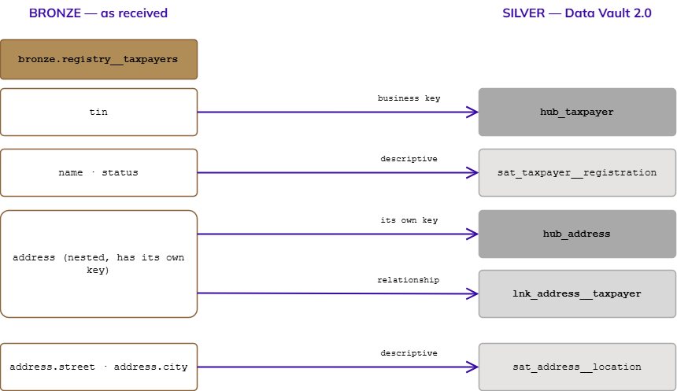

# Principles

*The second section of Nexus Rosetta. It sets out the rules every business-object definition follows, and the naming convention that turns a source response into Data Vault 2.0 objects. Written for everyone who names, models, builds or reads data in the Public Services Suite (PSS 3.0). The reasons behind it are in* `Whys.md`*.*

**Section:** Principles · **Version:** 0.1 · **Status:** Draft

## **Purpose**

`Whys.md` explained why every business object needs one common definition. This document says how a definition is written and kept.

These principles bind anyone who defines, names or maps a business object. They are different from `Data_Principles.md` in Nexus, which binds how the platform itself is designed. Where a principle here rests on one of those, the link is shown.

Each principle is one row of the table in the next section, with five columns:

* **Principle.** Its number, from R1 to R13.
* **Slogan.** One line, easy to remember and to repeat.
* **In short.** One sentence that says what it asks.
* **Extended.** What it means in practice, with an example.
* **Test.** How anyone can check that a definition follows it.

## **The principles**

| Principle | Slogan | In short | Extended | Test |
| --- | --- | --- | --- | --- |
| R1 | **Storage is everything** | Keep everything the sources send us, for as long as it can matter. | A definition can only be written, challenged or corrected against something that was kept. If a value was thrown away at the door, no later definition can recover what it meant, and no audit can show what was true at the time. Storage is cheap; a missing record is not. Everything received is stored first, and decisions about what it means come after. This is the same reasoning as `Data_Principles.md` T1 (history is never overwritten) and D1 (design insight-first). | For any figure in a report, can we still produce every source value it was built from? |
| R2 | **Raw is the only thing that matters** | The data exactly as received is the one source of truth; everything else is derived from it. | Bronze keeps each response as it arrived (`Medallion_Architecture.md`). Silver and Gold are views of that raw data, built by rules. Because they are derived, they can always be rebuilt, corrected and rebuilt again. The raw data is the only thing that cannot be recreated, so it is the only thing that cannot be edited. A definition never replaces or "cleans" the raw record. It adds meaning on top of it. | If we deleted Silver and Gold today, could we rebuild them from Bronze alone? |
| R3 | **Focus on the substance, not in the shape** | Define what a thing means, not how one system happens to lay it out. | One system sends a taxpayer as a flat JSON record, another as nested XML, a third as a database row. The shape differs in each; the meaning is the same. A definition describes the meaning: what a taxpayer is, how it is identified, which facts we learn about it. The shape belongs to the adapter that reads a given source, and it can change without touching the definition. This is `Data_Principles.md` P4 (business logic is isolated from technology). | Can the definition be read and agreed by someone who has never seen the source system's data format? |
| R4 | **Not everything needs a database** | Choose the storage that fits the data, not the one that is most familiar. | Raw responses fit well in files on object storage. Analytic tables fit open table formats such as Apache Iceberg (`Apache_Iceberg.md`). A relational database is the right choice when the work is transactional, not by default. Matching the store to the need keeps cost low, lets storage and compute scale separately, and avoids tying definitions to a vendor. This is `Data_Principles.md` D4 (the right tool for the right job), P3 (storage and compute scale independently) and L2 (open formats). | Is the chosen store justified by what the data is used for, and can the data be read without one vendor's product? |
| R5 | **Metadata is my new best friend** | The definitions, keys, versions and lineage are data too, and they are kept as carefully as the rest. | A business definition, an identifying key, a jurisdiction scenario, the Bronze path an object came from: all of this is metadata. It is what lets people, systems and AI models find and trust the data. Metadata is written down, versioned and held in the catalog (`Data_Catalog.md`), never left in someone's head or in a column name. This is `Data_Principles.md` P6 (ready for AI). | For any object, can we find its definition, its key, its owner and its source without asking a person? |
| R6 | **One word, one meaning** | Every business object has one definition, one English name, one identifying key and one authoritative place. | This is the promise made in `Whys.md`. A *taxpayer* is defined once. Every system, team and country that uses the word means that. If two teams need different things, they need different objects with different names, or one object with a recorded variation (R7). The language of the model is English (`Data_Principles.md` L1); other languages are translation, held as configuration. There is one authoritative place per fact (`Data_Principles.md` O1). | Does the object appear in exactly one place with exactly one definition, and does every other use point to it? |
| R7 | **Variation is a scenario, not a new object** | When a jurisdiction really differs, record the difference against the same object. | A new country should be an onboarding, not a project. When a country defines *period* differently, the difference is written as a scenario of the one *period* object, and not as a second object with a similar name. The scenario says what differs, where it applies and why. The question of how scenarios are recorded in the vault is still open (see *Open decisions and who decides*). | Is every difference between jurisdictions written against the object it varies, and is there no copy of the object with a country in its name? |
| R8 | **Meaning and mapping travel together** | No object is defined until we know both what it means and where it lives in the vault. | An object is identified in two ways: its business meaning, and the Hubs, Links and Satellites that represent it in Silver. One without the other is half a definition. Every element of a source response gets a recorded decision: mapped to an object, parked with a reason, or excluded with a reason. Nothing is dropped silently (R1). The naming convention that makes this mechanical is in *The naming convention*. | For every field in a Bronze response, can we point to the Silver object that holds it, or to the written reason it is not held? |
| R9 | **A name is a contract** | Names follow the convention, never the mood. | A name is read by people and by programs: generators, catalogs, lineage tools, queries. If names follow a strict pattern, a program can read a table name and know what the table is, what it belongs to and where it came from. Names are made once, by the rules in *The naming convention*, and are not renamed informally afterwards. A change of name is a change of definition and goes through the same review. | Can a program tell the type of an object, and the objects it connects, from its name alone? |
| R10 | **From the response to the report, nothing is lost** | Every figure can be traced back, step by step, to the response that produced it. | The path runs from the API response, through Bronze, to a Silver object, to the Gold table, to the report. Each step is identified by the names in *The naming convention* and recorded with its load date and record source. This is what allows a citizen or an institution to be shown how a figure was reached (`Data_Principles.md` T2). | Pick any number in a report. Can we walk back to the original response in a few steps without asking anyone? |
| R11 | **A type is a promise** | A column keeps the type it was declared with. The only change made in place is a safe widening. | Every consumer of a column relies on its type, and none of them can see the producer's intention. A changed type changes hashes, joins and totals without any error. So a type is declared once, from the list in *Data types*, and is not changed in place unless it is a widening that every consumer survives. Anything else is a new attribute, with a window to move over. | Can the type of any attribute be read from the catalog, and has it ever changed in a way the allowed changes do not permit? |
| R12 | **A table says what one row means** | Every table declares its grain, and a change of grain is a new table. | The grain, the answer to "what does one row represent?", decides what every count, sum and join means. A table that quietly changes from one row per payment to one row per taxpayer per month breaks every figure built on it. The grain is written down for each table (see *Granularity*), and changing it means a new table with a new name. | Does the description of the table complete the sentence "one row per ...", and is it still true today? |
| R13 | **Compute it, do not store it** | A value that can be computed from stored facts is not stored in Silver; it is a Gold object. | Age, age group, whether a document is valid today and how long a person has been registered all change without any new fact arriving. A stored copy goes stale, and nothing triggers its rewrite. Silver keeps the facts (the birth date, the expiry date, the registration date) and Gold computes the answer when it is asked, with its own grain (R12). A value the source itself reports is a fact, not a computed value, and is kept as received (R1). | For each column, ask whether it can be computed from other stored columns. If it can, it does not belong in Silver. |

## **The naming convention**

This convention makes R8 and R9 mechanical. Its one rule: **every element of a source response is identified as exactly one Data Vault 2.0 object**. A business key becomes a Hub, a relationship between two keys becomes a Link, and descriptive facts become a Satellite.

### **The standards it rests on**

| Standard | What we take from it |
| --- | --- |
| **ISO/IEC 11179-5** (naming principles for metadata registries) | A name is built from an **object class**, a **property**, and a **representation term**, in that order: `taxpayer` + `registration` + `date` gives `taxpayer_registration_date`. |
| **Data Vault 2.0 standards** | The structural columns every Hub, Link and Satellite carries: hash key, business key, load date, record source and, for Satellites, a hash difference. |
| **ISO 8601** | Dates and date-times as written values (`2026-10-15`, `2026-10-15T09:30:00Z`). |
| **ISO 3166-1 / ISO 4217** | Country codes and currency codes, used as the reference values for those concepts. |

### **General rules for every name**

* English, lowercase, letters, digits and underscores only (`snake_case`).
* Singular nouns: `taxpayer`, not `taxpayers`. The exception is a Bronze table, which keeps the endpoint name as the source calls it.
* No abbreviations unless they are on the approved list (see *Open decisions and who decides*).* Under 64 characters, so every engine accepts the name.
* The layer is carried by the schema (`bronze`, `silver`, `gold`), never repeated in the table name.

### **Object names**

| Object | Pattern | Example |
| --- | --- | --- |
| Bronze table | `bronze.<source>__<endpoint>` | `bronze.registry__taxpayers` |
| Hub | `hub_<object>` | `hub_taxpayer` |
| Link | `lnk_<object_a>__<object_b>`, objects in alphabetical order; a role is a suffix of the part that plays it | `lnk_address__taxpayer`, `lnk_legal_entity__party_owner` |
| Satellite | `sat_<parent>__<descriptor>` | `sat_taxpayer__registration` |
| Current view | `cur_<parent>__<descriptor>` | `cur_taxpayer__registration` |

**The twin pair.** An attribute group that may be kept in place is delivered as two Satellites with the same attributes. The one that keeps history carries the suffix `_history` and is the default: `sat_natural_person__physical_traits_history`. The one updated in place has no suffix: `sat_natural_person__physical_traits`. A group with no twin has no suffix and keeps history.

**The current view.** `cur_<parent>__<descriptor>` is a view over a history Satellite that returns the latest row for each parent key. It holds no data of its own, so the current value is never stored twice (R13).

**A code list has no table of its own.** The allowed values of a `_code` column are rows of the Code List object (`hub_code_list`, `hub_code_value` and their Satellites), so a new list adds rows and never a table. There is no `ref_` prefix. A code on which logic depends, such as a status the loader reads, is a closed list written in the column's description with `One of`.

**Why a double underscore separates the descriptor.** A Satellite name has two parts that mean different things: the **parent** it describes, and the **descriptor** that says which group of facts it holds. The separator between them must be something that can never appear inside either part. The reasons, in order of weight:

1. **A single underscore is already used inside names.** Object names such as `tax_return` and descriptors such as `filing_status` are written in `snake_case`, so they contain single underscores. `sat_tax_return_filing_status` could mean the parent `tax_return` with the descriptor `filing_status`, or the parent `tax` with the descriptor `return_filing_status`. With `__` the name has exactly one reading: `sat_tax_return__filing_status`.
2. **Programs can read it without a lookup.** A generator, the catalog or a lineage tool splits the name on `__` and gets the parent and the descriptor. It does not need a list of valid object names to guess where the parent ends. This is what makes R9 (*A name is a contract*) true in practice.
3. **The parent can be traced automatically.** What sits between `sat_` and the last `__` is the name of the Hub or Link the Satellite hangs from, without its `hub_` or `lnk_` prefix. A check can confirm that `hub_tax_return` exists whenever `sat_tax_return__filing_status` does, so a Satellite can never be left without a parent.
4. **A new descriptor never changes an existing name.** Adding `sat_taxpayer__contact` next to `sat_taxpayer__registration` touches nothing that exists. Descriptors can be added freely, which matches how Data Vault is meant to grow: a new requirement usually adds a Satellite (`Data_Vault_2.0.md`).
5. **It is a known convention.** dbt's style guide uses the same device (`stg_<source>__<table>`), so most data engineers already recognise it.

**A Satellite on a Link.** The parent name then contains a `__` of its own: the Satellite for `lnk_address__taxpayer` is `sat_address__taxpayer__contact_period`. The rule for reading a Satellite name is therefore fixed: **the descriptor is everything after the last `__`**, and the parent is what remains after removing `sat_`. That keeps every Satellite name readable by the same rule.

The same separator is used wherever a name joins two independent parts: a Bronze table (`<source>__<endpoint>`) and a Link (`<object_a>__<object_b>`). The rule is therefore one rule to remember: **a double underscore always divides two parts that can each contain their own underscores.**

**A Link with a role.** When a Link joins two roles of the same object (a person related to another person), or a second Link joins the same two objects (a Party that owns a Legal Entity, next to the Link that identifies the Legal Entity as a Party), the role is a **suffix of the part that plays it**, joined with a single underscore: `lnk_legal_entity__party_owner`, `lnk_natural_person__natural_person_relation`. Three rules keep it readable:

* The parts are still in alphabetical order of the **objects**, ignoring the suffix.
* The Business key cell of the Vault objects table lists the Hubs the Link joins, in order. When the same Hub is joined twice, each side names its role in brackets: `hub_natural_person` (subject), `hub_natural_person` (related). That cell, not the name, tells a tool which Hubs are joined.
* The hash-key column of each side is named by the role when the object repeats (`subject_natural_person_hk`, `related_natural_person_hk`), and by the role when it differs from the Hub (`owner_party_hk`).

**Why alphabetical order in Links.** A relationship exists once. Without a fixed order, two teams can create `taxpayer__address` and `address__taxpayer` for the same relationship.

**Why a prefix, not a suffix.** Objects of one type sort together in any list, and the type is the first thing a reader sees.

### **Column names**

Structural columns are the same everywhere:

| Column | Appears in | Meaning |
| --- | --- | --- |
| `<object>_hk` | Hub, Link, Satellite | Hash key, computed from the business key |
| `<object>_bk` | Hub | The business key itself, as the configuration defines it |
| `load_dts` | all | When Nexus first loaded the row |
| `record_source` | all | Which system and endpoint the row came from |
| `hashdiff` | Satellite | Hash of the descriptive values, used to detect change |

Descriptive columns end in a **representation term** (the third part of an ISO/IEC 11179 name):

| Term | Holds | Example |
| --- | --- | --- |
| `_id` | an identifier | `registration_id` |
| `_code` | a value from a code list | `country_code` |
| `_name` | a name or label | `taxpayer_name` |
| `_text` | written text, such as a name as written or a description | `name_text` |
| `_uri` | a pointer to a stored object | `artifact_uri` |
| `_number` | an exact number whose unit is in a `_code` column beside it | `value_number` |
| `_date` | a calendar date | `registration_date` |
| `_dts` | a date and time | `filed_dts` |
| `_amount` | money, with a `_currency_code` beside it | `assessed_amount` |
| `_flag` | true or false | `is_active_flag` |
| `_count` | a whole number of things | `dependant_count` |

### **From a response element to a vault object**

For each element of a Bronze response, ask in order:

1. **Does it identify a thing the business talks about, and stay the same over time?** It is a business key. The thing becomes a **Hub**.
2. **Is it a nested object that has its own key, or a reference to another object?** The nested object gets its own Hub, and the relationship becomes a **Link** between the two Hubs.
3. **Is it a descriptive fact about a Hub or a Link?** It goes in a **Satellite** on that parent. Facts that change at different speeds, come from different sources, or are personal data are kept in separate Satellites (`Data_Principles.md` T4).
4. **Is it a value from a list, such as a country?** The column holds the code, and the allowed values are rows of the **Code List** object. A list that the logic depends on, such as a status, is a closed list written in the column's description.
5. **None of these?** It is recorded as *parked* or *excluded*, with the reason. It is never dropped without a record.

*Diagram: from a response element to a Data Vault object. (Editable source: `From_Element_to_Vault_Object.drawio`.)*

The same example as a mapping record, which is the form each object's page in Business Objects will use:

| Bronze path | Decision | Silver object | Rule |
| --- | --- | --- | --- |
| `registry__taxpayers.tin` | Business key | `hub_taxpayer` (`taxpayer_bk`) | 1 |
| `registry__taxpayers.name`, `.status` | Descriptive | `sat_taxpayer__registration` | 3 |
| `registry__taxpayers.address` | Own key | `hub_address` | 2 |
| `registry__taxpayers.address` | Relationship | `lnk_address__taxpayer` | 2 |
| `registry__taxpayers.address.street`, `.city` | Descriptive | `sat_address__location` | 3 |

*The example is an illustration of the method, not a decided model. The real objects are defined one by one in Business Objects.*

## **Data types**

Every attribute in every table, whether it sits in a Hub, a Link or a Satellite, has one declared data type. This section says why that matters, which types are allowed and what happens when a type has to change.

### **Why a type must be respected**

1. **A type carries meaning.** `2026-10-15` as a date, as a timestamp and as text are three different facts. Text can hold any of them without complaint, which is exactly why it hides mistakes.
2. **Hashes depend on it.** Hash keys and hash differences are computed from the value written as text. If a type changes, its text can change (`10` becomes `10.00`, a date gains a time and a zone), and every hash computed from it changes with it. Satellites then show a change that never happened.
3. **Comparison and joins depend on it.** A number stored as text sorts `10` before `9`. A join between a number and a text silently drops or duplicates rows, depending on the engine.
4. **Audit depends on it.** A figure shown to a citizen or an institution must mean the same thing next year as it does today (R10).

Consumers cannot see a producer's intention, only its types. That is why a type is a promise (R11), and why a producer cannot break it alone.

### **The types we allow**

Tables are Apache Iceberg tables. The baseline is **format version 3**. A type is allowed only if it is on this list.

| Type | Use it for | Do not use it for | Since |
| --- | --- | --- | --- |
| `boolean` | A true or false fact (`_flag`) | An answer with more than two states: use a code | v1 |
| `int` | A whole number that stays below about 2 billion (`_count`) | An identifier | v1 |
| `long` | A whole number that can grow beyond `int` | An identifier | v1 |
| `double` | A measurement where a small rounding is acceptable | Money, keys, or anything compared for equality | v1 |
| `float` | Only when a source delivers it and nothing more precise exists | The same as `double` | v1 |
| `decimal(P,S)` | Money (`_amount`), rates and any exact number, with precision and scale declared (for example `decimal(18,2)`) | Whole numbers that never have decimals | v1 |
| `date` | A calendar date (`_date`) | A moment in time | v1 |
| `time` | A time of day with no date | A duration | v1 |
| `timestamptz` | A moment in time, stored in UTC (`_dts`) | A local clock reading | v1 |
| `timestamp` | A local date and time that has no time zone by nature, such as a legal deadline date and hour | A moment in time | v1 |
| `timestamptz_ns`, `timestamp_ns` | A moment with nanosecond precision, only when the source gives it | Anything a microsecond already describes | v3 |
| `string` | Identifiers, names, codes and free text (`_id`, `_code`, `_name`) | Numbers, dates and booleans | v1 |
| `uuid` | An identifier that really is a UUID | Any other identifier | v1 |
| `fixed(L)` | A value of exactly L bytes, such as a hash | Text | v1 |
| `binary` | Raw bytes | Text | v1 |
| `variant` | A semi-structured value whose shape varies, in Bronze and in Silver | An attribute used in a key, a join or a filter, unless it also has a typed column | v3 |
| `geometry`, `geography` | Spatial data, with the coordinate system declared | Addresses written as text | v3 |
| `unknown` | A placeholder for a column whose type is not known yet. It is always optional, and is promoted to its real type once known | Any attribute that is already understood | v3 |
| `struct`, `list`, `map` | The nested shape of a Bronze response, kept as received | A value that the mapping rules turn into a Hub, a Link or a Satellite attribute | v1 |

The representation term of a column (see *Column names*) fixes its type:

| Term | Type |
| --- | --- |
| `_id` | `string`, or `uuid` when the source guarantees a UUID. An identifier is never a number, even when it contains only digits |
| `_code` | `string` |
| `_name` | `string` |
| `_text` | `string` |
| `_uri` | `string` |
| `_number` | `decimal(P,S)`, with the unit in a `_code` column beside it |
| `_date` | `date` |
| `_dts` | `timestamptz` |
| `_amount` | `decimal(P,S)`, with `_currency_code` beside it |
| `_percent` | `decimal(P,S)`, a share from 0 to 100 |
| `_flag` | `boolean` |
| `_count` | `int`, or `long` when it can grow beyond that |

Four more rules:

* **Money is never a floating-point number.** It is `decimal(P,S)` with the scale declared once for the attribute.
* **A moment in time is always UTC and written to ISO 8601.** A local reading is stored with the zone it was read in, as a separate attribute.
* **A `variant` is used where the shape of a value really varies, for example by jurisdiction (R7).** Its use is recorded with the reason. Any attribute inside it that is used in a key, a join or a filter also gets its own typed column.
* **Nothing is cast silently.** When a Bronze value does not fit the declared type of its Silver attribute, the row is parked with the reason (R8). It is never converted to fit and never dropped.

### **Changing a type**

Producers and consumers work in different teams, and they cannot be asked to change on the same day. So the only changes made in place are the ones every consumer can survive without noticing.

| Change | In place? | What to do |
| --- | --- | --- |
| `int` to `long` | Yes | Promote. Announce it in the catalog |
| `float` to `double` | Yes | Promote. Announce it in the catalog |
| `decimal(P,S)` to a larger precision, same scale | Yes | Promote. Announce it in the catalog |
| `date` to `timestamp` or `timestamp_ns` | Yes | Promote. Announce it in the catalog |
| `unknown` to its real type | Yes | Promote. Announce it in the catalog |
| A new optional column, with a default value | Yes | Add it. The default (v3) lets older files be read without being rewritten |
| `long` to `int`, or a smaller precision | No | Treat as a new attribute |
| A different scale | No | Treat as a new attribute |
| `timestamp` to `timestamptz` | No | Treat as a new attribute. Iceberg does not allow it, because the values would change meaning |
| Text to number, date or boolean, or the reverse | No | Treat as a new attribute |
| Changing the type of an identifier or business key | No | Treat as a new Hub attribute. A key's type is part of every hash |

An in-place change is checked first: the text form used in hashes must not change. If it would, treat it as a new attribute.

A change that is not allowed in place follows one path:

1. **Add a new attribute** with its own name, through the usual name review (R9). The old one is never reused and its field ID is never given to another column.
2. **Fill both** for an agreed window. The old attribute is marked deprecated in the catalog (R5), with the date it will be retired.
3. **Move the consumers** to the new attribute during the window.
4. **Retire the old attribute.** Its data remains in Bronze, so nothing is lost (R1, R2).

When the mistake is in Silver, there is a shorter path: Silver is derived from Bronze (R2), so it is corrected in the mapping and rebuilt.

### **Apache Iceberg versions**

The baseline is format version 3, which gives the types and the default values above. Format version 4 is still being defined by the Iceberg community, and several of its parts are proposals and not yet a specification. What is being discussed concerns how metadata is stored and not new data types: faster commits, a leaner metadata tree, richer column statistics, column-level updates and changes to how schema changes are recorded. The rule is: **a table uses only features of the format version it is in production on.** Moving a table to version 4 is a decision, taken after the features have been ratified (see *Open decisions and who decides*), and it must not change the types in this section. How tables are kept ready for version 4, and the checklist for moving to it, are in `Apache_Iceberg.md`.

## **Granularity**

### **What granularity is**

The **granularity**, or **grain**, of a table is the answer to one question: **what does one row represent?** It is written as a sentence that starts with "one row per": one row per payment, one row per taxpayer per month, one row per address of a taxpayer.

The grain decides what every count, sum and join on the table means. Take two tables that both have an `amount`:

* In the first, there is one row per payment. Counting rows gives the number of payments, and summing `amount` gives the money received.
* In the second, there is one row per taxpayer per month. Counting rows gives the number of taxpayer-months, and `amount` is already a monthly total.

The columns are the same and the meanings are not. Join the second table to a table with one row per payment, and each monthly row is repeated once for every payment of that month. A sum over the result is then wrong, and nothing in the query warns about it.

### **The grain of each kind of table**

| Table | One row per |
| --- | --- |
| Bronze table | Response received, as received |
| Hub | Business key |
| Link | Distinct combination of the Hubs it connects |
| Satellite | Parent key, for each time its values change |
| Satellite with row versioning (the exception) | Parent key, replaced in place when its values change |
| Gold table | Declared in its description. Gold is usually aggregated, so its grain is never assumed |

### **History by default, row versioning by exception**

Every attribute group keeps its history unless a rule says otherwise. The Satellite that keeps history, with the suffix `_history`, is the one loaded by default. A Satellite that replaces its row in place (**row versioning**) is the exception, and it is used only where a jurisdiction forbids keeping the previous values.

**Why history is the default.** The reasons come from the principles above and from how Apache Iceberg works:

1. **History can produce the current value; the current value cannot produce history.** A view over the history Satellite returns the latest row for each parent key. Nothing can bring back a value that was replaced (R1, R2).
2. **Iceberg's time travel is not business history.** Every update makes a snapshot, so an old value can be read for a while. But snapshots belong to the whole table, they are removed by routine maintenance (`expire_snapshots`), and finding what was true on a given date means choosing the right snapshot. A fact that must be proved later cannot depend on a maintenance schedule.
3. **Appending is the cheapest write.** A new row in a history Satellite adds a file. An in-place update is a `MERGE`: it rewrites data files, or writes delete files that must be compacted later. The cost grows with the size of the table.
4. **Format version 3 does not change this.** Row lineage tells when a row was last changed. It does not keep the value it had before.

**A worked example.** A person's tribe is recorded as `huli` in 2025, and corrected to `enga` in 2026.

| Satellite | Rows after the correction | What a reader gets |
| --- | --- | --- |
| `sat_natural_person__community_affiliation_history` | Two rows: `huli` loaded in 2025 and `enga` loaded in 2026 | The value on any date, and the proof that it was corrected |
| `cur_natural_person__community_affiliation` | One row: `enga` | The current value, with no second copy to maintain |
| `sat_natural_person__community_affiliation` (in place) | One row: `enga`, `row_version` 2 | The current value only, and only after maintenance has removed `huli` |

**When row versioning is used.** A jurisdiction may forbid keeping a previous value of special-category data, such as religion or tribe, once it has been corrected. The Load Configuration then names the in-place Satellite for that jurisdiction and attribute group. Performance is not a reason. A group that is large or changes often is a reason to partition and compact the history Satellite, not to drop its history.

**What "not kept" requires in Iceberg.** An in-place update is a logical change. The previous value stays in older snapshots and data files until two things have run: the snapshots older than the change are expired, and the data files are rewritten, with any delete files and orphan files removed. Until then it can still be read. A Satellite is described as not keeping its previous values only when this maintenance is scheduled and recorded for it.

**The rules for an in-place Satellite.**

* **The version.** The row carries `row_version` (`int`, starts at 1, goes up by one with each update). `load_dts` and `record_source` describe the last write. There is no `hashdiff`.
* **A state, when the group needs one.** The row may carry a `status_flag` (`boolean`, for a yes or no state) or a `status_code` (`string`, for a state with several values such as `active`, `inactive`, `draft`), written under the rules for `_flag` and `_code` columns.
* **Delivered as a twin.** Each group is delivered with both Satellites, so that a jurisdiction can move from one to the other without changing a grain (see *Changing a grain*). The Load Configuration object (a Platform object) says, for each jurisdiction, which of the two is loaded. Where it has no row, the default is the history Satellite.
* **Never both for one jurisdiction.** Loading both would keep, in one table, the value that the other table must not keep.

### **Patterns that repeat across objects**

These four patterns are written once here, and the pages point to them.

**Validity ranges.** A row that says from when and until when a state applies carries both dates. The start is `effective_date` or `valid_from_date`; an unknown start is `1900-01-01`. The end is `end_date` or `valid_to_date`; a state that has not ended carries `9999-12-31`, never null. A question such as "what applied on this day" is then `start <= day AND day <= end`, with no test for null. Both columns are `date`, Null No, and the end has the default `9999-12-31`. When a new row starts for the same key and the same type, the loader closes the open row: its end becomes the new start minus one day, so at most one row per key and type is open. A start after its end, or two ranges of one key and type that overlap, is parked by the quality checks from Bronze to Silver (R8). This is only for ranges that a later row closes. A date that is a fact in itself, such as a birth, an expiry or a registration, stays a plain date and may be empty.

**Events as rows.** When the facts about a subject are things that happen on a date, the Satellite holds one row per event: `event_code` (a Code List value), `event_date` and the evidence. It does not hold one column for each kind of date. A new kind of event is a new Code List value and changes no table. The state of the subject, such as whether a person is active, is worked out in Gold from the events in date order (R13). An event recorded by mistake is never deleted: a later row for the same event is marked `voided`.

**Traits as rows.** A group of measurements or classifications that a jurisdiction may extend, such as height, weight and blood type, or ethnicity, tribe and religion, is one row per trait: `trait_code`, `value_text`, `value_number` and `measure_unit_code`. The Code List says, for each trait, which value column is used (`value_data_type_code`: `string`, `date` and `boolean` are written as text in ISO 8601, `integer` and `decimal` are numbers), and the other column stays empty. The load checks the value against that type (R11), so one table holds traits of different types and a new trait is a new Code List value, not a change of table. Typed columns stay right for a group that is small, stable and read by column; they are not used for a group that is open to growth.

**Evidence is a pointer to one stored object.** `artifact_uri` points to one object in Digital Artifact. Two uploads on two dates are two objects with two pointers, never one file replaced, so the earlier one stays as history (R1). A renewed document is a new identification row and a new object, and the old row keeps its own. Digital Artifact keeps a content digest of each object, so the same image uploaded twice can be found later; Nexus stores only the pointer.

### **Changing a grain**

A change of grain is a change of meaning, even when no column changes. It is any of these:

* Adding or removing a column from the set that identifies a row.
* Changing the level of aggregation or the size of the time bucket, for example from a day to a month.
* Moving between a row for each event and a row for the current state.
* Changing which Hubs a Link connects.

Adding a descriptive attribute, or widening a type, is not a change of grain.

**A change of grain is a new table with a new name.** The old table is kept and deprecated by the same four steps as a type change that is not allowed in place. The reason is the same as for types: consumers cannot see the producer's intention, and a table that changes what a row means breaks every figure built on it without any error.

### **Where the grain is written**

The grain of every table is written in the catalog (R5), in the sentence "one row per ...", and with the columns that identify the row. The page of each object in Business Objects records the grain and the type of each attribute next to its mapping.

## **How the principles fit together**

R2 and R6 can look like they pull in opposite directions: raw is the only thing that matters, yet every object has one common definition. They do not conflict, because they act on different things. Raw holds the facts, and nothing alters them. Definitions are metadata (R5) that give those facts a meaning, and the meaning is applied by the mapping into Silver (R8). If a definition changes, the facts are untouched and Silver is rebuilt.

The five principles R1 to R5 say what we keep and where. R6 to R10 say how we name and define what we keep. R11 and R12 say what must stay stable once it is defined. R13 says what is never stored. Together they are the path from the response to the report.

## **What this space is, and is not**

| It is | It is not |
| --- | --- |
| The rules a business-object definition follows, and how it is named and mapped | A replacement for `Data_Principles.md`, which governs the platform |
| A convention built on published standards | A finished standard: approval by the Architecture Review Board is what makes it 1.0 |
| Private to its author while it is being built | A decided data model; the objects themselves are defined in Business Objects |

## **Related documents**

* `Data_Principles.md`: the platform principles these build on.
* `Medallion_Architecture.md` and `Data_Vault_2.0.md`: the layers and the modelling technique used here.
* `Data_Catalog.md`: where the metadata of R5 is held.

## **Open decisions and who decides**

Not everything can be defined at this stage, and it does not need to be. What matters is that every open point has an owner, a place where it is decided and a moment by which it must be closed.

| Decision | Owner | How it is decided | Decide by |
|---|---|---|---|
| **Approving a new name or a change of name** | Data Team: Data Architecture Engineer, Data Engineers, BI Engineers and Data Product Owner | Reviewed by the team before the name is used in Silver | Before the object reaches Silver |
| **The approved abbreviation list** | Data Architecture Engineer and Data Product Owner | Each abbreviation is added to the list by agreement of both | Before the first use of that abbreviation |
| **How jurisdiction scenarios are recorded:** as Satellites, as separate Hubs, or both (R7) | Decided per feature | The feature specification states it. Unless it says otherwise, a scenario is a Satellite of the same Hub | When the feature specification is written |
| **How events and transactions are named** | Data Architecture Engineer and Data Product Owner | An event or a transaction is named with an object name that represents it. Whether it is modelled as a Hub or a Link is decided by the same two roles | Before the first mapping that needs it |
| **Which business key anchors each Hub** | Platform configuration | Set in the Nexus configuration, according to the rules of each jurisdiction. Names never contain the business key, so a change of key never renames an object (R9) | When a jurisdiction is configured |
| **How long the window is for moving from a deprecated attribute or table to its replacement** | Data Architecture Engineer and Data Product Owner | Agreed for each change, according to who consumes the attribute or table | When the change is announced |
| **Approving a change of grain** | Data Team: Data Architecture Engineer, Data Engineers, BI Engineers and Data Product Owner | Reviewed in the same way as a new name, because it creates a new table | Before the new table is created |
| **Moving a table to Apache Iceberg format version 4** | Data Architecture Engineer | Decided table by table, once the features it needs are ratified in the specification | After ratification of those features |

## **Where to go next**

* **Business Objects:** one page per object, using the mapping record in *From a response element to a vault object*.
* `Whys.md`: the reasons behind this section.
