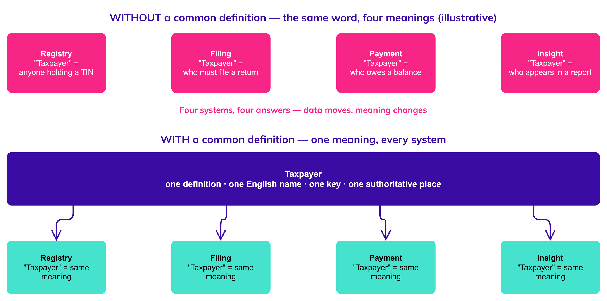
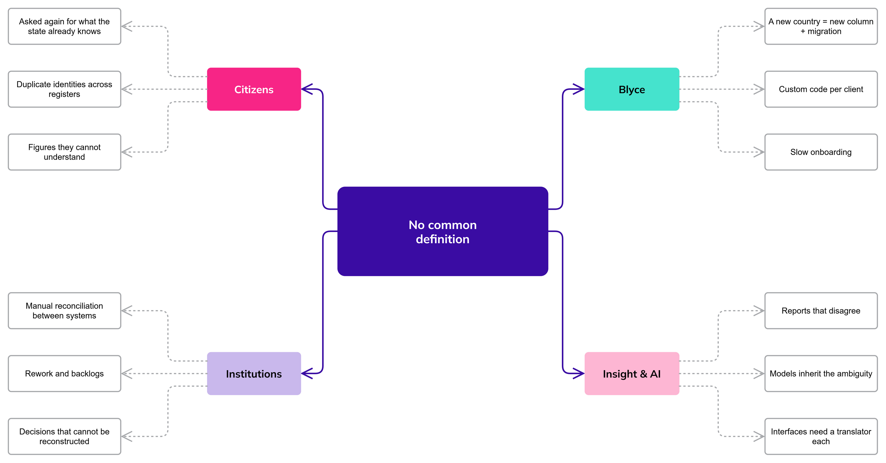
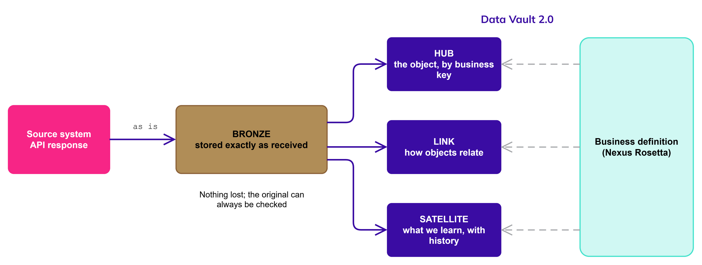

# Why We Need One Common Language

*The first section of Nexus Rosetta. It answers one question: why does every business object in the new platform need one common definition? Written for everyone who names, models, builds or reads data in the Public Services Suite (PSS 3.0) — product owners, business analysts, UX designers, architects and developers.*

**Section:** Whys? · **Version:** 0.1 · **Status:** Draft

## **The short answer**

Because the platform is built to serve **any legislation without custom development**, and that is only possible if everyone — people, systems and AI models — means the same thing by the same word.

A *taxpayer*, a *business*, an *address*, a *return*: each of these must have **one definition, one English name, one identifying key and one authoritative place**. Where a jurisdiction really differs, the difference is written down as a variation of the same object, not as a new object with a similar name.

Nexus Rosetta is where those definitions live. The name comes from the stone that let people read three scripts as one text: one meaning, every system.

## **The problem: the same word, different things**

Every large organisation has this problem, and a suite that serves many countries has it multiplied. The same word is used by different teams, systems and jurisdictions to mean slightly different things:

*Diagram: the same word in four systems, without and with a common definition. (Editable source: `Same_Word_Different_Meanings.drawio`.)*

The same happens with *address* (residential, postal or legal?), *period* (calendar year, fiscal year, filing period?) and *return* (does an amended one replace the first or sit beside it?).

*These are illustrations of the kind of question, not a list of known conflicts. The real list is built object by object in Business Objects.*

None of these is a mistake while it stays inside one team. It becomes one when data moves — between value streams, between systems of Engagement, Record and Insight, between countries — because every hand-over silently changes the meaning.

## **Why it matters for this platform**

Five facts from the Nexus documentation set make this a requirement rather than a preference:

* **The core promise depends on it.** "Any legislation, zero custom development" means rates, rules and report definitions are data, not code. Data can only be configured safely if it has one agreed meaning (`Data_Layer_Overview.md`).
* **One complete view needs many sources.** The tax domain alone documents 15+ external entities that must be integrated for a complete taxpayer view, with duplicated TINs and mismatched population records as a known cause of poor data quality. Poor registers raise enforcement costs by 20–40%. Identity cannot be resolved across registers unless each register means the same thing by "person" and "business" (`Data_Layer_Problems.md`).
* **We named it as our own problem.** Among the internal problems the data layer must solve is the plain statement: *we lack a common language.* English is the one language of the model — the names of objects, relationships, fields and rules, the code and the documentation. Every other language is a translation layer handled as configuration.
* **Insight is only as good as the definitions behind it.** A report that asks *how long does an assessment take?* is meaningful only if "assessment", "start" and "end" mean one thing everywhere and every status change was recorded with its date.
* **Trust needs explanation.** Citizens and institutions must be able to see how a figure was reached. A figure built from words that mean different things in different places cannot be explained.

## **What it costs when we do not have it**

*Diagram: what it costs, by who pays. (Editable source: `Cost_of_No_Common_Language.drawio`.)*

## **What a common definition gives us**

* **One meaning for people.** Product owners, analysts and developers can discuss a requirement without first agreeing on its words.
* **One meaning for systems.** The same object is recognised across Engagement, Record and Insight, so data moves without reinterpretation.
* **One meaning for machines.** Machine-learning models and AI agents work from explicit definitions and keys instead of guessing from column names.
* **Variation with a place to live.** A jurisdiction's difference is a documented scenario of a known object, so a new country is an onboarding, not a project.
* **A path from source to answer.** Every object can be traced from what an API returned to what a report shows.

## **How the definitions meet the platform**

A definition is only useful if it reaches the data. In Nexus it does so in two steps:

1. **Bronze keeps the source as it is.** API responses are stored exactly as received, so nothing is lost and the original can always be checked (`Medallion_Architecture.md`).
2. **Every business object is translated into Data Vault 2.0.** An object becomes a **Hub** (the thing that exists, identified by its business key), **Links** (how it relates to other objects) and **Satellites** (what we learn about it over time, including history). A new requirement usually adds a Satellite instead of changing what exists (`Data_Vault_2.0.md`).

*Diagram: from API response to business meaning. (Editable source: `From_API_to_Meaning.drawio`.)*

For that reason, **no object is considered defined until it is identified in both ways**: what it means to the business, and which Hubs, Links and Satellites represent it.

## **What this space is — and is not**

| It is | It is not |
| --- | --- |
| The single place where the meaning of each business object is agreed and kept | A glossary of technology terms (that is `Glossary.md` in Nexus) |
| Written in English, the one language of the model | A replacement for the Nexus documents; it builds on them |
| Private to its author while it is being built | A finished standard — approval by the Architecture Review Board is what makes it 1.0 |

## **What we do not yet know**

* **Which objects come first.** The first set of business objects for Business Objects is still to be chosen.
* **Who owns each definition,** and who may change one once it is agreed.
* **How jurisdictions will be recorded** — as scenarios of one object, as separate Satellites, or both. The Principles and Business Objects sections will settle this.

## **Where to go next**

* **Principles:** the rules every definition follows.
* **Business Objects:** one page per object, with its jurisdiction scenarios, modelling principles, limitations, Bronze representation and Data Vault mapping.
* `Data_Layer_Overview.md` and `Data_Layer_Problems.md` in Nexus — the platform context behind this section.
