# Apache Iceberg

# From the past: HDFS

Hive metastore, what it has:
- Schemas: columns list
- Partitions: directory paths
- File Locations: HDFS uris (**U**niform **R**esource **I**dentifier)

Hive metastore, what doest not has:
- Snapshots
- Statistics
- More than one write at a time

# What is ACID?

## A: Atomicity
No half states. It complete writes or not

## C: Consistency
Everybody sees the same version of the table

## I: Isolation
Concurrent writters do not corrupt each other

## D: Durability
Committed data survives crashes

# What the Community Develops to Solve HDFS Problems?

1. Apache Iceberg (2018)
2. Delta Lake (2019)
3. Apache Hudi (2019)

# How Apache Iceberg Works?

Step 1: Write Data Files
(Parquet, ORC, Avro)

Step 2: Write Manifest Files
(Store metadata about data files)

Step 3: Write Metadata File
(Store metadata about manifest files)

Step 4: Update Catalog
(Update metadata file, swap pointer in catalog - atomic operation)

Bonus: Old pointers retained until cleanup -> Free Time Travel

# What its take almost 10 years to solve the basic issues?

1) Object Store must add a strong consistency: by 2020 S3 had it
2) Engines has to learn to ask the catalog instead of listing files
Listing file is one of the most expensive operations in object stores
3) Catalog APIs has to standarize so multiple engines could share one - REST Catalog spec, 2023

# Who support Apache Iceberg?
| **Engine** | **Deployment** | **License** | **Architecture** |
|---|---|---|---|
| Snowflake | Cloud-only | Commercial | Serverless DW |
| Google BigQuery | Cloud-only | Commercial | Serverless DW |
| Amazon Redshift | Cloud-only | Commercial | MPP* |
| Databricks SQL | Cloud-only | Commercial | Lakehouse |
| Teradata Vantage | Hybrid | Commercial | MPP* |
| IBM watsonx.data | Hybrid | Commercial | Lakehouse |
| Cloudera | Hybrid | Commercial | Lakehouse |
| Dremio | Hybrid | Open Source Core | Lakehouse |
| ClickHouse | Hybrid | Open Source Core | MPP* |
| StarRocks | On-Prem | Open Source Core | MPP* |

Architecture:
- **Serverless DW** (Snowflake, BigQuery): also parallel under the hood, but compute/storage are decoupled and auto-scaled without you managing nodes
- **Lakehouse** (Databricks SQL, Dremio, Cloudera, IBM watsonx.data): query engines that run directly over open table formats (like Iceberg) sitting on object storage, rather than ingesting data into a proprietary MPP store
- **MPP**: It's a database/query architecture where data and query work are split across many independent nodes (each with its own CPU, memory, and often storage), which process their portion of the data in parallel and then combine results. This is in contrast to a single-node system or a "shared-everything" architecture.

## What is Open Lake House?

- Data Lives in Open File Formats on Object Storage, with an Open Catalog and any engine

### Three Pilars: Open Format, Open Catalog, Open Compute

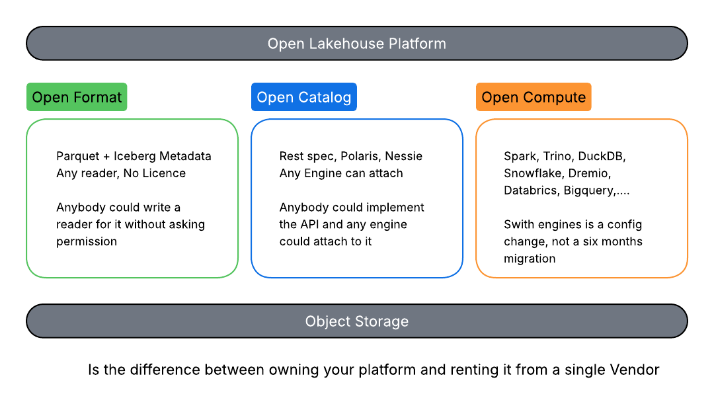

Remember:

### Design Fundamentals

1) Atomic Commits
Even with hundreds of concurrent writers

2) Evolution Without rewrite
Schema and partition changes without data rewrite

3) Engine-Agnostic Reads
Any Engine, Any time

### Schema Evolution 
| Feat | **Iceberg** | **Delta** | **Hudi** |
|---|---|---|---|
||Full Evolution|Mostly Works|Stricter|
|Add column|✅|✅|✅|
|Drop column|✅|✅|⚠️|
|Rename column|✅|⚠️|⚠️|
|Reorder column|✅|✅|⚠️|
|Change type|✅|⚠️|⚠️|

### Partition Evolution and Hidden Partitioning
| **Iceberg** | **Delta** | **Hudi** |
|---|---|---|
|Evolves|Rewrite required|Fixed at create|
|Old Spec = `PARTITION BY day(ts)`|Partition cols are physical|Partitioning fixed at create|
|-> change spec, no rewrite | Locked at CREATE TABLE | Same limitation aas Delta |
| NEW Spec = `PARTITION BY hour(ts)` | Change = full data rewrite | Change = full rewrite |
| Both coexist in same table | Cost = re-write all files | Pay for the regret 😭|

### Engine Ecosystem Compared
| Engine | Apache Iceberg | Delta Lake | Apache Hudi |
|---|---|---|---|
| Apache Spark | 🟢 Read+Write | 🟢 Read+Write | 🟢 Read+Write |
| Apache Flink | 🟢 Read+Write | 🟢 Read+Write | 🟢 Read+Write |
| Databricks | 🟢 Read+Write | 🟢 Read+Write | 🟢 Read+Write |
| Microsoft Fabric | 🟢 Read+Write | 🟢 Read+Write | 🟠 Read Only | 
| Trino | 🟢 Read+Write | 🟢 Read+Write | 🟠 Read Only |
| Snowflake | 🟢 Read+Write | 🟠 Read Only | 🟠 Read Only |
| Google BigQuery | 🟢 Read+Write | 🟠 Read Only | 🟠 Read Only |
| Amazon Redshift | 🟢 Read+Write | 🟠 Read Only | 🟠 Read Only | 
| ClickHouse | 🟢 Read+Write | 🟠 Read Only | 🟠 Read Only |
| Dremio | 🟢 Read+Write | 🟠 Read Only | 🟠 Read Only | 
| DuckDB | 🟢 Read+Write | 🟠 Read / 🔴 Limited Write | 🔴 Limited (Parquet Read) |

### The Boring but neeed stuff for Apache Iceberg

1) Auto Compaction
2) Auto-expire snapshots
3) Auto-orphan cleanup

On Cloud Service there is:
| Product | Comments | Costs considerations |
|---|---|---|
| **AWS** | S3 Tables | +/- 15% on storage cost per month vs S3 Standard. Also "Compaction - data processed" charges (varies according to volume processed). |
| **GCP** | BigLake Managed Tables | 0% on GCS but you get a Bigquery charges for compute (Varies on the GB Processed). |
| **Azure** | Fabric OneLake (with Table Virtualization) | 0% on OneLake storage cost, but active Microsoft Fabric Capacity (Ferrari vs Pizza paradigm) |

For On-Prem we must go for (`Need to go deeper`):
| Product | Comments |
|---|---|
| **MinIO** | This is the industry standard for on-premises object storage. It is **lightweight**, **extremely fast**, and can be easily deployed via Docker across bare-metal servers or NAS infrastructure. |
| **Ceph** | A more complex but highly scalable alternative if you are building massive, distributed storage clusters via its RADOS Gateway. |
| **Apache Ozone** | Apache Hadoop’s distributed object store. Not only is it a mature and robust *S3-compatible storage layer*, but it also integrates natively with the Hadoop ecosystem, making it a natural choice for those already invested in HDFS-based infrastructure.  |

An then via an Airflow recurrent job do:
- Data Files Compaction
- Manifest Files Compactation
- Expire snapshots (Vacuuming)
- Orphan cleanup

Best Practice: Run data and manifest compaction frequently (e.g., every few hours for high-volume streaming tables), while snapshot expiration and orphan file removal are better suited for a daily off-peak schedule. So as the data scales up:
Stategy 1: Run every X hours for data and manifest compaction 
Stategy 2: Run at night snapshot expiration and orphan file removal

At the end you need to develop the DAGS but also build a way to customize the CRON Jobs but also an Emergency Button to execute them on demand.

Next Step:
1) Storage and Catalog Setup
2) Apache Airflow Setup
3) DAGs Development for Data/Manifest Compaction, Expire Snapshots and Orphan Cleanup
4) Customization and Emergency Button Development 

# File LayOut

## Anatomy of an Iceberg Table

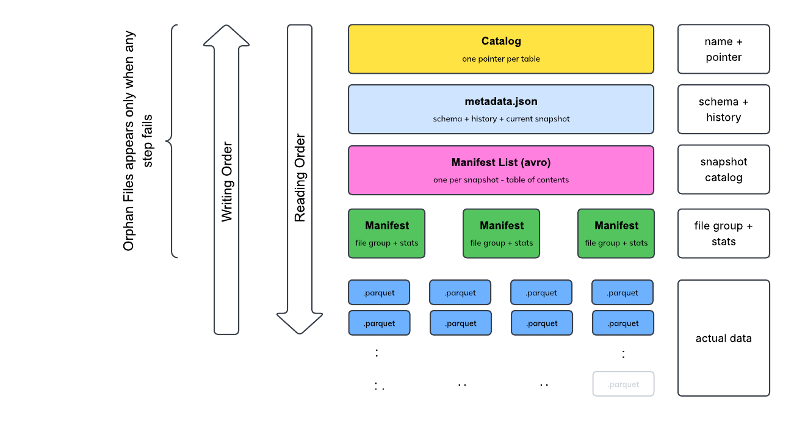

Iceberg support 3 file types:

| Type | Comments |
|---|---|
| Parquet | Default, best ecosystem support across all engines. **Column base format**. Best for analytical querying |
| ORC | Hive-origin columnar format. Still used in some legacy enviroments |
| AVRO | Used internally for manifests. Rare for data files. **Row based format**. Best for stremaing |

Parquet file trend to upload info 5x-10x smaller than CSV

### Setting File format On a New Table

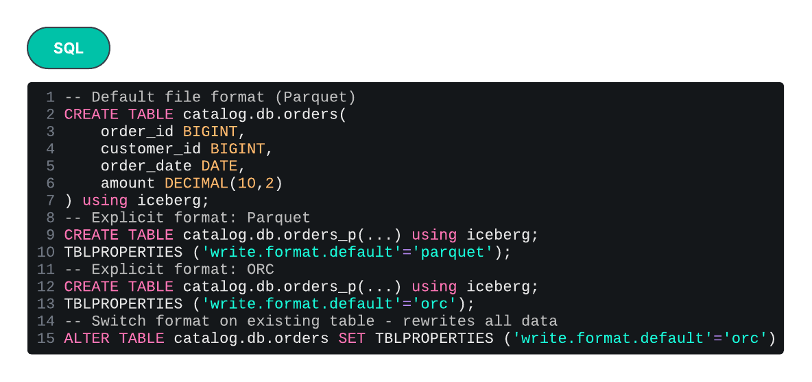

Comments:
- Switching formats rewrites all data: ❗Warning: computing costs!!!!!
- Mix format is painfull: ❗Avoid at all! 
- Explicit declaracion always, if not declared default is Parquet

File size is the key:
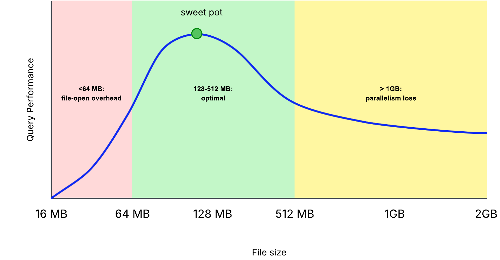

default file size be: 512MB
default suggested industry file size be: 128 MB

### Setting File Codec for compression

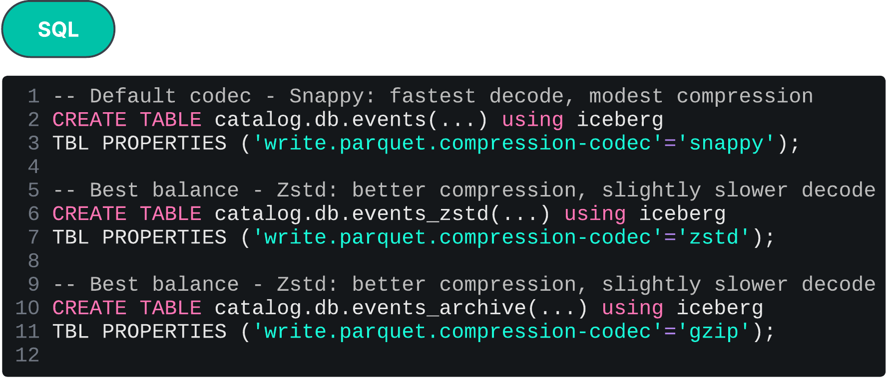

| Type | Default | Decode speed| Compression | Strategy |
|---|---|---|---|---|
| Snappy | ✅ | Fastest | Modest | Balance for Hot Data |
| Zstd |  ❌ | Slower than Snappy | Best than Snappy | Balance for Workloads |
| Gzip |  ❌ | Slowest | Hightest | Balance for Cold Data  |

Comments:
- By Default go for Zstd, unless measure tests show that Snappy is better
- Create an Airflow job to apply Hot/Cold Strategy, according to the bussiness case

## Manifest File
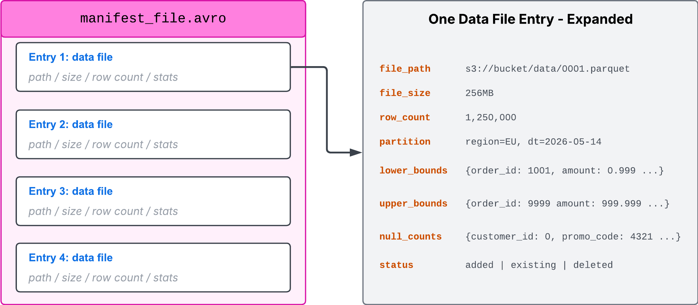

Comments about manifest files:
- Status Flags:
  
| Type | Default |
|---|---|
| Added | File was created in this snapshot commit |
| Existing | File was created in a prior snapshot, still part of this snapshot |
| Deleted | File is **logically** removed from this snapshot but stil on disk |

- In Iceberg v2 introduces delete files for row-level operations, this is different!
- Reading the reight combination of these flags reconstructs any snapshot accurataly

### Why Avro for Manifest files?
- Read sequentially, from top to bottom, every time. 
- Avro is row oriented, not column oriented!
- Avro files are smaller for metadata payload 

Performance Tradeoff
| More Manifests | Fewer Manifests |
|---|---|
| **Faster commits** -> each writeer adds smaller manifest | **Faster read** -> fewer manifests opens |
| **Slower reads** -> more manisfests opens in query time | **Faster read** -> bigger manifest writes |
| **Best for High write concurrency** | Default target: 8 M B per manifest, configurable |

### Structure of metadata.json file
It describes an Iceberg table at a single point in time.

This file is critical because is the one who use the Catalog to find the data.

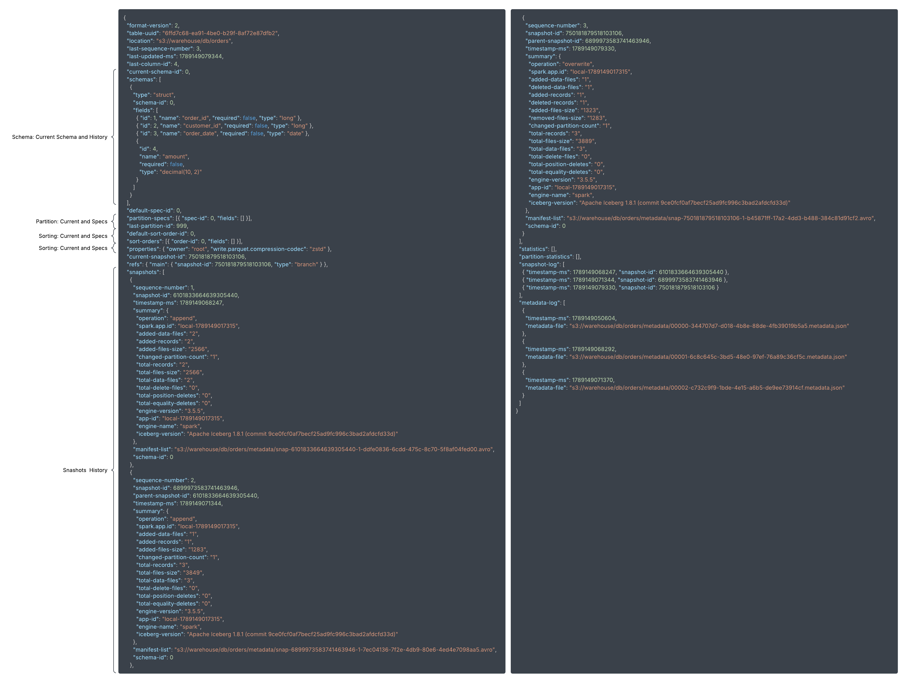

## CAS (Compare-And-Swap)

- What happens when it fails -> orphan were created, and this is why we need cleanup jobs
- Is the responsability of the Catalog to implemente CAS

Why CAS Pattern Wins?
| Concept | Comments |
|---|---|
| Lock-Free Writes | No locks during slow data write phase - only CAS is locked |
| Millesecond Locks | Lock is on the CAS operation itself - Milliseconds not minutes |
| Parallel Writers | Multiple writes proceed in parallell conflict rar in **well partitioned data** |
| Bounded Retries | Retry cost in bounded - typically one retry resolves the conflict |
| Battle tested | Same pattern GIT uses for branch updates - proven to scale at github |

## Format Version: 1 or 2?

| Concept | Comments | Comments |
|---|---|---|
| **Version 1** | Append-and-overwrite only | Full files added, Full files deleted, *no row-level operations*|
| **Version 2** | Adds delete files |row-level deletes without rewritting full data files. MERGE / UPDATE / DELETE work|

# Schema and Partition Evolution

In Iceberg schema evolution is a metadata operation - fast, cheap, safe

When data is stored in parquet file the schema is not stored in the data file but in the metadata file.

## Operations over a Column
| Operation | Comments |
|---|---|
| Add | - Existing data file return NULL for the new column on old rows - New writes include the new column populated normally - Default values supported in spec V3 - NULL or a literal default - Most common evolution operation. Always safe. Always metadata-only. |
| Rename | - Columns ID's stays the same, field name is a metadata operation - Existing files unchanged. New writes use the new name in metadata - Coordinate with downstream consumer before renaming widely-used columns: downstream lineage is REALLY important |
| Drop | - Removes column from the schema - Old parquet files are not rewritten. - Readers ignored it - Drop and re-add make no sense, because columns are identified by ID, not by name -> no data link to old data |

## Types Conversion
Only Types conversion are allowed if and only if is a widen type

| Type |  | 
|---|---| 
| Integer | to Long | 
| Long | to BigInt |
| Float | to Double | 
| Date | to Timestamp | 
| Timestamp | to Timestamp with time zone | 

❗❗❗ No downgrade, no unsafe types conversion are allowed!!! ❗❗❗

For not supported types conversion -> add the new column, migrate and drop old

## Partition Transforms

| Transforms | Comment | SQL Command | 
|---|---|---|
| Identity Transform | column value itseft | `CREATE TABLE t (region STRING, ...) PARTITIONED BY (region);` |
| Time-Based | year, month, day,  hour | `CREATE TABLE orders (...) PARTITIONED BY (days(order_date));` `CREATE TABLE orders (...) PARTITIONED BY (hours(event_ts));`|
| Bucket | hash-based, fixed cardinality |   `CREATE TABLE users (...) PARTITIONED BY (bucket(16,user_id));` |
| Truncate | prefix-based for strings or numerics   | `CREATE TABLE prods (...) PARTITIONED BY (truncate(8,sku));` |
| Combine Multiple Transforms | combine previous ones   | `CREATE TABLE sales (...) PARTITIONED BY (days(ts), bucket(8,customer_id));` |

### Partition Strategy: best practices
| Cardinality | Transform | Comments | 
|---|---|---|
| LOW | Identity | Less than 100 values|
| MEDIUM | days(ts) or bucket | timestamp, country (100-100K values) |
| HIGH | MUST bucket / truncate | More than 100K values |

The best strategy is when you get even-sized partition between 1G - 100G per partition

Why Iceberg handles partition better than Hive?
- Evolution: can change partition decisiones later withour rewriting historical data
- Hidden it hides the strategy from users, the engine handles pruning.

### Partition Evolution

- You can add in time a new partition criteria
- It applyes only to new ingested data
- Best applies when the data partition ages badly

### Partition vs Sorting

Not the same concept. Not overlapping concepts. They are complementary concepts. 

Partition divides the data
Sorting organizes the data

Both can be applied at the same time to improve performance. 

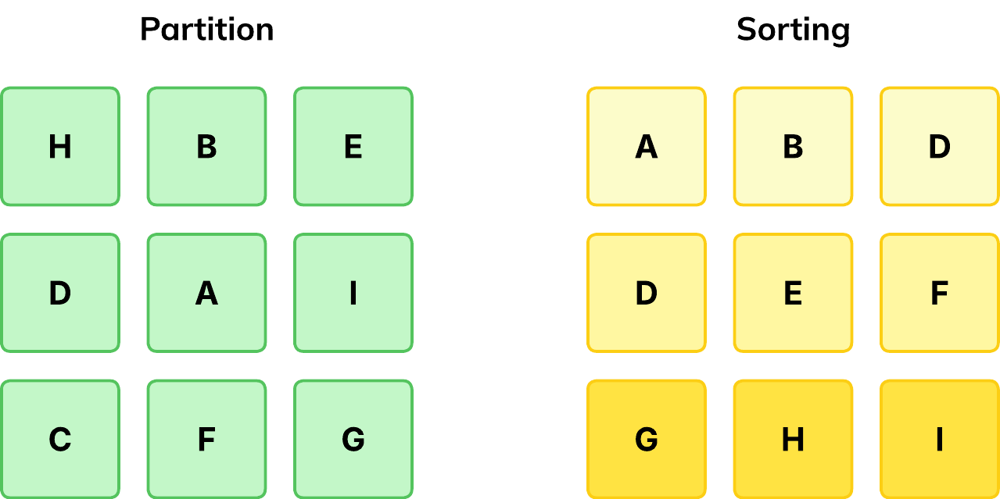

When prunning is applied it ignore the files. Partition and Sorting help by its own, together they are  more powerfull.

With sort happens the same as partition. It applys from the they it defined. If you want to back process everything you can apply it with a processing cost. So where sorting lives:
- Is stored in metadata files
- is versioned
- Old file keep old order until they are reprocessed (On-demand)
- Engine solves mix-sorting criteria

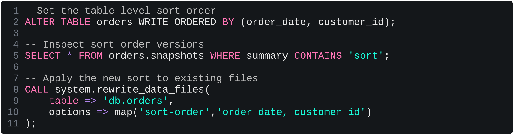

### Z-Order vs Sort Order

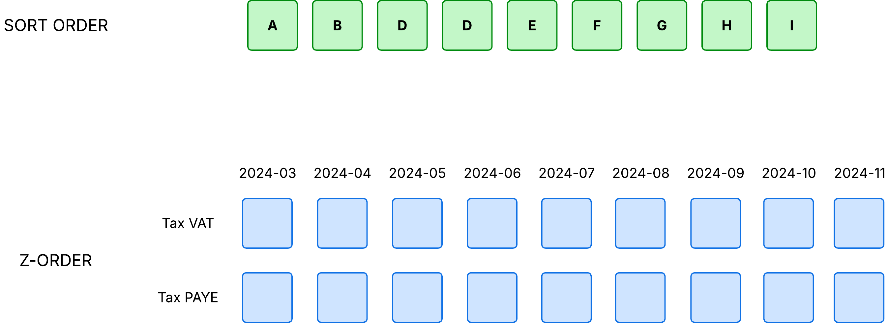

| Method | Best For | Typical worst case |
|---|---|
| Order | - Time series with one primray filter - Simplier operational model  - One hot column dominates queries | Filter on time an then by citizen_id |
| Z-Order | - Multi-analitical workloads - No sigle dominant filter column | The z-order doesn't help much filter on citizen_id only |

At the end, it depends on how you query the data in the most common case.

# REST Catalog

The API has 3 layers:
- Namespaces: logical container, like databases or schemas. Top of the tree
- Tables: what you actually query
- Commits: atomic updates to a table's pointer
+ Utility Endpoints: views, configurations, metrics, OAuth tokens

# Writing with Spark

Spark is the default writer for Iceberg:
    - Most Mature Integration
    - Schema Evolution, Branching and MERGE already in spark
    - Read Anywhere (Trino, Snowflake, DuckBD on the read side) but write are in Spark

Master Spark = Master Iceberg

## INSERT - UPDATE - MERGE - DELETE

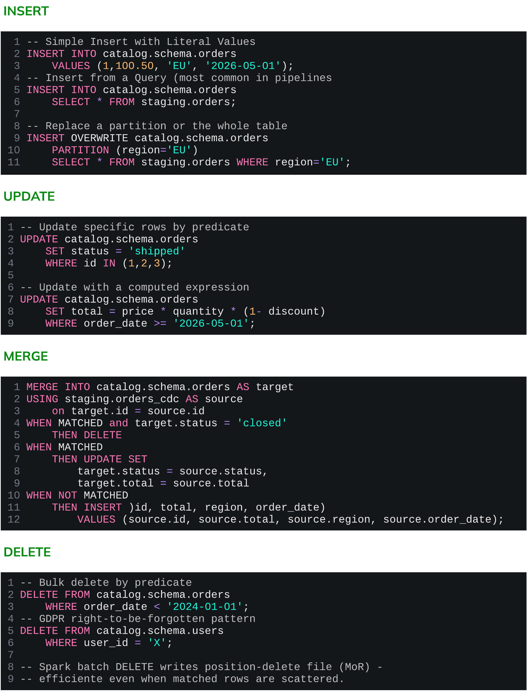

## Dataframes API

- Branch writing & Snapshot summary metadata only available via Dataframe.
- It turns ON WAP Pattern
- Add metadata to jobs.  

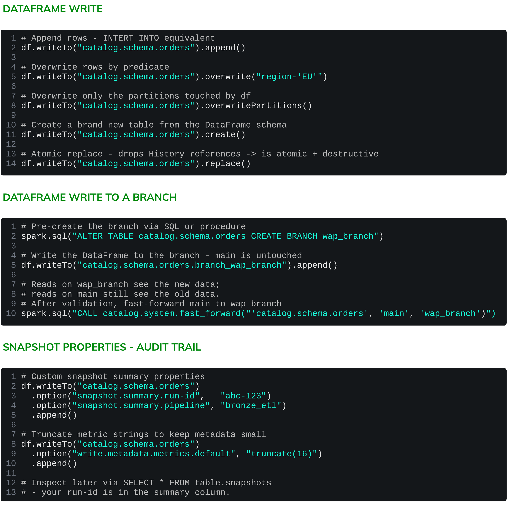

### Common DatafFrame Pitfalls

| Pitfall | Description |
|---|---|
| Schema Mismatch | Appends fails silently or reorders cols | 
| createOrReplace() | Replace is destructive - drops history | 
| Missing Partition Cols | Partitioned writes need partition cols | 
| Sort Order not Honored | Sort the DataFrame before writting | 
| Overwrite not reversible | Test oon small data - recovery is slow | 

### WAP Pattern on Spark (Batch/Even Driven)

- It turns ON by default when you use Dataframes API
- Validates writes before go to live reader on main
- WAP solves branch, audit and publish to main: safety pattern

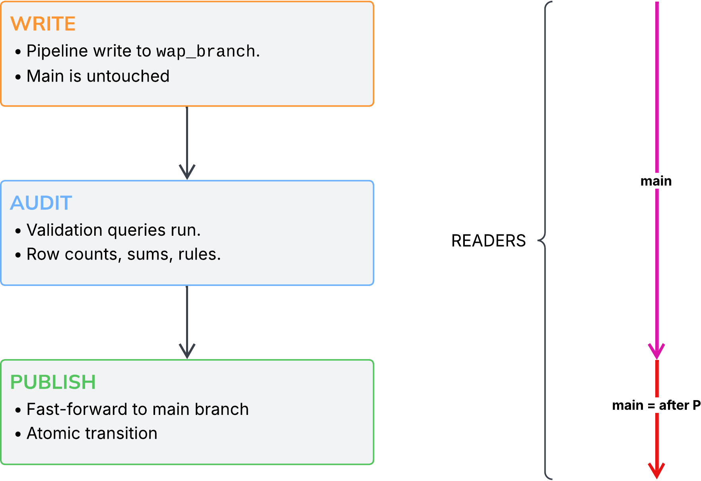

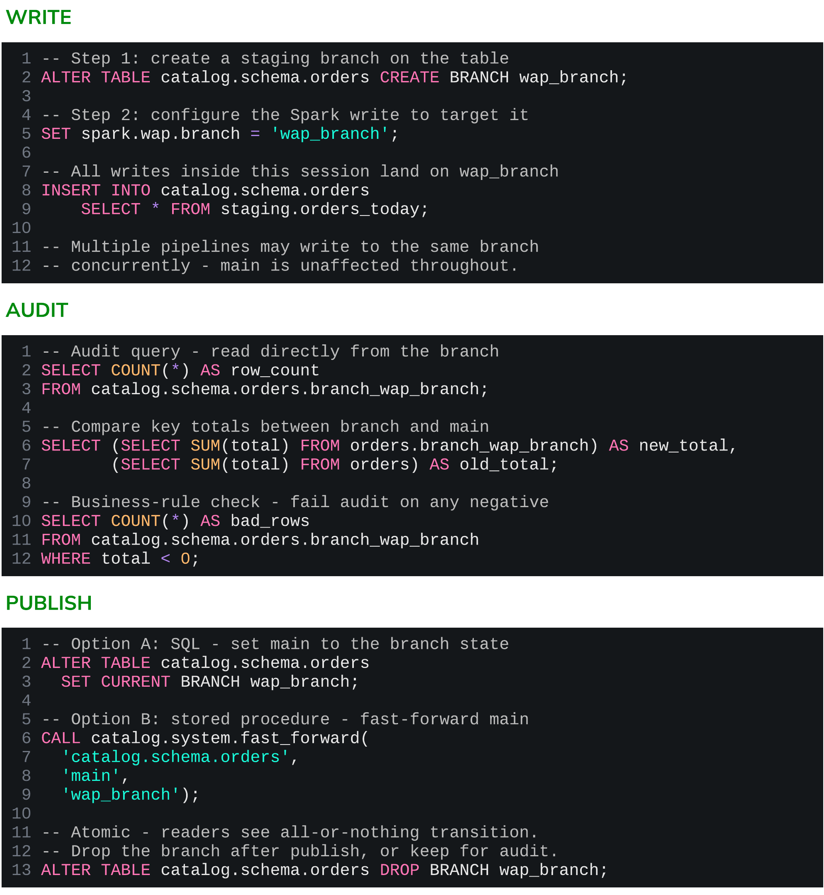

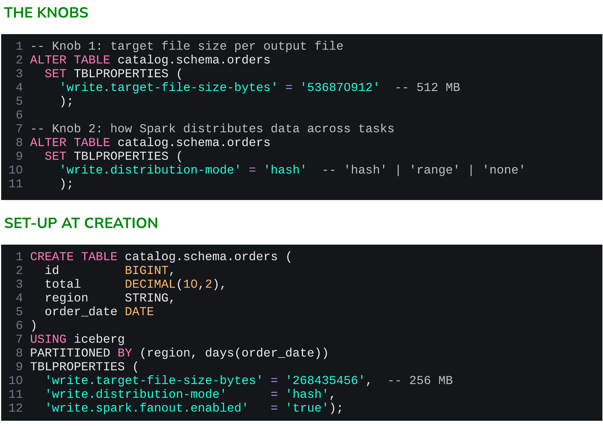

Write time is not enough:
- Streaming micro-batching: streaming workloads produce a lot of small commits (commit = file)
- Backfill jobs may produce uneven files due to sort and partition skew
- Schema/Partition Evolution leaves old files in old shapes
- All of these need maintenance compactaction

Write-tiome compactaction is the fist line of defense, not the only one!

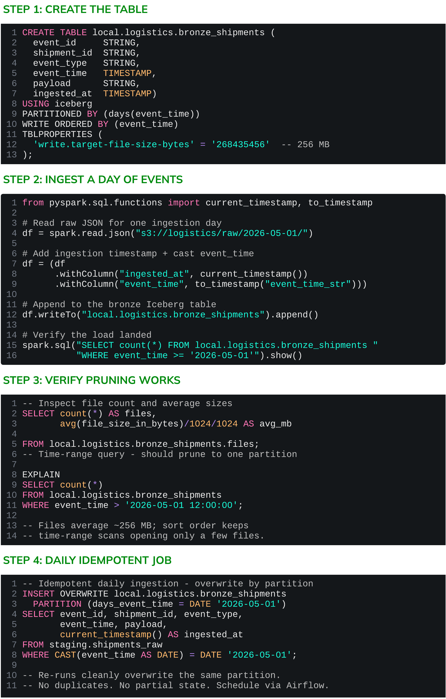

## CDC Streaming pattern

- Operational DB's hold source of truth
- CDC streams every insert/update/delete: Operational -> Analitics
- Defacto OpenSource Stack: Debezium + Kafka  + Iceberg (Why? ALternatives?)

