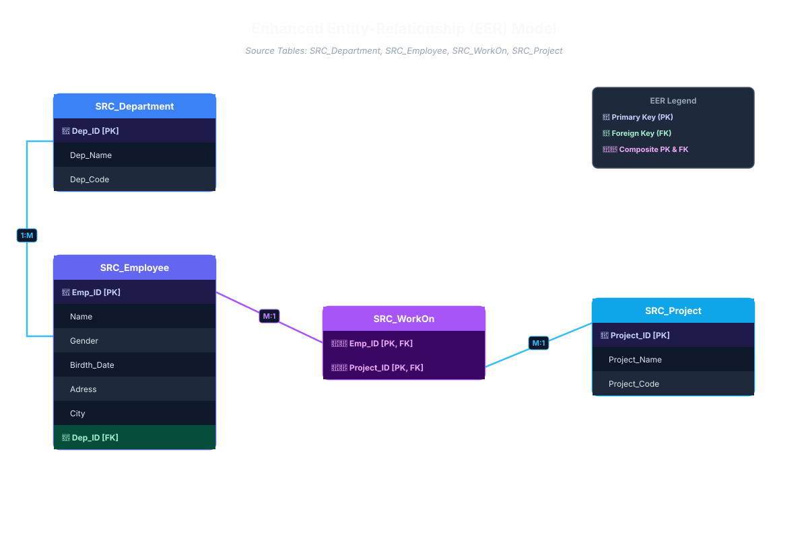
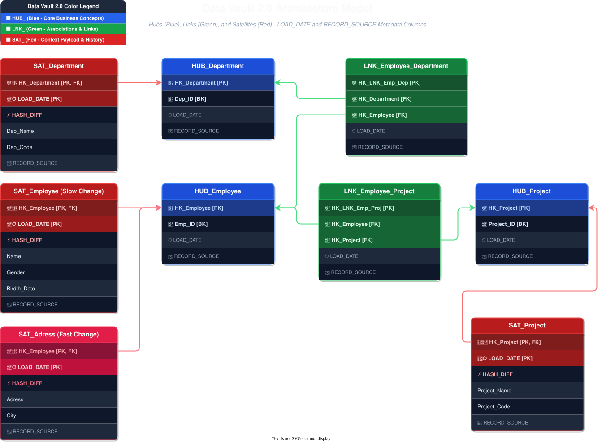

# Critical Concepts

**Business Keys**: Is the key of a Business Object that the organization uses to track, get, reference, or identify an instance of an Entity.

---

# Modelling Steps

1. Setting up naming conventions
2. Model the **HUBS** (`HUB_`)
3. Model the **LINKS** (`LNK_`)
4. Model the **SATELLITES** (`SAT_`)
5. Add Standalone Objects
6. Add Performance Tables (`PIT`, `BAT`)
7. Design Information Marts

---

# 1. Traditional Model (Typical Relational DataModel)
- **Draw.io Editable File**: [`model.drawio`](file:///c:/Development/documents/data_vault_2/model.drawio)

---

# 2. Data Vault 2.0 Model
- **Draw.io Editable File**: [`model_dv2.drawio`](file:///c:/Development/documents/data_vault_2/model_dv2.drawio)

### Architecture Breakdown:
- 🟦 **HUBS (Blue)**: `HUB_Department`, `HUB_Employee`, `HUB_Project`
- 🟩 **LINKS (Green)**: `LNK_Employee_Department`, `LNK_Employee_Project`
- 🟥 **SATELLITES (Red)**:
  - `SAT_Department`
  - `SAT_Project`
  - **Satellite Split by Rate of Change**:
    - `SAT_Employee` *(Slowly Changing: Name, Gender, Birth_Date)*
    - `SAT_Adress` *(Fast Changing: Address, City)*

# Notes about LINKS

They are use to model:
- Transactions
- Associations

A `LINK` table has the purpose of capture:
- Past
- Present
- Future

Always:
- represente M:N relationships!
- doesn't include start & end dates

Types
- Hierarchical Links
- Same-as Links
- Explotation Links

# Notes about SATELLITES

## Basic Structure
|Components|Notes|
|-|-|
|**Primary Key**|Hash key from the connected `Hub` or `Link` + `Load Date` |
|**Load Date**| Generally the timestamp when the data was first recorded in EDW (Enterprise Data Warehouse) |
|**Attributes**| Descriptive data like Name, Email, Gender|
|**Hash Diff**| Helps to compare a new record to the older ones and identify changes|
|**Record Source**| Which source system the record came from|
|**Load End Date**| 🚨 *Indicates the date when the `Satellite` entry becomes invalid. Load End Date are dead according to the creator of the methodology. It's no longer needed because it doesn't have any bussiness meaning and reduce efficiency. Also, when working with streaming technologies it's a performance killer because it introduce complexity in the architecture.* |

### Multi-Active Satellites

### Status Tracking Satellites

### Record Tracking Satellites