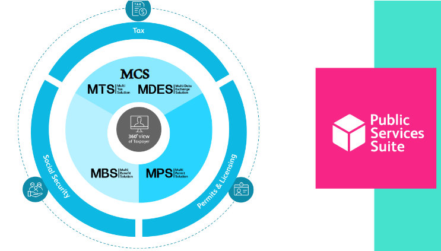
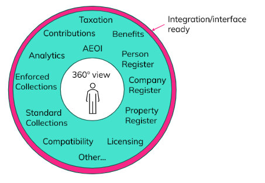
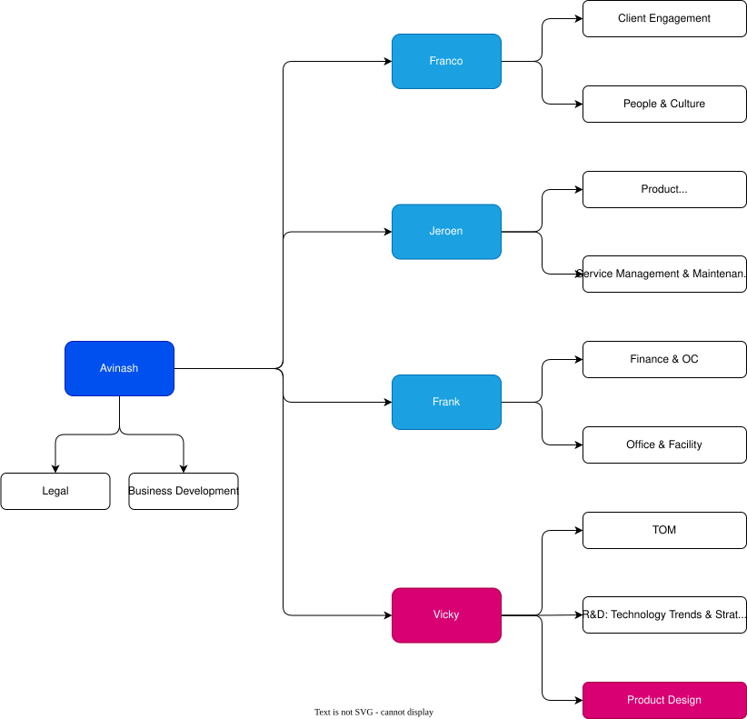

# Blyce Dictionary

## Clients

### SIDS: Small Island Developing States

The list of the 39 sovereign states officially recognized by the United Nations as Small Island Developing States (SIDS):

<table style="border-collapse: collapse; width: 100%;">
  <thead>
    <tr>
      <th style="border: 1px solid #999; padding: 6px 10px; text-align: left;">Territory Type</th>
      <th style="border: 1px solid #999; padding: 6px 10px; text-align: left;">Caribbean</th>
      <th style="border: 1px solid #999; padding: 6px 10px; text-align: left;">Pacific</th>
      <th style="border: 1px solid #999; padding: 6px 10px; text-align: left;">Africa</th>
      <th style="border: 1px solid #999; padding: 6px 10px; text-align: left;">Indian Ocean</th>
      <th style="border: 1px solid #999; padding: 6px 10px; text-align: left;">Mediterranean</th>
      <th style="border: 1px solid #999; padding: 6px 10px; text-align: left;">South China Sea</th>
    </tr>
  </thead>
  <tbody>
    <tr>
      <td rowspan="16" style="border: 1px solid #999; padding: 6px 10px; vertical-align: top;">UN Member</td>
      <td style="border: 1px solid #999; padding: 6px 10px;">Antigua and Barbuda</td>
      <td style="border: 1px solid #999; padding: 6px 10px;">Fiji</td>
      <td style="border: 1px solid #999; padding: 6px 10px;">Cabo Verde</td>
      <td style="border: 1px solid #999; padding: 6px 10px;">Comoros</td>
      <td style="border: 1px solid #999; padding: 6px 10px;"></td>
      <td style="border: 1px solid #999; padding: 6px 10px;">Singapore</td>
    </tr>
    <tr>
      <td style="border: 1px solid #999; padding: 6px 10px;">Bahamas</td>
      <td style="border: 1px solid #999; padding: 6px 10px;">Kiribati</td>
      <td style="border: 1px solid #999; padding: 6px 10px;">Guinea-Bissau</td>
      <td style="border: 1px solid #999; padding: 6px 10px;">Maldives</td>
      <td style="border: 1px solid #999; padding: 6px 10px;"></td>
      <td style="border: 1px solid #999; padding: 6px 10px;"></td>
    </tr>
    <tr>
      <td style="border: 1px solid #999; padding: 6px 10px;">Barbados</td>
      <td style="border: 1px solid #999; padding: 6px 10px;">Marshall Islands</td>
      <td style="border: 1px solid #999; padding: 6px 10px;">São Tomé and Príncipe</td>
      <td style="border: 1px solid #999; padding: 6px 10px;">Mauritius</td>
      <td style="border: 1px solid #999; padding: 6px 10px;"></td>
      <td style="border: 1px solid #999; padding: 6px 10px;"></td>
    </tr>
    <tr>
      <td style="border: 1px solid #999; padding: 6px 10px;">Belize</td>
      <td style="border: 1px solid #999; padding: 6px 10px;">Micronesia (Federated States of)</td>
      <td style="border: 1px solid #999; padding: 6px 10px;"></td>
      <td style="border: 1px solid #999; padding: 6px 10px;">Seychelles</td>
      <td style="border: 1px solid #999; padding: 6px 10px;"></td>
      <td style="border: 1px solid #999; padding: 6px 10px;"></td>
    </tr>
    <tr>
      <td style="border: 1px solid #999; padding: 6px 10px;">Cuba</td>
      <td style="border: 1px solid #999; padding: 6px 10px;">Nauru</td>
      <td style="border: 1px solid #999; padding: 6px 10px;"></td>
      <td style="border: 1px solid #999; padding: 6px 10px;"></td>
      <td style="border: 1px solid #999; padding: 6px 10px;"></td>
      <td style="border: 1px solid #999; padding: 6px 10px;"></td>
    </tr>
    <tr>
      <td style="border: 1px solid #999; padding: 6px 10px;">Dominica</td>
      <td style="border: 1px solid #999; padding: 6px 10px;">Palau</td>
      <td style="border: 1px solid #999; padding: 6px 10px;"></td>
      <td style="border: 1px solid #999; padding: 6px 10px;"></td>
      <td style="border: 1px solid #999; padding: 6px 10px;"></td>
      <td style="border: 1px solid #999; padding: 6px 10px;"></td>
    </tr>
    <tr>
      <td style="border: 1px solid #999; padding: 6px 10px;">Dominican Republic</td>
      <td style="border: 1px solid #999; padding: 6px 10px;">Papua New Guinea</td>
      <td style="border: 1px solid #999; padding: 6px 10px;"></td>
      <td style="border: 1px solid #999; padding: 6px 10px;"></td>
      <td style="border: 1px solid #999; padding: 6px 10px;"></td>
      <td style="border: 1px solid #999; padding: 6px 10px;"></td>
    </tr>
    <tr>
      <td style="border: 1px solid #999; padding: 6px 10px;">Grenada</td>
      <td style="border: 1px solid #999; padding: 6px 10px;">Samoa</td>
      <td style="border: 1px solid #999; padding: 6px 10px;"></td>
      <td style="border: 1px solid #999; padding: 6px 10px;"></td>
      <td style="border: 1px solid #999; padding: 6px 10px;"></td>
      <td style="border: 1px solid #999; padding: 6px 10px;"></td>
    </tr>
    <tr>
      <td style="border: 1px solid #999; padding: 6px 10px;">Guyana</td>
      <td style="border: 1px solid #999; padding: 6px 10px;">Solomon Islands</td>
      <td style="border: 1px solid #999; padding: 6px 10px;"></td>
      <td style="border: 1px solid #999; padding: 6px 10px;"></td>
      <td style="border: 1px solid #999; padding: 6px 10px;"></td>
      <td style="border: 1px solid #999; padding: 6px 10px;"></td>
    </tr>
    <tr>
      <td style="border: 1px solid #999; padding: 6px 10px;">Haiti</td>
      <td style="border: 1px solid #999; padding: 6px 10px;">Timor-Leste</td>
      <td style="border: 1px solid #999; padding: 6px 10px;"></td>
      <td style="border: 1px solid #999; padding: 6px 10px;"></td>
      <td style="border: 1px solid #999; padding: 6px 10px;"></td>
      <td style="border: 1px solid #999; padding: 6px 10px;"></td>
    </tr>
    <tr>
      <td style="border: 1px solid #999; padding: 6px 10px;">Jamaica</td>
      <td style="border: 1px solid #999; padding: 6px 10px;">Tonga</td>
      <td style="border: 1px solid #999; padding: 6px 10px;"></td>
      <td style="border: 1px solid #999; padding: 6px 10px;"></td>
      <td style="border: 1px solid #999; padding: 6px 10px;"></td>
      <td style="border: 1px solid #999; padding: 6px 10px;"></td>
    </tr>
    <tr>
      <td style="border: 1px solid #999; padding: 6px 10px;">Saint Kitts and Nevis</td>
      <td style="border: 1px solid #999; padding: 6px 10px;">Tuvalu</td>
      <td style="border: 1px solid #999; padding: 6px 10px;"></td>
      <td style="border: 1px solid #999; padding: 6px 10px;"></td>
      <td style="border: 1px solid #999; padding: 6px 10px;"></td>
      <td style="border: 1px solid #999; padding: 6px 10px;"></td>
    </tr>
    <tr>
      <td style="border: 1px solid #999; padding: 6px 10px;">Saint Lucia</td>
      <td style="border: 1px solid #999; padding: 6px 10px;">Vanuatu</td>
      <td style="border: 1px solid #999; padding: 6px 10px;"></td>
      <td style="border: 1px solid #999; padding: 6px 10px;"></td>
      <td style="border: 1px solid #999; padding: 6px 10px;"></td>
      <td style="border: 1px solid #999; padding: 6px 10px;"></td>
    </tr>
    <tr>
      <td style="border: 1px solid #999; padding: 6px 10px;">Saint Vincent and the Grenadines</td>
      <td style="border: 1px solid #999; padding: 6px 10px;"></td>
      <td style="border: 1px solid #999; padding: 6px 10px;"></td>
      <td style="border: 1px solid #999; padding: 6px 10px;"></td>
      <td style="border: 1px solid #999; padding: 6px 10px;"></td>
      <td style="border: 1px solid #999; padding: 6px 10px;"></td>
    </tr>
    <tr>
      <td style="border: 1px solid #999; padding: 6px 10px;">Suriname</td>
      <td style="border: 1px solid #999; padding: 6px 10px;"></td>
      <td style="border: 1px solid #999; padding: 6px 10px;"></td>
      <td style="border: 1px solid #999; padding: 6px 10px;"></td>
      <td style="border: 1px solid #999; padding: 6px 10px;"></td>
      <td style="border: 1px solid #999; padding: 6px 10px;"></td>
    </tr>
    <tr>
      <td style="border: 1px solid #999; padding: 6px 10px;">Trinidad and Tobago</td>
      <td style="border: 1px solid #999; padding: 6px 10px;"></td>
      <td style="border: 1px solid #999; padding: 6px 10px;"></td>
      <td style="border: 1px solid #999; padding: 6px 10px;"></td>
      <td style="border: 1px solid #999; padding: 6px 10px;"></td>
      <td style="border: 1px solid #999; padding: 6px 10px;"></td>
    </tr>
    <tr>
      <td rowspan="13" style="border: 1px solid #999; padding: 6px 10px; vertical-align: top;">Associate Member of United Nations Regional Commissions</td>
      <td style="border: 1px solid #999; padding: 6px 10px;">Anguilla</td>
      <td style="border: 1px solid #999; padding: 6px 10px;">American Samoa</td>
      <td style="border: 1px solid #999; padding: 6px 10px;"></td>
      <td style="border: 1px solid #999; padding: 6px 10px;"></td>
      <td style="border: 1px solid #999; padding: 6px 10px;"></td>
      <td style="border: 1px solid #999; padding: 6px 10px;"></td>
    </tr>
    <tr>
      <td style="border: 1px solid #999; padding: 6px 10px;">Aruba</td>
      <td style="border: 1px solid #999; padding: 6px 10px;">Commonwealth of Northern Marianas</td>
      <td style="border: 1px solid #999; padding: 6px 10px;"></td>
      <td style="border: 1px solid #999; padding: 6px 10px;"></td>
      <td style="border: 1px solid #999; padding: 6px 10px;"></td>
      <td style="border: 1px solid #999; padding: 6px 10px;"></td>
    </tr>
    <tr>
      <td style="border: 1px solid #999; padding: 6px 10px;">Bermuda</td>
      <td style="border: 1px solid #999; padding: 6px 10px;">French Polynesia</td>
      <td style="border: 1px solid #999; padding: 6px 10px;"></td>
      <td style="border: 1px solid #999; padding: 6px 10px;"></td>
      <td style="border: 1px solid #999; padding: 6px 10px;"></td>
      <td style="border: 1px solid #999; padding: 6px 10px;"></td>
    </tr>
    <tr>
      <td style="border: 1px solid #999; padding: 6px 10px;">British Virgin Islands</td>
      <td style="border: 1px solid #999; padding: 6px 10px;">Guam</td>
      <td style="border: 1px solid #999; padding: 6px 10px;"></td>
      <td style="border: 1px solid #999; padding: 6px 10px;"></td>
      <td style="border: 1px solid #999; padding: 6px 10px;"></td>
      <td style="border: 1px solid #999; padding: 6px 10px;"></td>
    </tr>
    <tr>
      <td style="border: 1px solid #999; padding: 6px 10px;">Cayman Islands</td>
      <td style="border: 1px solid #999; padding: 6px 10px;">New Caledonia</td>
      <td style="border: 1px solid #999; padding: 6px 10px;"></td>
      <td style="border: 1px solid #999; padding: 6px 10px;"></td>
      <td style="border: 1px solid #999; padding: 6px 10px;"></td>
      <td style="border: 1px solid #999; padding: 6px 10px;"></td>
    </tr>
    <tr>
      <td style="border: 1px solid #999; padding: 6px 10px;">Curaçao</td>
      <td style="border: 1px solid #999; padding: 6px 10px;"></td>
      <td style="border: 1px solid #999; padding: 6px 10px;"></td>
      <td style="border: 1px solid #999; padding: 6px 10px;"></td>
      <td style="border: 1px solid #999; padding: 6px 10px;"></td>
      <td style="border: 1px solid #999; padding: 6px 10px;"></td>
    </tr>
    <tr>
      <td style="border: 1px solid #999; padding: 6px 10px;">Guadeloupe</td>
      <td style="border: 1px solid #999; padding: 6px 10px;"></td>
      <td style="border: 1px solid #999; padding: 6px 10px;"></td>
      <td style="border: 1px solid #999; padding: 6px 10px;"></td>
      <td style="border: 1px solid #999; padding: 6px 10px;"></td>
      <td style="border: 1px solid #999; padding: 6px 10px;"></td>
    </tr>
    <tr>
      <td style="border: 1px solid #999; padding: 6px 10px;">Martinique</td>
      <td style="border: 1px solid #999; padding: 6px 10px;"></td>
      <td style="border: 1px solid #999; padding: 6px 10px;"></td>
      <td style="border: 1px solid #999; padding: 6px 10px;"></td>
      <td style="border: 1px solid #999; padding: 6px 10px;"></td>
      <td style="border: 1px solid #999; padding: 6px 10px;"></td>
    </tr>
    <tr>
      <td style="border: 1px solid #999; padding: 6px 10px;">Montserrat</td>
      <td style="border: 1px solid #999; padding: 6px 10px;"></td>
      <td style="border: 1px solid #999; padding: 6px 10px;"></td>
      <td style="border: 1px solid #999; padding: 6px 10px;"></td>
      <td style="border: 1px solid #999; padding: 6px 10px;"></td>
      <td style="border: 1px solid #999; padding: 6px 10px;"></td>
    </tr>
    <tr>
      <td style="border: 1px solid #999; padding: 6px 10px;">Puerto Rico</td>
      <td style="border: 1px solid #999; padding: 6px 10px;"></td>
      <td style="border: 1px solid #999; padding: 6px 10px;"></td>
      <td style="border: 1px solid #999; padding: 6px 10px;"></td>
      <td style="border: 1px solid #999; padding: 6px 10px;"></td>
      <td style="border: 1px solid #999; padding: 6px 10px;"></td>
    </tr>
    <tr>
      <td style="border: 1px solid #999; padding: 6px 10px;">Sint Maarten</td>
      <td style="border: 1px solid #999; padding: 6px 10px;"></td>
      <td style="border: 1px solid #999; padding: 6px 10px;"></td>
      <td style="border: 1px solid #999; padding: 6px 10px;"></td>
      <td style="border: 1px solid #999; padding: 6px 10px;"></td>
      <td style="border: 1px solid #999; padding: 6px 10px;"></td>
    </tr>
    <tr>
      <td style="border: 1px solid #999; padding: 6px 10px;">Turks and Caicos Islands</td>
      <td style="border: 1px solid #999; padding: 6px 10px;"></td>
      <td style="border: 1px solid #999; padding: 6px 10px;"></td>
      <td style="border: 1px solid #999; padding: 6px 10px;"></td>
      <td style="border: 1px solid #999; padding: 6px 10px;"></td>
      <td style="border: 1px solid #999; padding: 6px 10px;"></td>
    </tr>
    <tr>
      <td style="border: 1px solid #999; padding: 6px 10px;">U.S. Virgin Islands</td>
      <td style="border: 1px solid #999; padding: 6px 10px;"></td>
      <td style="border: 1px solid #999; padding: 6px 10px;"></td>
      <td style="border: 1px solid #999; padding: 6px 10px;"></td>
      <td style="border: 1px solid #999; padding: 6px 10px;"></td>
      <td style="border: 1px solid #999; padding: 6px 10px;"></td>
    </tr>
    <tr>
      <td rowspan="2" style="border: 1px solid #999; padding: 6px 10px; vertical-align: top;">Non-UN Member</td>
      <td style="border: 1px solid #999; padding: 6px 10px;"></td>
      <td style="border: 1px solid #999; padding: 6px 10px;">Cook Islands</td>
      <td style="border: 1px solid #999; padding: 6px 10px;"></td>
      <td style="border: 1px solid #999; padding: 6px 10px;"></td>
      <td style="border: 1px solid #999; padding: 6px 10px;"></td>
      <td style="border: 1px solid #999; padding: 6px 10px;"></td>
    </tr>
    <tr>
      <td style="border: 1px solid #999; padding: 6px 10px;"></td>
      <td style="border: 1px solid #999; padding: 6px 10px;">Niue</td>
      <td style="border: 1px solid #999; padding: 6px 10px;"></td>
      <td style="border: 1px solid #999; padding: 6px 10px;"></td>
      <td style="border: 1px solid #999; padding: 6px 10px;"></td>
      <td style="border: 1px solid #999; padding: 6px 10px;"></td>
    </tr>
  </tbody>
</table>

## Products

### MDES | Multi Data Exchange Solution
Secure platform for data exchange between government entities, enabling seamless interoperability.

### MBS | Multi Benefit Solution
Digitizes and automates social benefits processing, from applications to payments and case management.

### MPS | Multi Permit Solution
Streamlines the full permit lifecycle, including applications, reviews, approvals, and renewals.

### PSS | Public Services Suite
A citizen-facing suite that brings multiple government services online for easy access and self-service.

### MCS | Multi Collection Solution
Centralized system for managing financial collections, payments, and reconciliations across agencies.

### MTS | Multi Tax Solution
End-to-end tax administration platform covering registration, filing, assessment, and enforcement.

### NBC = Nieuwe Belastingdienst Curaçao = Nuevo Servicio de Impuestos de Curazao

### BCN = Belastingdienst Caribisch Nederland = Servicio de Impuestos del Caribe Neerlandés

### BSCN = Belasting Systeem Caraibisch Nederland = Sistema de Impuestos del Caribe Neerlandés

### IRD = Inland Revenue Department

## Core Values

1 - We make it happen
2 - We own it
3 - We aim higher
4 - We are connected

## Culture

- Netherlands: with direct talk and structured planning
- Colombia: natural COLLABORATION and friendlyness
- Curaçao: Relationship driven, story based communication

## Development
- TMA (Talent Management Analysis)
- Feedback
- Dialog
- Performance

## Who is Who
- **Draw.io Editable File**: [`org-chart.drawio`](file:///c:/Development/documents/onboarding/org-chart.drawio)

## Customer Metrics:

CSAT: Customer Satisfaction Score
NPS: Net Promoter Score
Net Revenue Retention
Health Scores
Renewal deadlines

## Servicev Excellence Metrics
SLA compliance
First Time resolution
Regular Reports
Service improvements
Root cause analysis

## Client Experience Business Unit
Three Departments, One Mission

Working Together
Delivering exceptional client experiences from onboarding to long-term success

### 1. Client Success (Strategic Partner)
Enable clients to achieve business outcomes and realize value.
- Mission: Achieve desired business outcomes
- Focus: Adoption, value, retention, partnership
- Work: Relationship & outcome management
- Stage: Onboarding → Long-term success

Responsibilities:
- Health scores & renewal readiness
- Solution adoption & enablement
- Client strategy & digital enablement
- Strategic feedback to product
- Upsell & expansion opportunities
- Client advocacy & case studies

Metrics: CSAT/NPS, NRR, Adoption, Advocacy

### 2. Service Management (Quality Guardian)
Ensures contractual performance, governance & quality delivery.
- Mission: Contractual performance & quality delivery
- Focus: SLA compliance, reporting, service improvement
- Work: Process & performance management
- Stage: Onboarding → Ongoing

Responsibilities:
- SLA & contract performance
- Service processes (ITIL)
- Issue escalation & follow-up
- Root Cause Analysis (RCA)
- Service reviews & reports
- Service improvements
- Cross-team collaboration

Metrics: SLA Compliance, FTR Rate, Reports, Meetings, Recurrence, Improvements

### 3. Service Desk (First Contact)
Front-line support providing reactive & proactive assistance.
- Mission: Day-to-day technical support
- Focus: Tickets, triage, resolution, escalation
- Work: Operational support
- Stage: Continuous

Responsibilities:
- Ticket ownership from intake to resolution
- Monitor progress & follow-up with internal teams & clients
- Manage escalations
- Maintain knowledge base
- Track ticket metrics
- Client communications
- SLA adherence
- Atlassian administration

Metrics: CSAT, MTTR, Backlog

### Client Journey
1) Onboarding: Client Success leads, Service Management involved
2) Post-Deployment: Service Management governance
3) Ongoing: All teams collaborate (Service Desk support, Service Management governance, Client Success outcomes)
